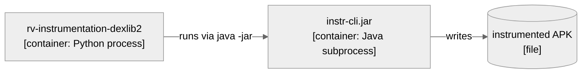
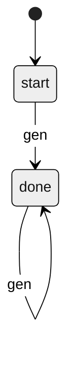

# Views and Beyond — Method Reference

This reference distills the SEI method *Documenting Software Architectures: Views and
Beyond* (Clements et al.) as applied by the `rv-doc-arch-*` skill suite. It is the shared
vocabulary for the analyze and generate phases. Read sections 1–5 before inferring styles
or filling the output template; read section 6 before drawing any diagram.

The core idea: an architecture is documented as a set of **views** (each view shows the
system from one category of structure) plus **beyond-views** information that applies
across all views (overview, rationale, mappings, glossary).

## 1. The three view categories

Every structure in a software architecture falls into one of three categories. Each
category has a small set of **styles**; a view documents the system in one style.

### Module views (code-time structure)
What the units of implementation are and how they relate statically.
Styles:
- **Decomposition** — is-part-of. Modules contain submodules.
- **Uses** — depends-on. A unit requires another to be correct.
- **Generalization** — is-a. Inheritance / interface implementation.
- **Layered** — allowed-to-use, restricted by layer ordering.
- **Aspects** — cross-cutting concerns woven across modules.
- **Data model** — entities and their relationships (ER).

### Component-and-connector (C&C) views (run-time structure)
What the runtime elements are (components) and their interaction channels (connectors).
Styles:
- **Pipe-and-filter** — stream transformation through stages.
- **Client-server** — request/response across a service boundary.
- **Peer-to-peer** — symmetric collaborating peers.
- **Service-oriented (SOA)** — independent services, often over a network/process boundary.
- **Publish-subscribe** — event-driven, decoupled producers/consumers.
- **Shared-data** — components communicate through a common store.

### Allocation views (mapping software to environment)
How software maps onto non-software structures.
Styles:
- **Deployment** — C&C elements onto execution nodes (devices, hosts, emulators).
- **Install** — components onto the file system / artifact layout (JARs, packages, images).
- **Work assignment** — modules onto teams / responsibilities.

## 2. The view template (5 sections per view)

Each view in the output document is written with the same five sections:

1. **Primary presentation** — the main diagram (Mermaid) showing the elements and
   relations of this view, with a numbered caption and a legend (section 6.4).
2. **Element catalog** — a table describing each element, its responsibility, and the
   relations/interfaces it participates in. Everything in the diagram appears here.
3. **Context diagram** — how this view's scope connects to its surroundings. Reference
   the single system context diagram in Part I (do not redraw it per view).
4. **Variability guide** — the variation points: where and how the structure can change
   (configuration, plug-in variants, optional elements).
5. **Rationale** — *why* this structure: the decisions, trade-offs, and constraints that
   produced it. Reference the relevant decisions in Part I rather than restating them.

## 3. Beyond-views information (Part I)

Information that spans all views, documented once:

- **Documentation overview** — purpose, scope, intended audience, how to read the doc.
- **System overview & context** — what the system does, its constraints, and the single
  **system context diagram** (external actors and systems). All views reference this.
- **Core components** — the principal elements, with a one-paragraph role each.
- **Mapping between views** — how elements in one view correspond to elements in another
  (e.g. which modules realize which runtime components; which components deploy where).
- **Rationale** — the cross-cutting architectural decisions, the patterns used, and the
  NFRs they serve.
- **Output artifacts** — what the system emits (files, logs, reports, results JSON).
- **Directory** — glossary, acronyms, references.

## 4. Stakeholder → view selection

Document the views that serve the stakeholders who will read the document. Do not produce
every style mechanically; select and record *why* in the model's `views_selected`.

| Stakeholder | Primary concern | Typical views |
|-------------|-----------------|---------------|
| Developer / maintainer | Code organization, dependencies | Module: Decomposition, Uses, Layered |
| Integrator | Interfaces, contracts | Module: Uses; C&C: Client-Server |
| Architect | Whole structure, trade-offs | All categories + Part I rationale |
| Tester | Isolation, test paths | Module: Uses, Decomposition |
| DevOps / SRE | Deployment, packaging | Allocation: Deployment, Install |
| Manager | Work division | Allocation: Work assignment |
| Performance analyst | Throughput, bottlenecks | C&C: Pipe-Filter, Shared-Data |

## 5. How this maps to RV-Android targets

- A **module** target usually needs Module views (Decomposition/Uses/Layered) plus a
  small C&C view if it has meaningful runtime behavior.
- A **subsystem** target (possibly cross-language, e.g. instrumentation = Python wrappers
  + Java/dexlib2 backend) needs Module + C&C + an Allocation (Install/Deployment) view to
  show the process boundary (e.g. `java -jar` subprocess) and artifact layout (the fat JAR).
- A **system** target needs all three categories, with the Mapping-between-views section
  doing the heavy lifting (module → component → deployment).

## 6. Diagrams

Every diagram in the document follows these rules. They decide *what kind of box* each
element is, how many boxes one diagram may hold, and how a reader traces a box back to code.

### 6.1 C4 level per view

The C4 model names four zoom levels. Each maps onto one place in a Views-and-Beyond document,
which settles what a box may stand for in that place:

| C4 level | Place in this document | A box is… | RV-Android examples |
|----------|------------------------|-----------|---------------------|
| Context | Part I §3, the single system context diagram | the target as one box, plus the people and external systems around it | researcher, APK corpus, Android SDK, LLM server, the rvsec Java tree |
| Container | C&C view and Allocation view (deployment) | something that runs as its own process or is deployed on its own | rv-experiment / rv-platform CLI (Python process), campaign Docker container, Android emulator, LLM server (SGLang or vLLM), Java subprocesses (`instr-cli.jar`, GATOR, apktool), `ape-rv.jar` under `app_process` on the device |
| Component | Module view (decomposition, uses, layered) | a unit of code inside one container | uv workspace modules and their packages; Maven modules inside a fat JAR |
| Code | not drawn | — | classes appear in catalogs and prose, not diagrams |

**A shared library is not a container.** A uv workspace module (`rv-android-core`,
`rv-tools`, …) is imported into the Python process; it never runs on its own, so it is a
component of the CLI container and belongs in the Module view. The same holds for a Maven
module packaged inside `instr-cli.jar`: the JAR run as a subprocess is the container, its
modules are components. Drawing a library as a container invents a process boundary that
does not exist and hides the one that does.

Containers the project does not build (emulator, LLM server, Docker host) are still drawn
when the target talks to them, marked `external` in the label.

Diagrams use `flowchart` with the `neutral` theme, as every document in `docs/architecture/`
does. Mermaid's `C4Context`/`C4Container` syntax is not used: its layout is experimental
and stays legible only with per-relation styling. The C4 level is carried by the label
instead — name, then kind and technology in brackets:

Edge labels are verbs, plus the mechanism when it crosses a process or language boundary
(`runs via java -jar`, `HTTP, OpenAI API`, `adb shell app_process`, `reads JSON`).
Arrows are one-directional; a request and its reply are one edge in the request direction.

### 6.2 Element limit

At most **12 nodes per diagram** (subgraph frames do not count). Every node must also
appear in the view's element catalog, and twelve is about what a reader can match against a
catalog without losing their place. When a view needs more, split it: one diagram for the
overall shape with groups collapsed into single nodes, then one diagram per group that
matters. Never shrink a diagram by dropping a boundary-crossing edge; drop internal detail.

### 6.3 Provenance comments

Each diagram states where it came from, as Mermaid comments placed right after the
diagram-type line (`flowchart LR`, `stateDiagram-v2`, …):

- `%% Source: <path>[, <path>…]` — always. The files or directories the diagram was drawn
  from, relative to the rv-android root (`../rvsec/…` for the Java tree).
- `%% Omitted: <what> (<why>)` — whenever something in the target's scope was left out
  (cross-cutting utilities, test code, a group shown in its own diagram).
- `%% Unverified: <relation>` — for an edge the analysis inferred but could not pin to code.
  The same doubt goes into the prose; prefer resolving it over keeping the comment.

Use the names the code uses (module, class, JAR, CLI command), so a reader can grep them.

### 6.4 Caption and legend

Number diagrams in document order and give each a caption line directly above the block:
`**Diagram N — <what it shows>.**` The Part I context diagram is Diagram 1. Prose refers to
diagrams by number.

Directly below the block, a `**Legend.**` line explains every notation the diagram uses and
nothing else: node shapes (rectangle, rounded, cylinder), subgraph frames, solid versus
dotted arrows, and what a bracketed label means. Keep shapes consistent across the whole
document, so the same shape never means two things in two diagrams. For example:

> **Legend.** Rectangle = running process `[container]`; cylinder = file; frame = Docker
> container boundary; solid arrow = call or invocation, labeled with its mechanism; dotted
> arrow = file read after the producer exits.

### 6.5 State diagrams from code

Draw a `stateDiagram-v2` when the target's behavior is a state machine a reader must follow.

- **`.mop` with an `fsm` block** — each `name [ … ]` entry is a state; the first one is the
  initial state (`[*] --> start`); each `event -> target` inside `state [ … ]` is an edge
  `state --> target : event`. `alias match = s` marks `s` as the accepting state; name it in
  the legend. An event with no transition from the current state goes to JavaMOP's implicit
  fail state; say so in the legend instead of drawing an edge per missing event.
- **`.mop` with an `ere`, `ltl` or `cfg` formula** — there is no hand-written automaton. Do
  not derive one by hand; quote the formula and, when the automaton matters, take it from
  `/rv-analyze-spec`.
- **Python or Java status enums** — each enum value is a state; each assignment that moves
  an object from one value to another is an edge labeled with the method that does it; a
  guard on that assignment goes in the label as `method [guard]`; a value with no outgoing
  assignment is terminal (`state --> [*]`).

The fragment `fsm : start [ gen -> done ]  done [ gen -> done ]  alias match = done` becomes:

