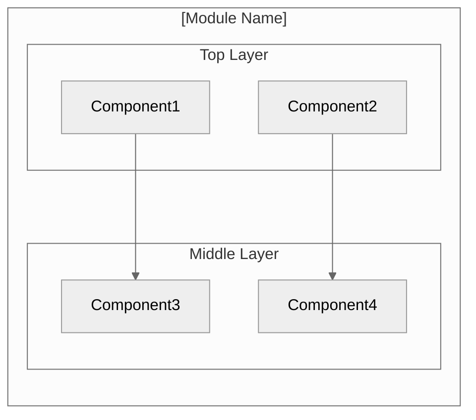
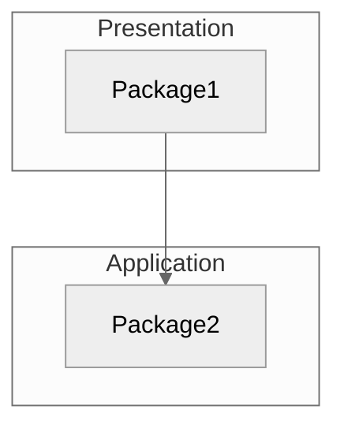
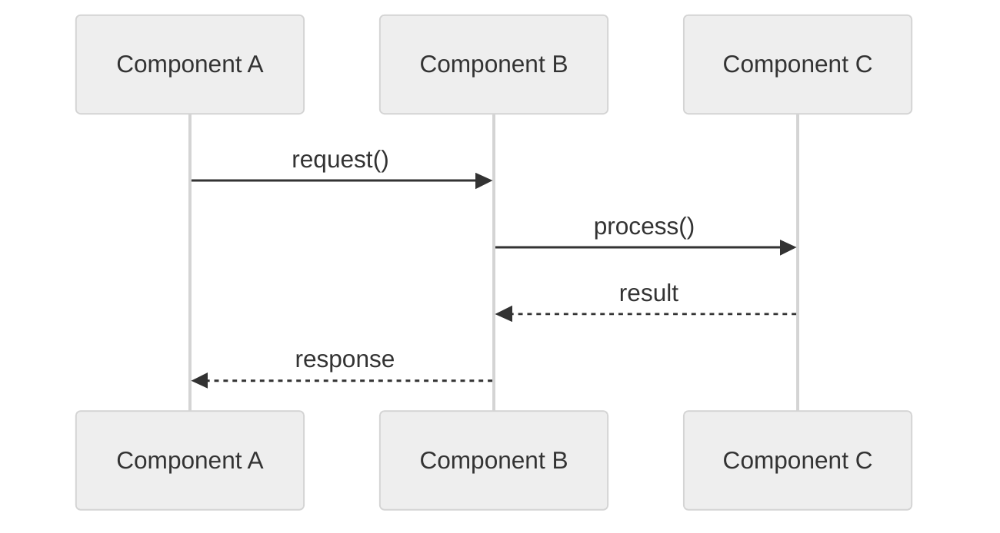
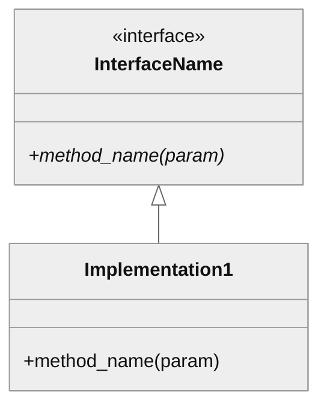

# [Module Name] Architecture

## Overview

[One paragraph describing the module's purpose and role in rv-android]

## Specification Alignment

This module implements requirements from `openspec/specs/[DOMAIN]/spec.md`.

### Functional Requirements

| FR | Description | Architectural Support |
|----|-------------|----------------------|
| FR[XX] | [From spec/PRD] | [Which component/pattern implements it] |

### Key Invariants

| Invariant | Description | Enforcement Mechanism |
|-----------|-------------|----------------------|
| INV-[DOM]-[NN] | [From spec] | [How architecture ensures it] |

### Specification Scenarios

Scenarios from `openspec/specs/[DOMAIN]/spec.md` that validate this architecture:
- **[Scenario name]**: [Brief description] — traces through [components]

## Key Architectural Decisions

Reference: `checklists/design-decisions.md`

| Decision | Choice | Rationale |
|----------|--------|-----------|
| Application Type | [CLI/Library/Service] | [Why] |
| Structuring | [Layered/Modular/etc.] | [Why] |
| Primary Pattern | [Pattern name] | [Why] |
| Control Strategy | [Event/Call-based] | [Why] |

## Architectural Patterns

Reference: `checklists/pattern-documentation.md`

### Pattern: [Primary Pattern Name]

**Description**: [How this pattern structures the module]

**When Used**: [Why this pattern was chosen]

**Advantages**:
- [Benefit in this context]

**Disadvantages**:
- [Trade-off accepted]

---

## Logical View

Reference: `checklists/architectural-views.md`

Shows key domain entities and their relationships.

### Domain Entities

| Entity | Responsibility |
|--------|----------------|
| [Entity1] | [What it represents] |
| [Entity2] | [What it represents] |

### Component Architecture



---

## Development View

Shows code organization for developers.

### Module Structure

```
module/
├── src/
│   └── package/
│       ├── layer1/
│       └── layer2/
├── tests/
└── pyproject.toml
```

### Package Dependencies



---

## Process View

Shows run-time behavior (include if concurrency is relevant).

### Execution Flow



---

## Core Components

### [Component Name]

**Purpose**: [What it does]

**Location**: `src/[package]/[component].py`

**Key Classes**:
- `ClassName`: [Purpose]

**Dependencies**:
- Internal: [list]
- External: [list]

### [Next Component]
...

---

## NFR Support

Reference: `checklists/nfr-architecture-mapping.md` and `docs/PRD.md` Section 7.

How the architecture supports non-functional requirements from the PRD.

| NFR | PRD ID | Priority | Architectural Support |
|-----|--------|----------|----------------------|
| Performance | NFR01 | P0 | [How architecture enables] |
| Maintainability | NFR02 | P0 | [How architecture enables] |
| Extensibility | NFR03 | P1 | [How architecture enables] |
| Reliability | NFR04 | P1 | [How architecture enables] |
| Testability | NFR07 | P1 | [How architecture enables] |

Note: Include only NFRs relevant to this module. PRD defines NFR01-NFR08.

---

## Key Interfaces

### [Interface/Protocol Name]

```python
class IComponentName(Protocol):
    """Description of interface contract."""

    def method_name(self, param: Type) -> ReturnType:
        """What this method does."""
        ...
```



---

## Scenarios

Key use cases that validate the architecture.

### Scenario 1: [Name]

**Description**: [What happens]

**Flow**:
1. [Step involving logical entities]
2. [Step involving components]
3. [Result]

---

## Extension Points

- **[Extension Point]**: How to extend this module
- **[Configuration]**: How to configure behavior

## Dependencies

### Internal (rv-android modules)

| Module | Purpose |
|--------|---------|
| rv-android-core | [What for] |
| rv-[module] | [What for] |

### External

| Package | Version | Purpose |
|---------|---------|---------|
| package-name | ^X.Y | [What for] |

## Testing Strategy

| Type | Location | Purpose |
|------|----------|---------|
| Unit | tests/unit/ | Isolated component tests |
| Integration | tests/integration/ | Component interaction tests |

## Related Documentation

- [Domain Spec](../../../openspec/specs/[DOMAIN]/spec.md) - Requirements and invariants for this module
- [PRD](../../../docs/PRD.md) - Product Requirements Document (FR01-37, NFR01-08)
- [CLAUDE.md](../CLAUDE.md) - Quick reference for Claude Code
- [ADR NNNN](../../../docs/adr/NNNN-[kebab-title].md) - Architectural decision recorded by `/rv-doc-adr` (one line per ADR in `docs/adr/` that concerns this module; omit the line when there is none)
