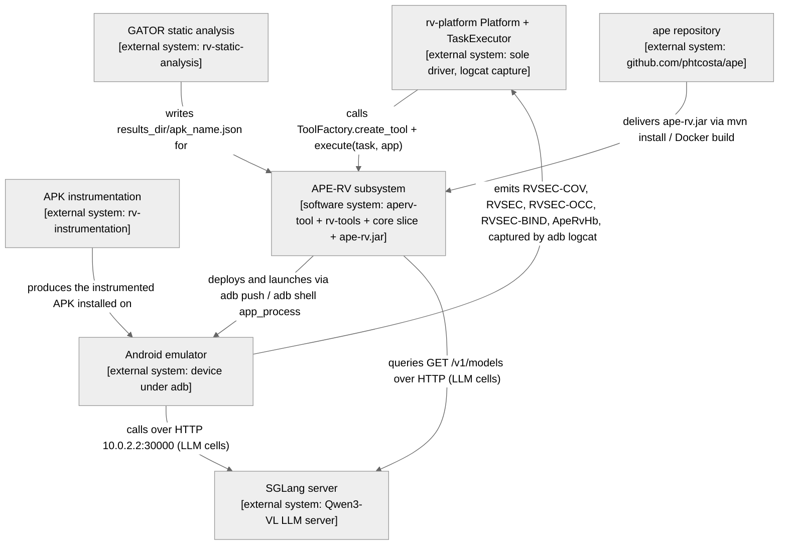
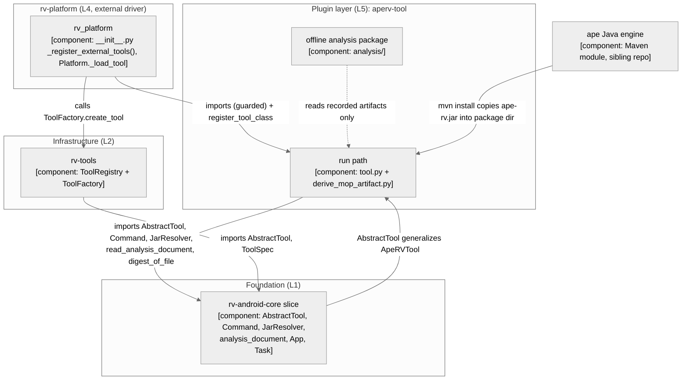
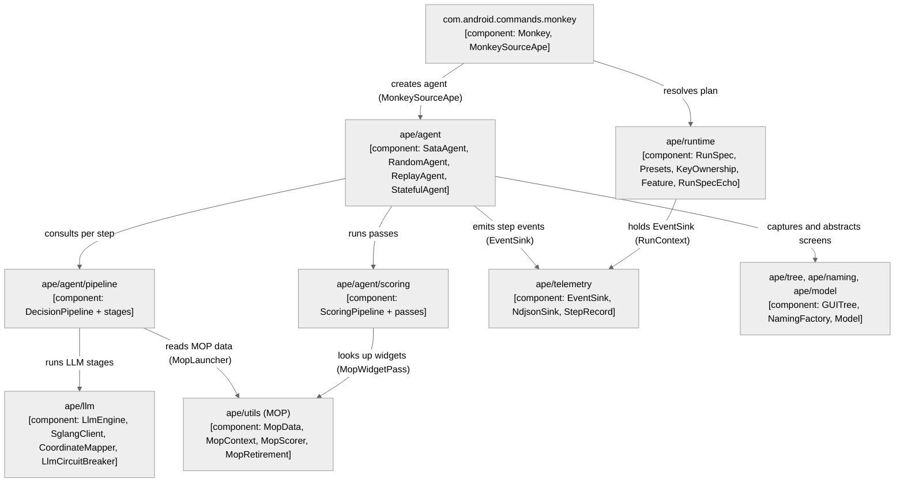
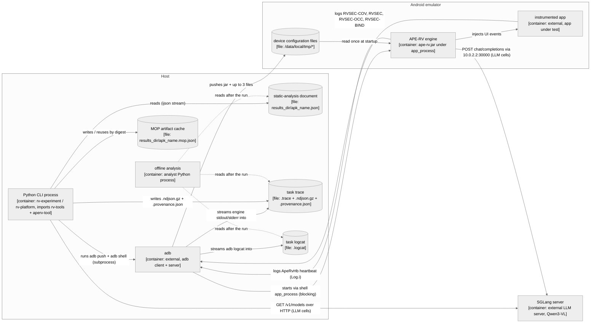
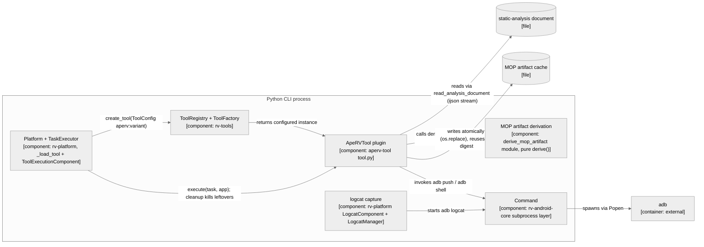
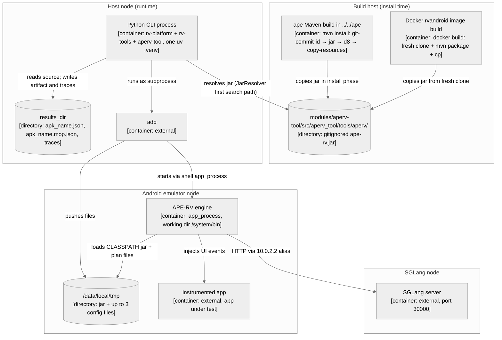

# Architecture — APE-RV Subsystem

> Target: subsystem-ape-rv · Regenerate with: /rv-doc-arch subsystem:ape-rv
> Scope: **subsystem** · Generated by `rv-doc-arch` from `rvsec@dc599aa5, ape@eea2b1a9`
> Languages: Python (3 modules, ~26k LOC, of which ~13.4k is the offline analysis package) + Java (1 module, 202 main source files, ~43.6k LOC)

## Table of Contents

- [Part I — Beyond Views](#part-i--beyond-views)
  - [1. Documentation overview](#1-documentation-overview)
  - [2. Conceptual primer](#2-conceptual-primer)
  - [3. System overview and context](#3-system-overview-and-context)
  - [4. How it works — end to end](#4-how-it-works--end-to-end)
  - [5. Core components](#5-core-components)
  - [6. Mapping between views](#6-mapping-between-views)
  - [7. Rationale](#7-rationale)
  - [8. Output artifacts](#8-output-artifacts)
  - [9. Directory](#9-directory)
- [Part II — Views](#part-ii--views)
  - [Module view](#module-view)
  - [Component-and-connector view](#component-and-connector-view)
  - [Allocation view](#allocation-view)
- [Appendices](#appendices)
- [Specification traceability](#specification-traceability)

---

## Part I — Beyond Views

### 1. Documentation overview

This document describes the architecture of the **APE-RV subsystem**: the on-device Android
exploration engine of RV-Android and its integration into the experiment platform. It is a
cross-language, cross-repository subsystem. Three Python modules live inside the rv-android uv
workspace: `aperv-tool`, which holds both the run-path plugin and an offline analysis package;
`rv-tools`; and a slice of `rv-android-core`. One Java Maven module lives in the sibling `ape`
repository (`../../ape`); it is dexed into `ape-rv.jar` and executed inside the Android emulator.

The intended reader is a **new engineer with no prior exposure to this subsystem** who needs to
understand what it does, how a run unfolds, and why it is shaped the way it is before touching
any file. It complements, and does not replace, the per-module docs
(`modules/aperv-tool/CLAUDE.md`, `modules/aperv-tool/docs/architecture.md`), the engine's own
`../../ape/CLAUDE.md`, and the OpenSpec specs.

**How to read this document:** Part I builds your mental model — what the subsystem is
([primer](#2-conceptual-primer)), how it behaves end to end
([walkthrough](#4-how-it-works--end-to-end)), and why it is shaped this way
([rationale](#7-rationale)). Part II documents the selected views in detail.

### 2. Conceptual primer

APE-RV is the on-device Android exploration engine of RV-Android, plus the Python plugin that
runs it inside the experiment platform. The engine is a Java fork of APE (ETH Zurich, ICSE 2019)
that runs inside the emulator as `ape-rv.jar`, explores the app under test through model-based UI
exploration, and can bias that exploration toward UI elements whose handlers reach monitored
operations (MOP). The Python side (`aperv-tool`, the `rv-tools` plugin registry and a slice of
`rv-android-core`) pushes the jar and its configuration files to the device, launches it, decides
from the elapsed time whether the run actually happened, and keeps the raw trace. A separate,
offline package inside `aperv-tool` reads the recorded traces afterwards.

**Why this approach.** The engine runs on the device through `app_process`, the mechanism AOSP
Monkey uses to load a jar into an Android runtime process, rather than as a host-side driver
issuing one adb call per UI event (the DroidBot and rv-agent approach). An on-device agent reads
the accessibility tree and injects events in-process, so it avoids an adb round trip per event,
but it must be configured entirely before launch because there is no host-side control loop
during the run. That constraint shapes the whole Python side: everything an experimental cell needs
is serialized into `ape.properties` and a derived MOP artifact before `app_process` starts.

Two further choices follow from it. First, **the meaning of a cell lives in the jar.** The jar
mounts five behaviour groups by declaration (BASE, ADDONS, STATIC, MOP, LLM), ships one preset per
experimental cell (`base`, `mop`, `as`, `as_mop`, `as_llm`, `as_mop_llm`) built as the union of that
cell's group blocks, resolves the run plan once at startup, and aborts on any unknown, retired or
ill-typed key; the Python variant is only a cell name plus the deployment facts the jar cannot
know. The rejected alternative, a Python dictionary that spelled out every flag, could
only validate Python constants against other Python constants and could not detect a jar that
silently ignored a key. Second, **the static-analysis document is projected host-side** into a
small explorer-shaped artifact instead of being parsed on the device, because the call graph that
dominates the document made the cells that read it abort on large apps while the baseline of the
same app explored normally. Wrapping the engine as an `AbstractTool` plugin, instead of a bespoke
launcher, lets experiments select it like any other tool (`--tools aperv:as_mop`) and inherit
the platform's timeout and cleanup semantics.

**Key concepts**

- **app_process** — The Android command that starts a runtime process from a jar on the device
  (`CLASSPATH=... app_process <working-dir> <main-class>`). APE-RV's entry point is
  `com.android.commands.monkey.Monkey`, so it executes like AOSP Monkey without being an
  installed app.
- **MOP (monitored operations)** — Operations watched by any runtime-verification specification
  (for example JCA cipher calls). Not security-specific terminology. The engine's research
  purpose is to steer exploration toward widgets whose handlers reach such operations.
- **Behaviour group** — One of the five sets of mechanisms the jar mounts by declaration: BASE
  (the APE algorithm), ADDONS (the fork's own improvements), STATIC (the consumers of the static
  GUI model: the navigation frontier, typed input, component triggering), MOP (the consumers of the
  specification targets) and LLM (the vision-language model). Each group's keys form one block in
  `Presets.java`.
- **Cell / variant** — A named configuration used as one comparison unit in an experiment: a
  union of groups. In `aperv-tool` a variant is one cell — its jar **preset** name, its own
  `variant` name (echoed as `RUN_START.variant`), an `overrides` dict holding only the server URL
  on the two LLM cells, and the Python-only orchestration keys `strategy`, `static_data` (every
  cell but `base`) and `broadcast_catalog` (the four `as*` cells). `ApeRVTool.get_variants()`
  returns seven names carrying six configurations (`default` is the same object as `base`). A dose
  or other tunable is a tool-DSL ablation on a cell, never a new variant.
- **Preset** — One of the six cell presets resident in the jar (`Presets.java`: `base`, `mop`,
  `as`, `as_mop`, `as_llm`, `as_mop_llm`), each the union of its cell's group blocks. `ape.preset`
  selects it and explicit keys override it. The jar owns what a group and a preset mean;
  `aperv-tool` owns which cells exist.
- **Run plan (`RunSpec`)** — The immutable plan the jar resolves once at startup from
  `/data/local/tmp/ape.properties`, `/sdcard/ape.properties` and the command line. Resolution is
  total and fail-fast: an unknown key, a retired key, a wrong type or an impossible feature
  combination prints `[APE-RUNSPEC-ABORT]` and exits before the first event. `KeyOwnership` is
  the registry of known keys, and a `Feature` is present when its key is set. The data root is
  `ape.staticDataPath`: the STATIC and MOP group keys require it, so a cell that mounts either
  group without the artifact aborts at resolution.
- **Static-analysis document** — `<results_dir>/<apk_name>.json`, written upstream by GATOR
  (`rv-static-analysis`). It carries windows, widgets, listeners, transitions, components,
  reachability and, per method, `targetDistances` pairs into the `distanceTargets` list. GATOR
  writes it compact by default (pairs already reduced, no indentation, a `distancePairs` marker)
  or full on request; `aperv-tool` reads either form and never writes or pushes it.
- **MOP artifact (format 2)** — The explorer-shaped projection `<results_dir>/<apk_name>.mop.json`
  that `derive_mop_artifact.derive()` computes host-side: per-widget MOP flags and distance pairs,
  the two MOP-activity sets, per-activity distances, a handler-class table, OPTIONSMENU records, a
  click-only WTG view, the component trigger surface and a `stats` block. It is pushed as
  `/data/local/tmp/mop-artifact.json`; the jar's `MopData.load` reads `formatVersion: 2` only and
  derives nothing.
- **Flag vs distance scoring** — `ape.mopScoring` selects how a MOP-reaching action is boosted;
  the MOP group block states `distance`. `flag` (the jar's key default) adds `mopWeightDirect` (500) or `mopWeightTransitive` (300); `distance` weighs
  the action by its nearest unretired target at call-graph distance d ≤ 1 / 2 / 3 (500 / 400 /
  300) and retires a target after `ape.mopRetireAfter` (3) first interactions.
- **Handler stamp** — An APK instrumented with the dexlib2 variant and `--stamp-handlers` carries
  the handler class of a clickable view as `rvsec.click` / `rvsec.longClick` extras. The jar
  copies them onto `GUITreeNode`, and `MopData.lookup` prefers a stamp naming a class in the
  artifact's `handlers` table over the widget id key.
- **Decision pipeline and scoring pipeline** — Action selection in the jar is a fixed-order list
  of decision stages (Budget, LlmNewState, LlmStagnation, LlmRandom, MopLauncher,
  ComponentTrigger, SataChain; the first stage that selects ends the step) plus, inside SATA, a
  list of scoring passes (`MopWidgetPass`, `MenuGatewayPass`, `WtgPass`, `FrontierPass`,
  `MopFrontierPass`, `CoveragePass`, `FormCompletionPass`). A stage or pass exists only when the
  plan carries its feature.
- **NDJSON trace** — The jar writes its telemetry to stdout, which the host captures into the
  task's `.trace`: a `RUN_START` record first, `ACT`/`STATE` dictionary records, one `StepRecord`
  per exploration step, `MOP_DATA`, `PIPELINE`, `LLM_ACK`, and `RUN_END` last. A line is a record
  iff it begins with `{`; Logger lines begin with `[APE] `. Telemetry is always on. A per-step
  `Log.i` heartbeat under the logcat tag `ApeRvHb` lets offline code place violations on steps.
- **Completion check** — `ApeRVTool` establishes from its own monotonic clock that the
  exploration ran its budget: a non-timeout return more than `APERV_TEARDOWN_GRACE_S` (45 s)
  short of the budget raises `RVToolExecutionError`. The exit code is not used, because APE-RV
  exits non-zero when it detects app crashes.
- **SATA agent, GUITree / State / Naming** — `SataAgent` is APE's epsilon-greedy adaptive
  exploration strategy (`--ape sata`). Each screen capture (GUITree, from `AccessibilityNodeInfo`)
  is mapped to an abstract State by a Naming; `NamingFactory` refines the abstraction when it
  proves too coarse.

### 3. System overview and context

The subsystem sits between the RV-Android experiment platform and the Android emulator. Its sole
driver is **rv-platform**: `Platform._load_tool` creates the tool via `ToolFactory`
(`modules/rv-platform/src/rv_platform/platform.py:578`) and hands it to the **TaskExecutor**,
which calls `execute(task, app)` once per (APK, repetition), managing the emulator lifecycle
around it; its `ToolExecutionComponent` also kills leftover device processes when the task ends. Upstream,
**rv-static-analysis** (GATOR) writes the per-APK `<results_dir>/<apk_name>.json` from which the
plugin derives the MOP artifact, and **rv-instrumentation** produces the APK under test: its
coverage and violation advice emits the `RVSEC-COV`, `RVSEC` and `RVSEC-OCC` logcat lines, and
its dexlib2 variant can stamp handler classes onto views for the jar to read (logged under
`RVSEC-BIND`).

All device interaction goes through **adb** — pushes before launch, one blocking `adb shell`
during the run. In the LLM cells the on-device jar calls the host-side **SGLang server** (Qwen3-VL)
directly through the emulator's `10.0.2.2` alias; Python only writes the connection parameters
and, once per run, asks the server which model it serves. Coverage, violations and the
engine's step heartbeat reach the results through the **rv-platform logcat capture**,
independently of anything the plugin reads. Finally, the **ape repository**
(`github.com/phtcosta/ape`, checked out at `../../ape`) is the source of the engine: its Maven
install step, or the Docker image build, delivers `ape-rv.jar` into the plugin's package
directory.

**Constraints:** the engine resolves its plan exactly once at startup, so there is no mid-run
reconfiguration anywhere in the subsystem; the jar is gitignored and must be built from the
sibling repository; and the MOP artifact format is defined jointly by the derivation here and the
reader there, so a format change is cut over on both sides together.

Diagram 1 shows the subsystem as one box among the systems it deals with (C4 context level);
every view refers back to it. The rv-platform logcat capture is drawn as part of rv-platform,
which is where it runs.

**Diagram 1 — System context: APE-RV between rv-platform, its upstream producers, the emulator and the LLM server.**

**Legend.** Rectangle = a software system, with its kind in brackets (`software system` = the
target documented here; `external system` = everything it interacts with); solid arrow = call,
deployment or data hand-off, labeled with what happens and its mechanism.

### 4. How it works — end to end

The following walks through a concrete example: an experiment runs
`uv run rv-experiment run --tools aperv:mop` — the cell that mounts MOP on APE alone — against
`cryptoapp.apk` (package `br.unb.cic.cryptoapp`) with a 300 s timeout, from tool registration to a
MOP-boosted widget click on the device and the completion check after the run.

**1. Registration.** Importing `rv_platform` runs `_register_external_tools()`, which imports
`ApeRVTool` inside a try/except `ImportError` and calls
`ToolRegistry.register_tool_class(ApeRVTool)`, guarded by `is_tool_registered('aperv')`.
Registration stores the `ToolSpec` (name `aperv`, `process_pattern` `com.android.commands.monkey`)
and the seven variant dicts. If `aperv-tool` is not installed, the platform logs "aperv tool not
available" and continues. (`modules/rv-platform/src/rv_platform/__init__.py:30-38`;
`ToolRegistry.get_instance()` in `modules/rv-tools/src/rv_tools/registry/registry.py`.)

**2. Creation and configuration.** rv-experiment splits any `@key=value` tool-DSL parameters off
the tool spec, and `ToolConfig.from_tool_specification` parses `aperv:mop` into
(name=`aperv`, variant=`mop`). For the two LLM cells the entry point also injects
`APERV_LLM_BASE_URL`, when set, as an `llm_url` parameter (§7, "LLM connectivity"); `aperv:mop`
receives nothing. `ToolFactory.create_tool` fetches a copy of the variant dict,
merges the DSL parameters at the top level as `{**variant_config, **parameters}`
(`modules/rv-tools/src/rv_tools/registry/factory.py:127`), instantiates `ApeRVTool` and calls
`configure()`. `configure()` requires `strategy` in `['sata', 'random']`, a non-empty `preset`,
a non-empty `variant` and an `overrides` dict. It copies `overrides`, folds every top-level key
that has an `APERV_PROPERTY_MAPPING` entry into it, rejects any remaining key that is not one of
the ten `APERV_ORCHESTRATION_KEYS` (so a YAML that still names `mop_data` fails here), rejects an override that has no `ape.*` mapping, and checks
`corpus_basis`, when present, against `<corpus-id>:<sha256>`. Every rejection is a
`ConfigurationError` raised before a device is touched (INV-APV-02, INV-APV-39). For this run the
variant is `{'preset': 'mop', 'variant': 'mop', 'strategy': 'sata', 'static_data':
'static_analysis', 'overrides': {}}`, with no `broadcast_catalog`, because the `mop` cell does not
mount STATIC.

**3. JAR resolution and push.** `execute_tool_specific_logic` resolves `ape-rv.jar` through
`JarResolver` with the module's own directory as the first search path — where `mvn install` in
the ape repository, or the Docker image build, places it — then `$RVSEC_HOME`- and
`$TOOLS_DIR`-derived paths (`search_paths = [os.path.dirname(__file__)]`, `tool.py:684`). The jar
is pushed with `adb -s <serial> push -a -p` to `/data/local/tmp/ape-rv.jar` (not `ape.jar`, which
belongs to the builtin ape tool, INV-APV-03). The bundled `system-broadcast.json` follows to
`/data/local/tmp/` only on a cell that carries `broadcast_catalog=True` — the four `as*` cells,
whose presets mount component triggering, the catalog's only reader — so this run pushes none
(INV-APV-10). Push output is appended to the trace file. A missing jar raises
`RVToolExecutionError`.

**4. Artifact derivation and push.** Because `static_data` is `'static_analysis'`, the tool
requires `<results_dir>/cryptoapp.apk.json`; if it is absent the task fails before the jar is
launched (INV-APV-45). `_derive_mop_artifact` computes `digest_of_file()` over the source in chunks and reuses
`<results_dir>/cryptoapp.apk.mop.json` when the cached artifact records the same `source.digest`
and `formatVersion` 2. On a miss it reads the document as a stream of JSON events with
`read_analysis_document(path, PairPolicy.reduce(3, 3))`, which folds each method's
`targetDistances` into per-target minima and keeps only the pairs the artifact can carry; a
document whose root object never closes is refused. `derive()` then runs every parse-time rule —
the listener × reachability cross-reference with D8 synthetic-lambda recovery, the widget
collision ranking, the empty-short-id drop that still marks its activity, DIALOG re-keying onto
the host activity, base-activity WTG keying with deduplication, the A′ activity-set union, the
OPTIONSMENU records, the per-activity deep-link URI, the distance lists, the handler table and the
component surface, whose receiver and service intent filters keep a reduced `data` member
(`schemes`, `hosts`, `paths`, `pathPrefixes`, `mimeTypes`) for component triggering —
and `serialize_canonical()` encodes the result with sorted keys and no whitespace. The bytes go
through a temp file in the same directory and `os.replace`, so a crash cannot leave a truncated
artifact. Only the artifact is pushed, to `/data/local/tmp/mop-artifact.json`; the source stays
untouched on the host. For cryptoapp the artifact has `targets` 27, `stats.flagged` 3 of
`widgetsTotal` 30, three MOP activities and 16 WTG edges
(`../../ape/src/test/resources/cryptoapp.apk.mop.json`).

**5. ape.properties generation and push.** `_push_properties` writes the cell as the jar reads
it: `ape.preset` first, `ape.variant` second, `ape.staticDataPath` when the artifact was pushed,
then one `ape.<key>=<value>` line per override in mapping order, with Python bools written as
lowercase `true`/`false`. The other Python-only keys never reach the file. For `mop` the overrides
dict is empty, so the file is three lines — `ape.preset=mop`, `ape.variant=mop` and
`ape.staticDataPath=/data/local/tmp/mop-artifact.json` — and the `mop` preset inside the jar
supplies everything else. The content goes through a host temp
file that is unlinked in a `finally` block.

**6. Launch via app_process.** This cell sets no `llm_url`, so no provenance sidecar is written.
`_build_main_command` builds
`adb -s <serial> shell CLASSPATH=/data/local/tmp/ape-rv.jar /system/bin/app_process /system/bin
com.android.commands.monkey.Monkey -p br.unb.cic.cryptoapp --running-minutes 5 --ape sata`
(`running_minutes = max(1, 300 // 60)`). `CLASSPATH` is an inline environment variable because
`app_process` reads it from the process environment. The working directory is `/system/bin`
because the engine resolves system-level resources relative to it (INV-APV-04). A configured seed
would be appended as Monkey's `-s <seed>`, distinct from adb's `-s <serial>` (INV-APV-18). The
host `Command` gets a timeout of 300 + 45 = 345 s, and stdout/stderr stream into the trace file
opened `'wb'`, replacing the push diagnostics.

**7. Plan resolution on the device.** `Monkey.run` resolves the `RunSpec` before any device
interaction. The `mop` preset — the BASE block plus the MOP block, which states distance
scoring and the MOP coin at `p_M = 1.0` — is merged with the explicit keys, and the MOP group
finds the artifact it requires through `ape.staticDataPath`. For this cell the resolved features
are `FUZZING`, `STATIC_DATA`, `MOP`, `WTG`, `MOP_FRONTIER`, `MOP_LAUNCHER`, `MOP_ACTIVITY_SOURCE`
and `MOP_COIN`, with no `MENU_GATEWAY` (it also requires the ADDONS member `MODEL_MENU`).
An unresolvable plan prints `[APE-RUNSPEC-ABORT] reason=... key=...` and returns before step 1
(INV-RUN-01). Otherwise `RunContext.initialize` seeds `RandomHelper` and `RunSpecEcho` writes
`RUN_START` — format version `v: 2`, run id, seed, agent, preset, `variant: "mop"` (outside the
plan digest), active features, resolved parameters, inert keys, plan digest and build stamp — as
the first line of the trace.

**8. Agent construction and MOP load.** `ApeAgent.createAgent` builds `SataAgent` for
`--ape sata`; there is no fallback branch, because an unknown type already aborted at resolution.
The `StatefulAgent` constructor calls `MopData.load(dataPath, package, mainActivity, sink)`
(`StatefulAgent.java:204-208`): it rejects anything whose `formatVersion` is not 2 — a full
static-analysis JSON or a format-1 artifact takes the `version-mismatch` branch — and records a
`MOP_DATA` record with status `loaded` or `rejected` and a reason (`file-missing`, `parse-error`,
`version-mismatch`, `package-mismatch`). The jar stops the run when the path is set but the load
returned null, so a cell that reads the artifact never explores without it (INV-MOP-22). The
loader separates the static GUI model, read by STATIC, from the MOP targets, read by MOP.
The agent then builds the `MopContext`, the `ScoringPipeline` and the `DecisionPipeline`, and
writes one `PIPELINE` record naming the stages, the passes and the candidate census.

**9. Exploration loop.** Each step captures a GUITree from `AccessibilityNodeInfo`, abstracts it
to a State through `NamingFactory`, and consults the `DecisionPipeline`, which gives the step
to one owner — `budget`, `restart`, `llm`, `launcher`, `mop` or `sata`. For the `mop` cell there is no LLM owner and no component-trigger stage, because LLM and STATIC
are not mounted; the MOP launcher and the MOP coin are. Each step records the owner that took it
in `dec.src` and the owner record in `dec.own`. Inside SATA the `ScoringPipeline` resets boosts
and runs its passes;
`MopWidgetPass` asks `MopData.lookup(activity, node, event)` for each action, which returns the
stamp record when the node carries a handler stamp naming a class in the artifact's `handlers`
table, and the widget id record otherwise. In cryptoapp's artifact the encrypt button
`executeButton` of `CryptographyActivity` carries the `click` pairs `[[16,3],[17,3],[18,3]]`, so
under distance scoring its click action is weighed at d = 3, `mopWeightD3` = 300; the encrypt
button `btn_cipher_encrypt` of `CipherActivity` is flagged `transitive` but reaches its targets
only at d = 4 and carries no pair, so distance scoring gives it no weight. The chosen `ModelAction` becomes an `ApeEvent` on the Monkey event
queue, and the resulting GUITree updates the `Model` graph. Each step is written as one
`StepRecord` on stdout and one `ApeRvHb` heartbeat line in logcat.

**10. Termination and completion check.** After `--running-minutes` the jar tears down — it
writes the `UICOV`/`UICOV-ACT` coverage dump and the `RUN_END` record — and exits, normally
within the 45 s grace. If the host `Command` timeout fires first, `Command.invoke` raises
`RVCommandTimeoutError`; the tool gzips the trace and re-raises `RVToolTimeoutError`, which
rv-platform records as a completed run (INV-TOOL-06, INV-APV-11). On a normal return the tool logs
a non-zero exit at debug level only (INV-APV-12), warns on a 0-byte trace, writes
`<trace>.ndjson.gz` beside the raw trace, and then compares its own elapsed time with the floor:
a return before 300 − 45 = 255 s raises `RVToolExecutionError`, so a dead emulator or an early jar
abort is stored as a failed task that resume re-executes (INV-APV-60).
rv-platform's `ToolExecutionComponent.cleanup()` kills leftover device processes matching
`com.android.commands.monkey` on every path.

**11. Offline reading (after the campaign).** Nothing in the run path reads what the jar wrote.
Afterwards, `aperv_tool.analysis.trace_ndjson.TraceReader` reads the trace (resolving the
`ACT`/`STATE` dictionaries, materializing omitted defaults, expanding the run-relative clock
through `RUN_START.t0`, and surfacing the owner record, `RUN_START.variant` and the `RUN_END`
census; it reads `RUN_START.v` 1 and 2, see §7, "Offline analysis"); `clock_logcat_join` places `RVSEC` violation lines on steps through the
`ApeRvHb` heartbeats in the task's `.logcat`; `coverage_dump` parses the `UICOV` dump; and the
campaign-analysis layers build frames, validity gates, estimators and envelopes over a whole
results tree.

### 5. Core components

**ApeRVTool plugin.** A new instance per task, configured once by the factory. It is the only
component that touches both worlds: it reads host artifacts (the jar, the static-analysis
document in `results_dir`) and writes the device's file-based configuration surface. It reads
nothing back from the engine except the exit condition and its own clock; the raw trace is kept,
compressed, and left for the offline readers.

**MOP artifact derivation.** Runs inside the plugin before launch on every cell but `base`. A cache hit costs
one sequential digest of the source; a miss costs one streaming read with exact pair reduction
(`read_analysis_document` in `rv-android-core`), a pure derivation, and an atomic write. The
result is keyed by (`source.digest`, `formatVersion`) and lives beside its source in
`results_dir`, where it can be inspected and diffed.

**ToolRegistry + ToolFactory.** Populated at import time and read for every task. rv-platform asks
the factory for `aperv:as_mop` and receives a configured `AbstractTool` without importing
`aperv_tool`. The variant dicts stored here are the experimental cells.

**Device configuration files.** `ape.properties` names the preset and the variant and carries
the deltas; `mop-artifact.json` is present on every cell but `base` and is advertised through
`ape.staticDataPath` only when the push succeeded; `system-broadcast.json` is the broadcast
catalog for component triggering, present on the four `as*` cells only. The jar resolves its plan from these once, so their pre-launch state determines the
run, and `RUN_START` echoes the resolved plan and its digest.

**APE-RV on-device process.** Once launched it is autonomous: the host's only handle is the
blocking adb shell connection, whose stdout and stderr stream into the trace file, and the
`Command` timeout that eventually kills it. Internally it loops capture, abstract, decide
(`DecisionPipeline`), score (`ScoringPipeline`), inject, update the `Model` graph, and writes one
`StepRecord` per step.

**Task trace file.** The primary artifact of a run, kept byte-identical to what was captured
(INV-APV-52). Its gzip copy is written on every exit path, including timeout, because timeout is
how most runs end. LLM cells add a `.provenance.json` sidecar next to it.

**SGLang LLM server.** The device-side Java process is the HTTP client, reaching the host through
the emulator's `10.0.2.2` alias (`http://10.0.2.2:30000/v1` in the LLM cells' overrides). In the
container deployment, the entrypoint's socat bridge on `127.0.0.1:30000` forwards to the `sglang`
service (`docker/rvandroid/docker-entrypoint.sh`). Python only writes `llm_*` properties and, once
per LLM-cell run, queries `/v1/models` for provenance.

**Logcat channels.** Coverage and violations are logged by the instrumented app and captured by
rv-platform for the task window, which is why an empty trace is a warning and why the trace can
be overwritten at launch. The engine adds one `ApeRvHb` line per step so offline code can place
violations on steps; the tag is a cross-repository constant (`TAG_APERV_HEARTBEAT` in
`modules/rv-android-core/src/rv_android_core/util/logging/constants.py`) because
`adb logcat -s` drops unlisted tags at the device.

**Offline readers and campaign analysis.** Run by analysts over a finished results tree. They
consume the trace through `TraceReader`, the logcat through `read_tagged_lines`, and the
static-analysis document (never the `.mop.json`), and produce frames, gate reports and envelopes.

| Component | Realized by | Responsibility |
|-----------|-------------|----------------|
| ApeRVTool plugin | `modules/aperv-tool/src/aperv_tool/tools/aperv/tool.py` | Per-run host orchestrator: cell config → device files → app_process launch → completion check → trace compression |
| MOP artifact derivation | `modules/aperv-tool/src/aperv_tool/tools/aperv/derive_mop_artifact.py` + `modules/rv-android-core/src/rv_android_core/util/analysis_document.py` | Stream-read the static-analysis document; derive, cache and serialize the format-2 artifact |
| ToolRegistry + ToolFactory | `modules/rv-tools/src/rv_tools/registry/` | Resolve `aperv:<variant>` to a configured plugin instance per task |
| Device configuration files | `/data/local/tmp/{ape-rv.jar, ape.properties, mop-artifact.json, system-broadcast.json}` | The file part of the host→engine configuration (the command line adds `-p`, `--running-minutes`, `--ape`, `-s`), pushed before launch and resolved once |
| APE-RV on-device process | `../../ape/src/main/java` (dexed to `target/ape-rv.jar`) | Plan resolution, MOP load, exploration until the minute budget expires, NDJSON trace |
| Task trace file | `task.result.trace_file`, `<trace>.ndjson.gz`, `<trace stem>.provenance.json` | Raw capture of the engine's output, its gzip copy, and LLM provenance |
| SGLang LLM server | host-side SGLang serving Qwen3-VL | OpenAI-compatible vision-LLM endpoint the jar consults in the LLM cells |
| Logcat channels | instrumented APK + engine heartbeat + rv-platform capture | Out-of-band coverage, violation and step-alignment streams |
| Offline readers and campaign analysis | `modules/aperv-tool/src/aperv_tool/analysis/` | Read-only analysis of recorded runs; never on the run path |

### 6. Mapping between views

The module structure and the runtime structure line up closely, but the correspondence crosses
both a language boundary and a process boundary, and knowing exactly where is essential to
reading this subsystem correctly.

On the host, `aperv-tool`'s run path (`tool.py` + `derive_mop_artifact.py`) realizes the
**ApeRVTool plugin** and the **MOP artifact derivation**; `rv-tools` realizes the
**ToolRegistry + ToolFactory** service; and `aperv-tool`'s `analysis/` package realizes the
**offline readers**, which have no runtime relationship to the plugin at all — they read the
artifacts it leaves. The `rv-android-core` slice does not appear as a runtime component of its
own: it is the inherited half of the plugin's behaviour (`AbstractTool.execute()` wraps
`execute_tool_specific_logic()`, `Command.invoke()` is the subprocess layer under every adb call,
and `read_analysis_document()` is the streaming reader the derivation runs on). Reading `tool.py`
without that slice gives a false picture: timeout conversion, subprocess cleanup and the bounded
read of the static-analysis document are inherited, not local.

The **cross-language, cross-process boundary** is crossed twice, by two different mechanisms.
First, at build/install time: the `ape` repository is compiled, dexed with d8, and its
`mvn install` step copies `target/ape-rv.jar` into
`modules/aperv-tool/src/aperv_tool/tools/aperv/`, so the Java module is physically embedded in
the Python module's package directory as a gitignored binary. Second, at run time: the plugin's
host `Command` spawns `adb -s <serial> shell CLASSPATH=/data/local/tmp/ape-rv.jar app_process
/system/bin com.android.commands.monkey.Monkey ...`, which turns the pushed jar into the **APE-RV
on-device process**. What crosses this boundary is the jar plus up to three configuration files
in one direction, and a stdout/stderr stream plus an exit code in the other. The stream is
structured — NDJSON records interleaved with `[APE] ` Logger lines — but the run path treats it
as opaque bytes. There is no RPC, no socket between Python and Java, and no mid-run control.

Two runtime connectors bypass the Python side entirely: the on-device Java process is an HTTP
client of the **SGLang server** (device→host via `10.0.2.2`), and the instrumented app and the
engine feed the **logcat channels** that rv-platform's logcat component captures. In deployment
terms, the Python modules live on the host node, the engine and the app under test share the
emulator node, and SGLang occupies a third node (in the container deployment, a separate
service reached through a socat bridge); the install view maps the ape repository's Maven chain
onto the plugin's package directory.

### 7. Rationale

The decisions that shaped this architecture, each with the tension behind it and the failure
mode it avoids.

**On-device execution via app_process with /system/bin as working directory.** The tension is
throughput against controllability. A host-side driver adapts per step with full Python tooling
but pays an adb round trip per event; an on-device agent explores at native speed but can only be
configured up front through pushed files. APE-RV takes the device side and inherits Monkey's
app_process launch. Within that choice the working directory must be `/system/bin` rather than
the intuitive `/data/local/tmp`: the engine resolves system resources relative to it, and
`/data/local/tmp` produces `ClassNotFoundException` on some API levels (INV-APV-04). Without this
decision the file-push machinery would be unnecessary, but exploration would be bounded by adb
latency.

**A variant is one cell — a jar preset that unions group blocks — and the jar validates the
plan.** A jar that ignores unknown properties silently and applies defaults for absent ones can run
a configuration nobody intended even when a Python variant spells out every flag, and Python-side
guards can only validate Python constants against other Python constants. Moving the key vectors
into the jar (`Presets.java`), composing each cell preset from the blocks of the groups it mounts,
and making plan resolution total gives the jar a contract: an unknown key, a retired key, a wrong
type or an impossible feature combination aborts before step 1 with `[APE-RUNSPEC-ABORT]`. The
groups are switched on and off by declaration so that a contrast between two cells is a contrast
between group sets: an "unguided" control that still consumed static-analysis or MOP data could
not attribute a gain to MOP guidance. The Python side keeps only what it can check locally: the
shape of the variant, a non-empty `variant` name, that every override is mappable, and that every
top-level key is known (INV-APV-39). It states on each variant the deployment facts the push needs
(`static_data`, `broadcast_catalog`, the LLM URL) rather than inferring them from a preset name,
because it does not know what a preset mounts. It writes the cell's name as `ape.variant`, which
the jar echoes as `RUN_START.variant` outside the plan digest (INV-APV-65), so a trace names its
cell without relying on a file name. The arm names of earlier campaigns are not defined, with no
alias, because each would claim a configuration the paired jar no longer runs; campaigns recorded
under them resume from the frozen image `rvandroid:0.9.5`. The rejected alternative, full
property expansions in Python with explicitness guards, was removed; the one-time proof that the
re-expression changed no effective configuration is archived under
`modules/aperv-tool/docs/gh95-migration-record/` and may not return as a standing test
(INV-APV-44). `tool.py` reads nothing back from the jar (INV-APV-43): the plan the jar resolved is
echoed in `RUN_START` for post-hoc auditing.

**Host-side derivation of the MOP artifact, and a cell that fails rather than degrades.** When
the device parsed the producer's whole document, a footprint guard rejected call-graph-heavy
apps, so the arms that read it ran zero steps on exactly those apps while the paired baseline explored
normally — a per-app fairness gap that corrupts a paired comparison rather than crashing it.
Deriving host-side removes both the parse and the guard; the artifact's size scales with the UI,
not with the call graph. Every rule lives in `derive_mop_artifact.py` with a named unit test, and
`MopData` only decodes (INV-MOP-35 on the jar side). The artifact goes to every cell that mounts
STATIC or MOP — every cell but `base` (INV-APV-66) — and a cell that cannot arm fails: on the host
when the static-analysis document is missing, truncated or refused (`RVToolExecutionError` before
launch, INV-APV-45), and on the device when the artifact is missing or of the wrong format (the
jar stops the run, INV-MOP-22). The warn-and-continue alternative produced runs labelled MOP that
explored as pure SATA, indistinguishable in the results directory from real ones. The source
document stays byte-identical on the host because offline metrics read it, and no analysis path
may read the derived artifact (INV-ANA-53). Two derivation rules are worth knowing because they
are easy to get wrong: `direct` keeps the producer's 0-hop meaning and `transitive` is the
any-depth reach it implies, with `direct` implying `transitive` (INV-DRV-01); and the producer's
`"complete"` sentinel is not read, so a well-typed first-pass document derives to an artifact
with an empty `wtg` (INV-DRV-08).

**A streaming, exactly-reduced read of the analysis document.** Since GATOR emits per-method
call-graph distances, a static-analysis document can reach several gigabytes, and a
whole-document `json.load` peaks at roughly three times the file size. The derivation keeps only
pairs at d ≤ 3 per widget and handler and the three nearest per activity, after taking per-target
minima across every merge (INV-DRV-10). Because a pair outside both cuts has three targets ahead
of it in its own method that stay ahead after any merge, folding pairs while streaming is exact:
the artifact is byte-identical to `serialize_canonical(derive(json.load(document)))`
(INV-APV-64). The same property makes GATOR's compact output (the default, already reduced, with
a `distancePairs` marker) and its full output derive the same artifact apart from the `source`
object. Freshness is a SHA-256 of the source plus the `formatVersion`, because mtime does not
survive a copy, a resume or a container boundary, and a format bump must invalidate artifacts
whose source did not change (INV-APV-47).

**Timeout is the success path; completion is established from elapsed time.** An exploration
tool runs until its budget expires, so treating timeout as failure would mark every healthy run
failed: `AbstractTool` and `ApeRVTool` turn `RVCommandTimeoutError` into `RVToolTimeoutError`, and
the platform records a completed run. The exit code cannot say whether a run happened, because
APE-RV exits non-zero when it detects an app crash — data the campaign wants — and a vanished
device also returns non-zero. Elapsed time separates them, because the exploration is
budget-bound by construction: a non-timeout return more than 45 s short of the budget raises
`RVToolExecutionError`, which rv-platform stores as an error that resume re-executes
(INV-APV-60). The same 45 s is added to the `Command` timeout so the engine can flush its model
and emit its coverage dump before the host kills it. The value is stated once
(`APERV_TEARDOWN_GRACE_S`) because the two uses must agree.

**The run path writes telemetry and never reads it.** The jar emits its own provenance
(`RUN_START`) and its own ending (`RUN_END`). If the tool parsed them, the run path would depend
on the trace format and could change task status on evidence that a later reader interprets
differently. So the collection path only copies and compresses (INV-APV-52, INV-APV-53), and
liveness, truncation and drift are decided by the offline readers over a whole results tree. For
the same reason no source file pins the revision or digest of `ape-rv.jar`: the jar is built in
another repository and is not bit-reproducible, so a pin fails on correct rebuilds and passes on
stale ones. The identity of the jar an LLM-cell run used is measured at push time
(`_capture_llm_provenance` digests it into `jar_sha256`, INV-APV-59).

**Binary hand-off at `mvn install` and Docker build; a coordinated format cut.** The engine and
the plugin live in separate repositories, so the risk is skew: a plugin writing a key the shipped
jar does not know (an abort at plan resolution) or a derivation emitting a format the jar does not
read (a `version-mismatch` abort). The coupling is an artifact copy at the producer's install
step: `../../ape/pom.xml`'s maven-resources-plugin drops the dexed jar exactly where
`_resolve_jar_path()` looks first, and `docker/rvandroid/Dockerfile` re-derives it from a fresh
clone of the default branch at image-build time. Committing the binary was removed by spec,
because a tracked jar goes stale silently (`openspec/specs/tools/spec.md:526-531`). A format
change is therefore a coordinated cut: the derivation's `FORMAT_VERSION` and `MopData`'s
`SUPPORTED_FORMAT_VERSION` move together, and both sides reject the other's format rather than
guess.

**LLM connectivity is device-to-host; Python only writes the configuration.** Because the host
has no channel into the running engine, per-step guidance must originate on the device; routing
it through Python would require a host-to-device RPC channel the app_process design avoids. So
`LlmEngine`, `SglangClient`, `ToolCallParser`, `CoordinateMapper` and `LlmCircuitBreaker` live in
`ape/llm` inside the jar. The LLM group block states the routing gates on while deliberately
omitting the server URL, which both LLM cells must supply (INV-APV-38). The host adds one thing it can do
better: a live `GET /v1/models` before launch records which model actually served the run, with
failures recorded rather than back-filled from configuration (INV-APV-33). That query runs
outside the emulator, so it rewrites `10.0.2.2` to `127.0.0.1`; the value written into
`ape.properties` keeps the alias the jar needs. A deployment changes the URL in one of two ways,
with the precedence DSL > environment > cell default: a tool-DSL `@llm_url=...`, or the
`APERV_LLM_BASE_URL` environment variable. `configure()` reads no environment (INV-TOOL-20), so the
variable is read only by the `rv-experiment` entry point, beside `RV_HUMANOID_URL`, which places it
as `llm_url` in the `ToolConfig.parameters` of every `aperv` cell whose variant definition carries
`overrides.llm_url` and whose parameters do not already set it (INV-APV-09, INV-EXP-41);
`configure()`'s DSL fold then moves it into `overrides`. The cells without the LLM group never
receive it, because it would write an `ape.llmUrl` line for a group they do not mount.
`rv-platform run` does not read the variable.

**Offline analysis lives in the tool package, outside the run path.** The trace format is a
contract between the jar and this module, so its readers sit beside the tool that captures it,
and a format change touches one layer. Keeping them off the run path means a reader bug cannot
fail a run (INV-APV-48), and admissibility is decided over the whole results tree with
denominators that travel with every number. The readers of an archived, pre-NDJSON corpus
are kept as readers of frozen data, not migrated (INV-APV-55). `TraceReader` reads two jar
generations of the NDJSON trace, `RUN_START.v` 1 (the `eea2b1a9` jar and earlier) and 2 (the
group-isolation jar), and carries both vocabularies without translating one into the other. Under
`v == 2`, `dec.src` is the owner that executed the step and is causal; under `v == 1` it is the
stage whose boost was largest, which is not (INV-APV-67), so counts of it are never pooled across
versions. The `v == 2` owner record and the other new decision members reach typed `StepRow` fields
that are `None` on a `v == 1` trace; `activity_has_mop` is `None` where the jar did not compute it
(INV-APV-68); `RUN_END` is a verbatim census attribute that the reader does not interpret. The
clean-control gate follows suit: on a legacy `key=value` stream it keeps an anchored `mop=`
pattern, and on any NDJSON trace it counts, through `TraceReader`, the MOP-group members of the
`ape` side's own clean-control list (`count_mop_group_signal`, INV-CAN-07), where `MOP_DATA` never
counts because the STATIC cells load the artifact by design.

**Decisions at a glance**

| Decision | Drivers | Invariant / ADR |
|----------|---------|-----------------|
| On-device execution via app_process, working dir `/system/bin` | event throughput without per-event adb round trips; direct AccessibilityNodeInfo access; system-level resource resolution | INV-APV-04 |
| Variant = one cell, a jar preset unioning group blocks; jar validates the plan | one owner for what a cell means; group isolation by declaration; fail-fast on configuration drift; auditable runs from `RUN_START` and `RUN_START.variant` | INV-APV-38..41, -43, -44, -65, -66; ape run-spec INV-RUN-01/03 |
| Host-side MOP artifact derivation; a cell fails rather than degrades | between-cell fairness; one authority for parse-time semantics; source integrity | INV-APV-45..47, INV-DRV-01..10, INV-ANA-53; ape INV-MOP-22/34 |
| Streaming, exactly-reduced read; cache by digest + format | bounded host memory; identical artifact from compact or full input; freshness across copies | INV-APV-47, INV-APV-64, INV-DRV-10 |
| Timeout is success; completion from elapsed time | exploration has no natural end; app crashes are data; dead devices must not pass | INV-TOOL-06, INV-APV-11, INV-APV-12, INV-APV-60 |
| Run path writes telemetry and never reads it | no run-path coupling to the trace format; truncation decided post hoc; no stale pins | INV-APV-43, INV-APV-52, INV-APV-53, INV-APV-57, INV-APV-59 |
| Binary hand-off at `mvn install` / Docker; coordinated format cut | jar matches its source; no binary in git; zero-config resolution | tools spec "No committed or bind-mounted jar dependency" |
| LLM connectivity device-to-host; Python only configures | no host control loop during a run; per-step latency; served-model provenance | INV-APV-33, INV-APV-38 |
| Offline analysis in the tool package, off the run path | one owner for the trace contract; validity before outcome | INV-APV-35, INV-APV-48, INV-APV-63; campaign-analysis spec |

**Patterns and styles**

On the module side the subsystem is **layered** — rv-tools (L2) and aperv-tool (L5) each build
on rv-android-core (L1) alone, with rv-platform (L4) declaring the plugin and reaching it only
through the guarded import in `rv_platform/__init__.py`, and `aperv-tool`'s run path importing only `rv_android_core` (the
offline package adds one lazy import of `rv_coverage`, see [Appendix A](#a-dependencies)) — combined
with a **plugin (registry + factory)** style: the `ToolRegistry` singleton and `ToolFactory` in
`rv_tools/registry/`, with `ApeRVTool` registered by `_register_external_tools()` and selected by
the string `aperv:<variant>`. At runtime two styles coexist: **client-server** across two
boundaries (the host Python client launches and awaits the on-device Java process over
adb/app_process, `tool.py:1145-1189`; the Java process is itself an HTTP client of the SGLang
server) and **shared-data** (all host→engine configuration flows through files pushed to
`/data/local/tmp` and resolved once by `RunSpec`; results flow back through the trace file and
the logcat channels). Allocation-wise, **deployment** spans three execution nodes (host,
emulator, SGLang) crossed only by adb and the `10.0.2.2` HTTP alias, and **install** is the
Maven chain jar → d8 → copy-resources into the plugin package, with the Docker image re-running it
from a fresh clone.

**NFRs served**

*Extensibility (NFR02).* `ApeRVTool` implements the `AbstractTool` hooks (`get_tool_spec`,
`get_variants`, `configure`, `execute_tool_specific_logic`) and is registered by a guarded import
in rv-platform, so experiments select it as `aperv:<variant>` through the registry and factory
without orchestration changes. A new cell is a jar preset composed from group blocks plus one
entry in `get_variants()`; a new engine tunable is a `KeyOwnership` entry in the jar plus an
`APERV_PROPERTY_MAPPING` entry; an ablation needs no code at all, only a tool-DSL override.

*Testability (NFR03).* `derive()` is pure, with one named test per rule plus the cryptoapp ground
truth (`modules/aperv-tool/tests/test_derive_mop_artifact.py`); the offline readers need no
device; the jar's decision and scoring pipelines are assembled from a plan and testable with stub
stages on the JVM.

*Resilience (NFR04).* Optional stages degrade: a missing `system-broadcast.json` is skipped, a
0-byte trace is a warning, a failed provenance query or sidecar write is recorded and the run
proceeds, a failed gzip logs a warning, a corrupt cached artifact is a cache miss, and a missing
`aperv-tool` package that fails to import is a warning in rv-platform. The MOP substrate is deliberately not optional
in a cell that reads it, and an early return is not success: the fail-fast points are
`configure()`'s validation, the missing jar, the cell that cannot arm (host and device), and the
completion check.

*Configurability (NFR05).* Six jar cell presets, seven variant names (six cells plus `default`),
a 66-entry property mapping, and per-run overrides through the tool DSL (`aperv:<variant>@key=value`) that `configure()` folds into
`overrides`. The jar also honours `/sdcard/ape.properties`. Deployment-specific values (`llm_url`,
`corpus_basis`) travel the same path as any other mapped key.

*Observability (NFR06).* The jar writes a self-describing NDJSON trace: `RUN_START` with the
resolved plan, active features, inert keys and plan digest; `MOP_DATA` with status and reason;
`PIPELINE` with the stage roster, passes and candidate census; one `StepRecord` per step; `RUN_END`
with the reason and counters; and an `ApeRvHb` heartbeat per step in logcat. The host side writes
push diagnostics, the gzip copy and the LLM provenance sidecar, and logs each lifecycle step
through `LoggingManager` with component `ApeRVTool`.

*Reproducibility (NFR08).* A configured seed reaches Monkey as `-s <seed>`, and
`RunContext.initialize` seeds `RandomHelper` from it (INV-APV-18, INV-EXPL-14). `RUN_START.variant`
names the cell in the trace itself. The canonical serializer makes the
artifact byte-deterministic for identical input (INV-DRV-05), and the artifact records the source
digest it came from. `RUN_START` records the plan digest, and LLM cells record the jar's sha256 and
the served model.

| NFR | PRD ID | Architectural support |
|-----|--------|-----------------------|
| Extensibility | NFR02 | AbstractTool hooks + guarded registration; new cell = jar preset + one variant entry; ablation = tool-DSL override; new tunable = jar key + mapping entry |
| Testability | NFR03 | Pure derivation with per-rule tests; device-free offline readers; plan-assembled pipelines testable on the JVM |
| Resilience | NFR04 | Graceful degradation at optional stages; fail-fast at configure(), jar resolution, artifact arming and completion |
| Configurability | NFR05 | 6 cell presets, 7 variant names, 66-entry mapping, tool-DSL overrides |
| Observability | NFR06 | NDJSON trace (`RUN_START`, `MOP_DATA`, `PIPELINE`, `StepRecord`, `RUN_END`), `ApeRvHb` heartbeat, provenance sidecar |
| Reproducibility | NFR08 | Seed via Monkey `-s`; `RUN_START.variant`; canonical artifact bytes with source digest; plan digest in `RUN_START` |

### 8. Output artifacts

A run leaves artifacts on both sides of the device boundary. Note the split between the trace,
which records what the engine did, and the logcat channels, which carry coverage and violations
independently of the engine.

| Artifact | Location | Notes |
|----------|----------|-------|
| Task trace | `task.result.trace_file` (`<apk>__<rep>__<timeout>__<arm>.trace`) | Raw stdout/stderr of the main run: NDJSON records (`RUN_START` … `RUN_END`) interleaved with `[APE] ` Logger lines and the `UICOV` dump; byte-identical to the capture |
| Compressed trace | `<trace>.ndjson.gz` beside the trace | Written on every exit path; non-fatal |
| LLM provenance sidecar | `<trace stem>.provenance.json` | LLM cells only: `llm_backend`, `llm_model`, `llm_sampling`, `jar_sha256`, `capture_status` |
| Derived MOP artifact | `<results_dir>/<apk_name>.mop.json` | Format 2, canonical bytes, keyed by `source.digest` and `formatVersion`; device input only (INV-ANA-53) |
| Device configuration set | `/data/local/tmp/{ape-rv.jar, ape.properties, mop-artifact.json, system-broadcast.json}` | Pushed fresh per task: the artifact on every cell but `base`, the catalog on the four `as*` cells |
| Logcat streams | task `.logcat` captured by rv-platform | `RVSEC-COV` coverage, `RVSEC` / `RVSEC-OCC` violations and `RVSEC-BIND` handler stamps from the instrumented app; `ApeRvHb` heartbeats from the engine |
| Offline reports | wherever the analyst names a destination | Join reports, coverage rows, campaign frames and envelopes from `aperv_tool.analysis` |

### 9. Directory

**Glossary / acronyms**

- **APE** — Android exploration tool from ETH Zurich (ICSE 2019); the upstream tool APE-RV forks.
- **MOP** — Monitored operations: operations watched by any runtime-verification specification
  (not security-specific).
- **RV** — Runtime verification.
- **SATA** — APE's epsilon-greedy adaptive exploration strategy.
- **WTG** — Window transition graph (from static analysis).
- **NDJSON** — Newline-delimited JSON: one JSON object per line.
- **Preset** — A cell's key vector resident in the jar, the union of its group blocks (`base`, `mop`, `as`, `as_mop`, `as_llm`, `as_mop_llm`).
- **Cell** — A union of behaviour groups (BASE, ADDONS, STATIC, MOP, LLM); one preset and one `aperv` variant each.
- **RunSpec** — The jar's resolved, validated run plan.
- **Arm** — One named tool configuration used as a comparison unit in an experiment.
- **adb** — Android Debug Bridge.
- **d8** — Android's DEX compiler, used to dex the engine jar.
- **SGLang** — The LLM serving framework hosting Qwen3-VL for the LLM cells.
- **JCA** — Java Cryptography Architecture.

**References**

- Subsystem spec: `openspec/specs/aperv/spec.md`; related: `openspec/specs/tools/spec.md`,
  `openspec/specs/campaign-analysis/spec.md`, `openspec/specs/analysis/spec.md`
- Engine specs: `../../ape/openspec/specs/` (run-spec, mop-guidance, decision-pipeline,
  scoring-pipeline, event-sink, llm-routing, among others)
- Module docs: `modules/aperv-tool/CLAUDE.md`, `modules/rv-tools/CLAUDE.md`,
  `modules/rv-android-core/CLAUDE.md`, `../../ape/CLAUDE.md`
- Campaign analysis narrative: `docs/20260815_gh103_analysis_layer.md`
- PRD: `docs/PRD.md` (FR18–FR20, NFR02–NFR06, NFR08)
- Related architecture: `docs/architecture/rv-android.md`, `docs/architecture/rv-platform.md`,
  `docs/architecture/static-analysis.md`

---

## Part II — Views

### Module view

*Style(s): uses + layered*

This view shows the static structure a maintainer must know before touching any file: the
L1/L2/L5 tiering (the core contract under both the registry and the plugin), the inverted
registration edge from rv-platform, the split of `aperv-tool` into a run path and an offline package that never call
each other, and the build-time edge through which the Java engine delivers its binary into the
plugin's package directory. Diagram 3 opens the engine to show its internal packages.

**Primary presentation** — components inside their container (C4 component level).

**Diagram 2 — Module structure: the Python layers, the inverted registration edge and the Java engine's build-time hand-off.**

**Legend.** Rectangle = code unit, with its kind in brackets; frame = layer of the uv workspace
(L1 foundation to L5 plugin); solid arrow = code or build dependency of the kind its label names
(import, call, generalization, build-time copy); dotted arrow = relation without a runtime
call (a read of files another component wrote).

**Diagram 3 — Inside `ape-rv.jar`: the engine's Java packages.**

**Legend.** Rectangle = Java package (or package group) inside `ape-rv.jar`, its main classes
in brackets; solid arrow = call or use, labeled with what the source does.

**Element catalog**

**aperv-tool — run path** (Python, `modules/aperv-tool/src/aperv_tool/tools/aperv`, plugin L5).
Two files carry it. `tool.py` holds the declarative tables and `ApeRVTool`.
`APERV_PROPERTY_MAPPING` has 66 entries translating Python override keys to `ape.*` properties,
grouped by the behaviour group that owns each key (the four group keys `addons`, `static`, `mop`,
`llm`, then the members); `APERV_ORCHESTRATION_KEYS` lists the ten top-level keys that are Python
orchestration (`preset`, `variant`, `overrides`, `strategy`, `static_data`, `broadcast_catalog`,
`seed`, and the three device-addressing keys rv-experiment injects with `--device-port`); of
those, only `preset` and `variant` reach the jar, through fixed lines. `get_variants()` returns
seven names carrying six configurations, one per experimental cell — `base`, `mop`, `as`,
`as_mop`, `as_llm`, `as_mop_llm`, with `default` bound to the `base` object. Each is the cell's
preset and its own `variant` name; every cell but `base` carries `static_data`, the four `as*`
cells carry `broadcast_catalog`, and the two LLM cells carry `llm_url` as their only override. A
MOP-off control is the absence of the MOP group, stated by the cell preset (`as` against
`as_mop`), not a set of zeroed weights. `configure()` validates the shape, requires a non-empty
`variant`, and folds tool-DSL parameters into `overrides`. `execute_tool_specific_logic()` pushes
the jar, the broadcast catalog when `broadcast_catalog` is set, the derived artifact when
`static_data` is set, then `ape.properties` (`ape.preset`, `ape.variant`, `ape.staticDataPath`,
overrides); it writes an LLM provenance sidecar for cells that set `llm_url`, runs the app_process
command, and on return checks for an empty trace, gzips the trace and applies the completion
check.
`derive_mop_artifact.py` (1612 lines, standard library only) is the single authority for the MOP
substrate's parse-time semantics: a pure `derive(document, source_file, source_digest)` and a
canonical serializer. The tricky part is distances: every merge takes the per-target minimum on
the full map, and lists are cut only at emission (d ≤ 3 for widgets and handlers, the three
nearest for activities), which is also what makes the caller's streaming reduction exact.

*Why separate:* the plugin is its own workspace module because it carries a gitignored binary with
an independent build lifecycle and because the cell table is experiment-design knowledge that does
not belong in the generic registry. Keeping it behind rv-platform's guarded import means a missing
binary or package degrades one tool instead of breaking tool discovery. The derivation is a
separate file with no rv-android imports, so each rule can be tested without a device, a tool
object or a fixture APK.

*Gotchas:*
- `ape-rv.jar` is gitignored. The Docker image clones `github.com/phtcosta/ape` (default branch),
  runs `mvn package` and copies `target/ape-rv.jar` into the module directory; a host run needs
  `mvn install -Drvsec_home=<rvsec root>` in `../../ape`, or `_resolve_jar_path()` raises
  `RVToolExecutionError`.
- The derivation and the jar are a coordinated cut: the derivation emits `formatVersion` 2 and
  `MopData` reads 2 only. A jar built before ape commit `61642793` reads format 1, rejects the
  artifact with `version-mismatch`, and every cell but `base` aborts at load. The cache key
  includes `formatVersion` for the same reason (INV-APV-47).
- The jar and `tool.py` are a pair across the key change. The cells need the jar of the `ape`
  change `isolate-guidance-groups` (contract v3.2): a jar that predates the group keys aborts on
  `ape.variant` and the cell presets as unknown, and the paired jar aborts on `ape.mopDataPath`,
  `ape.mopTargetPickCap` and `ape.leastVisitedPriorityTiebreak` as `retired_key`. The abort before
  step 1 is the intended guard; the offline cell gate (`tests/migration/test_cells.py`) and the
  device smoke compare each cell with the jar's per-cell `RUN_START` fixture.
- The jar must understand `ape.preset`. Cells are preset plus deltas, so a jar without the
  `RunSpec`/`Presets` resolution would ignore `ape.preset` as an unknown key and run on `Config`
  defaults under the cell's name. This is a deployment precondition the tool cannot detect, because
  it reads nothing back from the jar (INV-APV-43).
- `ToolRegistry.get_variant_config` returns a shallow copy, so the nested `overrides` dict is the
  registry's own object; `configure()` copies it (`dict(overrides)`) before folding DSL keys,
  which is what keeps the stored variant intact.
- The tool-DSL value wins over a variant's own override for the same key, and the fold applies only
  to keys that have a mapping entry; any other top-level key raises `ConfigurationError`
  (INV-APV-39).
- The trace file is opened `'ab'` for push diagnostics and `'wb'` for the main run: exploration
  output deliberately replaces push output.
- `APERV_TEARDOWN_GRACE_S` (45 s) is read from opposite sides — added to the `Command` timeout and
  subtracted from the budget for the completion floor. Changing it moves both.
- `configure()` reads no environment variable for the LLM URL (INV-TOOL-20). The default
  `http://10.0.2.2:30000/v1` lives in the LLM cells' overrides. A deployment changes it through the
  tool DSL (`@llm_url=...`), or through `APERV_LLM_BASE_URL`, which only the `rv-experiment` entry
  point reads and injects as an `llm_url` parameter into the cells whose variant carries
  `overrides.llm_url`; the DSL value wins over the variable.
- Inline comments in `tool.py` cite `Monkey.java:881-882` for seed parsing; in the current jar the
  `-s` option is parsed at `Monkey.java:1002-1003`.

**aperv-tool — offline analysis package** (Python, `modules/aperv-tool/src/aperv_tool/analysis`,
outside the run path). Three shipped readers consume what a run leaves behind.
`trace_ndjson.py`'s `TraceReader` is the only way code in the module reads an NDJSON trace: it
resolves the `ACT`/`STATE` dictionary records, materializes omitted defaults (boost fields at 0)
while preserving the fields whose absence is information (`dec.patched`, `dec.cf`, `dec.own` and
every other member of the group-isolation jar, INV-APV-49), checks `RUN_START.v` against
`SUPPORTED_VERSIONS = {1, 2}` (INV-APV-62), and yields one `StepRow` per step with its decision,
LLM sub-events and outcome joined. It exposes `RUN_START` (with `variant`) and the run-level
records `MOP_DATA`, `PIPELINE`, `LLM_ACK` and `RUN_END` as verbatim attributes, and interprets
none of them. `dec.src` keeps the meaning of the jar that wrote it — the executed owner under
`v == 2`, the largest boost under `v == 1` (INV-APV-67) — and `activity_has_mop` is `None` where the
jar did not compute it (INV-APV-68). `clock_logcat_join.py` places `RVSEC` violation lines on the
exploration timeline: a violation belongs to the step of the last `ApeRvHb` heartbeat at or before
it, both stamps coming from the same logcat, through the single tag-agnostic function
`place_on_timeline` (INV-APV-63). `coverage_dump.py` parses the jar's `UICOV` / `UICOV-ACT` dump at
Activity grain with an explicit dump status per run (INV-APV-36, INV-APV-37); a `UICOV` line
without `mopReach`, which the group-isolation jar writes only with MOP mounted, is complete, with
`mop_reach = None`. Around them the
campaign-analysis library is layered: Layer 0 run model and corpus scoping (`run_identity`,
`runspec`, `tasks_record`, `loader`, `liveness`, `gates`, `corpus`, `clones`), Layer 1 outcomes and
screen visits, Layer 2 `estimators/`, Layer 3 stream readers (`step_bundle`,
`state_coverage_join`, `violations`, `monitored_ops`, `static_artifact`, `baseline_ape`,
`baseline_droidbot`), Layer 4 `envelope`, `provenance` and `emit`, plus `callers/` with
`rq_map.toml` as the only place a research-question identifier may appear.

*Why separate:* the readers live in the tool package because the trace format is the jar's
contract with this module, and keeping every reader of it in one place lets a format change touch
one layer. They are separated from the run path by rule: the collection path writes the trace and
never inspects it (INV-APV-43, INV-APV-48, INV-APV-53). The numeric stack (pandas, numpy, scipy,
statsmodels) is declared for this package alone, and statsmodels is imported lazily.

*Gotchas:*
- No module outside `aperv-tool` may read a `*.mop.json` (INV-ANA-53): the artifact is a lossy
  projection, so metrics read the static-analysis document.
- A run with no `ApeRvHb` lines in its `.logcat` (capture allowlist missing the tag, or death
  before the first step) reports every violation `UNALIGNED`; this is expected, and no fallback
  reconstruction is to be added.
- `violations.parse_payload` is the sole parser of the `RVSEC` payload and its `v=1` message
  envelope; logcat cuts payloads at 4068 bytes, which surfaces as `envelope_truncated`, not as
  malformed.
- Scripts that read the archived pre-NDJSON corpus keep an `[APE-*]` line parser on purpose
  (INV-APV-55); they are readers of frozen data, not shims.

**rv-tools** (Python, `modules/rv-tools`, infrastructure L2). `ToolRegistry`
(`registry/registry.py`, singleton via `get_instance()`) keeps tool classes, ToolSpecs and
per-tool variant dicts. Importing `rv_tools` registers the eight builtin wrappers listed in
`BUILTIN_TOOLS` (APE, Monkey, ARES, DroidBot, DroidMate, FastBot, Humanoid, QTesting); a
registration that raises is logged and skipped (INV-TOOL-08). External tools — `rvagent` and
`aperv` — are registered by `_register_external_tools()` in `rv_platform/__init__.py`, not by
entry-point discovery. `register_tool_class` calls the class's `get_tool_spec()` and
`get_variants()` classmethods. `ToolFactory.create_tool(ToolConfig)` resolves the class, validates
the variant (an unknown variant raises `ConfigurationError`), merges
`{**variant_config, **parameters}`, instantiates the tool and always calls `configure()` before
returning (INV-TOOL-05).

*Why separate:* tool selection is data (`--tools aperv:as_mop` becomes a `ToolConfig`), so
rv-platform and rv-experiment never import concrete tool classes. Registering external tools from
rv-platform rather than from rv-tools keeps rv-tools' only workspace dependency at
rv-android-core (INV-TOOL-12); otherwise rv-tools would pull in rv-agent and its LLM stack.

*Gotchas:*
- `aperv-tool` declares `rv-android-core` and no other workspace module, rv-tools included: it
  subclasses `AbstractTool` and uses `ToolSpec` from the core, and rv-platform, which declares
  `aperv-tool`, imports it and registers it into the registry.
- `ToolRegistry.get_tool` skips `configure()` for the `default` variant; `ToolFactory.create_tool`
  always configures. For aperv the difference matters: an unconfigured `ApeRVTool` has an empty
  `_tool_config`, pushes no `ape.properties`, and the jar runs on its own defaults. rv-platform
  uses the factory path.
- Variant configs are returned as shallow copies (INV-TOOL-13); a tool that mutates a nested dict
  must copy it first, as `ApeRVTool.configure()` does.

**rv-android-core (ape-rv slice)** (Python, `modules/rv-android-core/src/rv_android_core/`:
`tools/`, `commands/`, `util/jar_resolver.py`, `util/analysis_document.py`, `domain/app.py`,
`domain/task.py`; foundation L1). `AbstractTool.execute()` logs, delegates to
`execute_tool_specific_logic(task, app)`, runs `kill_related_processes(process_pattern)` on the
success path (an on-device `ps | grep` followed by per-PID kills) and converts
`RVCommandTimeoutError` into `RVToolTimeoutError` (INV-TOOL-06). `Command.invoke()` runs Popen
without `shell=True` so `kill_process_tree` can clean up on timeout, returns a `CommandResult`,
and raises `RVCommandTimeoutError` carrying `timeout_seconds`. `JarResolver` searches
caller-supplied paths first, then `$RVSEC_HOME`- and `$TOOLS_DIR`-derived locations, and raises
`JarNotFoundError` with every path it tried. `util/analysis_document.py` provides
`read_analysis_document(path, PairPolicy)`, a single ijson (`yajl2_c`) event pass that builds the
document as `json.loads` would except for `targetDistances`, which the policy drops
(`PairPolicy.DROP`, used by the static-analysis parser) or reduces to per-target minima
(`PairPolicy.reduce(weighed_max, k)`, used by aperv-tool); it returns `(dict, truncated)`.
`digest_of_file()` is the chunked SHA-256 both caches key on. `App` wraps Androguard and exposes
`package_name` (the manifest package, used for `-p`) and `code_package` (the scoping package —
the manifest package unless the entry point enables `package_detector` or
`strip_build_type_suffix`). `Task` / `TaskConfiguration` carry `device_id`, `timeout`, `apk_name`,
`results_dir` and `result.trace_file`.

*Why separate:* these classes sit in the dependency-free foundation so every tool shares one
execution contract and one subprocess/timeout discipline. The subsystem includes them because
half of `ApeRVTool`'s runtime behaviour is inherited. The streaming reader lives here, not in
rv-static-analysis, because aperv-tool needs it and does not depend on rv-static-analysis; one
event builder keeps truncation and skipped-subtree handling identical for both readers.

*Gotchas:*
- `AbstractTool.execute()` only kills device processes on the success path; on a timeout or
  failure the cleanup comes from rv-platform's `ToolExecutionComponent.cleanup()`, which calls
  `kill_related_processes` on every path.
- `kill_related_processes` runs `ps | grep` inside the device shell and parses the second token of
  Android's ps output as the PID.
- `analysis_document.py` raises `ImportError` at import when ijson's C backend is missing; the
  pure-Python backend is too slow for multi-gigabyte documents.
- `App` validates the APK with Androguard at construction; a missing or corrupt APK raises
  `ConfigurationError` before any tool runs.

**ape (Java engine)** (Java, sibling repository `../../ape`, on-device executor). One Maven module
(`com.android.commands.monkey:ape-rv`, release 11) of 202 main source files.
`com.android.commands.monkey` (33 files) is the AOSP-derived Monkey framework: `Monkey.main`
parses `-p`, `--running-minutes`, `--ape` and `-s`, resolves the run plan, and hands event sourcing
to `MonkeySourceApe`. `ape/runtime` (10 files) holds the plan: `RunSpec.resolve` merges a `Presets`
vector with explicit keys, `KeyOwnership` assigns every key to the base parameters, a `Feature` or
the resolver, `Feature` presence is derived from keys, and `RunSpecEcho` writes `RUN_START`.
`ape/agent` holds the strategies (`SataAgent`, `RandomAgent`, `ReplayAgent` on top of
`StatefulAgent`); `ape/agent/pipeline` (13 files) is the `DecisionPipeline`, whose stages run in a
fixed order with hard precedence — the first stage that selects ends the step (INV-DP-02) — and
whose absent features have no stage object at all (INV-DP-03); `ape/agent/scoring` (11 files) is
the `ScoringPipeline` of `ScoringPass` implementations, a strict no-op when empty (INV-ARCH-02).
`ape/utils` holds `MopData` (loads the format-2 artifact and answers
`lookup(activity, node, event)`), `MopScorer`, `MopRetirement`, `MopContext` (mode, weights and
retirement for a run) and `Config` (387 lines; the flags the plan does not own). `ape/llm`
(13 files) is the LLM stack: `LlmEngine` sequences one decision (screenshot, prompt,
`SglangClient` call, `ToolCallParser`, `CoordinateMapper` with a ban record, judgement) and never
throws; `LlmCircuitBreaker` opens after 3 failures for 60 s. `ape/telemetry` (5 files) is the
`EventSink`, with `NdjsonSink` on every production path. `ape/tree`, `ape/naming` (38 files) and
`ape/model` are APE's GUITree capture, state abstraction with refinement, and exploration graph.

*Why separate:* the engine executes inside the Android runtime through app_process, compiles
against hidden framework APIs (`framework/classes-full-debug.jar` and `dalvik_stub/classes.jar`,
system scope, compile-time only) and is dexed with d8, so nothing in the Python tree could host
it. The boundary is the jar plus the pushed files in one direction and stdout, logcat and an exit
code in the other, which lets the Python side treat the engine as a black box configured by
`ape.properties`.

*Gotchas:*
- d8 must be on PATH (Android SDK build-tools 28+) for `mvn package`; the system-scope stub jars
  must not appear inside `ape-rv.jar`.
- Plan resolution is fail-fast: an unknown, retired or ill-typed key in `ape.properties` prints
  `[APE-RUNSPEC-ABORT]` and the process returns before step 1. On the host this is an early
  return that the completion check turns into a failed task.
- `MopData` reads `formatVersion` 2 only; a full static-analysis JSON or a format-1 artifact is
  rejected with `version-mismatch`, and `requireMopArm` then aborts the run with
  `StopTestingException` (INV-MOP-22).
- The static analyser speaks "Target" (`reachesTarget`, `directlyReachesTarget`,
  `targetMethods`); the wire speaks MOP. The rename happens in the host-side derivation; on the jar
  side only the wire key `hasTargetMethods` and the `ComponentInfo` field names keep "Target".
- Keys the selected MOP scoring mode does not read (`mopWeightDirect`/`Transitive` under
  `distance`; the five distance keys under `flag`) are accepted, kept in the plan digest, and
  listed in `RUN_START.inert`.
- Telemetry cannot be switched off per cell; `ape.stepTelemetryEnabled` is an unknown key and
  aborts resolution.
- `OutOfMemoryError` remains possible on long runs because every State keeps its GUITrees and the
  Graph keeps every State; it is not caught, so the task fails and is retried.

| Element | Responsibility | Relations / interfaces |
|---------|----------------|------------------------|
| aperv-tool run path (`ApeRVTool`, `derive`) | Arm table, configuration validation, MOP derivation and cache, device deployment, launch, completion check | extends `AbstractTool`; imports the core slice; registered into rv-tools by rv-platform; receives the jar from the ape repo |
| aperv-tool offline analysis package | Read-only readers of traces, logcats and results trees; campaign analysis | no runtime edge to the run path; reads its artifacts |
| rv-tools (`ToolRegistry` + `ToolFactory`) | Tool discovery, variant storage, configured instantiation | classmethod protocol `get_tool_spec()` / `get_variants()`; consumed by rv-platform per task |
| rv-android-core slice | AbstractTool lifecycle, Command subprocess layer, JarResolver, streaming document reader, App/Task domain | foundation with no workspace dependency, declared or imported; generalizes `ApeRVTool` via template method |
| ape (Java engine) | Plan resolution, model-based exploration, MOP and LLM guidance, NDJSON telemetry | build time: `mvn install` copies `ape-rv.jar` into the plugin's package dir |
| rv-platform (`rv_platform/__init__.py`) | External driver: guarded plugin registration, per-task factory calls | `register_tool_class(ApeRVTool)` in try/except `ImportError`; `ToolFactory.create_tool` |
| `com.android.commands.monkey` | Entry point and event queue | `Monkey.main`, `MonkeySourceApe` |
| `ape/runtime` | Run plan resolution and echo | `RunSpec`, `Presets`, `KeyOwnership`, `Feature`, `RunSpecEcho` |
| `ape/agent` | Exploration strategies | `SataAgent`, `RandomAgent`, `ReplayAgent`, `StatefulAgent` |
| `ape/agent/pipeline` | Ordered decision stages | `DecisionPipeline.Candidate` |
| `ape/agent/scoring` | Priority boosts per action | `ScoringPipeline.fromParams` |
| `ape/utils` (MOP) | Artifact load, lookup, scoring, retirement | `MopData`, `MopContext`, `MopScorer`, `MopRetirement` |
| `ape/llm` | LLM decision on device | `LlmEngine`, `SglangClient`, `CoordinateMapper`, `LlmCircuitBreaker` |
| `ape/telemetry` | NDJSON sink | `EventSink`, `NdjsonSink`, `StepRecord` |
| `ape/tree`, `ape/naming`, `ape/model` | Screen capture, abstraction, exploration graph | `GUITree`, `NamingFactory`, `Model` |

**Context** — see [system context](#3-system-overview-and-context).

**Variability guide**

Variation happens almost entirely in data. The experimental cells are fixed by the jar's
presets, each the union of the group blocks of the groups it mounts, and `get_variants()` names
each cell once; a new cell is a new preset in `Presets.java` plus one variant entry. An ablation is
not a new variant: it is a tool-DSL override on a cell (`aperv:as_mop@mop_coin_percentage=0.5`).
A new engine tunable is a `KeyOwnership` entry in the jar plus an
`APERV_PROPERTY_MAPPING` entry here; the mapping must hold only keys the deployed jar accepts
(INV-APV-41). Tool-DSL overrides (`aperv:<variant>@key=value`) vary any mapped key per run without
code changes. The strategy set is `sata` and `random`, fixed by `configure()`'s validation list
and matching the agents `ApeAgent.createAgent` builds (`replay` exists in the jar but needs a
replay log the tool never passes). On the engine side, which decision stages and scoring passes
exist is a function of the plan's features, and the MOP scoring mode is a plan key
(`ape.mopScoring`).

**Rationale**

The layering keeps the foundation dependency-free and the cell table out of generic registry
code; the plugin lives in its own module because it carries a gitignored binary with an
independent Maven build lifecycle. The inverted registration edge — rv-platform imports the
plugin, not the other way round — keeps the registry free of plugin dependencies, and the guard
around that import keeps a plugin that fails to import from taking down tool discovery. The generalization
edge (`AbstractTool` → `ApeRVTool`) is the single inheritance relation that matters, and it is
why the core slice is documented here at all. The offline package shares the module, not the run
path, so the trace contract has one owner while the collection path stays free of analysis code.
A separate module generalization view was excluded because this one edge is fully covered here.

### Component-and-connector view

*Style(s): client-server + shared-data*

This view shows the subsystem's defining runtime feature: a **double process boundary**. The host
Python plugin is a client that launches and awaits the on-device Java process over
adb/app_process; that Java process is in turn an HTTP client of the host-side SGLang server. But
request/response alone misrepresents the architecture — the actual host↔engine interface is
**shared data**: files pushed to `/data/local/tmp` and resolved once at engine startup, a trace
stream the run path stores without reading, and the out-of-band logcat channels. There is no
mid-run control channel of any kind.

**Primary presentation** — running containers and the connectors between them (C4
container level; a uv module is never a container).

**Diagram 4 — Runtime containers: the host Python process, adb, the on-device engine, the LLM server and the files they exchange.**

**Legend.** Rectangle = running process `[container]` (`external` = not built by this
subsystem); cylinder = file or set of files; frame = execution node (host or emulator; the
SGLang server sits outside both because it may run on its own node); solid
arrow = invocation, network call or write, labeled with its mechanism; dotted arrow = file
read after the producer exits. The engine's and the app's log arrows end at adb because the
device logcat buffer is read on the host by the `adb logcat` subprocess that rv-platform
starts.

The ApeRVTool plugin, the MOP artifact derivation, the registry and the rv-platform logcat
capture all run inside the Python CLI process of Diagram 4; Diagram 5 opens that container.

**Diagram 5 — Inside the Python CLI process: the in-process flow from TaskExecutor to adb.**

**Legend.** Rectangle = component inside the Python CLI process (frame), or an external
container outside it; cylinder = file; solid arrow = in-process call, or a subprocess spawn
where it leaves the frame.

**Element catalog**

Containers and connectors of Diagram 4:

| Component / connector | Type | Responsibility |
|-----------------------|------|----------------|
| Python CLI process | container (Python process; imports rv-platform, rv-tools, aperv-tool, rv-android-core) | Hosts the components of Diagram 5: resolves the cell, derives the MOP artifact, deploys and launches the engine, captures logcat, applies the completion check |
| adb | container (external, host binary) | The only connector the Python side uses to reach the emulator (the engine's LLM calls cross separately, over HTTP): pushes before launch, the single blocking `adb shell` during the run, and the `adb logcat` stream |
| Static-analysis document | store (external input) | GATOR output, compact or full; read, never written or pushed |
| MOP artifact cache | store | `<results_dir>/<apk_name>.mop.json`, format 2, keyed by `source.digest` and `formatVersion` |
| Task trace file | store | Raw engine output, its gzip copy, and the LLM provenance sidecar |
| Task logcat | store | The task's `.logcat`: `RVSEC-COV`, `RVSEC`, `RVSEC-OCC`, `RVSEC-BIND` and `ApeRvHb` lines captured by rv-platform |
| Offline analysis | container (analyst Python process) | Post-hoc reading of traces, logcats and results trees through `aperv_tool.analysis` |
| SGLang server | container (external) | Vision-LLM endpoint; called by the engine, queried once by the plugin for provenance |
| Device configuration files | store | The file part of the host→engine configuration (the `app_process` command line adds `-p`, `--running-minutes`, `--ape` and `-s`); resolved once into the run plan |
| APE-RV engine | container (Java process under `app_process`) | Autonomous exploration loop until the minute budget expires |
| Instrumented app | container (external) | App under test; emits coverage and violation lines as monitored methods execute |
| adb push / adb shell | connector (client-server) | Host→device deployment and the single blocking launch call |
| adb logcat | connector (out-of-band stream) | Measurement and alignment streams, independent of the trace |
| HTTP 10.0.2.2:30000 | connector (client-server, inverted) | Device→host LLM guidance in the LLM cells; circuit-broken on the Java side |

Components of Diagram 5 (inside the Python CLI process):

| Component / connector | Type | Responsibility |
|-----------------------|------|----------------|
| Platform + TaskExecutor (`_load_tool`, `ToolExecutionComponent`) | component (rv-platform) | `Platform._load_tool` asks the factory for the tool; the TaskExecutor's `ToolExecutionComponent` calls `execute(task, app)` and kills leftover `com.android.commands.monkey` processes in `cleanup()` |
| ToolRegistry + ToolFactory | component (service) | Resolves `aperv:<variant>` to a configured plugin instance per task |
| ApeRVTool plugin | component (class) | Deploys files, launches the engine, applies the completion check, compresses the trace |
| MOP artifact derivation | component (module, pure function) | `derive()` turns the parsed static-analysis document into the format-2 artifact; `ApeRVTool._derive_mop_artifact` reads the document, checks the cache and writes the file |
| Command | component (rv-android-core) | Runs every adb call as a `Popen` subprocess without `shell=True`; raises `RVCommandTimeoutError` on timeout |
| Logcat capture (rv-platform) | component (`LogcatComponent` + `LogcatManager`) | Starts the tag-filtered `adb logcat` subprocess that writes the task's `.logcat` |

**Context** — see [system context](#3-system-overview-and-context).

**Variability guide**

Which connectors are active depends on the cell. Every cell but `base` adds the static-analysis
read, the derivation and the `mop-artifact.json` store, advertised through `ape.staticDataPath`;
the four `as*` cells add the broadcast catalog. Which stages and passes exist on the jar side is a
function of the groups the cell's preset mounts: the STATIC members and the MOP members read the
same artifact, separated by the loader. The two LLM cells activate the device→host HTTP connector
and the host's provenance query; the URL is an override (`llm_url`) that a deployment can replace
through the tool DSL or, at the `rv-experiment` entry point, through `APERV_LLM_BASE_URL`. The scoring mode (`flag` or `distance`) changes how
`MopWidgetPass` and the MOP launcher read the artifact, not which connectors exist. The engine
also honours on-device property overrides at `/sdcard/ape.properties`.

**Scenarios**

- **WHEN** an experiment selects `aperv:mop@mop_frontier_weight=400`, **THEN** ToolFactory
  puts `mop_frontier_weight=400` at the top level of the merged config and `configure()` moves it
  into `overrides` because it has an `APERV_PROPERTY_MAPPING` entry, **AND** `ape.properties` gains
  `ape.mopFrontierWeight=400` after `ape.preset=mop`, `ape.variant=mop` and `ape.staticDataPath`,
  so the jar assembles
  `MopFrontierPass` with weight 400. *Why:* ToolFactory merges DSL parameters at the top level
  while `_push_properties()` reads only `overrides`; without the fold the override would vanish
  with no property line and no error (INV-APV-39).

- **WHEN** an experiment passes `aperv:base@strategy=bfs` or `aperv:base@mop_weight_activity=100`,
  **THEN** `configure()` raises `ConfigurationError` at tool creation — `bfs` is not in
  `['sata', 'random']`, and `mop_weight_activity` is neither a mapped key nor an orchestration
  key — **AND** no jar push, derivation or emulator time is spent. *Why:* `bfs` and `dfs` were
  never agent types in the jar, and an unknown key would abort plan resolution on the device
  minutes later; catching both on the host turns device-time waste into an immediate,
  attributable error (INV-APV-02, INV-APV-39).

- **WHEN** a cell that carries `static_data` (any cell but `base`) runs for an APK whose
  `<results_dir>/<apk_name>.json` does not exist, **THEN** `execute_tool_specific_logic` raises
  `RVToolExecutionError` naming the missing path after the jar push, **AND** no artifact is
  written or pushed and the jar is never launched. *Why:* a cell that explores without its static
  or MOP data is a mislabelled run; a failed task is visible in the run summary
  and retried, a degraded one is not (INV-APV-45).

- **WHEN** the same cell runs a second time on an unchanged static-analysis document, **THEN**
  `digest_of_file()` of the source equals the cached artifact's `source.digest` and its
  `formatVersion` is 2, so the cached `<apk_name>.mop.json` is pushed without parsing the source,
  **AND** after a format bump the same cached file no longer matches `FORMAT_VERSION` and is
  re-derived. *Why:* cache state may not change what the device receives for a given source and
  generator (INV-APV-47); mtime does not survive a copy, a resume or a container boundary.

- **WHEN** the static-analysis document was written in GATOR's default compact form (no
  indentation, `targetDistances` already reduced, a `distancePairs` marker before
  `distanceTargets`), **THEN** `read_analysis_document` with `PairPolicy.reduce(3, 3)` reads it
  like a full document and `derive()` produces the artifact the full document of the same
  analysis would, **AND** only the `source` object (file name and digest) differs between the two
  artifacts. *Why:* the compact writer and the streaming reduction both keep, per method, the
  minima at d ≤ 3 and the three nearest targets, and the derivation cuts only after merging by
  minimum (INV-APV-64).

- **WHEN** the static-analysis document lacks the `"complete": true` sentinel but its sections are
  well-typed (a first-pass report with empty `transitions`), **THEN** `derive()` produces an
  artifact whose `wtg` is empty and `stats.wtgEdges` is 0, **AND** the cell runs with widget and
  activity guidance but without a WTG navigation signal. *Why:* the sentinel says a second write
  pass happened, not that the bytes are intact; integrity is checked by the strict streaming read
  (INV-DRV-08).

- **WHEN** a producer was killed mid-write and the document ends inside `reachability`, **THEN**
  `read_analysis_document` returns `truncated=True` and `_derive_mop_artifact` raises
  `RVToolExecutionError` naming the path, **AND** no partial `.mop.json` survives, because the temp
  file is unlinked on every error path. *Why:* an interrupted write must not arm a run, even when
  the sections the derivation reads happen to be complete.

- **WHEN** the deployed `ape-rv.jar` predates format 2 and receives a format-2 artifact, **THEN**
  `MopData.load` records `MOP_DATA` with status `rejected`, reason `version-mismatch`, and returns
  null, and `requireMopArm` throws `StopTestingException`, **AND** the process returns long before
  the budget, so the completion check raises `RVToolExecutionError` and rv-platform stores the task
  as an error. *Why:* derivation and jar are a coordinated format cut; both sides reject the
  other's format rather than guess (INV-MOP-34, INV-MOP-22, INV-APV-60).

- **WHEN** `ape.properties` contains a key the jar's `KeyOwnership` does not know (for example a
  retired key), **THEN** `Monkey.run` prints `[APE-RUNSPEC-ABORT] reason=<class> key=<key>` to
  stdout and stderr and returns before any device interaction, **AND** the trace holds the abort
  line, the process exits within seconds, and the completion check fails the task. *Why:* plan
  resolution is total and fail-fast so a run never explores under a configuration nobody chose
  (INV-RUN-01); the elapsed-time check is what turns the early exit into a visible failure on the
  host.

- **WHEN** `aperv:as_mop` runs against a format-2 artifact, **THEN** the MOP group block of its
  preset states `ape.mopScoring=distance` (no properties line restates it) and `MopWidgetPass`
  weighs each action by its nearest
  unretired target — 500 at d ≤ 1, 400 at d = 2, 300 at d = 3, 0 beyond — splitting ties at the
  state's best level, **AND** a target retires after 3 first interactions (`ape.mopRetireAfter`)
  and stops weighting actions and ordering the MOP launcher. *Why:* the distance mode uses the
  per-target distances the artifact carries instead of a yes/no mark; the flag-mode weights stay in
  the plan as inert keys and are listed in `RUN_START.inert`.

- **WHEN** the APK under test was instrumented with `--stamp-handlers` and a button's handler class
  is listed in the artifact's `handlers` table, **THEN** `GUITreeBuilder` copies the `rvsec.click`
  extra onto the `GUITreeNode` and `MopData.lookup` returns the handler record with source
  `STAMP`, **AND** the stamp wins over the widget id key even when the handler reaches nothing;
  without a stamp the id key is used. *Why:* an id key can collide or be empty, while the stamp
  names the class that actually handles the click.

- **WHEN** the exploration of a 300 s task is still running at 345 s (budget plus 45 s grace),
  **THEN** `Command.invoke` raises `RVCommandTimeoutError` and `ApeRVTool` gzips the trace and
  raises `RVToolTimeoutError('APE-RV timed out after 300 seconds')`, **AND** rv-platform records a
  completed run, collects logcat, and its cleanup kills leftover `com.android.commands.monkey`
  processes on the device. *Why:* exploration tools have no natural completion; timeout is the
  designed exit (INV-TOOL-06, INV-APV-11), and compression must cover the majority path.

- **WHEN** the emulator dies at 1012 s of an 1800 s budget and `adb shell` returns with exit code
  255, **THEN** the non-zero exit is logged at debug level, the trace is gzipped, and the
  completion check raises `RVToolExecutionError` because 1012 < 1800 − 45, **AND** the task is
  stored as an error with a message, so resume re-executes it. *Why:* the exit code cannot
  separate a dead device from an app crash, which also exits non-zero; elapsed time can
  (INV-APV-60).

- **WHEN** APE-RV exits with code 211 at 302 s of a 300 s budget after detecting app crashes,
  **THEN** the code is logged at debug level ("non-zero is normal when app crashes are detected")
  and the completion check passes because 302 ≥ 255, **AND** the task completes and the logcat
  collected before and after the crash is kept. *Why:* provoking crashes is expected exploration
  behaviour (INV-APV-12).

- **WHEN** an LLM cell runs and the SGLang server does not answer the host's `GET /v1/models`,
  **THEN** the provenance sidecar records `capture_status` `query_failed` with `llm_model` null,
  while `jar_sha256` still holds the digest of the jar about to be pushed, **AND** the run
  proceeds; the jar itself still calls the server at `10.0.2.2`, and its circuit breaker opens
  after 3 failures for 60 s. *Why:* losing a record must not cost a run, and an unreachable server
  cannot attest to the model, so nothing is inferred from configuration (INV-APV-33).

- **WHEN** a paired-by-app comparison configures `seed=42`, **THEN** `_build_main_command` appends
  `-s 42` after `--ape <strategy>` and `seed` never appears in `ape.properties`, **AND** Monkey
  parses it and `RunContext.initialize` seeds `RandomHelper` from it. *Why:* the seed reaches the
  engine's RNG through Monkey's own command line (INV-APV-18, INV-EXPL-14); this `-s` is distinct
  from adb's `-s <serial>`.

- **WHEN** importing `aperv_tool` raises `ImportError` while `rv_platform` is imported (the
  module is declared, so it is installed, but an import inside it fails),
  **THEN** the error is logged as "aperv tool not available",
  **AND** the registry continues without `aperv` and every other tool remains usable. *Why:* the
  plugin carries a binary and a broken plugin must not take down tool discovery.

**Rationale**

The shared-data style is forced by the app_process decision: once the engine is launched there is
no host-side control loop, so all configuration must be complete before startup and must travel
as files, and the jar resolves those files into a plan exactly once. The inverted LLM connector
(device as HTTP client) exists because per-step guidance cannot originate on the host without a
host↔device RPC channel that the architecture avoids. The out-of-band logcat channels decouple
measurement from the tool's own output, which is what allows timeout-as-success,
non-zero-exit-as-normal and empty-trace-as-warning semantics without losing data; the completion
check closes the one gap those semantics would otherwise leave, a run that returned early. A
pipe-and-filter view was excluded because the deployment steps are sequential pushes, not filters
over a stream.

### Allocation view

*Style(s): deployment + install*

This view is mandatory for a cross-language, cross-node subsystem: it shows which software element
runs or lives where, and which connector crosses each boundary. There are three execution nodes —
the host (Python plugin, adb), the Android emulator (the engine and the app under test) and the
SGLang server — plus the ape repository as the build-time source. The install mapping, the Maven
chain that lands `ape-rv.jar` inside the Python package, is the integration mechanism between the
two repositories and the first thing to check when a run fails at jar resolution, because the jar
is gitignored.

**Primary presentation** — containers placed on execution nodes or files on disk.

**Diagram 6 — Deployment and install: where each container runs and how `ape-rv.jar` reaches the plugin's package directory.**

**Legend.** Rectangle = running process `[container]` (a build process in the build-host
frame); cylinder = directory on disk; frame = execution node; solid arrow = invocation, copy,
read or write, labeled with its mechanism.

**Element catalog**

| Software element | Allocated to | Notes |
|------------------|--------------|-------|
| Python CLI process (imports rv-platform, rv-tools, aperv-tool, rv-android-core) | Host node, single uv `.venv` | One process; cross-module imports work only because the workspace installs everything into one venv |
| `results_dir` (directory) | Host filesystem | Holds the static-analysis document (read only), the derived `.mop.json` cache, and the per-run trace, gzip and provenance files |
| ape Maven build (`mvn install` in `../../ape`) | Build host | Builds `../../ape/target/ape-rv.jar` (the source of truth) and copies it to the plugin package dir in the install phase |
| Plugin package directory (`modules/aperv-tool/src/aperv_tool/tools/aperv/`) | Host filesystem | Holds the gitignored `ape-rv.jar`; `JarResolver`'s first search path is this directory |
| Docker rvandroid image build | Build host | `docker/rvandroid/Dockerfile` clones `github.com/phtcosta/ape.git`, runs `mvn package -DskipTests` and copies the jar into the package dir |
| `/data/local/tmp` (device configuration set) | Emulator filesystem | jar + `ape.properties` + `mop-artifact.json` (every cell but `base`) + `system-broadcast.json` (the four `as*` cells); pushed fresh per task |
| APE-RV engine process | Emulator, via `app_process` (working dir `/system/bin`) | Not an installed app; an Android runtime process like AOSP Monkey |
| Instrumented app under test | Emulator (installed by rv-platform) | Emits `RVSEC-COV`, `RVSEC`, `RVSEC-OCC` (and `RVSEC-BIND` when stamped); driven by the engine's injected events |
| adb | Host node | The only connector the Python side uses to reach the emulator: push before launch, blocking shell during the run; the engine's LLM calls cross separately over the `10.0.2.2` HTTP alias |
| SGLang server | SGLang node, port 30000 | Reached from the emulator via `10.0.2.2`; in the container deployment through the entrypoint's socat bridge on `127.0.0.1:30000` to the `sglang` service |

**Context** — see [system context](#3-system-overview-and-context).

**Variability guide**

Two install paths produce the same artifact: a developer's `mvn install -Drvsec_home=<rvsec root>`
in the sibling checkout (requires d8 on PATH, Android SDK build-tools 28+), or the Docker image
build from a fresh clone of the ape default branch. If neither has run, `JarResolver` falls back
to `$RVSEC_HOME`- and `$TOOLS_DIR`-derived paths before `RVToolExecutionError` is raised. Because
the derivation emits format 2 and `tool.py` writes the cell presets and the group-isolation keys,
the jar on the device must be a build that reads format 2 and knows the six cell presets (the
`ape` change `isolate-guidance-groups`); which build is installed is a deployment decision,
recorded per LLM-cell run by
`jar_sha256` and per run by `RUN_START`'s build stamp. The device paths are constants
(`APERV_DEVICE_JAR_PATH`, `APERV_DEVICE_PROPERTIES_PATH`, `DEVICE_ARTIFACT_PATH`); the SGLang node
can be relocated per run via the `llm_url` override or `APERV_LLM_BASE_URL`.

**Rationale**

The deployment split follows the throughput decision: everything latency-critical (event
injection, accessibility reads, LLM calls in the LLM cells) runs on or originates from the emulator
node, while everything orchestration-shaped, including the derivation and its cache, stays on the
host. The emulator/host boundary is crossed by exactly two mechanisms — adb and the `10.0.2.2`
HTTP alias — which keeps the failure surface enumerable. The install mapping accepts cross-repo
skew as its residual risk and mitigates it by re-deriving the binary from source at every
producer-side install and image build, and by making both sides of the two cross-repo contracts
(plan keys and artifact format) reject what they do not understand. A work-assignment allocation
view was excluded: there is no team-to-module mapping to document.

---

## Appendices

### A. Dependencies

**Python side.** The three modules form a dependency chain inside the uv workspace: `aperv-tool`
depends on `rv-android-core` (AbstractTool, ToolSpec, Command, JarResolver, App, Task,
`util.analysis_document`) and declares no other workspace module (the registration edge is
inverted — rv-platform declares and imports the plugin). `aperv-tool` additionally
declares pandas, numpy, scipy and statsmodels for its offline analysis package alone; the run path
needs none of them. `rv-android-core` brings the third-party surface the run path uses: Pydantic
(Command and domain model validation), Androguard (APK parsing in `App`), psutil (process-tree
kill on timeout) and ijson with the `yajl2_c` backend (streaming document read). The only HTTP the
Python side performs is the provenance query (`urllib.request`); LLM traffic is Java-side.

**Java side.** The engine (`com.android.commands.monkey:ape-rv`, Java release 11) compiles against
two system-scope, compile-time-only stubs — `framework/classes-full-debug.jar` (Android framework
hidden APIs) and `dalvik_stub/classes.jar` — which must never reach the shipped jar. Tests use the
real `org.json:json` (test scope), which is also the round-trip parser for the hand-written
`ape.runtime.Json` serializer. The build uses `git-commit-id-maven-plugin` for the build stamp and
requires the Android SDK's d8 (build-tools 28+) on PATH for dexing (`--min-api 23`).

**External runtime services.** adb (host↔device), the SGLang server serving Qwen3-VL
(OpenAI-compatible HTTP, LLM cells only), and the rv-platform-managed emulator.

**External coupling.** Measured by imports, the subsystem is almost closed: on the Python side
4 of 166 first-party import edges leave it, and the Java engine imports nothing first-party
outside itself. The outside targets are the rest of the `rv_android_core` foundation, a lower
layer (`util.android` for package detection and build-type-suffix neutralization in `App`, and the `domain.coverage`
type `Task` names under `TYPE_CHECKING`), plus one lazy import of `rv_coverage`'s logcat
parser package, a peer module that `aperv-tool` does not declare, in the offline
`step_bundle.py`; the 57 cross-cutting edges go to
`rv_android_core`'s logging, error, validation and constants packages and are left out of the
ratio. The count sees imports only, so the couplings that carry this subsystem do not appear in
it: the binary hand-off of `ape-rv.jar` through `mvn install` and the Docker build, the
`adb push` / `adb shell app_process` launch (the jar runs on the device, never via `java -jar`), the `ape.properties` keys and the format-2 MOP
artifact (both validated by the jar), the NDJSON trace contract, the `ApeRvHb` logcat tag, and
the static-analysis JSON the derivation reads.

| Language | Files | Internal | External | Cross-cutting | Ratio |
|----------|-------|----------|----------|---------------|-------|
| Python | 115 | 162 | 4 | 57 | 0.02 |
| Java | 204 | 580 | 0 | 0 | 0.00 |
| All | — | 742 | 4 | 57 | 0.01 |

Most-imported external targets: `rv_android_core.util.android` (2),
`rv_android_core.domain.coverage` (1), `rv_coverage.parser.log` (1).

---

## Specification traceability

Domain: **aperv** · Spec: `openspec/specs/aperv/spec.md`

The subsystem has a dedicated aperv spec, the tools domain spec it plugs into
(`openspec/specs/tools/spec.md`), the campaign-analysis spec for the offline package
(`openspec/specs/campaign-analysis/spec.md`), and the analysis spec on the producer side of the
static-analysis document (`openspec/specs/analysis/spec.md`). The functional requirements FR18
(plugin system), FR19 (external tool support) and FR20 (per-tool variants) are realized across the
registry/factory indirection and the plugin's cell table; FR04–FR06 (GATOR, reachability) are the
upstream inputs the MOP derivation projects; FR11 and FR13 (logcat parsing, violation detection)
are what the offline readers consume. The INV-APV-* invariants are enforced in
`modules/aperv-tool/src/aperv_tool/tools/aperv/tool.py`, the readers under
`modules/aperv-tool/src/aperv_tool/analysis/` and their tests; the INV-DRV-* derivation invariants
are enforced in `derive_mop_artifact.py` with one named test per rule; INV-ANA-53 is enforced by a
repository audit test. The INV-TOOL-* invariants are enforced in `rv-tools` (registry/factory
semantics) and `rv-android-core` (`AbstractTool` timeout conversion). The Java engine lives in the
sibling repository and carries its own OpenSpec tree (`../../ape/openspec/specs/`); the jar-side
invariants cited here (INV-RUN-*, INV-MOP-*, INV-DP-*, INV-ARCH-*, INV-EXPL-*) are defined there.

One statement in the aperv spec disagrees with the code and with the spec's own data contracts:
INV-APV-02 still lists `['sata', 'random', 'bfs', 'dfs']`, while the Error contract and
`APERV_AVAILABLE_STRATEGIES` accept only `['sata', 'random']`. This document follows the code.
INV-APV-09 places the `APERV_LLM_BASE_URL` read at the `rv-experiment` entry point, which injects
it into the LLM cells' `ToolConfig.parameters` (experiment INV-EXP-41); `configure()` reads no
environment.

| Type | IDs | Where realized |
|------|-----|----------------|
| Functional requirements | FR18, FR19, FR20; FR04–FR06 (inputs); FR11, FR13 (offline readers) | ToolRegistry/ToolFactory (`rv-tools`); `ApeRVTool.get_variants()`, `configure()`, `execute_tool_specific_logic()`; `derive_mop_artifact.derive()`; `aperv_tool.analysis` |
| Invariants | INV-APV-01..12, 18, 33, 35..41, 43..68; INV-DRV-01..10; INV-CAN-07, 21, 22; INV-EXP-41; INV-ANA-53; INV-TOOL-02/05/06/07/08/12/13 | INV-APV-*: `tool.py`, `analysis/` + tests; INV-DRV-*: `derive_mop_artifact.py` + `tests/test_derive_mop_artifact.py`; INV-TOOL-*: `rv-tools` registry/factory + `rv-android-core` `AbstractTool` |
| NFRs | NFR02, NFR03, NFR04, NFR05, NFR06, NFR08 | see [Rationale](#7-rationale) |

**Related documentation:** per-module docs (`modules/aperv-tool/CLAUDE.md`,
`modules/aperv-tool/docs/architecture.md`), the engine's `../../ape/CLAUDE.md`, PRD
(`docs/PRD.md`).
