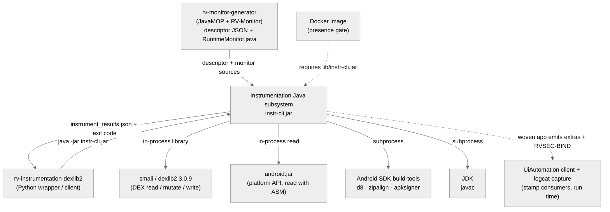
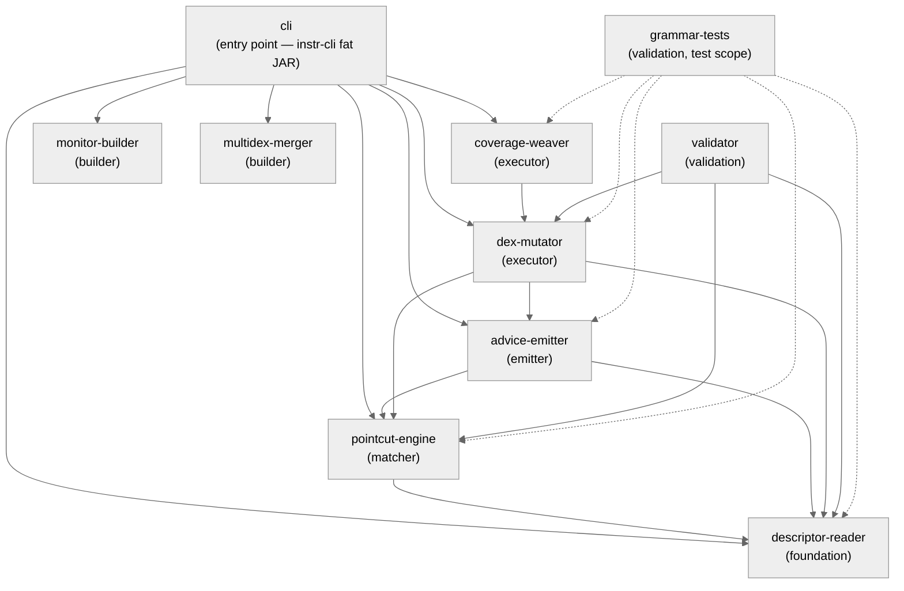
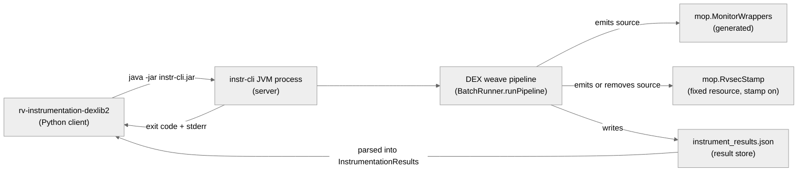
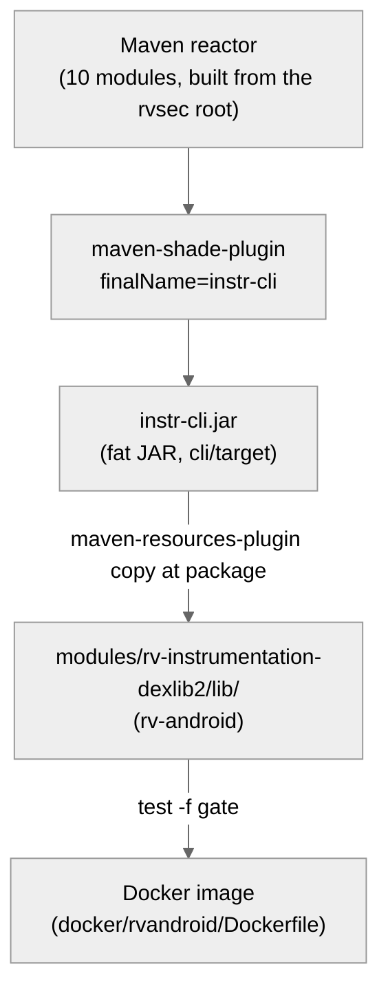

# Architecture — Instrumentation (Java/dexlib2 subsystem)

> Scope: **subsystem** · Generated by `rv-doc-arch` · Source model: `out/arch/subsystem-instrumentation-java/architecture-model.json`
> Languages: Java only — 10 Maven modules, ~15,200 lines of main Java (plus the 614-line `RvsecStamp.java` resource) and ~23,000 lines of tests.

## Table of Contents

- [Part I — Beyond Views](#part-i--beyond-views)
  - [1. Documentation overview](#1-documentation-overview)
  - [2. Conceptual primer](#2-conceptual-primer)
  - [3. System overview and context](#3-system-overview-and-context)
  - [4. How it works — end to end](#4-how-it-works--end-to-end)
  - [5. Core components](#5-core-components)
  - [6. Mapping between views](#6-mapping-between-views)
  - [7. Rationale](#7-rationale)
  - [8. Output artifacts](#8-output-artifacts)
  - [9. Directory](#9-directory)
- [Part II — Views](#part-ii--views)
  - [Module view](#module-view)
  - [Component-and-connector view](#component-and-connector-view)
  - [Allocation view](#allocation-view)
- [Appendices](#appendices)
- [Specification traceability](#specification-traceability)

---

## Part I — Beyond Views

### 1. Documentation overview

This document describes the **Java/Maven instrumentation engine** of RV-Android: the subsystem
that rewrites the bytecode of an Android APK so that runtime-verification monitors observe it.
It is the DEX-native instrumentation variant (`artifactId rvsec-instrumentation-dexlib2`,
version `0.9.5-SNAPSHOT`), shaded into one fat JAR, `instr-cli.jar`, and driven through a
picocli command line. The audience is a **new engineer with no prior exposure to this
subsystem**: read it top to bottom and you will know what it does, how one APK flows through
it, and why it is built this way.

The scope is the ten Maven modules under `../rvsec/rvsec-android/rvsec-instrumentation-dexlib2`
(paths in this document are relative to the rv-android root unless they name a module). The
Python wrapper that invokes the JAR (`modules/rv-instrumentation-dexlib2`) and the JavaMOP
monitor generator that produces its input are **external systems** here; the cross-language
view of the whole instrumentation stack is `docs/architecture/instrumentation.md`.

**How to read this document:** Part I builds your mental model — what the subsystem is
([primer](#2-conceptual-primer)), how it behaves end to end
([walkthrough](#4-how-it-works--end-to-end)), and why it is shaped this way
([rationale](#7-rationale)). Part II documents the selected views in detail.

### 2. Conceptual primer

This subsystem is the Java/Maven engine that rewrites the bytecode of a compiled Android APK so
that runtime-verification monitors observe the app. Given an APK and a JSON descriptor emitted
by JavaMOP that says, for example, "after a call to `javax.crypto.Cipher.getInstance(String)`
returns, fire the `CipherSpec` events with the transformation and the returned `Cipher`", it
edits the DEX bytecode inside the APK so those calls also notify the generated monitor,
compiles the monitor sources into extra DEX files, and repacks and re-signs the APK. It is a
Maven aggregator of ten modules, shaded into `instr-cli.jar` and driven through two picocli
subcommands, `instrument` and `batch`. Optionally it also rewrites `View` listener setters so
the running app records which handler class is bound to each clickable node — the *handler
stamp*, a GUI-exploration aid that is independent of the monitors.

**Why this approach.** The other RV-Android instrumentation variant, `rv-instrumentation-ajc`,
converts DEX to JVM bytecode with dex2jar, weaves AspectJ aspects with `ajc`, and converts back
with d8. That round trip is lossy: dex2jar mistranslates bytecode shapes common in Kotlin and
R8-optimized apps, which surfaces as `VerifyError` at boot, and the JVM detour discards the
app's own DEX layout. This engine never leaves DEX: it reads and writes the app's
`classes*.dex` with the smali/dexlib2 library, keeps each DEX in its slot and at its original
DEX format version, and adds monitor code only in new DEX slots. The price is that everything
`ajc` provided for free is implemented by hand at the register level — matching AspectJ
pointcuts against DEX instructions, allocating scratch registers under 4-bit operand fields,
routing after-advice through generated wrapper methods to avoid register aliasing,
synthesizing static initializers, and installing try/catch ranges for after-throwing and
after-finally semantics.

**Key concepts**

- **DEX** — The Dalvik Executable format Android runs. An APK holds `classes.dex`,
  `classes2.dex`, and so on; each file can reference at most 65,536 methods. DEX is
  register-based, and many instruction formats encode a register index in 4 bits, so only
  `v0..v15` are directly addressable by those forms.
- **dexlib2** — The smali project's library (`com.android.tools.smali:smali-dexlib2` 3.0.9)
  that reads, mutates and writes DEX. A method body is edited through a
  `MutableMethodImplementation` (MMI); `DexPool` serializes the result.
- **descriptor** — `MultiSpec_<N>MonitorAspect.json`, emitted by patched JavaMOP under
  `--emit-descriptor`. It is the only contract the engine reads (INV-INS-56): aspect name,
  imports, the `commonPointcut` with the class-level exclusions, the `baseAspectExclusions`
  package list, and one entry per advice with its position, pointcut expression,
  returning/throwing bindings and `monitorCalls` list. The textual `.aj` is never parsed.
- **pointcut / advice** — AspectJ vocabulary. A pointcut selects join points, e.g.
  `call(public static Cipher Cipher.getInstance(String)) && args(transformation)`; an advice is
  the code run there, before or after. Here an advice's body is the list of monitor event calls
  in its `monitorCalls`.
- **fused advice** — JavaMOP merges advices whose position and pointcut coincide, so one advice
  can carry several monitor calls (`CipherSpec_g1` fires `CipherSpec_g1Event` and
  `CipherSpec_g3Event`). Every emission path emits all of them, in descriptor order
  (INV-INS-104).
- **register aliasing** — An inline hook placed after a call must read the call's argument
  registers, but the `move-result` that follows the call may overwrite them. Reading them
  afterwards yields the wrong value and the verifier rejects the class. Routing the call through
  a wrapper avoids the problem.
- **wrapper** — A public static method of the generated class `mop.MonitorWrappers` that calls
  the original API, fires the monitor calls of every after-side advice bound to that call, and
  returns the result. The weaver swaps the call site's method reference for the wrapper's,
  keeping its registers. There is one wrapper per original call, merging all advices bound to it.
- **phase tag** — The `phase` field of each per-APK result in `instrument_results.json`:
  `signed`, `dex_only`, `build_only`, or a failure phase (`config_validation`, `apk_read`,
  `dex_write`, `io_error`, `uncaught`). It says how far the pipeline got.
- **handler stamp** — An opt-in rewrite (`--stamp-handlers`) that routes `View` listener
  setters and Compose node population to the fixed helper `mop.RvsecStamp`, which writes the
  bound handler class into the node's `AccessibilityNodeInfo` extras (`rvsec.click`,
  `rvsec.longClick`) and logs `RVSEC-BIND`. It adds no monitor event.

### 3. System overview and context

The engine sits between one producer, one caller, and a handful of libraries and tools.
Upstream, **rv-monitor-generator** (JavaMOP plus RV-Monitor) produces the descriptor
`MultiSpec_<N>MonitorAspect.json` and the monitor source `MultiSpec_<N>RuntimeMonitor.java`.
The caller is the **Python wrapper** `rv-instrumentation-dexlib2`, which builds the argument
list, runs `java -jar lib/instr-cli.jar`, parses the resulting `instrument_results.json` into
an `InstrumentationResults` model tagged `variant=dexlib2`, and records failures from the exit
code and stderr. Inside the JVM, the executor is built on **smali/dexlib2 3.0.9**, and the
**platform `android.jar`** is read with ASM to answer overload, hierarchy and class-existence
questions. Two toolchains run as subprocesses: the **JDK's `javac`** compiles the generated
and monitor Java sources, and the **Android SDK build-tools** supply `d8`, `zipalign` and
`apksigner`. The **Docker image** refuses to build when the JAR is missing. When the stamp is
on, the woven app produces node extras and `RVSEC-BIND` lines that a **UiAutomation client**
(APE-RV) and **rv-platform's logcat capture** consume at run time; the engine never talks to
them directly.

**Constraints:** woven APKs must install and verify on the device; the original multidex
partitioning must be kept exactly (INV-INS-52); the JSON descriptor, never the `.aj`, is the
only contract (INV-INS-56); register frames must stay verifier-valid under 4-bit operand
fields; an app DEX may not exceed 65,536 method references after weaving, and the engine does
not repartition app DEXes to make room.

**System context diagram** (external actors and systems — every view refers back to this):



### 4. How it works — end to end

The following walks through a concrete example: **instrumenting an app call to
`javax.crypto.Cipher.getInstance(String)` under the descriptor advice `CipherSpec_g1` (after
returning, `args(transformation)`, returning `c`, two fused monitor calls), ending in a signed
APK**, driven by
`java -jar instr-cli.jar batch <apks-dir> --descriptor MultiSpec_1MonitorAspect.json --monitor-src-dir <mop> --output <out> --keystore <ks>`.
The descriptor values quoted below come from the fixture
`../rvsec/rvsec-android/rvsec-instrumentation-dexlib2/descriptor-reader/src/test/resources/MultiSpec_1MonitorAspect.json`.

**Stage 1 — descriptor read.** `BatchRunner.runPipeline` first checks that a descriptor path
was given (otherwise the result is `phase=config_validation`) and calls
`DescriptorReader.read`, which deserializes the JSON with Jackson into an `AspectDescriptor`.
The descriptor-reader module holds only POJOs, so every later stage reads the same typed tree
and none re-parses JSON. The number of advices is recorded as the first counter. In the
fixture, advice `CipherSpec_g1` has position `after`, returning `[Cipher c]`, expression
`call(public static Cipher Cipher.getInstance(String)) && args(transformation)`, and two
monitor calls, `MultiSpec_1RuntimeMonitor.CipherSpec_g1Event(transformation, c)` and
`MultiSpec_1RuntimeMonitor.CipherSpec_g3Event(transformation, c)`. The `commonPointcut` is
`!within(com.runtimeverification.rvmonitor.java.rt.RVMObject+) && !adviceexecution() && BaseAspect.notwithin()`,
and `baseAspectExclusions` lists twelve package patterns (`sun..*`, `java..*`, `javax..*`, …).

**Stage 2 — type resolution and Android index.** Phase 2 opens an `AndroidClassIndex` over the
resolved `android.jar` (read with ASM, and released in a `finally` block on every exit, since a
batch runs many APKs in one JVM) and builds a `TypeResolver` from the descriptor imports plus
the index's class-existence lookup. Simple names resolve through the imports; a dotted nested
name such as `KeyStore.ProtectionParameter` is probed as written and then with dots replaced by
`$` from the right until the index knows the class (INV-INS-162). The resolver memoises every
answer (INV-INS-168). The resolved `android.jar` is printed per APK as
`[dexlib2] <apk>: android.jar = <path>`, because the flag, `ANDROID_HOME`, and the
highest-installed-platform default can disagree. In the example, `Cipher` resolves through the
import `javax.crypto.Cipher` to `Ljavax/crypto/Cipher;`, and `String` through the built-in
table to `Ljava/lang/String;`.

**Stage 3 — DEX extraction.** `extractDexes` opens the APK as a ZIP and reads every
`classes*.dex` entry into a `DexBackedDexFile`, keeping the entry name so the merger can put
the woven file back in the same slot, and sorting by name. Each DEX is opened with the
`Opcodes` of its own format version, parsed from the magic header, so `DexPool` later writes it
back at the same version; reading with the default opcodes would downgrade every output to
dex 035 and make the interface static and default methods of Kotlin/Compose apps illegal. The
highest input API across the DEXes is kept as `maxInputApi` for the monitor build. An APK with
`classes.dex` and `classes2.dex` yields two entries and `dexFiles=2`; an APK with no
`classes*.dex` fails with `phase=apk_read`.

**Stage 4 — wrapper generation and APK-wide inheritance.** `WrapperEmitter.generate` writes
`mop/MonitorWrappers.java` into the monitor source directory (or `<work-dir>/monitor-src` when
none is given). Every after-side advice that targets a non-constructor call is wrapped. Its
call pattern is expanded against `android.jar` into concrete overloads; an owner that does not
declare the method is climbed to the first ancestor that does (INV-INS-160), and a
trailing-varargs pattern admits only overloads whose fixed head matches position by position
(INV-INS-103). Advices are then grouped by the original call they wrap, so each call gets
exactly one wrapper that fires every advice bound to it in descriptor order (INV-INS-104). Three
more rules apply in the grouping loop: an advice whose positional `args()` arity cannot fit an
overload is left out of that overload's group and counted in `advicesExcludedByArity`
(INV-INS-159); `Owner+` advices grouped onto a supertype's method are merged into a subtype
owner's wrapper, because the call site on the subtype is replaced by that wrapper only
(INV-INS-160); and a group carrying a plain `after` advice guards the call with a catch-all
that fires the plain advices and rethrows (INV-INS-163):

```java
R result;
try { result = call(args); }
catch (Throwable t) { <plain after monitor calls>; throw t; }
<every advice's monitor calls>;
return result;
```

A wrapper-path advice whose target resolves to no method at all is counted in
`wrapperTargetsUnresolved`. For `CipherSpec_g1` the single overload is `getInstance(String)`,
the wrapper key is `Ljavax/crypto/Cipher;#getInstance(Ljava/lang/String;)Ljavax/crypto/Cipher;`,
and the wrapper `javax_crypto_Cipher_getInstance` calls `javax.crypto.Cipher.getInstance(p0)`
into `result`, then `CipherSpec_g1Event(p0, result)` and `CipherSpec_g3Event(p0, result)`, and
returns `result`. `BatchRunner` then builds one `InheritanceResolver` over every DEX of the APK
plus `android.jar`, and `DexWeaver.expandWrapperReplacementsForApk` adds lookup keys for
app-defined subtypes of each instance wrapper's owner, wherever in the APK those subtypes are
declared.

**Stage 5 — advice weave (per DEX).** `DexWeaver.weave` clears its parse memo, parses the
`commonPointcut` once — an unparseable one fails the weave with
`UnsupportedAspectConstructError` rather than silently dropping the class-level exclusions —
and runs the `staticinitialization` pre-pass. It then walks `ClassDef × Method × Instruction`.
Because the `commonPointcut` reads only the class, it is evaluated once per class and a rejected
class is skipped whole; each advice expression is parsed once per weave and its composition with
the `commonPointcut` is built once per class (INV-INS-168). **Pass 1** rewrites every invoke
whose method reference matches a wrapper key through `InstructionInjector.replaceInvoke`, which
keeps the register list and the code size. A virtual or interface invoke on a framework type
with no exact key is routed by `resolveSubtypeAlias` to the most specific registered wrapper
whose owner it is assignable to, or left unwoven and counted in `wrapperAliasesUnmerged` when no
single most specific owner exists. **Pass 2** walks right to left over the remaining
instructions, so insertions only shift indices already visited; it matches each advice with
`PointcutMatcher` and turns a match into an `EmitPlan` through the emitter `EmitterDispatch`
selects. In the example, `invoke-static {v2}, Ljavax/crypto/Cipher;->getInstance(Ljava/lang/String;)Ljavax/crypto/Cipher;`
becomes `invoke-static {v2}, Lmop/MonitorWrappers;->javax_crypto_Cipher_getInstance(Ljava/lang/String;)Ljavax/crypto/Cipher;`;
the following `move-result-object` is untouched, pass 2 skips the index, and
`wrappersSubstituted` increases by one. A later `Cipher.init(int, Key, …)` in the same method is
matched in pass 2 by the before advice `CipherSpec_i2`.

**Stage 6 — register allocation and injection (inline path).** For an inline plan — a before
advice, an after on a constructor, an after-throwing range, or a static-initializer delivery —
`RegisterAllocator.allocate` grows the frame through `RegisterShifter.bumpRegisterCount`, which
builds a new MMI because dexlib2's `registerCount` is private and final, re-homing every label
and try block, and returns the new slots as scratch. The weaver swaps in the new MMI and calls
the supplier's `replaceImpl` *before* applying the plan, otherwise serialization would read the
stale body (INV-INS-87). `InstructionInjector` then inserts the monitor invokes. For BEFORE it
moves the branch and switch targets and the line-number items that pointed at the call onto the
first inserted instruction, so no control path skips the monitor (INV-INS-161). A plain `after`
on a constructor gets the normal-path calls after the invoke plus a `java.lang.Throwable`
handler over the invoke alone that repeats the calls with the same bound registers and rethrows
(INV-INS-163). Bindings that cannot be encoded or resolved make the emitter throw, and the
weaver counts the skip. For `CipherSpec_i2`, `MonitorInvokeBuilder` emits one `invoke-static`
of `MultiSpec_1RuntimeMonitor.CipherSpec_i2Event` with the mode, key and receiver registers from
the `Match` bindings, in Format35c when all are at most `v15` and Format3rc when they form a
contiguous range; otherwise `plansSkippedHighRegister` increases.

**Stage 6′ — handler stamp (optional).** The `Cipher` example does not reach this stage. Only
when the stamp option resolves to on, a `StampWeaver` built over the same `InheritanceResolver`
runs after the advice weave of each DEX and before its coverage weave, over the same cached
bodies. It rewrites `invoke-virtual` sites of the three `View` setters to `invoke-static` of the
same-named `mop.RvsecStamp` helper (same registers, same size), and inserts a `composeNode` call
after each call of Compose's private node-population method. Running after the advice weave
means an advice on a setter still sees the framework call. For instance,
`invoke-virtual {v10, v11}, Landroid/widget/Button;->setOnClickListener(Landroid/view/View$OnClickListener;)V`
becomes
`invoke-static {v10, v11}, Lmop/RvsecStamp;->setOnClickListener(Landroid/view/View;Landroid/view/View$OnClickListener;)V`
and `stampClickSites` increases.

**Stage 7 — coverage weave and serialization.** When coverage is on (the default),
`CoverageWeaver` prepends a `const-string` with the precomputed Soot-style signature and
`invoke-static Lmop/Coverage;->log(Ljava/lang/String;)V` to every method of a class
`PackageFilter` does not exclude. It uses `v0` directly when the method has a local register,
and spills one low register through `RegisterShifter.spillLowRegisters` when every register is a
parameter. Each DEX is then written by `DexPool.writeTo` to `<work-dir>/woven_<entry>`. A DEX
that no longer fits the format — typically because the added references push it past 65,536
method ids — throws there and becomes `phase=dex_write` with the entry named in the message. In
the example, `woven_classes.dex` and `woven_classes2.dex` are written and `wovenDexes=2`.

**Stage 8 — monitor build (optional).** The build runs only when `--monitor-src-dir` is set and
`javac`, `d8` and the JDK runtime path all resolved; otherwise the result is `phase=dex_only`.
`CoverageSourceEmitter` writes `mop/Coverage.java`; `StampSourceEmitter` either writes
`mop/RvsecStamp.java` (stamp on) or deletes it and its compiled classes (stamp off), because the
source and class directories are shared across a batch and across runs. `MonitorBuilder`
compiles every `.java` in the source directory with `javac -source 1.8 -target 1.8` against
`android.jar` and the runtime jars, then runs `d8 --min-api <maxInputApi>` with the runtime jars
as extra inputs, so the monitor DEX matches the app DEX version and carries the runtime classes.
A non-zero exit becomes a `CommandException` tagged `javac` or `d8`. The example produces
`<work-dir>/monitor-build/dex/classes.dex` (more files when the monitor exceeds the method-id
limit) and `monitorDexes=1`.

**Stage 9 — merge and sign (optional).** The merge runs only when `apksigner`, `zipalign` and a
keystore resolved and `--output` is set; otherwise the result is `phase=build_only`.
`MultidexMerger.merge` rewrites the ZIP: woven DEXes replace their originals in place, every
other entry is copied with its original storage method (so `resources.arsc` stays STORED, as
API 30+ installs require), and each monitor DEX goes into the next free `classes<N>.dex` slot.
It then runs `zipalign -p 4` and `apksigner sign`. With app DEXes `classes.dex` and
`classes2.dex`, the monitor DEX lands as `classes3.dex`, the signed APK is `<out>/<apkName>`,
and the result is `phase=signed, success=true`. The results document is written before the
process exits, and the exit code is 0 only when every APK was signed.

**On the device — what a stamped APK does.** In an APK woven with the stamp, a routed setter
reaches `mop.RvsecStamp`. Each setter helper first makes the original call once, by virtual
dispatch and outside any `try`, so an app override still runs and its exceptions reach the app
unchanged; only then does it update the stamp inside `catch (Throwable)` (INV-INS-177). The
stamp is a chaining `View.AccessibilityDelegate` that forwards the ten delegate callbacks to the
app's delegate (readable from API 29) or the platform default, and writes the class name of the
last non-null listener into `rvsec.click` / `rvsec.longClick` (INV-INS-178). For a Compose node,
`composeNode` resolves the handler by reflection in two steps. *Node step:* the owner is the
action lambda's `this$0`, or its `f$0` when that value is an
`androidx.compose.foundation.AbstractClickableNode`; the handler is the owner's `onClick`,
`onLongClick` or, for a `ToggleableNode`, `onValueChange`, else the lambda itself. *Material
step:* a handler in `androidx.compose.material*` that declares exactly one non-static field
typed `kotlin.jvm.functions.Function*` is read through once, and the captured value is stamped
when its class is outside `androidx.`. Every change writes one logcat line at level `I` under
`RVSEC-BIND` (INV-INS-179). The stamp names the listener object's class, which bounds what a
reader may infer: an AppCompat XML `android:onClick` stamps `AppCompatViewInflater$DeclaredOnClickListener`;
toolbars, menus, AppCompat `AlertDialog` buttons and androidx `Preference` rows stamp the
library's dispatcher; framework `android.app.AlertDialog` and `android.preference` code is not
in the APK and is not stamped; and an app whose Compose internals R8 renamed gets
`stampComposeSites=0`. The module's own `CLAUDE.md` lists the remaining known limits.

### 5. Core components

A reader of the live system meets five runtime elements. The **instr-cli JVM process** is what
the Python `DexlibInstrumentation` wrapper starts as `java -jar instr-cli.jar <instrument|batch> …`,
with a fixed environment and no wall-clock timeout. On the rv-experiment path it runs
`instrument` once per APK, each with its own `--results-json` file; `batch` runs one JVM over
every `.apk` directly under a directory, in name order. The process resolves its configuration,
runs `BatchRunner.runPipeline` per APK, writes the results document, prints a one-line summary,
and exits 0 only when every APK was signed. There is no daemon and no state shared between
invocations, apart from the monitor source and work directories the caller chooses to reuse.

Inside the process, the **DEX weave pipeline** is `runPipeline`. It threads one
`AspectDescriptor`, one `TypeResolver`, one `AndroidClassIndex` and one APK-wide
`InheritanceResolver` through the per-DEX loop. For each DEX it creates a `DexFileMutator`,
wires its `forMethod`, `replaceImpl` and `addSynthesizedMethod` into the weaver's supplier, runs
the advice weave, the optional stamp pass and the optional coverage weave over the same cached
bodies, and serializes. It then stops at the first optional phase whose configuration is
missing. Its counters, accumulated in insertion order, are the observable record of what was
woven and what was declined.

**`mop.MonitorWrappers`** is generated by `WrapperEmitter` at weave time and compiled into the
monitor DEX. Each wrapper takes the receiver as its first parameter for instance calls, calls
the original method, fires the monitor calls of every advice grouped onto that call in
descriptor order (inside a catch-and-rethrow when a plain `after` advice is present), and
returns the result. Because the call site keeps its register list and its `move-result`, the
caller's frame is unchanged; this is why after-side advice on non-constructor calls needs no
inline injection. An empty class is emitted when nothing is wrapped, so the build compiles
uniformly.

**`instrument_results.json`** is the cross-language result contract. `BatchRunner` writes
`{variant: dexlib2, results: [PerApkResult…]}`; `instrument` writes a one-element array, so the
Python side parses both subcommands the same way. Each `PerApkResult` has `apkName`, `success`,
`message` (on failure, the cause chain down to the innermost exception, at most ten links),
`phase` and `weaveCounts`. The file is written for every processed APK, successful or not
(INV-INS-105), so an absent file means the JVM died. The Python wrapper parses it into
`InstrumentationResults` with `variant=dexlib2` (INV-INS-55) and re-checks each claimed success
against the output directory.

**`mop.RvsecStamp`** exists only when the stamp is on. It is a fixed Java source shipped as a
monitor-builder classpath resource, compiled into the monitor DEX next to the wrappers and
`mop.Coverage`; its run-time behaviour is described under *On the device* above.

| Component | Realized by | Responsibility |
|-----------|-------------|----------------|
| instr-cli JVM process | `InstrumentationCli`, `BatchRunner` (cli) | Short-lived JVM per `java -jar`; runs the pipeline for one APK or a directory and exits with 0 only when all APKs are signed. |
| DEX weave pipeline | `BatchRunner.runPipeline`, `DexWeaver`, `StampWeaver`, `CoverageWeaver`, `MonitorBuilder`, `MultidexMerger` | Six phases from APK and descriptor to woven DEXes, and optionally to a signed APK. |
| `mop.MonitorWrappers` (generated) | `WrapperEmitter` (advice-emitter) | One static wrapper per original call, firing every after-side advice bound to it. |
| `instrument_results.json` | `BatchRunner.writeResultsJson`, `BatchRunner.PerApkResult` | Per-APK `phase`, `success`, `message` and `weaveCounts`; written for every APK. |
| `mop.RvsecStamp` (stamp on only) | resource `RvsecStamp.java` + `StampSourceEmitter` (monitor-builder); call sites by `StampWeaver` | Original setter call, chaining stamp delegate, node extras, `RVSEC-BIND` log. |

### 6. Mapping between views

The module view and the component-and-connector view describe the same artifact at two
altitudes, and the install view explains how that artifact physically reaches its caller. The
`cli` module realizes the *instr-cli JVM process* (`InstrumentationCli`, `ConfigResolver`,
`BatchRunner`) and the *`instrument_results.json`* store (`BatchRunner.writeResultsJson`). The
*DEX weave pipeline* is realized by `cli` orchestrating the libraries below it: dex-mutator
(`DexWeaver`, `StampWeaver`, `InstructionInjector`, `RegisterShifter`), coverage-weaver
(`CoverageWeaver`), monitor-builder (`MonitorBuilder`) and multidex-merger (`MultidexMerger`),
which in turn use advice-emitter, pointcut-engine and descriptor-reader. advice-emitter
realizes the generated *`mop.MonitorWrappers`* source; monitor-builder realizes
*`mop.RvsecStamp`* from its resource and compiles all three generated sources. The validator
and grammar-tests modules realize no runtime component: they are verification tooling.

One boundary crosses both a language and a process: the Python `rv-instrumentation-dexlib2`
module depends on the instr-cli process through
`java -jar lib/instr-cli.jar {instrument|batch} … --results-json <file>`. What crosses it is argv
in one direction — the descriptor path, `android.jar`, tool paths, keystore and passwords, the
narrowed `--classpath` of runtime jars, output and work directories, `--coverage`, and
`--stamp-handlers` when the caller's configuration asks for the stamp (the wrapper never relies
on `RVSEC_STAMP_HANDLERS`, INV-INS-180) — and, in the other direction, `instrument_results.json`,
the exit code and stderr. Three further dependencies leave the JVM's own code: dex-mutator uses
the in-process smali/dexlib2 library, monitor-builder runs `javac` and `d8`, and
multidex-merger runs `zipalign` and `apksigner`. The install view closes the loop: the shaded
`instr-cli.jar` is copied into `modules/rv-instrumentation-dexlib2/lib` at Maven `package`, which
is where the wrapper resolves it.

### 7. Rationale

The decisions that shaped this architecture, each with the tension behind it and the failure
mode it avoids.

**DEX-native weaving instead of dex2jar + ajc + d8 (INV-INS-52).** The `ajc` variant converts
every DEX to JVM bytecode and back, and the conversion is lossy on shapes Kotlin and R8 produce;
that is structural, not a bug to patch. Editing DEX directly keeps the app's partitioning
(INV-INS-52) and, since each DEX is opened with the `Opcodes` of its own magic version and the
monitor DEX is built with `d8 --min-api` at the highest input API, its format version too;
downgrading to dex 035 would make interface static and default methods illegal and crash Compose
apps at run time. The cost is that register management, try tables and static initializers are
implemented by hand, and that cost is confined to dex-mutator.

**Every after-side advice goes through one merged wrapper per original call (INV-INS-104).** An
inline hook after a call reads argument registers that the `move-result` may already have
overwritten, which the verifier rejects. A wrapper calls the original and fires the events in
its own frame while the call site keeps its registers, so the caller's frame is untouched.
Because a call site carries only its own method reference, the registry can hold one wrapper
per call; emitting a wrapper per advice made later registrations overwrite earlier ones and
silently lose monitor events. `WrapperEmitter` therefore groups advices by call and merges them,
and `DexWeaver.registerWrapper` throws `IllegalStateException` if two wrappers ever claim one
key. Inline AFTER remains only for constructor invokes, which return void and have no
`move-result`.

**Frame growth by MMI clone with mandatory supplier notification (INV-INS-80, INV-INS-87).**
dexlib2 offers no way to change a method's register count, and a reflective write is not seen
by the `DexPool` writer. `RegisterShifter.bumpRegisterCount` builds a new MMI of the larger size
and copies every instruction, label and try block. Two failure modes shape the rule: a shift can
overflow a 4-bit field mid-method, so `spillLowRegisters` clones before shifting and leaves the
source untouched if it throws; and `DexFileMutator` would otherwise keep serving the
pre-growth body, so the weaver calls `replaceImpl` before applying the plan. Without either, an
instrumented method would fail verification on every entry or lose its injected code.

**Decide once what does not change within a weave (INV-INS-168).** The matcher is asked about
every advice at every instruction of every method. The `commonPointcut` reads only the class, so
when its tree holds only class-level clauses `DexWeaver` evaluates it once per class and skips
rejected classes whole (`getCommonAstEvals` exposes the count for a non-regression test);
otherwise it falls back to per-instruction composition. Each advice expression is parsed once
per weave (a rejected one is memoised as null), its composition with the `commonPointcut` is
built once per class, and `TypeResolver` memoises every name. INV-INS-168 requires the memoised
weave to produce byte-identical DEX files and equal counters.

**Fail loud where silence would mis-weave; count where a skip is safe.** When dropping something
would weave sites the specification meant to exclude or gate, the weave stops: an unparseable
`commonPointcut` or an `if()` shape outside the two supported ones raises
`UnsupportedAspectConstructError` (INV-INS-98), and a `BaseAspect.notwithin()` without
exclusions or any other unresolvable named reference raises `LegacyDescriptorException` or
`UnresolvedNamedRefException`; the APK then fails with `phase=uncaught` and the expression in
the message. When a single site cannot be woven safely, it is skipped and counted:
`plansSkippedHighRegister`, `plansSkippedUnresolvedBinding` (INV-INS-71), `plansSkippedAliasing`,
`constructorInlineSkippedAliasing`, `wrapperAliasesUnmerged`, `wrapperTargetsUnresolved`,
`advicesExcludedByArity`, `coverageSpillFailed`. The distinction is whether the omission could
add instrumentation the specification did not ask for (abort) or only withhold one site
(count).

**Phase-tagged results, always written, with an exit code that means "APK produced" (INV-INS-55,
INV-INS-105).** Instrumentation runs over many APKs, and one malformed APK or one missing tool
path must not abort the rest or erase the evidence. `runPipeline` catches `IOException` and
`RuntimeException` and returns a result tagged with the phase reached, carrying the counters
accumulated so far and the full cause chain, with the stack trace on stderr; dexlib2's
`ExceptionWithContext` keeps the real cause only in `getCause()`, which is why the chain is
walked. The results document is written before the process exits. The exit code is 1 for
`dex_only` and `build_only` as well, because no installable APK exists; the phase tag is what
tells a withheld flag from a broken weave.

**Handler stamp as a separate, opt-in pass with a fixed helper in the monitor DEX
(INV-INS-174..180).** The GUI explorer keys widgets by resource id, which many clickable nodes
and all Compose virtual nodes lack; recording the handler class on the real node at run time
gives it another key. The pass is its own class rather than an entry in the wrapper registry,
because the registry is keyed to the descriptor and gated by its `commonPointcut`; mixing the
two would make the stamp depend on the specifications and change the MOP weave. It runs after
the advice weave and before coverage; its helper is a fixed source compiled with the monitors,
which keeps helper code out of the app DEXes and their method-id budget; and when off, every
woven DEX and the monitor DEX are byte-identical to the output without the stamp code, no stamp
counter is written, and any helper an earlier run left in the shared directories is removed.

**Decisions at a glance**

| Decision | Drivers | Invariant / ADR |
|----------|---------|-----------------|
| DEX-native weaving, each DEX kept in its slot and version | bytecode fidelity on Kotlin/R8 apps, multidex preservation | INV-INS-52 |
| One merged wrapper per original call for every after-side advice | register aliasing; one wrapper per call site; emission cardinality | INV-INS-104 (INV-INS-66, INV-INS-68 in archived changes) |
| Frame growth by MMI clone + supplier notification | `registerCount` private final; atomic spill; serialization must see growth | INV-INS-80, INV-INS-87 (archived changes) |
| Decide once what does not change within a weave | weave cost on large APKs; byte-identical output | INV-INS-168 |
| Fail loud where silence would mis-weave; count safe skips | no silent over-instrumentation; every declined site has a number | INV-INS-71, INV-INS-98; requirement "Fail-Closed Pointcut Parsing" |
| Phase-tagged results, always written, exit 0 only when signed | batch resilience; post-mortem evidence | INV-INS-55, INV-INS-105 |
| Handler stamp as a separate opt-in pass | resource-id-free node key; MOP weave unchanged; off byte-identical | INV-INS-174..180 |

**Patterns and styles**

At the **module** level the subsystem is **layered** (high confidence): `descriptor-reader` ←
`pointcut-engine` ← `advice-emitter` ← `dex-mutator` ← `coverage-weaver`, with `cli` on top and
`validator` / `grammar-tests` beside, and the pom dependencies form a DAG with no upward edge.
It is also a clean **decomposition** (high): one aggregator pom with ten child modules, each
owning one stage or concern. At the **component-and-connector** level the runtime is
**pipe-and-filter** (high): `runPipeline` passes one APK through descriptor read, type
resolution, DEX extraction, weave and serialization, `javac`/`d8`, and repack/sign, each phase
consuming the previous one's output and the run able to stop at any optional boundary. Over it
sits a **client-server** relation (medium): the Python wrapper is the client and the instr-cli
JVM the server, with argv as request and the results document plus exit code as response. At
the **allocation** level the **install** style (high) is the shaded JAR copied into the Python
module's `lib/`, and the **deployment** style (medium) is the Docker image build that fails
without it.

**NFRs served**

*Compatibility (NFR07).* Instrumented APKs must install and run on the device. `RegisterShifter`
widens 4-bit forms and grows frames by clone so woven methods keep a verifier-valid frame;
wrappers keep caller registers unchanged; the inserted before-block inherits branch targets and
line entries so control flow and stack traces stay coherent; each DEX keeps its format version
and the monitor DEX is built at the same API level; `MultidexMerger` keeps `resources.arsc` and
other STORED entries uncompressed and the DEX partitioning intact; and the validator's Layer 2
installs and launches APKs and scans for `VerifyError`.

*Configurability (NFR05).* Every external dependency is an option with a fallback:
`ConfigResolver` resolves flag, then environment variable, then a default derived from
`ANDROID_HOME` or `JAVA_HOME`. All options are `INHERIT`-scoped, so `instrument` and `batch`
take the same flags. Optional phases degrade by configuration: without the builder tools or
`--monitor-src-dir` the run ends at `dex_only`, without signing tools or `--output` at
`build_only`. `--coverage` (default on) and `--stamp-handlers` (default off;
`RVSEC_STAMP_HANDLERS=true` as fallback; `--no-stamp-handlers` wins) select the two optional
weaves.

*Observability (NFR06).* `weaveCounts` records what was read (`advices`, `dexFiles`,
`maxInputApi`, `classesSeen`, `methodsSeen`), what was produced (`wrappersGenerated`,
`matchesApplied`, `wrappersSubstituted`, `wrappersAliasedToSubtype`, `constructorInlineApplied`,
`coverageInstrumented`, `wovenDexes`, `monitorDexes`) and every place a match was declined
(`plansSkipped`, `plansSkippedAliasing`, `plansSkippedHighRegister`,
`plansSkippedUnresolvedBinding`, `constructorInlineSkippedAliasing`, `wrapperAliasesUnmerged`,
`wrapperTargetsUnresolved`, `advicesExcludedByArity`, `coverageSpillFailed`).
`advicesExcludedByArity` and `wrapperTargetsUnresolved` are always written, so `0` means none;
the six `stamp*` counters appear only when the stamp is on. Failures carry the cause chain, the
`android.jar` in use is logged per APK, unwoven subtype aliases and skipped bindings are logged
to stderr, and on the device every stamp change writes an `RVSEC-BIND` line.

*Testability (NFR03).* The matcher / emitter / mutator split makes each stage testable on its
own: a `Match` and an `EmitPlan` are plain data, and `MutableImplSupplier` has default no-op
methods so test suppliers need no frame-growth wiring. grammar-tests ties every AspectJ construct
row of the coverage matrix to a passing test and fails the build on orphans; the validator adds
layered equivalence gates against the `ajc` variant, with oracles admitted only from an
independent weaver's recordings.

*Resilience (NFR04).* A per-APK exception becomes a phase-tagged result and the batch continues;
a site that cannot be woven safely is skipped and counted; a spill that cannot be widened vetoes
one method and leaves the cached body intact; an advice expression that does not parse is
skipped and counted. On the device, the stamp helper catches every `Throwable` of its own logic
after the app's setter has run.

*Reproducibility (NFR08).* Output is a deterministic function of the APK, the descriptor and the
`android.jar`: APKs and DEX entries are processed in name order, advices in descriptor order,
and the memoised weave is required to be byte-identical to the unmemoised one (INV-INS-168).
With the stamp off, every woven DEX and the monitor DEX are byte-identical to the output without
the stamp code (INV-INS-174).

| NFR | PRD ID | Architectural support |
|-----|--------|-----------------------|
| Compatibility | NFR07 | `RegisterShifter`; wrappers; `insertBefore` target move; DEX version preserved; STORED entries kept; `BootValidator` |
| Configurability | NFR05 | `ConfigResolver` flag → env → default; `INHERIT` options; `canBuild` / `canMerge`; `--coverage`, `--stamp-handlers` |
| Observability | NFR06 | `weaveCounts` (read / produced / declined); cause chain; `RVSEC-BIND` |
| Testability | NFR03 | plain-data plans and matches; grammar-tests; validator layers |
| Resilience | NFR04 | phase-tagged results; counted skips; atomic spill; stamp helper catches its own failures |
| Reproducibility | NFR08 | name and descriptor ordering; INV-INS-168; INV-INS-174 |

### 8. Output artifacts

The pipeline produces a graded set of artifacts depending on how far it runs. The signed APK is
the deliverable; the woven and monitor DEXes and the generated sources are inputs to later
phases and the terminal artifacts of `dex_only` and `build_only`; the results document is
written whatever the outcome.

| Artifact | Location | Notes |
|----------|----------|-------|
| instrumented and signed APK | `<output>/<apkName>` | `phase=signed` only |
| woven DEX files | `<work-dir>/woven_classes<N>.dex` | written when the weave succeeds; terminal artifact of `dex_only` |
| monitor DEX files | `<work-dir>/monitor-build/dex/` | monitor, `MonitorWrappers`, `Coverage`, runtime-jar classes, and `RvsecStamp` when the stamp is on; terminal artifact of `build_only` |
| generated sources `mop/MonitorWrappers.java`, `mop/Coverage.java`, `mop/RvsecStamp.java` | `<monitor-src-dir>` (wrappers fall back to `<work-dir>/monitor-src`) | `Coverage` only with coverage on and a build; `RvsecStamp` only with the stamp on, removed otherwise |
| `instrument_results.json` | the `--results-json` path | `{variant, results:[{apkName, success, message, phase, weaveCounts}]}`; written for every processed APK |
| console and stderr | process streams | per-APK `android.jar` line, result line or batch summary, stack traces, skip and alias warnings |
| node extras `rvsec.click` / `rvsec.longClick`, `RVSEC-BIND` lines | on the device, when a stamped APK runs | produced by the woven app, not by the engine |

### 9. Directory

**Glossary / acronyms**

- **DEX** — Dalvik Executable bytecode; register-based, 4-bit operand fields in many formats.
- **MMI** — `MutableMethodImplementation`, dexlib2's mutable method body.
- **PCD** — Pointcut designator; an AspectJ pointcut node kind (`call`, `execution`, `within`, …).
- **CPS** — Continuation-passing style; the shape Kotlin coroutines compile to (see `CpsDetector`).
- **ajc** — the AspectJ compiler, used by the `rv-instrumentation-ajc` variant.
- **fused advice** — one descriptor advice carrying several monitor calls.
- **wrapper group** — the advices bound to one original call, emitted as one wrapper.
- **phase tag** — the `phase` of a `PerApkResult`.
- **handler stamp / `RVSEC-BIND`** — the opt-in node-extras rewrite and its logcat tag.
- **TOST** — Two One-Sided Tests; the non-inferiority test of validator Layer 4.
- **F1 / kappa** — per-specification agreement metrics of validator Layer 3.

**References**

- SDD spec: `openspec/specs/instrumentation/spec.md` (domain `instrumentation`).
- Cross-language instrumentation architecture: `docs/architecture/instrumentation.md`.
- Module guide and stamp limits: `../rvsec/rvsec-android/rvsec-instrumentation-dexlib2/CLAUDE.md`.
- AspectJ grammar coverage matrix (live contract, enforced by grammar-tests):
  `docs/aspectj_grammar_coverage.md`; unsupported constructs: `docs/LIMITATIONS.md`.
- Python wrapper: `modules/rv-instrumentation-dexlib2`.
- PRD: `docs/PRD.md`.

---

## Part II — Views

### Module view

*Style(s): layered, decomposition*

This view shows the static structure a maintainer must respect: the foundation → matcher →
emitter → executor → entry-point tiers and the acyclic Maven dependency graph. The **layered**
style explains why the arrows point the way they do — each tier depends only on tiers below it.
The **decomposition** style explains what each of the ten child modules owns. Together they
answer "where does my change go, and what may it depend on".

**Primary presentation**



Solid arrows are compile-scope Maven dependencies; dotted arrows are test-scope dependencies.

**Element catalog**

The **descriptor-reader** is the foundation. `DescriptorReader.read` accepts a `File`, `Path`,
`InputStream` or JSON string and deserializes it with Jackson into an `AspectDescriptor`: aspect
name, short name, package, imports, the `commonPointcut` string, the `baseAspectExclusions` list
and the advices. Each `AdviceDescriptor` carries its name, spec name, parameters, position,
returning and throwing bindings, raw pointcut expression and an ordered list of
`MonitorCallDescriptor`. A malformed document raises `DescriptorParseError`. The POJOs carry no
DEX type and no pointcut logic. The module is separate because the descriptor is the contract
with rv-monitor-generator (INV-INS-56): with its model at the bottom of the graph, every consumer
shares one shape and none can couple to the raw JSON or reach the `.aj`. *Gotchas:* the
`commonPointcut` is a separate field whose class-level exclusions no advice expression repeats,
so the weaver must apply it; `monitorCalls` is an ordered list and every entry is emitted
(INV-INS-104); and the validator's `parity` subcommand checks the JSON and the `.aj` agree on
advice count, aspect name and package.

The **pointcut-engine** is the matcher. `PointcutExpressionParser` turns an expression into an
immutable AST (`CallPC`, `ExecutionPC`, `StaticInitPC`, `WithinPC`, `NotWithinPC`, `ArgsPC`,
`TargetPC`, `IfPC`, `NamedRefPC`, `NegationPC`, combined by `CombinedPC`). `PointcutMatcher`
evaluates it against a `(ClassDef, Method, Instruction, index)` tuple and returns a `Match` with
argument and target register bindings; for a non-constructor call it peeks at the next
instruction and records a `move-result` destination under `$return` (INV-INS-72), and for a
constructor it fixes the receiver and argument offsets (INV-INS-70). `args()` constrains the
call's arity in every form, from `ArgsPC.types()`, which keeps a trailing `..` (INV-INS-159).
`BaseAspectExpander` expands `BaseAspect.notwithin()` into one `NotWithinPC` per
`baseAspectExclusions` entry; an empty list raises `LegacyDescriptorException`, and any other
unresolvable named reference raises `UnresolvedNamedRefException`. `TypeResolver` maps names to
DEX descriptors through the imports, a built-in table and the class-existence lookup, memoising
every answer. `AndroidClassIndex` reads `android.jar` with ASM and answers overloads, class
existence (`exists`), inherited methods (`methodsInHierarchy`, INV-INS-160) and assignability;
`InheritanceResolver` combines it with the hierarchy of every DEX of the APK. `CpsDetector`
recognises Kotlin coroutine state machines. The module is separate because pointcut semantics do
not depend on how a hook is emitted, which is what makes per-construct grammar tests possible
without building DEX output. *Gotchas:* `IfPC` and `NamedRefPC` are true at match time — the
`if()` guard is realized later by `IfGuardEmitter`; `target(o)` only collects the receiver while
`target(Cipher)` constrains its type; `AndroidClassIndex` holds the `android.jar` ZIP open and
must be closed; and `BatchRunner` gives `TypeResolver` the `android.jar` index's lookup only, so
nested-type resolution sees framework classes.

The **advice-emitter** is the emitter. `EmitterDispatch.select` chooses an emitter: a
`staticinitialization(` expression wins, `around` is rejected, then position plus
returning/throwing select `BeforeEmitter`, `AfterEmitter`, `AfterReturningEmitter` or
`AfterThrowingEmitter`, and an `if(` in the expression wraps the choice in `IfGuardEmitter`. An
emitter turns an `EmitContext` into an `EmitPlan`: instructions to insert, a scratch-register
request, an `InsertionPoint` (BEFORE, AFTER, METHOD_ENTRY, TRY_CATCH_WRAP, REPLACE) and an
optional guard or try-catch spec. `MonitorInvokeBuilder` builds one `invoke-static` per monitor
call of the advice, in descriptor order, choosing Format35c or Format3rc, and throws
`HighRegisterNonContiguous` or `UnresolvedBindingException` when it cannot; an unresolvable
binding in any call skips the whole advice, because emitting half a fused advice would drive the
monitor through a transition its companion event never accompanied. `WrapperEmitter` generates
`mop/MonitorWrappers.java` as described in [Stage 4](#4-how-it-works--end-to-end). The module is
separate because it decides *what* to inject while dex-mutator decides *where* and *how*; an
`EmitPlan` is plain data. *Gotchas:* there is no literal `v0` fallback for an unresolved binding
(INV-INS-71); wrapper names are `<declaring_fqn_with_underscores>_<method>` with a numeric suffix
for further overloads; and `IfGuardEmitter` lowers exactly `<bound> == null` and
`!Thread.holdsLock(<bound>)` — any other shape throws `UnsupportedAspectConstructError` and fails
the APK.

The **dex-mutator** is the executor. `DexWeaver.weave` runs the static-initialization pre-pass
(synthesizing a `<clinit>` through `StaticInitSynthesizer` when a matched class has none, or
prepending into the existing one after spilling two low registers), then the per-class gate,
pass 1 and pass 2, and returns a `WeaveReport`. `RegisterShifter` is the register-level core:
`bumpRegisterCount` clones an MMI into a larger frame, re-homing labels and try blocks;
`spillLowRegisters` clones first and then shifts every register reference up, widening 4-bit
forms to `/from16` variants, so the low registers become free while parameters stay at the top
of the frame — a format that cannot be widened throws and the source MMI is left untouched
(INV-INS-80). `RegisterAllocator` grows the frame with `bumpRegisterCount` and returns the new
slots. `InstructionInjector` inserts before, after and at method entry, installs guards and
try/catch ranges (rebuilding the MMI for range splitting) and replaces invoke references.
`DexFileMutator` caches mutable bodies per DEX, accepts replacements and synthesized methods, and
rewrites the `DexFile` for serialization. `StampWeaver` is the independent handler-stamp pass,
returning a `StampReport` of six counts. The module is separate as the pure executor: every DEX
format hazard — register widths, labels, try tables, frame growth — is concentrated here.
*Gotchas:* every frame growth returns a new MMI and the caller MUST call `replaceImpl` before
applying the plan (INV-INS-87); an inline AFTER on a non-constructor invoke is skipped and
counted in `plansSkippedAliasing`; the after-finally handler on a constructor catches
`java.lang.Throwable`, not catch-all, because a code unit allows one catch-all entry and a user
`finally` around the call already has one; subtype aliases live in a map separate from the exact
wrapper keys, so the rebinding guard keeps its meaning; and pass 2 iterates right to left so
insertions only shift indices already processed.

The **coverage-weaver** is a second, orthogonal executor. `CoverageWeaver.weave` skips classes
`PackageFilter` excludes — `java`, `javax`, `sun`, `android`, `androidx`, `kotlin`, `kotlinx`,
`mop`, the monitor runtimes, `com.google`, `org.aspectj` and a few library prefixes, plus classes
ending in `$Log` (INV-INS-53) — and prepends a `const-string` with the `SignatureFormatter`
signature and an `invoke-static` of `mop.Coverage.log` to every other method with code. The
signature is computed at weave time in the Soot-style shape the AspectJ `Coverage.aj` emits, so
`RVSEC-COV` lines match between variants. It is separate because coverage has its own flag, its
own filter and its own runtime class, and reuses only the spill machinery. *Gotchas:* growing
`registerCount` alone on a method without locals leaves the parameter registers uninitialized
and fails verification, so `spillLowRegisters` is the path; and `mop.Coverage` itself is
generated by monitor-builder's `CoverageSourceEmitter`, logs under `RVSEC-COV` and deduplicates
with `ConcurrentHashMap.newKeySet()`.

The **monitor-builder** compiles generated sources to DEX. `MonitorBuilder.build(sourceDir,
outputDir, minApi)` runs `javac -source 1.8 -target 1.8` over every `.java` under the source
directory with `android.jar` and the runtime jars on the classpath, then `d8 --min-api <minApi>`
over the classes plus the runtime jars; non-zero exits, or nothing to compile or dex, raise
`CommandException` tagged `javac` or `d8`. `CoverageSourceEmitter` writes `mop/Coverage.java`;
`StampSourceEmitter` copies the resource `RvsecStamp.java` to `mop/RvsecStamp.java` when the
stamp is on, and otherwise deletes that source and the `RvsecStamp*.class` files. The module is
separate because it shells out to external toolchains, a different failure category from
in-process mutation, and lets the pipeline stop cleanly before it. *Gotchas:* the `javac`
classpath must hold exactly the runtime jars the monitor needs (`rv-monitor-rt`, `rvsec-core`,
`rvsec-logger-logcat`), which the Python wrapper computes and passes with `--classpath`; those
jars are also `d8` inputs, so their classes travel in the monitor DEX; and `RvsecStamp.java`
compiles against `android.jar` alone at `-source 1.8`, so Compose objects reach it as `Object`.

The **multidex-merger** repacks and signs. `MultidexMerger.merge` finds the highest
`classes<N>.dex` index of the input, replaces each woven entry in place, copies every other entry
keeping its storage method (and size and CRC for STORED entries), appends each monitor DEX at
the next free index, runs `zipalign -p 4` and `apksigner sign`, and deletes its temporary files
on every exit. It is the only stage that produces the deliverable, so the multidex policy
(INV-INS-52) lives in one place. *Gotchas:* app DEX partitioning is never changed — an app DEX
close to the method-id limit overflows earlier, in the weave (`dex_write`), not here; and
`zipalign` runs before `apksigner` because aligning after signing would invalidate the
signature.

The **cli** is the entry point and orchestrator, shaded into `instr-cli.jar`.
`InstrumentationCli` (`br.unb.cic.rv.cli.InstrumentationCli`) has subcommands `instrument <apk>`
and `batch <apks-dir>`; every option is `INHERIT`-scoped: `--descriptor`, `--android-jar`,
`--javac`, `--jdk-rt`, `--d8`, `--zipalign`, `--apksigner`, `--keystore`, `--keystore-pass`,
`--key-alias`, `--key-pass`, `--classpath`, `--output`, `--work-dir`, `--monitor-src-dir`,
`--coverage`/`--no-coverage`, `--stamp-handlers`/`--no-stamp-handlers`, `--log-level` and
`--results-json`. `ConfigResolver` applies flag, then environment (`ANDROID_HOME`, `JAVA_HOME`,
`RVSEC_KEYSTORE`, `RVSEC_KEYSTORE_PASS`, `RVSEC_KEY_ALIAS`, `RVSEC_KEY_PASS`,
`RVSEC_STAMP_HANDLERS`), then defaults (the highest installed platform and build-tools). Only
`android.jar` is mandatory; the builder and merger configurations exist only when all their
tools resolved. It is separate because it is the process boundary. *Gotchas:* a missing
`android.jar` is rejected before any APK is processed, and the JVM then exits non-zero with no
results document; `dex_only` and `build_only` exit 1; the weave loop accumulates into the counts
map as it goes, so a later failure still reports earlier DEXes' counters; and the copy of the JAR
into the Python module uses `${main.basedir}`, which resolves only when building from the root
reactor.

The two validation modules sit beside the production tiers and never reach `instr-cli.jar`. The
**validator** (`ValidationCli`, command name `validator-cli`) has subcommands `inventory`
(`ConstructionInventoryGenerator`), `mapping` (`FeatureMappingChecker`, INV-INS-54), `parity`
(`DescriptorAjParityChecker`, INV-INS-56), `oracles` (`OracleLoader`, INV-INS-59), `preflight`
(`MethodRefAuditor`, which projects per-DEX method references after weaving and warns at 62,000
and errors at 65,000), `layer1` (`BaksmaliDiffer`, per-spec static hook recall), `layer2`
(`BootValidator`, install, launch and `VerifyError` scan), `layer3` (`TraceComparator`, per-spec
F1 and Cohen's kappa against oracles, with `--mandatory`), `layer4` (`BatchValidator`, paired
Wilcoxon TOST on method coverage) and `layer5` (`CoverageValidator`, `RVSEC-COV` recall).
`OracleLoader` admits an oracle by its provenance block and rejects one derived from a recording
of the weaver under validation (INV-INS-107); `TraceComparator` parses the violation line the
on-device collector writes (INV-INS-117), matches on location as well as spec and error type
(INV-INS-116), and scores the union of observed and expected specifications. *Gotchas:*
`FeatureMappingChecker` reads `docs/AJ_TO_DEXLIB2_MAPPING.md` and
`docs/AJ_CONSTRUCTIONS_INVENTORY.md`, which carry a SUPERSEDED banner pointing to
`docs/aspectj_grammar_coverage.md` (INV-INS-102); and Layer 3 must run with `--mandatory` whenever
`cryptoapp.apk` is in the result set (INV-INS-73). The **grammar-tests** module has no main
sources. Its JUnit 5 tests exercise one AspectJ construct per class against the five weave
modules, and `MatrixIntegrityTest` parses `docs/aspectj_grammar_coverage.md` (commonmark with
GFM tables) and fails the build when a row has no valid verdict, a COVERED row cites no passing
test, a test has no row, a SILENT-GAP row remains, a demand count no longer reproduces
(`DemandCounter`), or a superseded inventory document lacks its SUPERSEDED banner (INV-INS-88..102).

| Element | Responsibility | Relations / interfaces |
|---------|----------------|------------------------|
| descriptor-reader (foundation) | Parse the JavaMOP JSON descriptor into a typed POJO tree. | used by every other module |
| pointcut-engine (matcher) | Parse pointcuts, match them against DEX instructions, resolve types and hierarchies. | uses descriptor-reader; ASM over `android.jar` |
| advice-emitter (emitter) | Turn a match into an `EmitPlan`; generate `mop.MonitorWrappers`. | uses pointcut-engine, descriptor-reader |
| dex-mutator (executor) | Apply substitutions and plans; manage registers; stamp pass. | uses advice-emitter, pointcut-engine, descriptor-reader; smali/dexlib2 |
| coverage-weaver (executor) | Prepend `Coverage.log(signature)` to non-excluded methods. | uses dex-mutator |
| monitor-builder (builder) | `javac` + `d8` over generated and monitor sources; emit/remove `RvsecStamp.java`. | used by cli; subprocesses |
| multidex-merger (builder) | Repack DEXes into new slots; `zipalign`, `apksigner`. | used by cli; subprocesses |
| cli (entry point) | picocli root, configuration, pipeline, results document; the fat JAR. | uses all seven production modules; `java -jar` |
| validator (validation) | Layered ajc-vs-dexlib2 gates and contract checks. | uses dex-mutator, pointcut-engine, descriptor-reader |
| grammar-tests (validation) | Enforce the grammar coverage matrix. | test-scope use of the five weave modules |

**Context** — see [system context](#3-system-overview-and-context).

**Variability guide**

The dependency DAG is the hard constraint: a new pointcut construct adds a PCD class in
pointcut-engine and a matrix row with a test in grammar-tests; a new advice kind adds an emitter
plus an `EmitterDispatch` case; a new injection mechanism is contained in dex-mutator; a new
`if()` shape extends `IfGuardEmitter`. No tier may depend upward. `--coverage` selects whether
coverage-weaver runs, and `--stamp-handlers` whether `StampWeaver` runs and whether
`StampSourceEmitter` emits or removes the helper; monitor-builder and multidex-merger are
independently optional (`dex_only`, `build_only`). The validation modules may carry dependencies
(commons-math3, commonmark, junit-pioneer) that production modules must not.

**Rationale**

The layering keeps bytecode-format hazards in one module and pointcut semantics in another, so
the rest of the subsystem reasons in plans and matches rather than in `Format35c` versus
`Format3rc`. The decomposition into single-responsibility modules is what makes the
per-construct grammar tests and the validator's layered gates tractable: each targets one stage
in isolation. Keeping descriptor-reader at the bottom pins the cross-tool contract (INV-INS-56)
to one model that nothing can bypass.

### Component-and-connector view

*Style(s): pipe-and-filter, client-server*

This view shows the subsystem in motion. The **pipe-and-filter** style traces one APK through
the phases — descriptor read → type resolution → DEX extraction → per-DEX weave (advice, stamp,
coverage) and serialization → `javac`/`d8` → repack/sign — each feeding the next and each
optional phase able to end the run. The **client-server** style exposes the Python-to-Java
boundary: the wrapper is the client, the instr-cli JVM the server, invoked per `java -jar` with
argv and answering with the results document and the exit code.

**Primary presentation**



**Element catalog**

| Component / connector | Type | Responsibility |
|-----------------------|------|----------------|
| rv-instrumentation-dexlib2 (Python client) | external client | Builds argv, launches the JVM, parses the results document, records failures from exit code and stderr. |
| instr-cli JVM process | subprocess (server) | Runs the pipeline for one APK (`instrument`) or a directory (`batch`), then exits. |
| DEX weave pipeline | service | Phases from APK and descriptor to woven DEXes and optionally a signed APK. |
| `mop.MonitorWrappers` (generated) | class | One wrapper per original call; caller registers unchanged. |
| `mop.RvsecStamp` (stamp on) | class | Run-time helper of the handler stamp, compiled into the monitor DEX. |
| `instrument_results.json` | store | Per-APK `phase`, `success`, `message`, `weaveCounts`. |
| `java -jar … --results-json` | connector (subprocess + file) | The process and language boundary: argv in; results document, exit code and stderr out. |

**Context** — see [system context](#3-system-overview-and-context).

**Variability guide**

The client uses two modes: `instrument <apk>` per APK (the path rv-experiment takes, one results
file per APK) and `batch <apks-dir>` for a whole directory in one JVM. The pipeline always runs
through weave and serialization; the `javac`/`d8` phase runs only when `--monitor-src-dir` and
the builder tools are present, and repack/sign only when the signing tools and `--output` are
present. `--coverage` inserts or omits the coverage filter, and `--stamp-handlers` the stamp
pass between the advice and coverage weaves.

**Scenarios**

*WHEN* the app calls `javax.crypto.Cipher.getInstance(String)` and the descriptor has
`CipherSpec_g1` (after returning, two monitor calls) on that call, *THEN* pass 1 rewrites the
`invoke-static` to `Lmop/MonitorWrappers;->javax_crypto_Cipher_getInstance(Ljava/lang/String;)Ljavax/crypto/Cipher;`
and increments `wrappersSubstituted`, and pass 2 skips that index, *AND* the wrapper fires
`CipherSpec_g1Event` and then `CipherSpec_g3Event` with the transformation and the returned
`Cipher`, while the caller's registers and `move-result-object` are unchanged. *Why:* an inline
post-call hook would read registers the `move-result` may have overwritten, and a fused advice
must emit every monitor call in descriptor order (INV-INS-104).

*WHEN* two specifications both advise the same call, for example two after-returning advices on
`SecureRandom.getInstance(String)`, *THEN* `WrapperEmitter` groups both under the call's
registry key and emits a single wrapper that fires both in descriptor order, *AND*
`DexWeaver.registerWrapper` registers one key; a second wrapper for the same key would raise
`IllegalStateException`. *Why:* the call site carries only its method reference, so the registry
can hold one wrapper per call; one wrapper per advice made the last registration win and dropped
the other events.

*WHEN* a method selected for coverage has no local registers (every register is a parameter,
e.g. a one-line getter), *THEN* `CoverageWeaver` calls `RegisterShifter.spillLowRegisters(impl, 1)`,
which clones the body into a frame one register larger and shifts every reference up by one,
*AND* the parameters end up in the top registers where the runtime initializes them while the
`const-string` + `invoke-static Coverage.log` pair uses `v0`. *Why:* growing `registerCount`
alone leaves the parameter slots uninitialized at entry, which the verifier rejects with
"tried to get class from non-reference register vN (type=Undefined)".

*WHEN* an advice binding lives above `v15` and the bindings are not contiguous, so neither
Format35c nor Format3rc can encode the monitor invoke, *THEN* `MonitorInvokeBuilder` throws
`HighRegisterNonContiguous` and `DexWeaver` increments `plansSkippedHighRegister`, *AND* the rest
of the method and of the APK are woven normally. *Why:* an invalid invoke would fail
verification on the device; a counted skip keeps the APK and records the gap.

*WHEN* the app calls `invoke-interface Ljava/security/PublicKey;->getEncoded()[B` and the
descriptor wraps only `call(public byte[] Key+.getEncoded())`, *THEN* no wrapper key matches
exactly, so `resolveSubtypeAlias` routes the invoke to the `Key` wrapper — the only registered
owner `PublicKey` is assignable to — and increments `wrappersAliasedToSubtype`, *AND* when no
single most specific candidate exists the invoke is left unwoven, logged with the owners
involved, and counted in `wrapperAliasesUnmerged`. *Why:* `call(Key+.getEncoded())` covers
framework subtypes such as `PublicKey`; a lookup by exact owner alone loses those calls
(INV-INS-160).

*WHEN* an app subclass `CustomCipher extends javax.crypto.Cipher` is declared in `classes2.dex`
and called from `classes.dex`, *THEN* `expandWrapperReplacementsForApk`, run once with an
`InheritanceResolver` over all DEXes, adds a lookup key for the subclass signature and increments
`wrappersAliasedToSubtype`, *AND* the virtual call on `CustomCipher` is rewritten to the
`Cipher`-typed wrapper, which verifies because the subtype is assignable to the receiver formal;
static wrappers are not expanded. *Why:* the subclass and the call site can sit in different DEX
files, and a per-DEX hierarchy would miss it.

*WHEN* a method holds `if-eqz v5, L` with `L: invoke-virtual Cipher.init(ILjava/security/Key;)V`
on line 69 and a before advice is inserted at `L`, *THEN* `insertBefore` moves the `if-eqz`
target and the line-69 entry to the first inserted instruction (the guard prefix when the plan
has an `if()` guard), *AND* a try range that began at the call still begins at the call. *Why:*
a branch still pointing at the call would bypass the monitor, and a report raised from the block
would name the wrong line (INV-INS-161).

*WHEN* a plain `after` advice matches a constructor invoke that sits inside a user `finally`
block and the constructor throws, *THEN* the monitor calls run on the normal path after the
invoke and, on the exceptional path, in a handler that catches `java.lang.Throwable` over the
invoke alone, repeats the calls with the same bound registers and rethrows, *AND* the method
stays writable next to the user's catch-all entry. *Why:* AspectJ `after` means after-finally
(INV-INS-163), and a code unit may carry only one catch-all entry, so the advice handler is typed.

*WHEN* the weave adds wrapper and monitor references to an app DEX already close to 65,536
method ids, *THEN* `DexPool.writeTo` throws while serializing that DEX and `runPipeline` returns
`phase=dex_write`, `success=false`, with the entry name and the cause chain in the message, *AND*
`weaveCounts` keeps the counters of the DEXes already woven, the results document is written,
and the process exits 1. *Why:* the engine never repartitions app DEXes (INV-INS-52); naming the
entry tells the reader which DEX overflowed without opening the APK. The validator's `preflight`
subcommand projects this risk before a campaign.

*WHEN* instr-cli runs without `--monitor-src-dir`, or without `javac`/`d8` resolved, *THEN* the
DEXes are woven and written under the work directory and the result is `phase=dex_only`,
`success=false`, *AND* the process exits 1 and the woven DEXes remain available for inspection.
*Why:* the build and merge are optional phases gated on their configuration, and the exit code
answers whether an installable APK exists.

*WHEN* the descriptor's `commonPointcut` is present but does not parse, *THEN*
`DexWeaver.parseCommonPointcut` raises `UnsupportedAspectConstructError` naming the aspect and
the expression, and the APK fails with `phase=uncaught`, *AND* no DEX of that APK is written.
*Why:* the `commonPointcut` holds the class-level exclusions no advice repeats; weaving without
it would instrument every site they exist to exclude.

*WHEN* a `staticinitialization(T+)` advice matches a class that has no `<clinit>`, *THEN* the
pre-pass synthesizes one through `StaticInitSynthesizer` in a 2-register frame and registers it
with `addSynthesizedMethod`, while a class that has one gets the delivery prepended after
spilling two low registers, *AND* the per-method loop skips static-initialization advice, so no
class is double-emitted; both counts are added to `matchesApplied`. *Why:* the join point is the
class initializer, which may not exist; only the pre-pass can create it and handle existing ones
uniformly.

*WHEN* an APK is instrumented with `--stamp-handlers` and a method holds
`invoke-virtual {v10, v11}, Landroid/widget/Button;->setOnClickListener(Landroid/view/View$OnClickListener;)V`,
*THEN* step 4a′ rewrites it to
`invoke-static {v10, v11}, Lmop/RvsecStamp;->setOnClickListener(Landroid/view/View;Landroid/view/View$OnClickListener;)V`
and counts `stampClickSites`, *AND* code size, branch targets and try ranges are unchanged and
every MOP counter equals its value without the option. *Why:* the helper takes the receiver first
and calls the setter by virtual dispatch, so the app's behaviour is kept while the helper learns
the listener (INV-INS-175, INV-INS-177).

*WHEN* one APK of a batch is instrumented with `--stamp-handlers` and a later one, sharing
`--monitor-src-dir` and `--work-dir`, without it, *THEN* step 5a′ of the later APK deletes
`mop/RvsecStamp.java` and the `RvsecStamp*.class` files before `MonitorBuilder` runs, *AND* the
later APK's monitor DEX holds no `Lmop/RvsecStamp;` class. *Why:* `MonitorBuilder` compiles every
`.java` it finds; without the removal an off run would ship the helper and lose byte identity
(INV-INS-174).

**Rationale**

Pipe-and-filter fits a transformation with one direction of flow and no shared mutable state
between phases: each phase is testable alone, and the run can end cleanly at any optional
boundary with a phase tag that says where. The client-server framing confines the
cross-language contract to one connector, so the Python side needs to know nothing about the
internal phases beyond the `phase` it reads back and the exit code. The generated wrapper and
stamp classes appear in this view because the pipeline materializes them at run time and both
the weave (which routes call sites to them) and the build (which compiles them) depend on them.

### Allocation view

*Style(s): install, deployment*

This view explains how the software maps onto deliverable artifacts and where they live — the
bridge that lets a Python process invoke a Java engine. The **install** style is the core: the
whole subsystem ships as one shaded JAR, `instr-cli.jar`, copied into the Python module's `lib/`
directory at build time. The **deployment** style covers the Docker image, whose build fails
when the JAR is absent.

**Primary presentation**



**Element catalog**

| Software element | Allocated to | Notes |
|------------------|--------------|-------|
| 10 Maven modules | Maven reactor | `cli` produces the runnable artifact; the others are libraries or test-only. |
| `instr-cli.jar` (fat JAR) | maven-shade-plugin (`finalName=instr-cli`, main class `br.unb.cic.rv.cli.InstrumentationCli`) | The single artifact the Python side runs with `java -jar`. |
| `instr-cli.jar` copy | `modules/rv-instrumentation-dexlib2/lib/` | Copied by a maven-resources-plugin execution in `cli/pom.xml` at every `package`, to `${main.basedir}/rv-android/modules/rv-instrumentation-dexlib2/lib`; the wrapper's default `cli_jar_path` points there. |
| Docker image | `docker/rvandroid/Dockerfile` | `test -f …/lib/instr-cli.jar` fails the image build when the copy did not run. |

**Context** — see [system context](#3-system-overview-and-context).

**Variability guide**

The install location is fixed by the copy execution and the wrapper's default path; moving it
means changing both, or passing an explicit `cli_jar_path` to the wrapper. Because the copy uses
`${main.basedir}`, it resolves only when the module is built from the rvsec root reactor
(`mvn -pl :cli -am package` there). The Docker gate is what makes the dexlib2 variant safe to
select at experiment time.

**Rationale**

Shading collapses ten modules and their dependencies (notably smali/dexlib2, ASM, Jackson,
picocli) into one file with no classpath assembly for the caller — the simplest cross-language
contract: one file, one `java -jar`. The build-time copy removes a manual deployment step that,
if forgotten, would leave the wrapper pointing at a stale or absent JAR, and the Docker gate
turns a late run-time failure into an early build failure.

---

## Appendices

### A. Dependencies

The subsystem is Java only. Its in-process libraries are **smali/dexlib2 3.0.9**
(`com.android.tools.smali:smali-dexlib2`; the whole executor is built on it, and its
private-final `registerCount` and the `DexPool` writer motivate the clone-based frame growth),
**smali-baksmali 3.0.9** (dex-mutator and validator), **ASM 9.7.1** (pointcut-engine's
`android.jar` index), **Jackson 2.18.2** (descriptor and results JSON), **picocli 4.7.6** (the
CLI) and **slf4j 2.0.16** (logging, `slf4j-simple` in the shaded JAR). Versions are managed in
the aggregator pom. Four external tools run as subprocesses, not linked: the JDK's `javac`, and
the Android SDK build-tools' `d8`, `zipalign` and `apksigner`. Confined to the validation tier,
and never on the production path, are **commons-math3** (Wilcoxon TOST and kappa in validator),
**commonmark** with **commonmark-ext-gfm-tables**, and **junit-pioneer** (grammar-tests). Tests
use **JUnit Jupiter 5.11.3**, and the aggregator pom carries the JaCoCo plugin for coverage
reports.

### B. Data model

The subsystem defines no separate entity model. The descriptor tree (`AspectDescriptor` →
`AdviceDescriptor` → `MonitorCallDescriptor` / `ParameterDescriptor`) and the result record
(`PerApkResult` with its `weaveCounts` map) are documented in the
[walkthrough](#4-how-it-works--end-to-end), the [core components](#5-core-components), and the
descriptor-reader element of the [module view](#module-view).

---

## Specification traceability

Domain: **instrumentation** · Spec: `openspec/specs/instrumentation/spec.md`

The subsystem realizes FR02 (APK instrumentation with monitors) for the `dexlib2` variant, in
the live requirements "DEX-Native APK Instrumentation Pipeline" and those that follow it (named
binding, frame growth, grammar coverage, emission cardinality, wrapper registry key uniqueness,
fail-closed pointcut parsing, result reporting, positional arity, inherited framework methods,
before-block control transfer, nested types, after on normal and exceptional completion,
weave-once memoisation, handler stamp). It consumes the output of FR01 (monitor generation with
descriptor emission) and is specification-set agnostic, which is how it serves FR03. Most
invariants below are enforced in code and pinned by tests; the mapping names the unit that
enforces each. NFR realization is narrated in the [Rationale](#7-rationale).

| Type | IDs | Where realized |
|------|-----|----------------|
| Functional requirements | FR02 (realized); FR01 (consumed); FR03 (spec-set agnostic) | `BatchRunner.runPipeline` orchestrating descriptor-reader → pointcut-engine → advice-emitter → dex-mutator → coverage-weaver → monitor-builder → multidex-merger |
| Invariants | INV-INS-52, 53, 54, 55, 56, 58, 59, 70, 71, 72, 73, 88..102, 103, 104, 105, 106, 107, 116, 117, 159, 160, 161, 162, 163, 168, 174..180 | INV-INS-52 `MultidexMerger`; INV-INS-53 `PackageFilter`; INV-INS-54/56/59/73/106/107/116/117 validator (`FeatureMappingChecker`, `DescriptorAjParityChecker`, `OracleLoader`/`OracleProvenance`, `TraceComparator`, `BaksmaliDiffer`); INV-INS-55/105 `BatchRunner.PerApkResult`, `writeResultsJson`; INV-INS-58 `BatchValidator`; INV-INS-70/72 `PointcutMatcher`; INV-INS-71 `MonitorInvokeBuilder` + `DexWeaver` counter; INV-INS-88..102 grammar-tests `MatrixIntegrityTest` (INV-INS-98 `IfGuardEmitter`, INV-INS-101 `BaseAspectExpander`); INV-INS-103 `WrapperEmitter.expandCallTarget`; INV-INS-104 `MonitorInvokeBuilder.buildInvoke` + `WrapperEmitter` grouping + `DexWeaver.registerWrapper`; INV-INS-159 `PointcutMatcher` args matching + `WrapperEmitter.argsArityCompatible`; INV-INS-160 `AndroidClassIndex.methodsInHierarchy`, `WrapperEmitter` merge, `DexWeaver.resolveSubtypeAlias`; INV-INS-161 `InstructionInjector.insertBefore`; INV-INS-162 `TypeResolver` with `AndroidClassIndex.exists`; INV-INS-163 `WrapperEmitter` wrapper body + `DexWeaver.applyConstructorAfterFinally`; INV-INS-168 `DexWeaver.parseCached`, per-class composition, `TypeResolver` memo; INV-INS-174 `ConfigResolver`, `BatchRunner` steps 4a′/5a′, `StampSourceEmitter.remove`; INV-INS-175/176 `StampWeaver`; INV-INS-177..179 `RvsecStamp` resource; INV-INS-180 Python wrapper (`_common_cli_args`) |
| Invariants recorded only in archived changes | INV-INS-60, 61, 62, 66, 68, 69, 80, 87 | cited in code comments and in the gh52, gh56 and gh61 change deltas under `openspec/changes/archive/`, but absent from the current domain spec: INV-INS-60 `mop.Coverage` thread safety; INV-INS-61 `CpsDetector`; INV-INS-62 `MethodRefAuditor`; INV-INS-66/68 wrapper substitution and subtype expansion (`WrapperEmitter`, `DexWeaver`); INV-INS-69 `HighRegisterNonContiguous`; INV-INS-80/87 `RegisterShifter`, `DexFileMutator.replaceImpl` (covered by the live requirements "Frame Growth Persistence in RegisterShifter" and "Supplier-Cache Replacement After Frame Growth") |
| NFRs | NFR03, NFR04, NFR05, NFR06, NFR07, NFR08 | see [Rationale](#7-rationale) |

Two gaps between the spec and the tree are worth knowing. INV-INS-54 and the requirement
"AspectJ-to-Dexlib2 Mapping Documentation" still describe `docs/AJ_TO_DEXLIB2_MAPPING.md` as the
mapping the validator's `mapping` subcommand enforces, while INV-INS-102 declares that document
superseded by `docs/aspectj_grammar_coverage.md`, which grammar-tests enforces. And the
`plansSkippedUnresolvedBinding` guard in `scripts/run_phase5_validators.sh` reads the key at the
root of `instrument_results.json`, whereas the counter lives under
`results[].weaveCounts`; as written, the guard reads its default of 0.

**Related documentation:** cross-language view `docs/architecture/instrumentation.md`; module
guide `../rvsec/rvsec-android/rvsec-instrumentation-dexlib2/CLAUDE.md`; Python wrapper
`modules/rv-instrumentation-dexlib2`; PRD `docs/PRD.md`.
