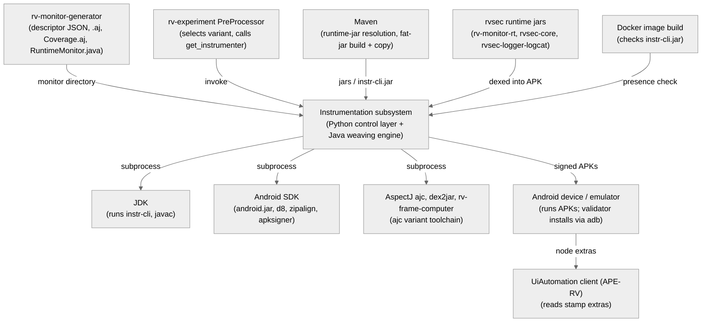
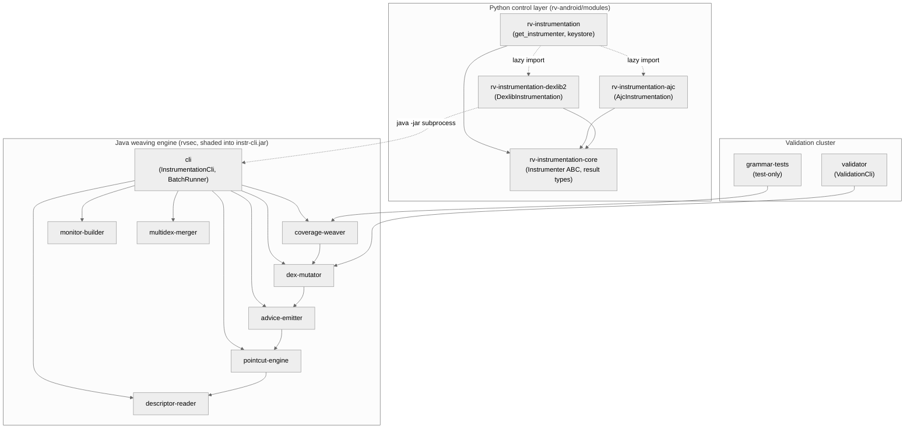
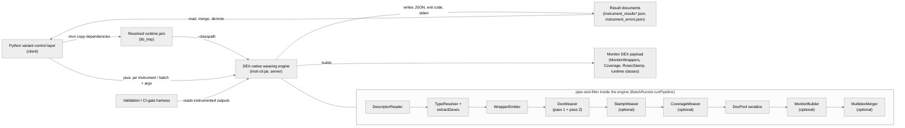

# Architecture — Instrumentation Subsystem

> Scope: **subsystem** · Generated by `rv-doc-arch` · Source model: `out/arch/subsystem-instrumentation/architecture-model.json`
> Languages: Python (4 modules, ~4,200 LOC) and Java (10 Maven modules, ~15,200 LOC of main code plus a 614-line runtime helper resource) — joined by a `java -jar instr-cli.jar` subprocess boundary

## Table of Contents

- [Part I — Beyond Views](#part-i--beyond-views)
  - [1. Documentation overview](#1-documentation-overview)
  - [2. Conceptual primer](#2-conceptual-primer)
  - [3. System overview and context](#3-system-overview-and-context)
  - [4. How it works — end to end](#4-how-it-works--end-to-end)
  - [5. Core components](#5-core-components)
  - [6. Mapping between views](#6-mapping-between-views)
  - [7. Rationale](#7-rationale)
  - [8. Output artifacts](#8-output-artifacts)
  - [9. Directory](#9-directory)
- [Part II — Views](#part-ii--views)
  - [Module view](#module-view)
  - [Component-and-connector view](#component-and-connector-view)
  - [Allocation view](#allocation-view)
- [Appendices](#appendices)
- [Specification traceability](#specification-traceability)

---

## Part I — Beyond Views

### 1. Documentation overview

This document describes the **instrumentation subsystem** of RV-Android: the part of the framework that takes an ordinary Android APK and rewrites it so that, when the app runs, calls to APIs under observation fire into generated runtime-verification monitors, every executed application method reports itself for coverage and, on request, every clickable UI node carries the class of its handler. The subsystem spans two source trees and two languages: a thin Python control layer in `rv-android` (four uv-workspace modules) and a Java/Maven weaving engine in the `rvsec` tree (ten Maven modules), joined by one `java -jar instr-cli.jar` subprocess call per APK.

The audience is a **new engineer with no prior exposure to the subsystem**. Read top to bottom, the document should leave you able to follow a real instrumentation run, explain why the code is split the way it is, and find where each responsibility lives. The Java engine has a companion document, `docs/architecture/instrumentation-java.md`, that goes deeper into the engine alone; this one keeps both sides and the boundary between them in view.

**How to read this document:** Part I builds your mental model — what the subsystem is ([primer](#2-conceptual-primer)), how it behaves end to end ([walkthrough](#4-how-it-works--end-to-end)), and why it is shaped this way ([rationale](#7-rationale)). Part II documents the selected views in detail.

### 2. Conceptual primer

The instrumentation subsystem takes an ordinary Android APK and rewrites it so that every call to an API under observation (for example `javax.crypto.Cipher.getInstance`) also reports an event to the runtime-verification monitors generated from the MOP specifications, and every executed application method reports itself for coverage. Optionally it also makes each clickable UI node carry the class of its click handler, which a GUI explorer reads through accessibility. The result is a signed APK that installs and runs like the original. Four small Python modules decide which weaving pipeline runs and interpret its results; a ten-module Java engine rewrites DEX bytecode; the two meet at a single subprocess call.

**Why this approach.** Two weaving strategies exist, and the subsystem keeps both behind one Python interface, the `Instrumenter` ABC. The **ajc** variant round-trips the APK through dex2jar (DEX to JVM bytecode), the AspectJ compiler `ajc` (weaving) and d8 (back to DEX). It reuses a real AspectJ weaver, but the round-trip is where R8-optimized and Kotlin/Compose bytecode breaks, which is why that pipeline carries a stack-frame recomputation step before and after weaving and a quarantine step that removes known-problematic library classes before weaving and restores them afterwards. The **dexlib2** variant rejects the round-trip and edits DEX in place with the smali/dexlib2 library, so the app's multidex partitioning, DEX format version and bytecode shape survive. The price is that everything AspectJ provides for free is re-implemented by hand: a pointcut parser and matcher, advice emitters, generated static wrappers that avoid register aliasing, and a DEX register allocator that respects the 4-bit operand fields of many DEX instruction formats. Neither variant replaces the other yet: rv-experiment defaults to `ajc` (`--instrumentation-variant`, default `ajc`), and the instrumentation spec ties a change of default to the validator's Layer-4 non-inferiority gate (INV-INS-58), so dexlib2 is opt-in.

**Key concepts**

- **DEX bytecode** — The register-based instruction format Android runs (ART/Dalvik). Each method declares a fixed `registerCount`; parameters occupy the highest registers and locals the lowest. Many instruction formats encode a register in 4 bits and can only name `v0`–`v15`; wider forms (`/from16`, `/range`) exist for higher registers.
- **pointcut / advice** — AspectJ vocabulary used by JavaMOP. A pointcut selects program points, for example `call(public static Cipher Cipher.getInstance(String)) && args(transformation)`; an advice is what runs there, positioned before or after the point. Here the advice body is one or more static calls into the generated `MultiSpec_<N>RuntimeMonitor` class.
- **descriptor JSON** — `MultiSpec_<N>MonitorAspect.json`, written by patched JavaMOP next to the `.aj` aspect. It lists the aspect's imports, its `commonPointcut` (class-level exclusions) and every advice with its position, pointcut expression, `returning`/`throwing` bindings and the ordered `monitorCalls` to fire. The dexlib2 engine reads only this file, never the `.aj` text (INV-INS-56).
- **wrapper substitution** — How the dexlib2 engine weaves an `after` advice on a method call: it generates a static method in `mop.MonitorWrappers` that calls the original method, fires every monitor call bound to that call and returns the original result, then rewrites the call site's invoke to call the wrapper with the same registers. The caller's registers and its `move-result` stay byte-identical, which sidesteps register aliasing (INV-INS-66).
- **register allocation / shifting** — Inline advice needs scratch registers. Growing a method's frame means cloning the method body with a larger `registerCount`, shifting every operand and widening any 4-bit operand that would pass `v15`. dexlib2 offers no setter for `registerCount`, so `RegisterShifter` clones, and the caller must swap the clone into the per-method cache (INV-INS-87). A mistake surfaces on the device as a `VerifyError`.
- **variant** — One of the two interchangeable implementations of the `Instrumenter` ABC: `ajc` (`AjcInstrumentation`) or `dexlib2` (`DexlibInstrumentation`). `rv_instrumentation.get_instrumenter(variant, config)` is the single dispatch site (INV-INS-36).
- **phase tag and weave counters** — For every APK the Java engine writes a `PerApkResult` with `success`, a `phase` saying how far the pipeline got (`signed`, `dex_only`, `build_only`, `dex_write`, `apk_read`, `io_error`, `config_validation`, `uncaught`), a message carrying the exception's cause chain, and a `weaveCounts` map counting what the weaver did and what it declined to do. The Python side carries the counters into `InstrumentationResults.weave_counts`.
- **handler stamp** — An opt-in rewrite (`--stamp-handlers`) that serves the GUI explorer rather than the monitors: View listener setters and Compose node population are routed to `mop.RvsecStamp`, which writes the handler class into the node's `AccessibilityNodeInfo` extras (`rvsec.click`, `rvsec.longClick`) and logs each change under `RVSEC-BIND`. With the option off, the output is byte-identical to the instrumentation without it (INV-INS-174).

### 3. System overview and context

The subsystem sits between monitor generation and the device. Upstream, **rv-monitor-generator** (patched JavaMOP plus RV-Monitor) fills the monitor directory with the descriptor JSON, the `.aj` aspects, `Coverage.aj` and the `MultiSpec_*RuntimeMonitor.java` sources; the ajc variant consumes the aspects, the dexlib2 variant the descriptor, and both the monitor sources. The caller is **rv-experiment's `PreProcessor`**, which selects the variant, builds that variant's configuration just in time and calls `get_instrumenter` and `instrument_apks` with an explicit list of APK paths. **Maven** plays two roles: it resolves the monitors' runtime jars (`dependency:copy-dependencies` on `rv-android/pom.xml`, a Template Method shared by both variants) and it builds the engine's fat jar and copies it into the Python module. The **JDK** runs the engine and compiles the monitor sources; the **Android SDK** supplies `android.jar`, `d8`, `zipalign` and `apksigner`; **AspectJ, dex2jar and rv-frame-computer** form the ajc variant's toolchain. The **rvsec runtime jars** (`rv-monitor-rt`, `rvsec-core`, `rvsec-logger-logcat`) are dexed into every instrumented APK; `rvsec-logger-logcat`'s `ErrorCollector` is what writes the monitors' violation lines on the device. Downstream, the instrumented APKs run on an **Android device or emulator** under rv-platform (outside this subsystem); the validator's `BootValidator` is the only component here that installs APKs itself. A **UiAutomation client** such as APE-RV reads the stamp's node extras, and the **Docker image build** refuses to complete without the engine jar.

**Constraints:** instrumented APKs must install and pass on-device DEX verification; the original multidex partitioning must be preserved (INV-INS-52); the descriptor JSON, never the `.aj` text, is the dexlib2 contract (INV-INS-56); `resources.arsc` must stay STORED for API 30+; monitor sources compile at Java 1.8 so d8 and `android.jar` accept them; specification sets are never mixed within one run (INV-INS-09). The Python layer and the Java engine share no memory: they communicate only through command-line flags, a fixed environment, result files, stdout/stderr and the exit code.

**System context diagram** (external actors and systems — every view refers back to this):



### 4. How it works — end to end

The following walks through a concrete example: **instrumenting an APK `app.apk` whose code calls `Cipher.getInstance(String)` and then `cipher.init(int, Key)`, using the dexlib2 variant as rv-experiment drives it, against a JCA descriptor in which advice `CipherSpec_g1` is an after-returning advice on `call(public static Cipher Cipher.getInstance(String)) && args(transformation)` with two monitor calls (`MultiSpec_1RuntimeMonitor.CipherSpec_g1Event` and `CipherSpec_g3Event`, both with arguments `[transformation, c]`), and advice `CipherSpec_i2` is a before advice on `call(public void Cipher.init(int, Key, ..)) && args(mode, key, ..) && target(c)`.** The two advices exercise the engine's two weaving paths: the first goes through a generated wrapper, the second is injected inline. Each stage below transforms a typed artifact and hands it to the next.

1. **Variant selection (Python).** `PreProcessor._instrument_apks` reads `instrumentation_variant` from `ExperimentConfig`, builds the variant's configuration just in time with `get_dexlib_instrumentation_config()` and calls `rv_instrumentation.get_instrumenter("dexlib2", config)`. The factory lazy-imports only `rv_instrumentation_dexlib2` and returns a `DexlibInstrumentation`. The pre-processor then calls `instrument_apks(apks_dir, results_dir, apk_paths=apk_list)`; it always passes `apk_paths`, so production takes the per-APK path described below, not the batch path. *Concretely:* `DexlibInstrumentationConfig(monitor_output_dir=<output_dir>/monitors, instrumented_dir=<output_dir>/instrumented_apks, working_dir=<output_dir>, keystore_file=modules/rv-instrumentation/assets/keystore.jks, keystore_alias='server', stamp_handlers=<resolved --stamp-handlers>)`.

2. **Preparation and runtime classpath (Python).** `prepare_instrumentation()` checks that at least one `MultiSpec_*MonitorAspect.json` exists in the monitor directory (otherwise `MissingDescriptorError`, INV-INS-50) and that `lib/instr-cli.jar` exists (otherwise `FileNotFoundError`). It resolves the rvsec root from `RVSEC_HOME` and runs the ABC's Template Method `_resolve_runtime_libs`, which executes `mvn -f rv-android/pom.xml dependency:copy-dependencies -DincludeScope=runtime -Dmdep.stripVersion=true` into `<working_dir>/lib_tmp`. That pom also pulls AspectJ, Kotlin and Surefire jars, and everything on the final classpath gets dexed into the APK, so the wrapper keeps only the three artifacts the generated monitors call at run time and appends them to `extra_classpath`. *Concretely:* the allowlist is `("rv-monitor-rt", "rvsec-core", "rvsec-logger-logcat")`; a resolution that matches none of them raises `RuntimeError`.

3. **Subprocess boundary (Python → Java).** For each complete APK path the wrapper runs one JVM with the `instrument` subcommand and a per-APK results file. The argument list comes from `_common_cli_args`; `--stamp-handlers` is appended only when `stamp_handlers` is true (INV-INS-180). The environment is built by `_build_subprocess_env`: only `PATH`, `HOME`, `JAVA_HOME`, `ANDROID_HOME` and `RVSEC_HOME`, plus `RVSEC_KEYSTORE`/`RVSEC_KEYSTORE_PASS` when configured — never a copy of `os.environ` (INV-EXP-30). There is no wallclock timeout, because weave time scales with the APK's method count. The run's argv, exit code, elapsed time, stdout and stderr are written next to the per-APK JSON so a platform-jar mismatch or a `javac` diagnostic stays readable after the fact. *Concretely:* `java -jar lib/instr-cli.jar instrument app.apk --results-json instrument_results.d/app.json --descriptor monitors/MultiSpec_1MonitorAspect.json --output instrumented_apks --work-dir <output_dir> --monitor-src-dir monitors --keystore … --key-alias server … --classpath rv-monitor-rt.jar,rvsec-core.jar,rvsec-logger-logcat.jar`, logged to `instrument_results.d/app.log`.

4. **Configuration and descriptor read (Java).** picocli parses the flags (all `INHERIT`-scoped, so both subcommands accept them) and `ConfigResolver.resolve` builds an immutable `EffectiveConfig` with precedence flag → environment variable → built-in default. `android.jar` is the one mandatory input (from `--android-jar`, or the highest platform directory under `$ANDROID_HOME/platforms`); `javac`, `d8`, `zipalign` and `apksigner` are resolved best effort from `JAVA_HOME` and the newest `$ANDROID_HOME/build-tools`, and `BuilderConfig`/`MergerConfig` exist only when their tools resolved. `BatchRunner.runPipeline` prints the resolved `android.jar` path, then `DescriptorReader.read` deserializes the descriptor with a strict Jackson mapper (`FAIL_ON_UNKNOWN_PROPERTIES=true`) into an `AspectDescriptor`. *Concretely:* advice `CipherSpec_g1` arrives as `position="after"`, `returning=[Cipher c]`, `monitorCalls=[CipherSpec_g1Event(transformation, c), CipherSpec_g3Event(transformation, c)]`, and the aspect's `commonPointcut` is `!within(com.runtimeverification.rvmonitor.java.rt.RVMObject+) && !adviceexecution() && BaseAspect.notwithin()`.

5. **Type resolution and DEX extraction (Java).** `AndroidClassIndex` indexes `android.jar` with ASM, and `TypeResolver(descriptor.getImports(), index::exists)` maps short names from the descriptor's imports to DEX descriptors; the existence lookup makes a dotted nested name such as `KeyStore.ProtectionParameter` resolve to `Ljava/security/KeyStore$ProtectionParameter;` (INV-INS-162), and each name is resolved once per resolver (INV-INS-168). `extractDexes` reads every `classes*.dex` entry into a `DexBackedDexFile`, keeping its entry name and reading it with the `Opcodes` of its own DEX format version, so the woven output keeps that version; the highest input API is recorded so d8 can later emit the monitor DEX at the same level. *Concretely:* `Cipher` resolves to `Ljavax/crypto/Cipher;`; the counters `advices`, `dexFiles` and `maxInputApi` are recorded; an APK with no `classes*.dex` stops here with `phase=apk_read`.

6. **Wrapper generation (Java).** `WrapperEmitter.generate` writes `mop/MonitorWrappers.java` into the monitor source directory. Every advice positioned `after` on a non-constructor `call(...)` takes the wrapper path: its call target is expanded to the concrete overloads `android.jar` declares or inherits (INV-INS-160), advices are grouped per original call, and each group becomes one static wrapper that calls the original, fires every grouped advice's monitor calls in descriptor order (INV-INS-104) and returns the result. An advice whose positional `args()` arity cannot fit an overload is left out of that overload's wrapper and counted (INV-INS-159); a plain `after` (no `returning`, no `throwing`) gets a catch-all handler that fires its monitor calls and rethrows (INV-INS-163). Then one `InheritanceResolver` is built over every DEX of the APK and `DexWeaver.expandWrapperReplacementsForApk` registers app subclasses of wrapped owners, so a subclass declared in `classes2.dex` resolves to the same wrapper as a call in `classes.dex`. *Concretely:* a static wrapper in `Lmop/MonitorWrappers;` taking `(Ljava/lang/String;)` and returning `Ljavax/crypto/Cipher;` fires `CipherSpec_g1Event` and then `CipherSpec_g3Event`; the counters `wrappersGenerated`, `advicesExcludedByArity` and `wrapperTargetsUnresolved` are recorded.

7. **Advice weave per DEX (Java).** `DexWeaver.weave` walks classes, methods and instructions. A `commonPointcut` made only of class-level clauses is evaluated once per class, so a rejected class is skipped whole. **Pass 1** rewrites every invoke whose method reference has a wrapper key with `InstructionInjector.replaceInvoke`, which keeps the instruction size and register list: the `getInstance` call becomes an `invoke-static` of the wrapper and its `move-result-object` is untouched. **Pass 2** iterates right to left over the remaining instructions (so an insertion only shifts indices already visited) and runs the inline path: `PointcutMatcher` matches the `Cipher.init(int, Key)` invoke against `CipherSpec_i2` and returns a `Match` with `argBindings` for `mode` and `key` and the receiver as `targetRegister`; `EmitterDispatch` selects `BeforeEmitter`; `MonitorInvokeBuilder` builds the monitor invoke in Format35c (all registers ≤ `v15`) or Format3rc (a contiguous range), throwing `HighRegisterNonContiguous` or `UnresolvedBindingException` when it cannot, which the weaver counts and skips; `RegisterAllocator` grows the frame if the plan needs scratch registers and the caller swaps the grown body into the cache (INV-INS-87); and `InstructionInjector.insertBefore` inserts the block and moves the call's branch targets and line entry onto it, so no path into the call bypasses the monitor (INV-INS-161). *Concretely:* `wrappersSubstituted` counts the `getInstance` site and `matchesApplied` the `init` site; declined work lands in `plansSkipped`, `plansSkippedAliasing`, `plansSkippedHighRegister` and `plansSkippedUnresolvedBinding`.

8. **Handler stamp, coverage weave and serialization (Java).** If the stamp is on, `StampWeaver.weave` runs next, over the same cached method bodies: it rewrites `invoke-virtual` of the three View listener setters (`setOnClickListener`, `setOnLongClickListener`, `setAccessibilityDelegate`) whose owner resolves to a View subtype into an `invoke-static` of the same-named `mop.RvsecStamp` method, and inserts `RvsecStamp.composeNode` after each call of Compose's `populateAccessibilityNodeInfoProperties`; it runs after the advice weave so an advice on a setter still sees the framework call. If coverage is on (the default), `CoverageWeaver.weave` prepends to every method `PackageFilter` does not exclude a `const-string` of the method's Soot-style signature and an `invoke-static Lmop/Coverage;->log(Ljava/lang/String;)V`; a method with no local register gets one through `RegisterShifter.spillLowRegisters`, or is counted in `coverageSpillFailed`. Each woven DEX is then serialized with `DexPool.writeTo`; a DEX that no longer fits the format (for example past 65,536 method ids) stops the APK with `phase=dex_write`, naming the entry. *Concretely:* `<work-dir>/woven_classes.dex` and `woven_classes2.dex` are written; the counters `coverageInstrumented` and `coverageSpillFailed` and, with the stamp on, `stampClickSites`, `stampLongClickSites`, `stampDelegateSites`, `stampComposeSites`, `stampInvokeSuperSkipped` and `stampOwnerNotView` are recorded.

9. **Monitor build (Java).** When `--monitor-src-dir` is set and the builder tools resolved, `CoverageSourceEmitter.emit` writes `mop/Coverage.java`, and `StampSourceEmitter` either writes `mop/RvsecStamp.java` (stamp on) or deletes it and its compiled classes left by an earlier run (stamp off) — the source and build directories are shared across runs and `MonitorBuilder` compiles every `.java` it finds. `MonitorBuilder.build` runs `javac -source 1.8 -target 1.8` over the monitor sources, `MonitorWrappers`, `Coverage` and (when present) `RvsecStamp` against `android.jar` plus the allowlisted jars, then `d8 --min-api <maxInputApi>` over the classes and, as positional inputs, the runtime jars, so `rv-monitor-rt`, `rvsec-core` and `rvsec-logger-logcat` classes are dexed with the monitors; d8 splits the output past the 65,536 method-id limit. Without `--monitor-src-dir` or the tools, the APK stops at `phase=dex_only`. *Concretely:* `<work-dir>/monitor-build/` holds the compiled classes and the monitor DEX files; the counter `monitorDexes` is recorded.

10. **Merge and sign (Java).** When the merger tools, a keystore and `--output` are present, `MultidexMerger.merge` rewrites the APK ZIP: every non-DEX entry is copied with its original compression method (so `resources.arsc` stays STORED), each `classes<N>.dex` is replaced by its woven version, and each monitor DEX is appended in the next free `classes<N>.dex` slot, never merged into an app DEX (INV-INS-52). The result is aligned with `zipalign -p -f 4` and signed with `apksigner sign` using the configured keystore. The `PerApkResult` is `phase=signed, success=true`; it is written to the per-APK results JSON and the JVM exits 0. Any other outcome — `dex_only` and `build_only` included, since neither produced an installable APK — exits 1 after the JSON is written. *Concretely:* `instrumented_apks/app.apk` is signed with alias `server`, and `instrument_results.d/app.json` is `{"variant": "dexlib2", "results": [{"apkName": "app.apk", "success": true, "phase": "signed", "message": …, "weaveCounts": {…}}]}`.

11. **Result parse (Python).** A non-zero exit makes `_run_cli` raise `RuntimeError` carrying the CLI's stderr (which includes the stack trace and the cause chain), and the loop records an `InstrumentationError` with `phase="dexlib2_pipeline"` for that APK and moves on. An exit of 0 is still not taken on trust: the loop checks that `results_dir/<apk file name>` exists and demotes the APK to an error when it does not. After the loop, `_merge_per_apk_results` concatenates every per-APK JSON — failed APKs included, since the CLI writes the JSON either way — into `instrument_results.json` and returns the per-APK counters, which become `InstrumentationResults.weave_counts` with `variant="dexlib2"`; `_persist_errors_json` writes `instrument_errors.json`. The batch path (no `apk_paths`) instead parses the CLI's own `instrument_results.json` with `_parse_results_json` and cross-checks claimed successes on disk with `_demote_silent_failures`. *Concretely:* `InstrumentationResults(success_count=1, total_count=1, errors={}, weave_counts={"app.apk": {"matchesApplied": …, "wrappersSubstituted": …}}, variant="dexlib2")`, and `instrument_errors.json` is `{}`.

### 5. Core components

At run time the subsystem is six cooperating elements.

The **Python variant control layer** is the in-process Python that rv-experiment's `PreProcessor` drives during pre-processing. It picks the variant through `get_instrumenter`, and the chosen variant runs `prepare_instrumentation` (which itself spawns Maven to resolve runtime jars). The ajc variant then executes its whole toolchain as a chain of subprocesses in this process; the dexlib2 variant hands each APK to the Java engine through one `java -jar` call. This layer owns result interpretation: it treats a non-zero exit as a per-APK error, re-checks that every claimed output APK exists, merges per-APK result files, carries the weaver counters into `weave_counts` and writes `instrument_errors.json`. It is the only component that knows both variants exist and the only one that touches the experiment configuration.

The **DEX-native weaving engine (`instr-cli.jar`)** is a short-lived JVM launched once per APK by the production path (or once per directory by the batch path). Inside, `BatchRunner.runPipeline` threads one `AspectDescriptor`, one `TypeResolver`, one `AndroidClassIndex` and one APK-wide `InheritanceResolver` through the per-DEX loop, building a fresh `DexFileMutator` per DEX and running the advice weave, the optional stamp pass and the optional coverage weave over the same cached method bodies before serializing. It shares no memory with Python: flags and environment come in; a results JSON, stdout/stderr and the signed APK go out; and the exit code says whether every APK was instrumented. It is the source of truth for dexlib2 behaviour — the Python wrapper only orchestrates it.

The **result documents** carry outcomes across the boundary. The engine writes `{"variant": "dexlib2", "results": [PerApkResult…]}` whether the APK succeeded or failed (INV-INS-105). On the per-APK path each JVM writes `instrument_results.d/<stem>.json` and the wrapper concatenates them into `instrument_results.json` in the same schema, so a results tree can be read without knowing which path produced it. `instrument_errors.json` maps an APK name to `{code, tool, message, phase}` for both variants and is written as `{}` when clean. The counters in these files are what make a weaving change measurable rather than inferred: an extra monitor invoke per site that pushes a method past its register budget shows up as `plansSkippedHighRegister`, and an advice/overload pair excluded by arity as `advicesExcludedByArity`.

The **monitor DEX payload** is everything the rewritten bytecode calls, compiled into extra `classes<N>.dex` files rather than into the app's own DEXes. `mop.MonitorWrappers` is generated per descriptor and is where after-advice monitor calls fire; `mop.Coverage` logs each first-seen method under `RVSEC-COV`; `mop.RvsecStamp` (only with the stamp) writes the node extras and logs `RVSEC-BIND`; and the runtime jars bring the monitor base classes and `ErrorCollector`, which writes the first occurrence of each violation identity under `RVSEC` and occurrence lines under `RVSEC-OCC`, at most one per identity per 100 ms (INV-INS-170..173). Keeping this payload out of the app DEXes is what preserves the app's multidex partitioning.

The **resolved runtime jars** live in a per-variant `lib_tmp` directory populated by `mvn dependency:copy-dependencies` against `rv-android/pom.xml`. The ajc variant merges their classes into the woven JAR; the dexlib2 variant forwards the three allowlisted jars as `--classpath`, where `MonitorBuilder` both compiles against them and dexes them. This shared-data link keeps both variants agreeing on which runtime classes the monitors need.

Finally, the **validation / CI-gate harness** is a separate set of JVM entry points (`ValidationCli` and the grammar-tests suite) that run in CI and, for Layer 2, against a device. They are not on the instrumentation path: they take already-instrumented outputs and descriptors and produce `Report` JSON with an exit code a CI step can act on.

| Component | Realized by | Responsibility |
|-----------|-------------|----------------|
| Python variant control layer | `rv-instrumentation-core`, `rv-instrumentation`, `rv-instrumentation-ajc`, `rv-instrumentation-dexlib2` | Select a variant, prepare the runtime classpath, run the pipeline, interpret its outcome. |
| DEX-native weaving engine (`instr-cli.jar`) | `descriptor-reader`, `pointcut-engine`, `advice-emitter`, `dex-mutator`, `coverage-weaver`, `monitor-builder`, `multidex-merger`, `cli` | Read the descriptor; weave advice, wrappers, coverage and the optional stamp; build the monitor DEX; merge, sign, report. |
| Result documents | `BatchRunner.writeResultsJson`; `_merge_per_apk_results`, `_persist_errors_json`; ajc's error writer | Per-APK outcome, phase, message and counters across the boundary. |
| Monitor DEX payload | `WrapperEmitter`, `CoverageSourceEmitter`, `StampSourceEmitter`, `MonitorBuilder`, runtime jars | The classes the woven app calls at run time. |
| Resolved runtime jars | `Instrumenter._resolve_runtime_libs` | `rv-monitor-rt`, `rvsec-core`, `rvsec-logger-logcat` (plus the AspectJ runtime for ajc). |
| Validation / CI-gate harness | `validator`, `grammar-tests` | Gate dexlib2 against contracts and the ajc baseline, offline. |

### 6. Mapping between views

The module structure and the runtime structure line up cleanly, but across a language boundary that is the defining feature of this subsystem. The four Python modules together **realize** the runtime component "Python variant control layer": rv-experiment's `PreProcessor` calls `rv-instrumentation` (`get_instrumenter(variant, config)`), which lazy-imports either `rv-instrumentation-ajc` or `rv-instrumentation-dexlib2`; both variants subclass the `Instrumenter` ABC of `rv-instrumentation-core` and depend on nothing else in the family (INV-INS-41). The eight Java modules `descriptor-reader`, `pointcut-engine`, `advice-emitter`, `dex-mutator`, `coverage-weaver`, `monitor-builder`, `multidex-merger` and the `cli` that aggregates them realize the "DEX-native weaving engine", shaded into one `instr-cli.jar`. `advice-emitter` and `monitor-builder`, together with the runtime jars, also realize the "monitor DEX payload": the first generates `mop.MonitorWrappers`, the second emits `mop.Coverage` and `mop.RvsecStamp` and compiles everything. The two remaining Java modules, `validator` and `grammar-tests`, realize the "validation / CI-gate harness".

The load-bearing boundary is between `rv-instrumentation-dexlib2` (Python) and the engine (Java), and the mechanism is a **subprocess**: `java -jar instr-cli.jar {instrument|batch} … --results-json <file>`. Nothing is shared in memory. What crosses *in* is the argument list — descriptor path, output and work directories, monitor source directory, keystore settings, the allowlisted `--classpath` jars, the results-JSON path and `--stamp-handlers` when requested — plus a fixed environment of five OS variables and the keystore extras. What crosses *out* is the results JSON (`apkName`, `success`, `phase`, `message`, `weaveCounts`), stdout/stderr (the resolved `android.jar`, per-advice skips, `javac`/`d8` diagnostics, and on failure the stack trace), the exit code, and the signed APK on disk. Because the result is a set of claims made by another process, the wrapper does not trust any single one of them: it treats a non-zero exit as an error, checks the output APK exists before crediting a success, and keeps the counters even for APKs it demotes.

On the install axis, `cli/pom.xml` shades the engine into `instr-cli.jar` and a `maven-resources-plugin` execution copies it into `modules/rv-instrumentation-dexlib2/lib/` at every package (design D9); `DexlibInstrumentationConfig` resolves the jar relative to the module, and the Docker image build fails if it is missing. The shared `keystore.jks` lives in `modules/rv-instrumentation/assets/`: `AjcInstrumentationConfig` defaults to it, and rv-experiment points the dexlib2 variant at it. On the deployment axis, the engine runs as a separate JVM on whatever host or container runs rv-experiment, and the validator's `BootValidator` places instrumented APKs on a device with `adb install`.

### 7. Rationale

The decisions that shaped this architecture, each with the tension behind it and the failure mode it avoids.

**DEX-native weaving (dexlib2) as an alternative to the dex2jar + ajc + d8 round-trip.** The ajc pipeline has to leave DEX and come back, and that round-trip is where R8-optimized and Kotlin apps break: the AspectJ weaver needs well-formed JVM stack-map frames, which is why the ajc variant runs `rv-frame-computer` before and after weaving and quarantines the library classes listed in `weaving_excludes.yaml`. Extending that machinery class by class was the rejected alternative. The dexlib2 engine never leaves DEX, keeps the app's DEX partitioning (INV-INS-52) and its DEX format version, and touches only the instructions it weaves. The cost is that pointcut matching, advice emission, wrapper generation and register management are all hand-written and each must be validated, which is what the validator and grammar-tests modules exist for.

**Two interchangeable variants behind one `Instrumenter` ABC and one factory; ajc remains the default.** Neither pipeline is promoted by assertion. Both implement `instrument_apks` with the same signature, `get_instrumenter` is the single dispatch site (INV-INS-36), every implementation depends only on `-core` (INV-INS-41), and `InstrumentationResults.variant` records which pipeline produced a result (INV-INS-55). The spec ties a change of default from `ajc` to `dexlib2` to the Layer-4 non-inferiority gate (INV-INS-58), so the default stays `ajc`, and dexlib2 is selected with `--instrumentation-variant dexlib2` or `RV_INSTRUMENTATION_VARIANT`. Without the shared ABC and the tag, changing pipelines would mean rewriting every caller and losing the ability to tell results apart.

**Stage separation: matcher, emitter and mutator as separate Maven modules.** All three stages touch the same join point for different reasons: the matcher decides *where*, the emitter decides *what* to inject and how many registers it needs, the mutator decides *how* registers and bytes change. Folding them together would scatter 4-bit operand knowledge through pointcut logic and make a register bug indistinguishable from a matching bug. Kept apart, the matcher produces a `Match`, the emitter an `EmitPlan` of plain data, and the mutator applies it; `FeatureMappingChecker` (INV-INS-54) and the grammar coverage matrix can then point every AspectJ construct at the module and test that implements it.

**After advice on calls goes through one merged static wrapper per call target.** An inline after-hook must read the call's argument registers after the call, but the compiler may reuse them for the result, and reading a reused register yields wrong values or a `VerifyError`. The wrapper calls the original and fires the monitors in its own frame, and the call site keeps its registers and `move-result` (INV-INS-66). Because the weaver's registry can only key on the call's own method reference, several advices on one call must share one wrapper; emitting one wrapper per advice let the last registration win and silently dropped the others, so wrappers are merged per call and fire every advice's `monitorCalls` in descriptor order (INV-INS-104). Inline weaving remains for `before` advice and for constructors, which return `void` and have no `move-result`.

**Skip and count rather than emit invalid advice.** A verifier failure in one method makes the whole class fail to load on the device. Emitting something and hoping — which once meant defaulting an unresolved binding to `v0` — produced exactly that. The engine treats each hazard as a skip with a counter: `UnresolvedBindingException` (INV-INS-71), `HighRegisterNonContiguous` (INV-INS-69), inline AFTER on a non-constructor call, an unwidenable spill, an around advice. This trades a measurable loss of completeness for a guarantee that the APK installs, and the counters in `weaveCounts` make the loss visible instead of silent.

**JSON descriptor, not `.aj` text, as the generator-to-engine contract.** Scraping the generated `.aj` would couple the engine to AspectJ's textual syntax and to JavaMOP's formatting. The descriptor mirrors the aspect's structure, is read with a strict mapper so an unknown field fails at once (INV-INS-56), and `DescriptorAjParityChecker` checks it still agrees with the `.aj` on name, package and advice count.

**The exit code answers whether the APK was instrumented; the results JSON is always written and carries the cause.** `runPipeline` never throws, so a failure is a phase-tagged `PerApkResult`. If the process exited 0 regardless, the Python side — which raises only on a non-zero exit — would label every failure a silent toolchain drop. The CLI therefore writes the results JSON first and exits 1 whenever any APK is not `signed`, including `dex_only` and `build_only`, since neither produced an installable APK; the phase tag still distinguishes a withheld flag from a broken weave. Messages keep the full cause chain (dexlib2 wraps the real cause, such as a DEX past 65,536 method ids, inside a generic context exception, joined here with `; caused by: `), and counters accumulated before the failure are kept. On top of that, the wrapper verifies that every claimed output APK exists before crediting it, and the per-APK path writes a results JSON for every APK (INV-INS-105). The accepted consequence is that the wrapper's batch path raises on a batch with any failure; rv-experiment always uses the per-APK path.

**No wallclock timeout and an explicit environment for the engine subprocess; options travel as argv.** A wallclock cap would abort exactly the large apps whose weave is slow because they have many methods; hang detection, if ever needed, belongs to an inactivity watchdog. The environment is built from `PATH`, `HOME`, `JAVA_HOME`, `ANDROID_HOME` and `RVSEC_HOME` only, because user-facing `RV_*` configuration must not leak into the toolchain (INV-EXP-30). The stamp relies on this: `instr-cli` reads `RVSEC_STAMP_HANDLERS` when no option is given, but the wrapper never forwards it, so the stamp is requested only by the `--stamp-handlers` argument built from `stamp_handlers` (INV-INS-180), and the invocation states what it asked for.

**The handler stamp is a separate, opt-in pass with a fixed helper in the monitor DEX.** The GUI explorer needs to know which handler a clickable node is bound to, and many nodes have no resource-id. Recording the handler class on the real node at run time answers that, but it must not disturb what the monitors observe. So the stamp does not register its setters in the wrapper registry (which would tie it to the descriptor and to the `commonPointcut`); `StampWeaver` reuses only `replaceInvoke` and the cached method bodies, runs after the advice weave so an advice on a setter still sees the framework call, and its rewrite is size-stable so coverage is unaffected. The helper is a fixed source compiled into the monitor DEX with the monitors. With the option off, no stamp code runs, no `stamp*` counter is written, and the step before the monitor build deletes any helper an earlier run left in the shared directories, so the output is byte-identical to the instrumentation without the stamp (INV-INS-174) and the MOP counters are equal on and off (INV-INS-175).

**Decide once what does not change within a weave.** The weave loop runs over every instruction of every method of every class, times the number of advices. Re-parsing an expression or rebuilding the `commonPointcut` composition per instruction multiplied the cost by the instruction count. The weaver memoises parsed expressions, builds the composition once per class (and evaluates a class-only `commonPointcut` once per class), and `TypeResolver` memoises descriptors (INV-INS-168). This is sound because the AST is immutable and the matcher keeps match state per call, and the requirement is accepted on the output: the woven DEXes and every counter must be identical with and without the memo.

**Decisions at a glance**

| Decision | Drivers | Invariant / ADR |
|----------|---------|-----------------|
| DEX-native weaving vs dex2jar + ajc + d8 | fidelity on R8/Kotlin bytecode; multidex and DEX-version preservation; no quarantine | INV-INS-52 |
| Two variants behind one ABC + factory; ajc default | swap without touching callers; attributable results; promotion by evidence | INV-INS-36, -41, -55, -58 |
| Matcher / emitter / mutator as separate modules | single responsibility; stage testability; contained DEX hazards | INV-INS-54 |
| One merged wrapper per call for after advice | register aliasing; one key per call site; every monitor call fires | INV-INS-66, -104 |
| Skip and count, never default a register | per-class verification; visible gaps | INV-INS-69, -71 |
| JSON descriptor as the contract | stable machine contract; fail fast on drift | INV-INS-56 |
| Exit code = APK instrumented; JSON always written with cause | failures never look like successes; post-mortem | INV-INS-105 |
| No wallclock timeout; fixed environment; options as argv | slow large apps; layer purity | INV-EXP-30, INV-INS-180 |
| Handler stamp as a separate opt-in pass | node key for the GUI explorer; MOP weave unchanged; off byte-identical | INV-INS-174..179 |
| Decide once per weave | weave cost; identical output | INV-INS-168 |

No ADR exists for these modules; formal records can be authored with `/rv-doc-adr`.

**Patterns and styles**

The subsystem is **layered** on both sides of the language boundary. On the Python side the order is `rv-instrumentation-core` ← variants ← `rv-instrumentation`, acyclic by INV-INS-41. On the Java side `descriptor-reader` ← `pointcut-engine` ← `advice-emitter` ← `dex-mutator` ← `coverage-weaver` is an allowed-to-use order, with `cli` on top and `monitor-builder` and `multidex-merger` as standalone libraries it calls. The Java tree is also a plain **decomposition**: a `pom` aggregator whose ten children each own one stage or concern. **Generalization** appears twice: both variants subclass `Instrumenter`, and `PointcutExpression` is a sealed interface with eleven record implementations. At run time the subsystem is **client-server** — the Python wrapper launches the Java engine as a request/response subprocess with no shared memory — wrapped around a **pipe-and-filter** core in which `BatchRunner.runPipeline` streams each APK through descriptor read, type resolution, DEX extraction, wrapper generation, advice weave, optional stamp, optional coverage, serialization, monitor build and merge/sign, and can stop at `dex_only` or `build_only`. The result documents and `lib_tmp` add a **shared-data** element. On the allocation axis the dominant style is **install** (shaded jar copied into the Python module by D9; shared keystore in the parent module), with a **deployment** aspect (the engine as a separate JVM; the Docker build's presence check; `BootValidator` deploying to a device).

**NFRs served**

*Compatibility (NFR07).* Instrumented APKs must install and verify on the device. The dexlib2 engine reads each DEX with the `Opcodes` of its own format version so the output keeps it, builds the monitor DEX with `d8 --min-api` at the highest input API, compiles monitor sources at Java 1.8, grows frames by clone and widens 4-bit operands to `/from16` or `/range` forms, keeps `resources.arsc` STORED for API 30+, and never merges monitor classes into an app DEX. The ajc variant recomputes stack-map frames before and after weaving and aligns native libraries to 16 KiB pages before signing.

*Modularity (NFR01).* Four uv-workspace Python modules with an acyclic graph (INV-INS-41) and a ten-module Maven reactor in which each weaving stage is its own artifact. The two trees couple only through the CLI flag contract, the result JSON schema and the jar copied by design D9.

*Extensibility (NFR02).* A new variant is a module that depends only on `rv-instrumentation-core`, subclasses `Instrumenter`, and gets one lazy-import branch in `get_instrumenter`; rv-experiment does not change. Inside the engine, a new pointcut construct is a new record in `pointcut-engine`, a new advice kind a new emitter plus an `EmitterDispatch` case, and a new rewrite a new pass in `dex-mutator`, as `StampWeaver` is.

*Testability (NFR03).* An `EmitPlan` is plain data and a `Match` carries its bindings, so matcher and emitter tests need no bytecode mutation; `MutableImplSupplier` has default methods so test suppliers need no frame-growth wiring. The Java reactor carries about 23,000 lines of tests against about 15,200 lines of main code, `grammar-tests` enforces the construct matrix, and the Python wrappers are tested with the CLI mocked.

*Resilience (NFR04).* Failure is contained at every granularity. A pointcut that does not parse becomes a skipped plan; an unencodable or unresolved binding is skipped with a counter; an unwidenable spill vetoes one method; a per-APK exception becomes a phase-tagged `PerApkResult` and the batch continues. On the Python side a non-zero exit or a missing output APK becomes one APK's error, and rv-experiment copies the original APKs when instrumentation fails or is unavailable (INV-EXP-08). On the device, the stamp helper catches its own failures after the app's original setter call has run.

*Configurability (NFR05).* `ConfigResolver` resolves every engine input as flag, then environment variable, then default, and optional stages degrade instead of failing: no monitor sources or builder tools stops at `dex_only`, no merger tools or output directory stops at `build_only`. `--coverage` and `--stamp-handlers` toggle passes. On the Python side the variant, the quarantine, the package key and the stamp are resolved once at the rv-experiment entry point and passed by value into the variant configurations.

*Observability (NFR06).* Every APK yields a results entry with phase, cause-chain message and `weaveCounts` — reach, applied matches, wrapper substitutions and aliases, every skip family, coverage, and the `stamp*` counters when on — carried into `InstrumentationResults.weave_counts`. The engine logs the resolved `android.jar`, and the wrapper persists each JVM's argv, exit code and output to a log file. On the device, the instrumented APK writes `RVSEC` (first occurrence of a violation identity), `RVSEC-OCC` (occurrences, throttled to one line per identity per 100 ms), `RVSEC-COV` (coverage) and, with the stamp, `RVSEC-BIND`.

*Reproducibility (NFR08).* Output identity is a stated acceptance criterion: with the stamp off, every woven DEX and the monitor DEX are byte-identical to the instrumentation without the stamp (INV-INS-174); the memoisation of INV-INS-168 must not change any DEX or counter; batch input is processed in sorted file-name order and DEX entries in sorted entry-name order.

| NFR | PRD ID | Architectural support |
|-----|--------|-----------------------|
| Compatibility | NFR07 | DEX version kept; `d8 --min-api`; Java 1.8 monitors; clone-based frame growth + widening; STORED `resources.arsc`; ajc frame recomputation |
| Modularity | NFR01 | 4 acyclic Python modules + 10-module reactor, coupled by CLI, JSON schema and jar |
| Extensibility | NFR02 | New variant = `-core`-only module + one factory branch; new construct/emitter/pass per engine module |
| Testability | NFR03 | Plain-data plans and matches; grammar matrix; mocked CLI in Python tests |
| Resilience | NFR04 | Counted skips; phase-tagged results; per-APK errors; original-APK fallback (INV-EXP-08) |
| Configurability | NFR05 | Flag → env → default; optional stages; `--coverage`, `--stamp-handlers` |
| Observability | NFR06 | `weaveCounts` → `weave_counts`; per-run logs; `RVSEC`, `RVSEC-OCC`, `RVSEC-COV`, `RVSEC-BIND` |
| Reproducibility | NFR08 | Stamp off byte-identical; memo output identity; deterministic ordering |

### 8. Output artifacts

A run leaves signed APKs plus machine-readable result and error files; the dexlib2 path also leaves per-APK logs and intermediates under the work directory, and the instrumented APKs themselves produce logcat lines and node extras when they run.

| Artifact | Location | Notes |
|----------|----------|-------|
| Instrumented and signed APKs | `results_dir` (rv-experiment: `<output_dir>/instrumented_apks/`) | Same file name as the input; hash differs from the original (INV-INS-06). |
| `instrument_results.json` | `results_dir` | dexlib2 only: `{variant, results: [{apkName, success, phase, message, weaveCounts}]}`; written by the CLI (batch) or merged by the wrapper (per-APK path). |
| `instrument_results.d/<apk>.json`, `<apk>.log` | `results_dir` | Per-APK path only: one results JSON per JVM run, plus that run's argv, exit code, stdout and stderr. |
| `instr-cli.log` | `results_dir` | Batch path only. |
| `instrument_errors.json` | `results_dir` | Both variants: `{apk: {code, tool, message, phase}}`; `{}` when clean. |
| Woven DEXes and monitor build | `--work-dir` (rv-experiment: `<output_dir>`) | `woven_classes*.dex`, `monitor-build/`; the terminal artifacts when the phase is `dex_only` or `build_only`. |
| Generated sources | `--monitor-src-dir` (rv-experiment: `<output_dir>/monitors/mop/`) | `MonitorWrappers.java`, `Coverage.java`, and `RvsecStamp.java` only while the stamp is on. |
| Runtime jars | `<working_dir>/lib_tmp/` | Copied by `mvn dependency:copy-dependencies`. |
| `instr-cli.jar` | `modules/rv-instrumentation-dexlib2/lib/` | Shaded fat jar copied by the Maven build (D9); gitignored. |
| Validation `Report` JSON | path given to `ValidationCli` | `{layer, passed, message, metrics}`; exit 0/1. |
| Logcat lines and node extras | on the device, while an instrumented APK runs | `RVSEC`, `RVSEC-OCC`, `RVSEC-COV`, `RVSEC-BIND`; `rvsec.click` / `rvsec.longClick` extras when stamped. |

### 9. Directory

**Glossary / acronyms**

- **ABC** — Abstract Base Class (Python); here the `Instrumenter` contract.
- **ajc** — the AspectJ compiler; also the name of the round-trip weaving variant.
- **d8** — Android SDK tool that compiles JVM `.class` files to DEX.
- **DEX** — Dalvik Executable bytecode, run by ART/Dalvik.
- **dexlib2** — the smali project's DEX manipulation library; also the name of the DEX-native variant.
- **EmitPlan / Match / RegisterRequest** — the typed artifacts passed matcher → emitter → mutator.
- **MMI** — `MutableMethodImplementation`, dexlib2's mutable method body.
- **MOP** — monitored operations: the operations a specification watches.
- **PerApkResult** — the engine's per-APK outcome record (`apkName`, `success`, `message`, `phase`, `weaveCounts`).
- **R8** — the Android code shrinker and optimizer whose output the ajc round-trip struggles with.
- **TOST** — two one-sided tests; the validator's Layer-4 non-inferiority test.
- **VerifyError** — on-device DEX verification failure.

**References**

- Java engine in depth: `docs/architecture/instrumentation-java.md`; engine notes in `../rvsec/rvsec-android/rvsec-instrumentation-dexlib2/CLAUDE.md`.
- Per-module 4+1 docs: `modules/rv-instrumentation-core/docs/architecture.md`, `modules/rv-instrumentation/docs/architecture.md`, `modules/rv-instrumentation-ajc/docs/architecture.md`, `modules/rv-instrumentation-dexlib2/docs/architecture.md`.
- Monitor generation (upstream): `docs/architecture/monitor-generation.md`.
- Domain spec: `openspec/specs/instrumentation/spec.md`; PRD: `docs/PRD.md`.
- Grammar coverage matrix: `docs/aspectj_grammar_coverage.md`; out-of-scope AspectJ constructs: `docs/LIMITATIONS.md`.

---

## Part II — Views

### Module view

*Style(s): layered, decomposition, generalization*

This view shows how source modules are organized and which may depend on which. It matters because the subsystem's shape — two interchangeable variants behind one contract, and a weaving engine decomposed into separately testable stages — is a story about module boundaries. There are two clusters: the Python control cluster, a strict layering of `-core` ← variants ← parent, and the Java engine cluster, a ten-module Maven reactor decomposed by pipeline stage. The acyclicity rule INV-INS-41 is the load-bearing constraint on the Python side; the Maven reactor enforces the Java order.

**Primary presentation**



**Element catalog**

**rv-instrumentation-core** holds only the contract. `Instrumenter` declares a single abstract method, `instrument_apks(apks_dir, results_dir, force_instrumentation=False, apk_paths=None) -> InstrumentationResults`; when `apk_paths` is given each item is a complete path, and a variant must not re-join it with `apks_dir`. The ABC also implements `_resolve_runtime_libs(rvsec_root, lib_tmp_dir, timeout_seconds=600)`, which both variants call: it runs `mvn -f <rvsec_root>/rv-android/pom.xml -q dependency:copy-dependencies -DincludeScope=runtime -Dmdep.stripVersion=true` into the variant's own `lib_tmp` and returns the sorted jar paths, raising `FileNotFoundError` when the pom is missing and `RuntimeError` when Maven fails or copies nothing. `InstrumentationResults` (a `BaseValidatedModel` from rv-android-core) carries `success_count`, `total_count`, an `errors` map keyed by APK name, a `weave_counts` map of per-APK weaver counters, a required `variant` string and a computed `success_rate` percentage. A `model_validator(mode="before")` fills `variant="ajc"` whenever the incoming data has no `variant` key; that covers legacy JSON written before the field existed and also the ajc variant, which constructs its results without naming a variant. The module exists to keep the graph acyclic: the parent depends on both variants and both variants need the contract, so the contract cannot live in the parent (INV-INS-41). *Gotchas:* because the before-validator also runs on constructor keyword arguments, `InstrumentationResults()` yields `variant == "ajc"` — the dexlib2 wrapper always passes `variant="dexlib2"` explicitly; `-Dmdep.stripVersion=true` must match the `stripVersion` setting of `rv-android/pom.xml`, since both variants look jars up by base artifactId; `weave_counts` is empty for ajc.

**rv-instrumentation** is the public entry point and is deliberately almost empty. `factory.py` defines `get_instrumenter(variant, config) -> Instrumenter`: for `"ajc"` it imports `AjcInstrumentation` inside the branch, for `"dexlib2"` it imports `DexlibInstrumentation` inside the branch, and any other value raises `ValueError` naming the valid variants. `__init__.py` re-exports `Instrumenter`, `InstrumentationResults` and `InstrumentationError`, so consumers import the whole public API from `rv_instrumentation`. The module owns `assets/keystore.jks`, the keystore both variants sign with (alias `server`). It is the single dispatch site (INV-INS-36): rv-experiment codes against the factory and the ABC and never names a concrete class. *Gotchas:* the pyproject declares all three siblings, but the variants are imported only inside the chosen branch, so selecting one never imports the other; the module has no CLI.

**rv-instrumentation-ajc** is the AspectJ variant. `AjcInstrumentation.instrument` runs a fixed sequence per APK: decompile DEX to a JAR with dex2jar; strip pre-desugared `j$.*` shims so d8 can merge later; quarantine the library classes matched by `assets/weaving_excludes.yaml` into a side directory (when `enable_quarantine`, the default); copy the generated aspects and monitor sources, including `Coverage.aj`, into the class tree; recompute stack-map frames with `rv-frame-computer` so ajc's reader gets well-formed frames; weave with ajc; recompute frames again because weaving corrupts them; restore the quarantined classes with their original bytecode; merge the runtime support classes from `lib_tmp`; recompile to DEX with d8; align with `zipalign -P 16 4`; and sign with `apksigner sign` followed by `apksigner verify`. Errors are recorded per APK with the failing phase and written to `instrument_errors.json`. The quarantine guard refuses to quarantine anything under the app's own package (`App.code_package`); when that package path matches no class in the decompiled tree the guard cannot protect anything, and the variant logs a warning. The module depends only on `-core`, so its toolchain never entangles with the DEX-native engine; it also ships its own command line (`rv-instrumentation-ajc`). *Gotchas:* `--no-quarantine` (rv-experiment) turns off both the quarantine and the restore step and exists for comparison runs; `package_detector` reaches the `App` objects this variant builds and therefore decides which package the quarantine guard protects — the variant itself reads no environment variable; it reports no weaver counters, and its coverage comes from `Coverage.aj`, not `CoverageWeaver`, so coverage figures from the two variants are produced by different mechanisms.

**rv-instrumentation-dexlib2** is a subprocess orchestrator, not a weaver. `prepare_instrumentation` validates the descriptor and the jar, resolves runtime jars through the ABC, and narrows them to the three-artifact allowlist. `instrument_apks` has two paths. With `apk_paths` — what rv-experiment uses — it runs the `instrument` subcommand once per APK with a per-APK `--results-json` under `instrument_results.d/`, persists each run's output to `instrument_results.d/<stem>.log`, records a non-zero exit or a missing output APK as an `InstrumentationError` (`phase="dexlib2_pipeline"`, or `"apk_lookup"` when the input path does not exist), and after the loop merges the per-APK JSONs into `instrument_results.json` and their counters into `weave_counts` (INV-INS-105). Without `apk_paths` it runs the `batch` subcommand over the whole directory in one JVM, logs to `instr-cli.log`, parses the CLI's `instrument_results.json` and demotes claimed successes whose APK is missing (`_demote_silent_failures`). Both paths write `instrument_errors.json` and tag the results `variant="dexlib2"`. `_common_cli_args` builds the flags shared by both subcommands and appends `--stamp-handlers` only when `stamp_handlers` is true. It depends only on `-core`; the weaving lives in the Maven tree so it can evolve and be tested on the JVM independently. *Gotchas:* `instr-cli` exits 1 whenever any APK is not `phase=signed` — on the per-APK path that is one recorded error, on the batch path `_run_cli` raises and `instrument_apks` propagates the `RuntimeError` for the whole batch; `lib/instr-cli.jar` is gitignored and produced by the Maven build; there is deliberately no wallclock timeout; `RVSEC_STAMP_HANDLERS` never reaches the JVM because the environment is fixed; and `pyproject.toml` declares a `rv-instrumentation-dexlib2` console script pointing at `rv_instrumentation_dexlib2.__main__:main`, but the package has no `__main__.py`, so that script fails when invoked.

The Java engine decomposes the pipeline by stage.

**descriptor-reader** is the foundation. `DescriptorReader.read` deserializes the descriptor with a strict Jackson mapper (`FAIL_ON_UNKNOWN_PROPERTIES=true`) into `AspectDescriptor` (`aspectName`, `package`, `imports`, `commonPointcut`, `baseAspectExclusions`, `advices`); each `AdviceDescriptor` carries `name`, `specName`, `parameters`, `position`, `isAround`, `returning`, `throwing`, the pointcut `expression` and an ordered `monitorCalls` list of `MonitorCallDescriptor` (`method`, `args`, …). It pins the generator-to-engine contract (INV-INS-56) to one model at the bottom of the graph. *Gotcha:* the advice kind is not an enum but `position` + `isAround` + the presence of `returning`/`throwing`.

**pointcut-engine** is the matcher. `PointcutExpressionParser` builds an AST behind the sealed interface `PointcutExpression` (eleven records: `CallPC`, `ExecutionPC`, `ArgsPC`, `TargetPC`, `WithinPC`, `NotWithinPC`, `NegationPC`, `StaticInitPC`, `IfPC`, `CombinedPC`, `NamedRefPC`). `PointcutMatcher` evaluates it against a class, method and instruction and returns a `Match` with `argBindings` (`arg00..`, named bindings, and a synthetic `$return` taken from a following `move-result*`, INV-INS-72), `targetRegister` and `isConstructor`; `args()` constrains positional arity in every form (INV-INS-159). `TypeResolver` resolves short and nested names (INV-INS-162) with a per-resolver memo (INV-INS-168); `AndroidClassIndex` parses `android.jar` with ASM to enumerate overloads, answer existence and find inherited methods; `InheritanceResolver` answers subtype queries across every DEX of the APK plus `android.jar`; `CpsDetector` recognises Kotlin coroutine state machines. It is separate because pointcut semantics are independent of emission and register layout. *Gotchas:* `IfPC` and `NamedRefPC` match true here and guards are realised later by `IfGuardEmitter`; for a constructor match the receiver is `regs[0]` and user arguments start at `regs[1]` (INV-INS-70); `AndroidClassIndex` holds the jar open and `BatchRunner` closes it after every APK.

**advice-emitter** decides what to inject. `EmitterDispatch.select` picks an emitter by advice position (an around advice raises `UnsupportedOperationException`, which the weaver counts as a skipped plan); an emitter returns an `EmitPlan` of instructions, an `InsertionPoint` and a `RegisterRequest`. `MonitorInvokeBuilder` emits one invoke per `monitorCalls` entry in order (INV-INS-104), in Format35c or Format3rc, and throws `HighRegisterNonContiguous` (INV-INS-69) or `UnresolvedBindingException` (INV-INS-71) rather than guess. `WrapperEmitter.generate` writes the merged wrappers described in the walkthrough, with fixed-prefix fidelity for trailing varargs (INV-INS-103), arity exclusion (INV-INS-159), inherited targets (INV-INS-160) and after-finally semantics (INV-INS-163). It is separate because an `EmitPlan` is plain data, independent of where registers physically live. *Gotchas:* constructors never take the wrapper path; instance-target wrappers are still static methods with the receiver as first parameter, so the rewritten `invoke-static` keeps the original register list.

**dex-mutator** is the only stage that mutates bytecode. `DexWeaver.weave` gates classes with the hoisted `commonPointcut`, then runs pass 1 (wrapper substitution, with framework-subtype invokes routed to the most specific assignable wrapper or counted in `wrapperAliasesUnmerged`) and pass 2 (right-to-left inline advice); inline AFTER on a non-constructor invoke is skipped defensively (`plansSkippedAliasing`), and a plain AFTER on a constructor gets a catch-all rethrowing handler. `RegisterAllocator`, `RegisterShifter` (`bumpRegisterCount`, `spillLowRegisters`) and `InstructionInjector` (`insertBefore`, `insertAfter`, `insertAtMethodEntry`, `installTryCatch`, `replaceInvoke`) implement placement and frame growth; `StaticInitSynthesizer` creates a missing `<clinit>`; `DexFileMutator` caches per-method bodies and exposes `replaceImpl`; `StampWeaver` is the separate stamp pass. All DEX-format hazard is concentrated here. *Gotchas:* `registerCount` has no setter — the only safe grow is the clone followed by `replaceImpl` (INV-INS-80, INV-INS-87); `insertBefore` moves branch targets and the line entry but not try-range boundaries (INV-INS-161).

**coverage-weaver** prepends the coverage probe to every method `PackageFilter` does not exclude (prefixes such as `Ljava/`, `Landroid/`, `Landroidx/`, `Lkotlin/`, `Lmop/`, `Lcom/google/`; INV-INS-53), with the signature string precomputed by `SignatureFormatter`, reusing `RegisterShifter.spillLowRegisters` for zero-local methods. It is gated by its own flag and filter. *Gotcha:* bumping `registerCount` alone on a zero-local method leaves parameters where the runtime does not initialise them; the generated `mop.Coverage` keeps its seen-set in a concurrent set (INV-INS-60).

**monitor-builder** compiles the monitor DEX: `MonitorBuilder.build` runs `javac` at Java 1.8 and then `d8 --min-api` with the runtime jars as positional inputs; `CoverageSourceEmitter` and `StampSourceEmitter` write (or, for the stamp, remove) the fixed runtime sources. It is separate because it shells out to external toolchains and can be skipped entirely. *Gotchas:* leaving the runtime jars out of the d8 inputs compiles but fails at run time with `ClassNotFoundException`; `RvsecStamp.java` compiles against `android.jar` alone, so it names androidx/Compose types by string.

**multidex-merger** repacks, aligns and signs: non-DEX entries are copied with their original compression, woven DEXes replace their slots, monitor DEXes take new slots (INV-INS-52), then `zipalign -p -f 4` and `apksigner sign`; a tool failure raises `MergerException`. *Gotcha:* zipalign runs before apksigner because the signature covers the aligned layout.

**cli** is the entry point and orchestrator. `InstrumentationCli` (`br.unb.cic.rv.cli.InstrumentationCli`) has the subcommands `instrument <apk>` and `batch <apks-dir>`, both returning an exit code; options are `--descriptor`, `--android-jar`, `--javac`, `--jdk-rt`, `--d8`, `--zipalign`, `--apksigner`, `--keystore`, `--keystore-pass`, `--key-alias`, `--key-pass`, `--classpath`, `--output`, `--work-dir`, `--monitor-src-dir`, `--coverage/--no-coverage` (default on), `--stamp-handlers/--no-stamp-handlers` (default off), `--log-level` and `--results-json`. `BatchRunner.runPipeline` never throws (`io_error`, `uncaught`, `dex_write` and the other phases are results), keeps the cause chain and the counters on failure, and `instrumentOne`/`instrumentBatch` write the results JSON before returning the exit status. *Gotcha:* exit 1 with a results JSON is a well-formed failure; no JSON means the JVM died.

The validation cluster sits beside the production tiers. **validator** is a CI-gate harness: `ValidationCli` exposes `inventory`, `mapping` (INV-INS-54), `parity` (INV-INS-56), `oracles` (INV-INS-59), `preflight` and `layer1`–`layer5` — static hook recall (`BaksmaliDiffer`), install-and-launch with a VerifyError scan over adb (`BootValidator`), trace F1 and Cohen's kappa against oracles (`TraceComparator`, which parses the collector's violation line, INV-INS-117), Wilcoxon TOST non-inferiority (`BatchValidator`, INV-INS-58) and `RVSEC-COV` recall (`CoverageValidator`); `OracleProvenance` admits a derived oracle only when it was recorded from a different weaver (INV-INS-107). **grammar-tests** is a test-only module of forty JUnit classes plus `MatrixIntegrityTest`, which enforces `docs/aspectj_grammar_coverage.md` as a contract (INV-INS-88..93).

| Element | Responsibility | Relations / interfaces |
|---------|----------------|------------------------|
| rv-instrumentation-core | `Instrumenter` ABC, `_resolve_runtime_libs`, `InstrumentationResults` / `InstrumentationError` | Depended on by both variants and the parent (INV-INS-41) |
| rv-instrumentation | `get_instrumenter` factory; re-exports; shared keystore | Depends on `-core`; lazy-imports the variants |
| rv-instrumentation-ajc | dex2jar → quarantine → ajc → d8 → zipalign → apksigner pipeline | Subclasses `Instrumenter`; depends only on `-core` |
| rv-instrumentation-dexlib2 | Subprocess orchestrator for `instr-cli.jar`; result merge and demotion | Subclasses `Instrumenter`; subprocess → `cli` |
| descriptor-reader | Descriptor JSON → `AspectDescriptor` | Used by every engine module |
| pointcut-engine | Pointcut AST, matching, type and inheritance resolution | Uses descriptor-reader |
| advice-emitter | `EmitPlan`s, monitor invokes, `mop.MonitorWrappers` source | Uses pointcut-engine |
| dex-mutator | Wrapper substitution, inline injection, frame growth, stamp pass | Uses advice-emitter |
| coverage-weaver | Method-entry coverage probe under `PackageFilter` | Uses dex-mutator |
| monitor-builder | `javac` + `d8` → monitor DEX; Coverage/stamp sources | Called by `cli`; shells out to JDK and SDK |
| multidex-merger | Repack, zipalign, apksigner | Called by `cli`; shells out to SDK |
| cli | picocli entry; `BatchRunner` orchestration; fat jar | Aggregates the seven engine modules |
| validator | Contract checkers and five-layer gates | Uses dex-mutator and lower modules |
| grammar-tests | Grammar matrix enforcement (test-only) | Uses coverage-weaver and lower modules |

**Context** — see [system context](#3-system-overview-and-context).

**Variability guide**

The weaving variant is the primary point of variability: `--instrumentation-variant {ajc,dexlib2}` (or `RV_INSTRUMENTATION_VARIANT`) selects what `get_instrumenter` returns; `ajc` is the default. Within the ajc variant, `--no-quarantine` toggles the quarantine and restore steps, and `--package-detector` changes which package the quarantine guard protects. Within the dexlib2 variant, `--stamp-handlers` (rv-experiment) or `stamp_handlers` (config) adds the stamp pass. A third variant is a module declaring only `-core`, an `Instrumenter` subclass and one factory branch. In the engine, the reactor order is the hard constraint: a new pointcut construct belongs in `pointcut-engine`, a new advice kind in `advice-emitter` plus an `EmitterDispatch` case, a new rewrite in `dex-mutator`, and no tier may depend upward. The validation modules may carry dependencies (commons-math3, commonmark) that production modules must not.

**Rationale**

The Python layering exists to break a dependency cycle while letting both variants share the contract and the Maven-resolution Template Method: the contract in a leaf module with no implementation dependency is what allows the parent to depend on the variants without the variants depending on the parent (INV-INS-41). The Java decomposition exists so that the three stages that touch a join point for different reasons stay independently testable, concentrating DEX-encoding hazard in `dex-mutator` and pointcut breadth in `grammar-tests`. The validation cluster is separate so the gates run in CI without entering the jar the Python side executes.

### Component-and-connector view

*Style(s): client-server, pipe-and-filter, shared-data*

This view shows the subsystem at run time: which processes exist and how they talk. The defining feature is the **client-server subprocess boundary** between the Python control layer and the Java engine — they share no memory and communicate only through argv, a fixed environment, result files, stdout/stderr and the exit code. Inside the engine the structure is **pipe-and-filter**: each APK streams through a chain of filters, each transforming a typed artifact into the next, and the chain can end early at `dex_only` or `build_only`. Result files and the runtime-jar directory are the **shared-data** elements that both sides read or write.

**Primary presentation**



**Element catalog**

| Component / connector | Type | Responsibility |
|-----------------------|------|----------------|
| Python variant control layer | component (in-process) | Select variant, prepare classpath, invoke the engine, interpret results. |
| DEX-native weaving engine | component (subprocess JVM) | Run the filter chain for one APK (or a directory) and report per APK. |
| Resolved runtime jars | store (`lib_tmp` directory) | Supply `rv-monitor-rt`, `rvsec-core`, `rvsec-logger-logcat` to the monitor build. |
| Result documents | store (files) | `instrument_results.json`, `instrument_results.d/`, `instrument_errors.json`. |
| Monitor DEX payload | component (generated classes) | The classes the woven app calls at run time. |
| Validation / CI-gate harness | component (subprocess JVM) | Compare outputs against contracts and the ajc baseline; emit `Report`s. |
| `java -jar instr-cli.jar …` | connector (subprocess, request/response) | The language and process boundary: argv + environment in; JSON, exit code, stderr, APK out. |
| `mvn copy-dependencies` / `--classpath` | connector (subprocess + path passing) | Resolve and forward runtime jars. |
| Filter chain | connector (pipe-and-filter) | `AspectDescriptor` → wrappers → `Match`/`EmitPlan` → mutated DEX → DEX files → monitor DEX → signed APK. |
| `DescriptorReader` | filter | Descriptor JSON → `AspectDescriptor`. |
| `TypeResolver` + `extractDexes` | filter | Imports → descriptors; APK → version-preserving `DexBackedDexFile`s. |
| `WrapperEmitter` | filter | After advices → `mop/MonitorWrappers.java` + wrapper keys. |
| `DexWeaver` | filter | Wrapper substitution (pass 1) and inline advice (pass 2). |
| `StampWeaver` | filter (optional) | Route listener setters and Compose population to `mop.RvsecStamp`. |
| `CoverageWeaver` | filter (optional, default on) | Method-entry coverage probe. |
| `DexPool` serialize | filter | Mutated DEX → `woven_classes*.dex`; failure → `dex_write`. |
| `MonitorBuilder` | filter (optional) | `javac` + `d8` → monitor DEX; skipped → `dex_only`. |
| `MultidexMerger` | filter (optional) | Repack + zipalign + apksigner; skipped → `build_only`. |

**Context** — see [system context](#3-system-overview-and-context).

**Variability guide**

The dexlib2 wrapper drives the engine in one of two modes over the same connector: the `instrument` subcommand once per APK (the `apk_paths` path rv-experiment uses, with a per-APK results file and log) or the `batch` subcommand over a whole directory in one JVM. The chain's length varies with configuration: without `--monitor-src-dir` or the builder tools it ends at `dex_only`; without merger tools, a keystore or `--output` it ends at `build_only`. `--coverage/--no-coverage` inserts or removes the coverage filter, and `--stamp-handlers` inserts the stamp filter between the advice and coverage weaves (and makes the build compile `mop.RvsecStamp`).

**Scenarios**

*WHEN the descriptor has an after-returning advice on `call(public static Cipher Cipher.getInstance(String)) && args(transformation)` with two monitor calls, and the app executes `invoke-static {v1}, Ljavax/crypto/Cipher;->getInstance(Ljava/lang/String;)Ljavax/crypto/Cipher;` followed by `move-result-object v2`*, THEN pass 1 of `DexWeaver.weave` rewrites the invoke to `invoke-static {v1}` of the generated wrapper in `Lmop/MonitorWrappers;`, increments `wrappersSubstituted`, and pass 2 skips that index, AND the wrapper fires `CipherSpec_g1Event` and then `CipherSpec_g3Event` with the argument and the result while `v1`, `v2` and the `move-result-object` in the caller are unchanged. *Why:* an inline after-hook would have to read `v1` after the call, which the compiler may have reused (INV-INS-66), and every advice bound to one call must fire from the one key the call site carries (INV-INS-104).

*WHEN a method holds `if-eqz v5, L` with `L: invoke-virtual Cipher.init(ILjava/security/Key;)V`, and a before advice is inserted at `L`*, THEN `InstructionInjector.insertBefore` moves the `if-eqz` target and the call's line entry to the first inserted instruction, AND a try range that began at the call still begins at the call. *Why:* a branch that still pointed at the call would skip the monitor, and the specification would then report a false sequence error on the next operation (INV-INS-161).

*WHEN a monitor invoke needs a binding (for example a `returning` value) that the matcher could not resolve to a register*, THEN `MonitorInvokeBuilder` throws `UnresolvedBindingException`, the weaver skips that plan and increments `plansSkippedUnresolvedBinding`, AND the rest of the method and APK is woven and the APK still installs. *Why:* defaulting the binding to `v0` produces a register of the wrong type and a `VerifyError` on the device (INV-INS-71).

*WHEN one DEX of a large multidex APK no longer fits the DEX format after weaving (for example it passes 65,536 method ids)*, THEN `DexPool.writeTo` throws and `runPipeline` returns `phase=dex_write` with a message naming the DEX entry and carrying the cause chain, the stack trace goes to stderr, and `weaveCounts` keeps the counters of the DEXes already woven, AND `instr-cli` writes the per-APK results JSON and exits 1; the wrapper records an `InstrumentationError(phase="dexlib2_pipeline")` whose message includes that stderr, continues with the next APK, and still merges this APK's counters into `instrument_results.json`. *Why:* dexlib2 wraps the real cause in a generic context exception, so without the cause chain the failure is undiagnosable, and an exit of 0 would have made it look like a silent toolchain drop.

*WHEN `instr-cli` exits 0 for an APK but `results_dir/<apk file name>` does not exist*, THEN the per-APK loop records the APK as an error whose message points at `instrument_results.d/<stem>.log` (on the batch path, `_demote_silent_failures` moves the claimed success to the errors map), AND `success_count` counts only APKs present on disk while the demoted APK keeps its weaver counters. *Why:* the exit code and the JSON are claims made by the subprocess; the APK file is what the next phase installs.

*WHEN `DexlibInstrumentation.instrument_apks` is called without `apk_paths` and one APK in the directory fails*, THEN `instr-cli batch` writes `instrument_results.json` for all APKs and exits 1, and `_run_cli` raises `RuntimeError`, AND `instrument_apks` propagates the error for the whole batch instead of returning per-APK results. *Why:* the CLI's exit code reports whether every APK was instrumented; rv-experiment never uses this path (it always passes `apk_paths`), so the wrapper's batch path was deliberately left as is.

*WHEN rv-experiment runs with `--stamp-handlers` and `--instrumentation-variant dexlib2`*, THEN `DexlibInstrumentationConfig.stamp_handlers` is true, `_common_cli_args` appends `--stamp-handlers` exactly once, and each APK's `weaveCounts` carries the six `stamp*` keys, AND every MOP counter equals its value in a run without the option while the subprocess environment still contains only the fixed key set. *Why:* the stamp must be requested explicitly (INV-INS-180) and must not change what the monitors observe (INV-INS-175); with the ajc variant the run aborts before pre-processing because that variant has no stamp (INV-EXP-40).

*WHEN a batch instruments one APK with the stamp and then, with the same `--monitor-src-dir` and `--work-dir`, another APK without it*, THEN the step before the second APK's monitor build deletes `mop/RvsecStamp.java` and the `RvsecStamp*.class` files, AND the second APK's monitor DEX contains no `Lmop/RvsecStamp;` class and no `stamp*` key is written. *Why:* `MonitorBuilder` compiles every `.java` in the shared directory; without the removal an off run would ship the helper and stop being byte-identical (INV-INS-174).

*WHEN coverage weaving reaches a method whose registers are all parameters (no local register)*, THEN `CoverageWeaver` calls `RegisterShifter.spillLowRegisters` to free `v0` for the `const-string` probe, and if the spill is vetoed the method is skipped and counted in `coverageSpillFailed`, AND every other method of the class is still probed. *Why:* growing `registerCount` without shifting leaves parameters in registers the runtime does not initialise them in, and the method fails verification.

*WHEN the merger repacks an APK whose `resources.arsc` is STORED*, THEN `MultidexMerger.merge` copies it with the STORED method and its original size and CRC, AND the package manager on API 30+ accepts the APK. *Why:* Android requires `resources.arsc` uncompressed for apps targeting API 30+; re-deflating it during the repack makes the APK uninstallable.

*WHEN rv-experiment selects `dexlib2` but `modules/rv-instrumentation-dexlib2/lib/instr-cli.jar` is absent*, THEN `prepare_instrumentation` raises `FileNotFoundError` before any APK is processed, AND the `PreProcessor` copies the original APKs to the instrumented directory so execution proceeds without monitors (INV-EXP-08). *Why:* the jar is a gitignored build artifact (D9); the Docker image build checks for it so a container never reaches this point.

**Rationale**

The subprocess boundary lets the Java engine evolve, be unit-tested and be shaded independently of the Python layer; the only couplings are the flag contract, the result schema and the copied jar. Because the connector is request/response over files and an exit code, the client never trusts one signal alone — it combines the exit code, the JSON and the presence of the output APK. The pipe-and-filter interior keeps each transformation a function of its input artifact, so a failure or a skip at any filter is localized, tagged with the phase it reached and visible in `weaveCounts` rather than corrupting the run; the optional filters are what make the `dex_only` and `build_only` outcomes possible.

### Allocation view

*Style(s): install, deployment*

This view shows how the software is packaged and placed: which artifacts are built, where they are copied, which shared assets they depend on, and where things run. It matters because the language boundary is bridged by a **build-time copy** — the shaded engine jar lands in the Python module's `lib/` — and by a **single signing asset** in the parent module.

**Primary presentation**

```mermaid
%%{init: {'theme': 'neutral'}}%%
flowchart TB
  reactor["Maven reactor<br/>(rvsec-instrumentation-dexlib2, 10 modules)"]
  shade["maven-shade-plugin<br/>(cli → instr-cli.jar)"]
  jar["instr-cli.jar"]
  libdir["modules/rv-instrumentation-dexlib2/lib/<br/>(gitignored)"]
  dockerimg["Docker image build<br/>(docker/rvandroid/Dockerfile)"]
  keystore["modules/rv-instrumentation/assets/keystore.jks"]
  dexvar["rv-instrumentation-dexlib2<br/>(java -jar)"]
  ajcvar["rv-instrumentation-ajc<br/>(apksigner)"]
  outdir["results_dir<br/>(signed APKs, result files)"]
  device["Android device / emulator<br/>(adb install — BootValidator)"]

  reactor --> shade
  shade --> jar
  jar -->|maven-resources copy (D9)| libdir
  libdir -->|presence check| dockerimg
  libdir --> dexvar
  keystore --> dexvar
  keystore --> ajcvar
  dexvar --> outdir
  ajcvar --> outdir
  outdir -->|validation only| device
```

**Element catalog**

| Software element | Allocated to | Notes |
|------------------|--------------|-------|
| Maven reactor | `../rvsec/rvsec-android/rvsec-instrumentation-dexlib2/` | Ten modules built together; `cli` produces the runnable artifact. |
| `instr-cli.jar` | `cli/target/` via maven-shade (`finalName` `instr-cli`) | Main class `br.unb.cic.rv.cli.InstrumentationCli`. |
| `instr-cli.jar` copy | `modules/rv-instrumentation-dexlib2/lib/` | `copy-resources` execution to `${main.basedir}/rv-android/modules/rv-instrumentation-dexlib2/lib` (design D9); resolved by `DexlibInstrumentationConfig` relative to the module; gitignored. |
| Docker image build | `docker/rvandroid/Dockerfile` | `RUN test -f …/lib/instr-cli.jar` fails the build when the copy did not run. |
| `keystore.jks` | `modules/rv-instrumentation/assets/` | Default of `AjcInstrumentationConfig`; passed to the dexlib2 variant by rv-experiment (alias `server`). |
| Runtime jars | `<working_dir>/lib_tmp/` | Populated per variant by `mvn dependency:copy-dependencies`. |
| `rv-instrumentation-dexlib2`, `rv-instrumentation-ajc` | the host or container running rv-experiment (shared `.venv`) | dexlib2 launches `java -jar` on the copied jar; ajc runs its toolchain in-process as subprocesses. Both sign with the shared keystore. |
| Signed APKs and result files | `results_dir` | Consumed by rv-platform for execution; deployed by `BootValidator` only for validation. |
| Android device / emulator | outside the subsystem | Receives instrumented APKs through `adb install` only from the validator's `BootValidator`; experiment runs install them through rv-platform. |

**Context** — see [system context](#3-system-overview-and-context).

**Variability guide**

The jar's install location is fixed by the D9 execution so the Python wrapper can resolve it by a path relative to the module; `cli_jar_path` overrides it for a development build or a mounted jar. Because the jar is gitignored, a clean checkout has no engine until the Maven build runs; the Docker build and `prepare_instrumentation` both fail early in that case. The `main.basedir` property that the copy relies on resolves only when the build runs from the root reactor.

**Rationale**

Shading the engine into one jar and copying it into the Python module keeps the cross-language coupling to one file plus a flag contract — the Java reactor can be rebuilt without touching Python source, and the caller needs no classpath assembly. The Docker presence check turns a late, mid-experiment `FileNotFoundError` into an early build failure. One keystore in the parent module gives both variants the same signing identity, so instrumented APKs from either variant install under the same assumptions.

---

## Appendices

### A. Dependencies

On the **Python** side the modules are uv-workspace members that depend on `rv-android-core` (for `BaseValidatedModel`, `App`, logging) and Pydantic; the ajc variant also uses PyYAML for `weaving_excludes.yaml`. The heavy lifting is delegated to external processes: Maven for runtime-jar resolution, and, for ajc, dex2jar, ajc, `rv-frame-computer`, d8, zipalign and apksigner. On the **Java** side the engine depends on smali-dexlib2 and smali-baksmali (DEX read, mutate, write), Jackson (strict descriptor parsing), ASM (`android.jar` indexing in `AndroidClassIndex`), picocli (CLI) and SLF4J, and shells out to the JDK's `javac` and the Android SDK's `d8`, `zipalign` and `apksigner`. Test and tooling dependencies — commons-math3 in `validator`, commonmark in `grammar-tests`, JUnit 5 throughout — never reach the shaded jar's production path. The monitor runtime comes from `rv-monitor-rt`, `rvsec-core` and `rvsec-logger-logcat`, resolved from `rv-android/pom.xml`. The two trees are coupled only through the CLI flag contract, the result JSON schema and the copied `instr-cli.jar`.

### B. Data model

*Not applicable as a separate view — the subsystem defines no persistent entities. The descriptor POJO tree (`AspectDescriptor` → `AdviceDescriptor` → `MonitorCallDescriptor`) is described in the [module view](#module-view), the result documents in [Output artifacts](#8-output-artifacts), and the in-flight artifacts (`Match`, `EmitPlan`, `WeaveReport`, `PerApkResult`) in the [walkthrough](#4-how-it-works--end-to-end) and the [component-and-connector view](#component-and-connector-view).*

---

## Specification traceability

Domain: **instrumentation** · Spec: `openspec/specs/instrumentation/spec.md`

The subsystem realizes FR02 (APK instrumentation with monitors) with both variants, including the coverage instrumentation the requirement covers, and the instrumentation half of FR03 (specification-set support): both variants are spec-set agnostic and process one monitor directory, hence one set, per run (INV-INS-09). FR01 (monitor generation) is realized upstream by rv-monitor-generator; this subsystem consumes its outputs and compiles the generated monitor sources into DEX as part of FR02. Several invariants the code cites are defined only in the delta specs of archived changes and were never carried into the main spec; they are listed separately below with the file that defines them.

| Type | IDs | Where realized |
|------|-----|----------------|
| Functional requirements | FR02, FR03 (FR01 upstream) | FR02: `AjcInstrumentation`; `DexlibInstrumentation` + the `instr-cli` pipeline (`BatchRunner.runPipeline` through `MultidexMerger`), coverage via `Coverage.aj` (ajc) or `CoverageWeaver` (dexlib2). FR03: one descriptor / monitor directory per run; no spec-set branching in either variant. |
| Invariants (main spec) | INV-INS-06, -09, -10, -52, -53, -54, -55, -56, -58, -59, -70, -71, -72, -73, -88..93, -103, -104, -105, -107, -117, -159, -160, -161, -162, -163, -168, -170..173, -174..179, -180 | -06 instrumented hash differs from the original and -10 the APK is signed before it lands in the instrumented directory (`MultidexMerger`, ajc `__sign_apk`); -09 one set per run; -52 multidex preserved (`MultidexMerger`); -53 canonical coverage filter (`PackageFilter`); -54 feature mapping (`FeatureMappingChecker`); -55 variant tag (`InstrumentationResults`); -56 JSON contract (`DescriptorReader`, `DescriptorAjParityChecker`); -58/-59/-73/-107/-117 validator gates and oracles (`BatchValidator`, `TraceComparator`, `OracleProvenance`); -70/-72 constructor offset and `$return` (`PointcutMatcher`); -71 no `v0` default (`MonitorInvokeBuilder`); -88..93 grammar matrix (`MatrixIntegrityTest`); -103/-159/-160/-163 wrapper expansion and grouping (`WrapperEmitter`, `AndroidClassIndex.methodsInHierarchy`, `DexWeaver.resolveSubtypeAlias`); -104 every monitor call on every path (`MonitorInvokeBuilder`, `WrapperEmitter`); -105 results JSON on the production path (`BatchRunner.instrumentOne`, `_merge_per_apk_results`); -161 before-block not bypassed (`InstructionInjector.insertBefore`); -162 nested types (`TypeResolver`); -168 decide once (`DexWeaver.parseCached`, `TypeResolver`); -170..173 `RVSEC` / `RVSEC-OCC` lines (`ErrorCollector` in `rvsec-logger-logcat`); -174..179 handler stamp (`ConfigResolver`, `StampWeaver`, `StampSourceEmitter`, `RvsecStamp`); -180 stamp forwarded as argv (`_common_cli_args`). |
| Invariants (archived delta specs only) | INV-INS-36, -41; INV-INS-50, -51, -60, -61, -66, -68, -69; INV-INS-80, -87; INV-EXP-30 | -36/-41 in `openspec/changes/archive/2026-05-06-gh53-consolidacao-instrumentation/specs/instrumentation/spec.md` (`get_instrumenter`; module graph); -50/-51/-60/-61/-66/-68/-69 in `openspec/changes/archive/2026-05-06-gh52-instr-dexlib2/specs/instrumentation/spec.md` (`prepare_instrumentation`; per-variant invariant subset; `mop.Coverage` concurrent set; `CpsDetector`; wrappers; instance wrappers and subtype aliasing; `HighRegisterNonContiguous`); -80/-87 in `openspec/changes/archive/2026-05-26-gh61-dexlib2-gaps-bundle/specs/instrumentation/spec.md` (`RegisterShifter`, `DexFileMutator.replaceImpl`); INV-EXP-30 in `openspec/changes/archive/2026-05-07-gh55-env-purity-avd-api30/specs/experiment/spec.md` (`_build_subprocess_env`). |
| NFRs | NFR01–NFR08 | see [Rationale](#7-rationale) |

**Related documentation:** per-module 4+1 docs (`modules/<m>/docs/architecture.md`), the Java engine document (`docs/architecture/instrumentation-java.md`), PRD (`docs/PRD.md`). No ADRs exist for these modules.
