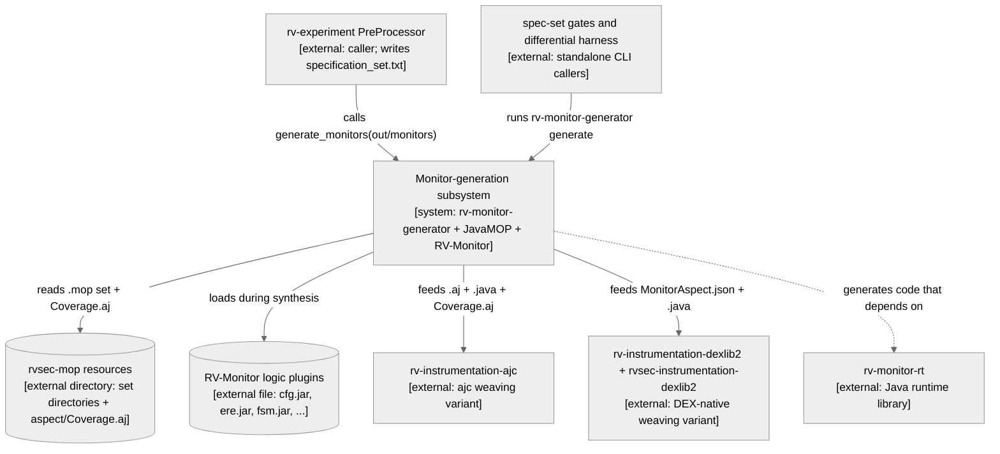
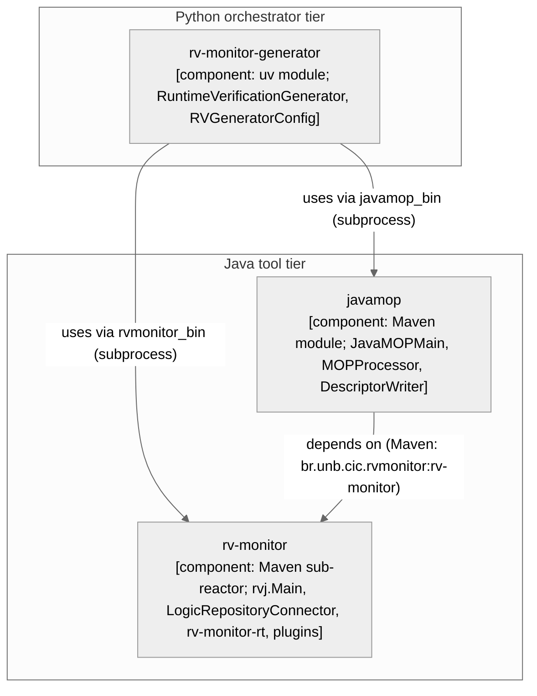
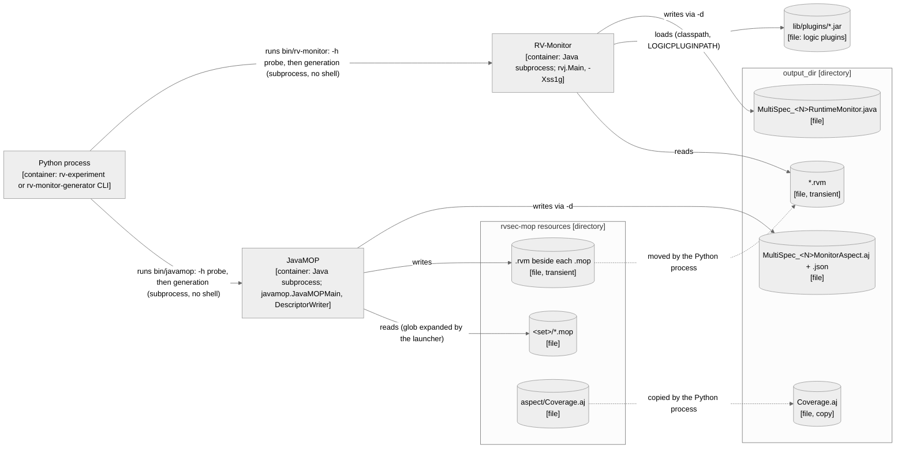
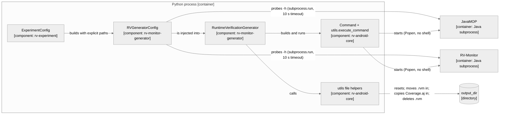
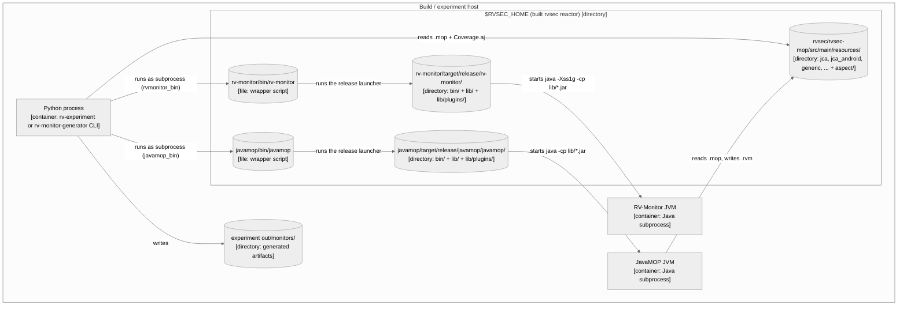

# Architecture — Monitor Generation Subsystem

> Target: subsystem-monitor-generation · Regenerate with: /rv-doc-arch subsystem:monitor-generation
> Scope: **subsystem** · Generated by `rv-doc-arch` from `rvsec@dc599aa5`
> Languages: Python (1 module, ~1,005 LOC orchestration) + Java (2 Maven trees, ~112k LOC: the forked `javamop` module and the `rv-monitor` sub-reactor)

## Table of Contents

- [Part I — Beyond Views](#part-i--beyond-views)
  - [1. Documentation overview](#1-documentation-overview)
  - [2. Conceptual primer](#2-conceptual-primer)
  - [3. System overview and context](#3-system-overview-and-context)
  - [4. How it works — end to end](#4-how-it-works--end-to-end)
  - [5. Core components](#5-core-components)
  - [6. Mapping between views](#6-mapping-between-views)
  - [7. Rationale](#7-rationale)
  - [8. Output artifacts](#8-output-artifacts)
  - [9. Directory](#9-directory)
- [Part II — Views](#part-ii--views)
  - [Module view](#module-view)
  - [Component-and-connector view](#component-and-connector-view)
  - [Allocation view](#allocation-view)
- [Appendices](#appendices)
- [Specification traceability](#specification-traceability)

---

## Part I — Beyond Views

### 1. Documentation overview

This document describes the **monitor-generation subsystem** of RV-Android: the first stage of
the instrumentation pipeline. It turns formal MOP specifications into the runtime-verification
artifacts that the downstream weavers consume. Its scope is one Python orchestrator module
(`rv-monitor-generator`) plus the two forked Java command-line tools it drives (`javamop`, and
`rv-monitor`, which is a multi-module reactor of its own). The audience is a new engineer with no
prior exposure to this subsystem. A top-to-bottom read tells you *what* it produces, *how*
a generation run flows through it, and *why* it is a thin Python driver over heavyweight Java
tools.

**How to read this document:** Part I builds your mental model — what the subsystem is
([primer](#2-conceptual-primer)), how it behaves end to end
([walkthrough](#4-how-it-works--end-to-end)), and why it is shaped this way
([rationale](#7-rationale)). Part II documents the selected views in detail.

### 2. Conceptual primer

The monitor-generation subsystem is the first stage of the RV-Android instrumentation
pipeline. Its input is a specification set: a directory of formal MOP specifications (`.mop` files
that describe legal API-usage patterns, for example "a `Cipher` must be `init()`ed before
`doFinal()`"). Its output is three artifacts that a runtime-verification run needs. The first is
one merged AspectJ aspect (`.aj`) that declares *where* in the bytecode to intercept method calls.
The second is one merged Java monitor class (`.java`) whose state machines decide *whether* an
observed call sequence is legal. The third is a JSON descriptor that mirrors the aspect for the
DEX-native weaver. Structurally the subsystem is a thin Python orchestrator
(`rv-monitor-generator`, one module, ~1k LOC). It runs two forked Java command-line tools, JavaMOP
and RV-Monitor, as subprocesses.

**Why this approach.** The obvious alternative is a MOP compiler written in Python. It would parse
the `.mop` grammar, build the FSM/ERE/LTL/CFG/PDA logic engines, and synthesize the monitor code
itself. RVSEC instead reuses the Runtime Verification Inc. toolchain
(`runtimeverification/javamop` and `runtimeverification/rv-monitor`), forked into the rvsec
reactor under `br.unb.cic.*` groupIds. This has costs: two heavyweight Maven builds, a JVM
start-up per invocation, and a Python→shell→Java process boundary. In return, RVSEC does not have
to reimplement a JavaCC grammar and ten logic plugins. The Python side owns orchestration,
configuration and path resolution, and two file-level workarounds for JavaMOP behavior. The fork
is not frozen, though. Where the generated artifacts themselves had to change, RVSEC changed the
Java tools: JavaMOP gained the `--emit-descriptor` JSON, and RV-Monitor gained the `__EVENTNAME`
macro expansion and the `try`/`finally` framing of the dispatcher lock.

**Key concepts**

- **MOP specification (`.mop`)** — A Monitoring-Oriented Programming spec: a text file pairing
  AspectJ-style events (method-call pointcuts) with a temporal or state-machine property that
  classifies event sequences as valid or violating. The specification sets live under
  `$RVSEC_HOME/rvsec/rvsec-mop/src/main/resources/`.
- **AspectJ pointcut / advice** — A pointcut is a pattern selecting join points (for example
  `call(* Cipher.getInstance(..))`); advice is code that runs before/after/around them. JavaMOP
  emits pointcut+advice as an `.aj` file; the advice body calls into the generated monitor.
- **`.rvm` intermediate** — The RV-Monitor input format: a monitor specification distilled from a
  `.mop`. JavaMOP writes it, RV-Monitor reads it, and the generator deletes it after synthesis.
- **RV-Monitor logic plugin** — One jar per formalism (`cfg`, `ere`, `fsm`, `ltl`, `pda`, `po`,
  `ptcaret`, `ptltl`, `srs`, `tfsm`) under the release's `lib/plugins/`. RV-Monitor loads them
  through `LOGICPLUGINPATH` to synthesize the monitor code for a spec's logic.
- **merged aspect (`-merge`)** — With `-merge`, all specs of a run are combined into a single
  `MultiSpec_<N>MonitorAspect.aj` and one `MultiSpec_<N>RuntimeMonitor.java`. One aspect then
  intercepts everything; without the flag there would be one aspect per spec, each adding its own
  runtime overhead.
- **descriptor JSON** — A `MultiSpec_<N>MonitorAspect.json` file emitted by the RVSEC-local
  `--emit-descriptor` option of JavaMOP. It holds the same pointcut, advice and monitor-call
  information as the `.aj`, as a JSON tree, so the DEX-native (dexlib2) weaver never has to parse
  textual AspectJ.
- **specification set** — A directory of `.mop` files used as a unit. `rv-experiment` selects one
  per run by name. The names are `jca` (the frozen Java SE cryptography set, 23 specs),
  `jca_android` (its successor for Android API 30: seeded from `jca`, extended since with junction
  and producer specifications, and carrying a `codes.csv` beside the `.mop` files), `generic`
  (general API-usage specs), and `custom` (a directory the caller supplies). Two more directories
  exist in the tree and have no name: `generic_new`, and the archived `jca_android_bug_predicate`.
- **`__EVENTNAME`** — A macro that a specification writes where its report needs the name of the
  offending event. RV-Monitor expands it. Inside an event body it becomes a string literal; inside
  a handler it becomes a call to the per-class helper `RVM_eventName()`.

### 3. System overview and context

The subsystem sits between the RVSEC specification tree and the two instrumentation variants. Its
input comes from the `rvsec-mop` resource tree, which holds the specification-set directories plus
an `aspect/` directory. Today `aspect/` contains one hand-written aspect, `Coverage.aj`.

The output feeds two consumers. The **ajc variant** (`rv-instrumentation-ajc`) copies the
generated `.aj` and `.java` files, together with `Coverage.aj`, into its working directory. It then
weaves them into APKs through dex2jar + ajc + d8. The **dexlib2 variant** (`rv-instrumentation-dexlib2`, which wraps
the Java engine `rvsec-instrumentation-dexlib2`) works differently. It reads the
`MultiSpec_*MonitorAspect.json` descriptor as its only pointcut/advice contract and compiles the
generated `.java`. It reimplements coverage natively instead of using `Coverage.aj`. The output
directory also serves as its `--monitor-src-dir`. The engine writes its own sources into it:
`mop/MonitorWrappers.java`, `mop/Coverage.java`, and, when the handler stamp is on,
`mop/RvsecStamp.java`.

The `rv-experiment` **PreProcessor** drives the subsystem in production. It obtains an
`RVGeneratorConfig` from `ExperimentConfig.get_monitored_operations_config()` and calls
`RuntimeVerificationGenerator(config).generate_monitors(<out>/monitors)`. It then records which set
produced the monitors. The standalone CLI (`rv-monitor-generator generate`) has a second group of
callers: the specification-set gates and the differential harness under `scripts/`, which generate
a set into a scratch directory.

Two further external systems take part. The **RV-Monitor logic plugins**, one jar per formalism,
are loaded from `lib/plugins/` while RV-Monitor synthesizes monitor code. **rv-monitor-rt**, the
RV-Monitor runtime library, is the only `rv-monitor` artifact used when the *app* runs. The
generated monitor depends on it, and instrumented APKs carry it. This subsystem does not produce
it.

**Constraints:** Generation runs entirely on the build/experiment host; no emulator or device is
involved. It requires the rvsec reactor to have been built (`mvn install`) under `RVSEC_HOME`, so
that the tools' assembled release layouts exist. The forked tools compile for Java 21, inherited
from `rvsec-parent`. Exactly one specification set is used per run, and sets are never mixed
(INV-INS-09).

Diagram 1 shows the subsystem as one box among its callers, its inputs and its consumers (C4
context level). Every view refers back to it.

**Diagram 1 — The monitor-generation subsystem among its callers, inputs and consumers.**

**Legend.** Rectangle = software system, container or component (the bracketed label gives the
C4 level; `external` = outside this subsystem); cylinder = file or directory on disk; solid
arrow = an action of the element at the tail (call, run, read, load, feed); dotted arrow =
compile/run-time dependency of the generated code, not a call.

### 4. How it works — end to end

The following walks through a concrete example: **generating the merged monitor for the
`jca_android` set during an `rv-experiment` run**. The generator runs JavaMOP and RV-Monitor over
every `.mop` file in `$RVSEC_HOME/rvsec/rvsec-mop/src/main/resources/jca_android/`, and the run
ends with `MultiSpec_1MonitorAspect.aj`, `MultiSpec_1MonitorAspect.json` and
`MultiSpec_1RuntimeMonitor.java` in the output directory.

1. **Set selection and fail-fast config.** `PreProcessor._generate_monitors` calls
   `ExperimentConfig.get_monitored_operations_config()`. That method resolves `RVSEC_HOME` (the
   `rvsec_root` field first, then the environment variable; INV-EXP-05). It then maps the set name
   to its directory with `resolve_spec_set_dir`. Static analysis uses the same mapping, so a run
   cannot instrument against one set and measure against another. The config is built with all
   four paths explicit, so `RVGeneratorConfig`'s highest-priority branch applies and
   `_resolve_from_rvsec_root` is not consulted. `model_post_init` still validates eagerly. It
   checks that both launchers exist and are executable, that both directories exist and are
   readable, and that at least one `.mop` is present. It also runs each launcher with `-h` under a
   10-second timeout and accepts *any* stdout/stderr, because the tools exit non-zero on `-h`.
   Concretely: `javamop_bin = $RVSEC_HOME/javamop/bin/javamop`; `rvmonitor_bin =
   $RVSEC_HOME/rv-monitor/bin/rv-monitor`; `mop_specs_dir = .../resources/jca_android`;
   `aspects_dir = .../resources/aspect`, or `custom_aspects_dir` when the experiment sets one.

2. **Reset output directory.** `generate_monitors(output_dir)` first calls
   `self.config.validate_output_directory(output_dir)` (mkdir + write-probe) and then
   `utils.reset_folder(output_dir)`. The reset deletes and recreates the directory, so no artifact
   from a previous set can leak into this run. Here `output_dir` is `<experiment out>/monitors/`
   (`MONITORS_DIR`).

3. **JavaMOP: `.mop` → `.aj` + `.json` + `.rvm`.** `_execute_javamop` builds
   `Command(javamop_bin, ['-d', output_dir, '-merge', '--emit-descriptor',
   '<mop_specs_dir>/*.mop'])` and runs it through `utils.execute_command`. `Command` starts the
   process without a shell, so the `*.mop` pattern reaches the launcher unexpanded. The launcher
   expands it, because it passes `$@` unquoted. Inside the JVM, `JavaMOPMain.process` calls
   `processMultipleFiles`. Each file is parsed by `SpecExtractor.parse`, and
   `MOPProcessor.generateRVFile` writes a per-spec `.rvm`. `FileCombiner.combineSpecFiles` then
   merges the specs, and `writeCombinedAspectFile` writes the merged `.aj` into `-d`. Because
   `--emit-descriptor` is set, `MOPProcessor.generateDescriptorFile` builds an `AspectJDescriptor`,
   which calls `DescriptorWriter.buildAspect`. That serializes the same combined model that
   produced the `.aj`, and `writeCombinedDescriptorFile` writes the JSON beside the aspect. In the
   descriptor, each `advices[]` entry carries `expression` (the pointcut as text, for example
   `call(...Cipher.getInstance(..)) && ...`) and `monitorCalls[]` naming the monitor method and its
   arguments. The aspect-level `imports` list is what the weaver uses to map `Cipher` to
   `Ljavax/crypto/Cipher;`.

4. **`.rvm` move.** `-d` relocates the `.aj` and `.json`, but JavaMOP writes each `.rvm` at the
   path of its source `.mop`. The generator compensates immediately with
   `utils.move_files_by_extension('.rvm', self.config.mop_specs_dir, output_dir)`. RV-Monitor reads
   `output_dir`, so without this move it would find no input and produce no monitor class.

5. **Copy custom aspects.** Still inside `_execute_javamop`,
   `utils.copy_files_by_extension('.aj', self.config.aspects_dir, output_dir)` copies every `.aj` in
   the aspects directory into the output directory. Today that is only `Coverage.aj`. It is woven by
   the ajc variant and logs each distinct executed method signature once, as
   `Log.v("RVSEC-COV", signature)`. Without it, the ajc variant's coverage would read 0%.

6. **RV-Monitor: `.rvm` → `.java`.** `_execute_rvmonitor` builds `Command(rvmonitor_bin, ['-d',
   output_dir, '-merge', '<output_dir>/*.rvm'])`. The release launcher builds a classpath from
   `lib/`, points `LOGICPLUGINPATH` at `lib/plugins/`, and runs the JVM with `-Xss1g`.
   `LogicRepositoryConnector` gets each spec's monitor logic from the plugin for its formalism, and
   the generator writes the merged monitor class. Two behaviors of the generator shape that class.
   First, each dispatcher spins on `tryLock()` of the file's single `ReentrantLock` and then enters
   a `try` whose `finally` releases the lock (INV-INS-129). Second, each monitor class carries an
   `RVM_eventNames` table and an `RVM_eventName()` decoder, which are used to expand
   `__EVENTNAME` (INV-INS-120). Before writing the file, `Main.checkNoUnexpandedEventNameMacro`
   aborts generation, naming file and line, if the literal `__EVENTNAME` has survived. The output is
   `MultiSpec_1RuntimeMonitor.java`, in package `mop`.

7. **Cleanup, result, provenance.** `_execute_rvmonitor` ends by calling
   `utils.delete_files_by_extension('.rvm', output_dir)`, because the intermediaries must not remain
   (INV-INS-04). `generate_monitors` then returns `True`. "Success" here means that both commands
   exited 0 and wrote nothing to stderr; the method does not inspect the artifacts. On `True`, the
   PreProcessor writes the provenance marker `specification_set.txt`, which holds the set name
   (INV-EXP-38). On `False`, it logs a warning and pre-processing continues.
   `get_generation_summary(output_dir)` reports integer counts of `.aj`, `.java` and
   `*MonitorAspect.json` files, plus the `.mop` count. The final `output_dir` holds
   `MultiSpec_1MonitorAspect.aj`, `MultiSpec_1MonitorAspect.json`, `MultiSpec_1RuntimeMonitor.java`,
   `Coverage.aj`, `specification_set.txt`, and no `.rvm` files.

### 5. Core components

`RuntimeVerificationGenerator` is the single runtime coordinator of the subsystem. It holds a
validated `RVGeneratorConfig`, a `LoggingManager` logger tagged with component context, and the
`ErrorHandler` singleton. `generate_monitors` is its pipeline entry point. It runs the two private
stage methods (`_execute_javamop`, `_execute_rvmonitor`) one after the other against a single
`output_dir`. Any exception in the pipeline goes to `ErrorHandler.handle_error` with a context dict
(`component`, `operation`, `output_dir`, `mop_specs_dir`, `pipeline_stage`) and becomes a `False`
return. `get_generation_summary` is a read-only report of what the directory contains. The class
never manages processes itself; each tool run goes through `rv_android_core`'s `Command` and
`utils.execute_command`. That helper raises `CommandException` on a non-zero exit *or* on any
stderr output.

`RVGeneratorConfig` is a Pydantic model. Its `model_post_init` runs resolution and validation
eagerly, so an operational error surfaces at construction (INV-INS-12) rather than in the middle
of the pipeline. It has four explicit path fields (`javamop_bin`, `rvmonitor_bin`,
`mop_specs_dir`, `aspects_dir`), an `rvsec_root` shortcut, and an `emit_descriptor` toggle
(default `True`). `_resolve_from_rvsec_root` encodes the reactor layout as path joins and defaults
`mop_specs_dir` to the `jca` set. `_validate_tool_functionality` probes each launcher with `-h`.

The set name becomes a directory in **`ExperimentConfig.resolve_spec_set_dir`**, which lives in
`rv-experiment`, outside this subsystem's paths. `jca`, `jca_android` and `generic` resolve to
`resources/<name>`; `custom` takes `custom_specs_dir`. The enumeration is closed (INV-INS-09):
`generic_new` and `jca_android_bug_predicate` have no value, and `ExperimentConfig.validate()`
rejects them by name.

The **JavaMOP CLI** is a JVM process. The `bin/javamop` wrapper hands over to the release launcher,
which sets `LOGICPLUGINPATH` and the `lib`/`lib/plugins` classpath and invokes
`javamop.JavaMOPMain`. From the Python side it is a black box, invoked once per generation with
`-d <out> -merge [--emit-descriptor] <specs>/*.mop`. It is the first filter of the chain:
`.mop` in; `.aj` and `.json` out into `-d`; `.rvm` out beside the specs.

The **RV-Monitor CLI** is the second filter: a JVM process invoked with `-d <out> -merge
<out>/*.rvm`. Its launcher puts the per-formalism plugin jars on the plugin path, and
`LogicRepositoryConnector` selects the right plugin per spec to emit the merged
`RuntimeMonitor.java`. It shares the output directory with JavaMOP as the hand-off medium: the
`.rvm` files arrive there through the Python move, RV-Monitor reads them, and the generator then
deletes them.

`DescriptorWriter`, with its entry class `AspectJDescriptor`, is the core of the RVSEC-local
JavaMOP patch. It walks the fully built `CombinedAspect` and its advices (`AdviceAndPointCut`).
At aspect level it emits `aspectName`, `fileName`, `shortName`, `package`, `imports`,
`commonPointcut` and the twelve-entry `baseAspectExclusions`. For each advice it emits `name`,
`specName`, `parameters`, `position`, `isAround`, the optional `returnType`, `returning`,
`throwing`, `expression`, and `monitorCalls[]`. Each monitor call carries `method`, `specName`,
`eventId`, `uniqueId`, `args` and `countCond`. Pointcut expressions stay strings, because the
expressions JavaMOP generates are regular enough for the weaver's own pointcut parser.

| Component | Realized by | Responsibility |
|-----------|-------------|----------------|
| `RuntimeVerificationGenerator` | `modules/rv-monitor-generator/src/rv_monitor_generator/runtime_verification_generator.py` | Drives the two-tool pipeline in-process; owns invocation order, workarounds, and error handling. |
| `RVGeneratorConfig` | `modules/rv-monitor-generator/src/rv_monitor_generator/config.py` | Priority-based path resolution and fail-fast validation of tools, directories, and spec availability. |
| Set resolver (external) | `modules/rv-experiment/src/rv_experiment/config.py` (`resolve_spec_set_dir`, `get_monitored_operations_config`) | Maps `specification_set` to a directory; builds the config with explicit paths. |
| JavaMOP CLI (subprocess) | `../javamop/bin/javamop`, `../javamop/src/main/scripts/bin/javamop`, `../javamop/src/main/java/javamop/JavaMOPMain.java` | Compiles a set's `.mop` into a merged `.aj` (+ `.json`), leaving `.rvm` beside the specs. |
| RV-Monitor CLI (subprocess) | `../rv-monitor/bin/rv-monitor`, `../rv-monitor/rv-monitor/src/main/scripts/bin/rv-monitor`, `../rv-monitor/rv-monitor/src/main/java/com/runtimeverification/rvmonitor/java/rvj/Main.java` | Synthesizes the merged monitor class from the `.rvm` intermediates using logic plugins. |
| `DescriptorWriter` / `AspectJDescriptor` | `../javamop/src/main/java/javamop/output/descriptor/DescriptorWriter.java`, `../javamop/src/main/java/javamop/output/AspectJDescriptor.java` | Serializes the AspectJ output model to JSON so the DEX-native weaver never parses textual `.aj`. |

### 6. Mapping between views

The module-view elements and the runtime (component-and-connector) elements correspond closely,
because the subsystem is small and mostly a driver. The Python module `rv-monitor-generator`
realizes two runtime components, `RuntimeVerificationGenerator` and `RVGeneratorConfig`, both
in-process Python objects. The Java module `javamop` realizes the JavaMOP CLI component and
contains `DescriptorWriter`. The Java module `rv-monitor` realizes the RV-Monitor CLI component. At
build time `javamop` depends on `rv-monitor` (Maven dependency `br.unb.cic.rvmonitor:rv-monitor`).
At generation time, however, the orchestrator drives the two CLIs independently, and their only
coupling is the shared output directory.

The **cross-language / process boundary** is the defining feature of this subsystem. The Python
orchestrator never links against Java code. It reaches JavaMOP and RV-Monitor only by starting
the `bin/javamop` and `bin/rv-monitor` shell launchers as **subprocesses**, with a new JVM per
call: `RVGeneratorConfig` runs each with `-h` through `subprocess.run`, and the generation runs go
through `rv_android_core`'s `Command` and `utils.execute_command`. Everything that
crosses the boundary is file-based. Command-line arguments go in, and an unexpanded glob is one of
them, expanded by the launcher. Files written to the shared `output_dir` (`.aj`, `.json`, `.java`)
come out, along with the `.rvm` files written beside the specs, plus the exit code and stderr.
There is no shared memory, no RPC and no serialized object across the boundary (Diagram 3 draws
it at container level). Because the file
system is the only integration medium, a single file operation (the `.rvm` move) is enough to
repair JavaMOP's output placement.

The same directory is also the boundary to the next stage. The ajc variant copies it into its own
temporary directory. The dexlib2 variant passes it to `instr-cli` as `--monitor-src-dir`, and
`instr-cli` writes `mop/*.java` sources into it before compiling everything under it.

For allocation, each Java tool is consumed as an **installed artifact**, not as a source module.
`maven-assembly-plugin` builds `target/release/javamop/javamop/` and `target/release/rv-monitor/`,
each with a `bin/` launcher and `lib/` + `lib/plugins/` jars. The Python side resolves the
module-root wrappers `$RVSEC_HOME/javamop/bin/javamop` and `$RVSEC_HOME/rv-monitor/bin/rv-monitor`,
which run those release launchers as child processes (Diagram 5). `RVSEC_HOME` is therefore the
root of a built rvsec reactor. The Docker image uses `/opt/rvsec`, a clone built with `mvn clean install -DskipTests
-DskipMopAgent`.

### 7. Rationale

The decisions that shaped this architecture, each with the tension behind it and the failure
mode it avoids.

**Reuse the forked RV toolchain instead of reimplementing MOP compilation.** The tension is
between owning a small Python codebase and reimplementing a large, subtle formal-methods pipeline.
RVSEC forked `runtimeverification/javamop` and `runtimeverification/rv-monitor` into the reactor,
rebasing the groupIds to `br.unb.cic.*`, and invokes them as CLIs. A Python MOP compiler would have
to reimplement a JavaCC grammar, ten logic formalisms and monitor code generation, all of which are
research-grade and easy to get subtly wrong. Without this decision the subsystem would be an order
of magnitude larger and would carry the correctness risk of a bespoke monitor synthesizer. The
price is a heavyweight Java/Maven build dependency and a JVM per invocation. The fork is changed
only where the generated artifacts must change, and each such change is pinned by an invariant
(see below).

**Merge all specs into one aspect (`-merge`) for both tools.** Both `_execute_javamop` and
`_execute_rvmonitor` pass `-merge`. Without it, a set would produce one `.aj`/`.java` per `.mop`.
Each aspect would install its own interception machinery into the woven APK and add per-call
overhead. Merging yields a single aspect that intercepts all monitored operations. This matters
because the woven code runs on an emulator during every test. It also leaves the weavers one
artifact to integrate instead of many.

**Emit a JSON descriptor to decouple the DEX-native weaver from textual `.aj`.** The dexlib2
variant weaves at the bytecode level and needs the pointcut, advice and monitor-call structure of
the aspect. Parsing textual AspectJ to get it would be brittle and would duplicate JavaMOP's work.
The RVSEC-local patch (`DescriptorWriter`/`AspectJDescriptor`, refs #52) instead serializes the
*same* in-memory model that produced the `.aj`, so the two cannot disagree about what is woven. The
rejected alternative, having the weaver parse `.aj`, would tie the weaver to AspectJ surface syntax
and break on any formatting change. `RVGeneratorConfig` enables `emit_descriptor` by default, so one
generation run serves both variants. With the flag off, the dexlib2 wrapper raises
`MissingDescriptorError`. The descriptor also carries the `imports` list, which the weaver uses to
map simple type names (`Cipher`) to DEX descriptors (`Ljavax/crypto/Cipher;`). It also carries the
pre-expanded twelve-entry `baseAspectExclusions` list (INV-INS-97).

**Work around JavaMOP's `.rvm` placement by moving files in Python.** JavaMOP writes each `.rvm`
at the path of its `.mop`, whatever `-d` says. The generator owns the fix in one line,
`utils.move_files_by_extension('.rvm', mop_specs_dir, output_dir)`, run immediately after the
JavaMOP call. Two alternatives were rejected. Patching JavaMOP's output routing would widen the
fork. Pointing RV-Monitor at `mop_specs_dir` would mix generated files into the specification tree.
Without the move, RV-Monitor would find nothing in `output_dir/*.rvm` and synthesize no monitor
class, violating INV-INS-01. After synthesis the pipeline deletes the `.rvm` files from
`output_dir` (INV-INS-04).

**Priority-based path resolution with fail-fast validation.** The subsystem runs on developer
checkouts, in CI and in the Docker image. `RVGeneratorConfig` resolves paths in a fixed priority
order (explicit paths > `rvsec_root` > `RVSEC_HOME`) and validates them eagerly in
`model_post_init`. A missing launcher or an empty spec directory therefore raises
`ConfigurationError` at construction, not three subprocesses deep. The rejected alternative, lazy
validation at execution, would report the failure mid-pipeline, after a JVM had already run, with a
partially populated output directory and a less actionable error. Failing fast keeps the error next
to its cause (INV-INS-12).

**Let the generator own report-side facts the monitor already holds.** A violation report needs
the name of the offending event, and the generated monitor already records the index of the last
event. Writing that bookkeeping by hand in every event body of every set would duplicate it, and
the copies would drift. RV-Monitor therefore expands `__EVENTNAME` itself. The expansion is a
string literal in an event body and a call to `RVM_eventName()` in a handler. The helper decodes
the index the way each monitor shape stores it and returns `none` before any event. Generation
fails closed if the macro survives (INV-INS-120). The dispatcher lock follows the same reasoning.
A generated file has one `ReentrantLock` shared by every specification, and waiters spin on
`tryLock()`. An exception that skipped `unlock()` would therefore stall every monitored call from
every other thread. The generator frames the region in `try`/`finally` and changes nothing else
about the dispatcher (INV-INS-129).

**Decisions at a glance**

| Decision | Drivers | Invariant / ADR |
|----------|---------|-----------------|
| Reuse forked RV toolchain vs. reimplement MOP compilation | avoid reimplementing the `.mop` grammar + 10 logic plugins; small Python surface | — |
| Merge all specs into one aspect (`-merge`) | one woven aspect vs. N; one artifact for the weavers | — |
| Emit JSON descriptor to decouple dexlib2 weaver from `.aj` | weaver must not parse AspectJ; type-name resolution via `imports` | INV-INS-97 |
| Move `.rvm` in Python | JavaMOP writes `.rvm` beside the `.mop`; RV-Monitor reads the output dir | INV-INS-04 |
| Priority-based path resolution + fail-fast validation | dev/CI/Docker layouts; fail before running any tool | INV-INS-12 |
| Generator expands `__EVENTNAME` and frames the dispatcher lock | no per-spec bookkeeping; a throwing handler must not stall other threads | INV-INS-120, INV-INS-129 |

**Patterns and styles**

At the module level the subsystem is **layered** and structured by **uses** relations. The Python
orchestrator sits above the Java tool layer, the dependency runs one way and is acyclic, and
`javamop` depends on `rv-monitor`, not the reverse. At the component-and-connector level it is a
**pipe-and-filter** chain: `.mop` → JavaMOP → `.aj` + `.rvm` → RV-Monitor → `.java`, with the
shared output directory as the connector. That chain runs over a **client-server** substrate: the
Python orchestrator is the client, and each Java tool is a request/response subprocess with its own
JVM start-up. At the allocation level it follows an **install** style. The Maven assembly produces
`bin/` + `lib/` + `lib/plugins/` release layouts, and the Python side reaches them through wrappers
resolved under `$RVSEC_HOME`.

**NFRs served**

**Compatibility** (NFR07) comes from reaching the RVSEC toolchain entirely through external
processes: the Python side carries no JVM dependency of its own. Descriptor emission is additive.
It adds a file without changing the `.aj`, `.rvm` or `.java`, and when the JavaMOP on the path
writes no descriptor, `get_generation_summary` reports `descriptors: 0`, so a caller can see the
mismatch.

**Configurability** (NFR05) comes from making every path a Pydantic field with a documented
resolution order (explicit → `rvsec_root` → `RVSEC_HOME` → `ConfigurationError`). The CLI exposes
the four paths and `--rvsec-root` as flags; `emit_descriptor` is set only through the library API.
`rv-experiment` builds an `RVGeneratorConfig` just in time, from the `specification_set` name and an
optional `custom_aspects_dir`.

**Resilience** (NFR04) comes from one try/except around the whole pipeline. Any exception,
including a `CommandException` for a non-zero exit or stderr output, goes through the centralized
`ErrorHandler` with a structured context, and the method returns `False` instead of propagating.
Configuration problems are caught earlier, at construction. In the generated code, the lock framing
keeps an exception raised in one specification from stalling the others.

**Reproducibility** (NFR08) holds because generation is deterministic for a given set. The output
directory is reset before every run, and the same `-merge` invocation over the same `.mop` set
yields the same merged artifacts. The provenance marker also lets a resumed run refuse monitors
that were generated from another set (INV-EXP-38).

| NFR | PRD ID | Architectural support |
|-----|--------|-----------------------|
| Compatibility | NFR07 | External-process integration; additive descriptor emission; `descriptors: 0` makes a missing descriptor observable. |
| Configurability | NFR05 | Priority-based path resolution (explicit → `rvsec_root` → `RVSEC_HOME` → error); path flags on the CLI; injected by `rv-experiment`. |
| Resilience | NFR04 | Whole-pipeline try/except → `ErrorHandler` → `False`; config errors at construction; lock released on every exit in generated code. |
| Reproducibility | NFR08 | Output dir reset each run; deterministic `-merge` output; provenance marker checked under `--skip-monitors`. |

### 8. Output artifacts

A successful generation leaves the generated monitor artifacts (aspect, monitor class, descriptor)
and the copied custom aspect in the monitor output directory. In an `rv-experiment` run the
PreProcessor adds the provenance marker. These files are the whole contract with the downstream
weavers. The dexlib2 engine later adds its own `mop/*.java` sources to the same directory; those
are its outputs, not this subsystem's.

| Artifact | Location | Notes |
|----------|----------|-------|
| `MultiSpec_<N>MonitorAspect.aj` | `output_dir` | Merged AspectJ aspect (pointcuts + advice) from JavaMOP; consumed by the ajc variant. |
| `MultiSpec_<N>RuntimeMonitor.java` | `output_dir` | Merged monitor class (package `mop`) from RV-Monitor; compiled into instrumented APKs by both variants. |
| `MultiSpec_<N>MonitorAspect.json` | `output_dir` | Descriptor (`emit_descriptor` default on); consumed by the dexlib2 variant; absent → `MissingDescriptorError`. |
| `Coverage.aj` | `output_dir` | Copied from `aspects_dir`; ajc variant only; logs each distinct executed signature once under `RVSEC-COV`. |
| `specification_set.txt` | `output_dir` | Written by the PreProcessor after a successful generation; names the set (INV-EXP-38). |

### 9. Directory

**Glossary / acronyms**

- **MOP** — Monitoring-Oriented Programming; here, "monitored operations" (any operation watched
  by a specification), not specifically security operations.
- **JCA** — Java Cryptography Architecture; the `jca` set (23 specs, frozen) and its successor
  `jca_android`.
- **AspectJ / `.aj`** — Aspect-oriented weaving language; the pointcut+advice source JavaMOP emits.
- **`.rvm`** — RV-Monitor input format; a transient monitor specification.
- **FSM / ERE / LTL / CFG / PDA** — logic formalisms, one RV-Monitor plugin jar each.
- **ajc / dexlib2** — the two instrumentation (weaving) variants consuming this subsystem's output.
- **`rv-monitor-rt`** — RV-Monitor runtime library, carried into instrumented APKs.
- **`__EVENTNAME`** — macro expanded by RV-Monitor to the name of the offending event.

**References**

- Instrumentation domain spec: `openspec/specs/instrumentation/spec.md`; set selection and
  provenance: `openspec/specs/experiment/spec.md`.
- Module docs: `modules/rv-monitor-generator/CLAUDE.md` and its per-module 4+1 doc
  `modules/rv-monitor-generator/docs/architecture.md`; Java tool guides `../javamop/CLAUDE.md` and
  `../rv-monitor/CLAUDE.md`.
- Forked upstream tools: `runtimeverification/javamop`, `runtimeverification/rv-monitor`
  (internalized under `br.unb.cic.*`).
- Descriptor patch: refs #52 (`DescriptorWriter` / `AspectJDescriptor`).

---

## Part II — Views

### Module view

*Style(s): layered, uses*

This view shows the static, build-time structure: the Python orchestrator tier above the two Java
tool tiers, and the acyclic dependencies among them. It shows that the subsystem is a thin driver
over two large, independently built tools. The only build-time coupling between the tools is
JavaMOP's Maven dependency on RV-Monitor, which mirrors the data flow: JavaMOP's `.rvm` output is
RV-Monitor's input. The "uses" relations on the same picture show which unit requires which. The
generator uses both tool launchers, and JavaMOP uses RV-Monitor as its monitor-synthesis backend.

**Primary presentation** — components in their tiers (C4 component level).

**Diagram 2 — The Python orchestrator tier above the two Java tool modules.**

**Legend.** Rectangle = component (the bracketed label gives its kind and main classes); frame =
tier; solid arrow = uses or build dependency, labeled with its mechanism.

**Element catalog**

The module `rv-monitor-generator` is the orchestrator tier. It has two behavioral classes and a
CLI. `RVGeneratorConfig` (a `BaseValidatedModel`) resolves and validates every path at construction
(`model_post_init` → `_resolve_paths` → `_validate_configuration`). Resolution tries three sources
in order. First come explicit paths: when `javamop_bin`, `rvmonitor_bin` and `mop_specs_dir` are
all given, `aspects_dir` defaults to the `aspect` directory beside `mop_specs_dir`. Then comes
`rvsec_root`, then the `RVSEC_HOME` variable, and with none of them the result is
`ConfigurationError`. `RuntimeVerificationGenerator.generate_monitors(output_dir)` is the pipeline:
`validate_output_directory` → `reset_folder` → `_execute_javamop` → `_execute_rvmonitor`, all
inside one try/except. The CLI (`rv-monitor-generator generate`, in `__main__.py`) builds the config
from `--rvsec-root`, `--javamop-bin`, `--rvmonitor-bin`, `--specs-dir` and `--aspects-dir`. The
module's difficulty is concentrated at its seams with JavaMOP. It must know that `.rvm` files land
beside the specs, and that the JavaMOP it finds may or may not write a descriptor.

**Why separate:** a separate module draws a clean line between *producing* monitors and *weaving*
them. Both weaving variants consume the artifacts of one generation run, so neither weaver owns the
JavaMOP/RV-Monitor invocation. The Java toolchain dependency and its subprocess quirks sit behind
one small, testable Python surface. That same surface is what the specification-set gates and the
differential harness call.

**Gotchas:**

- `generate_monitors` does not check that a `.aj` or `.java` was produced. It returns `True` when
  both commands exit 0 with empty stderr. The instrumentation spec records that the toolchain can
  exit 0 on failure (INV-INS-139, INV-INS-145). Callers that need certainty therefore inspect the
  directory, as the differential harness does by testing for `MultiSpec_1RuntimeMonitor.java`.
- The `.rvm` move takes *every* `.rvm` in `mop_specs_dir`, not only those of the current run. It
  also needs `mop_specs_dir` to be writable by JavaMOP, although validation checks only that it is
  readable. `rvsec-mop/.gitignore` ignores `*.rvm` because the files land there.
- The `-h` probe has a 10-second timeout. A cold JVM on a loaded machine can miss it and raise
  `ConfigurationError`; the differential harness retries once for this reason. The probe accepts
  *any* output, and that includes the shell's error when a wrapper's release launcher has not been
  built.
- `emit_descriptor` has no CLI flag. The CLI always runs with the default (`True`).

The module `javamop` is the MOP→AspectJ compiler tier. `JavaMOPMain.main` parses the CLI flags with
JCommander into `JavaMOPOptions`. `process` then collects the `.mop` files and, with `-merge`, calls
`processMultipleFiles`. Each spec is parsed by `SpecExtractor` into a `MOPSpecFile`, and
`MOPProcessor.generateRVFile` writes its `.rvm` at the `.mop`'s own path.
`FileCombiner.combineSpecFiles` merges the specs, and `writeCombinedAspectFile` emits the merged
`.aj`. With `--emit-descriptor`, `writeCombinedDescriptorFile` writes the JSON beside the `.aj`. The
build is Maven, with a JavaCC-generated parser and a `maven-assembly-plugin` producing
`target/release/javamop/javamop/`.

**Why separate:** JavaMOP is a large upstream tool internalized as a fork. It stays its own Maven
module so that RVSEC can carry a small local patch (the `--emit-descriptor` seam, refs #52) while
the `.mop` grammar and AspectJ generation stay behind a CLI that the Python orchestrator treats as a
black box.

**Gotchas:**

- The module-root `bin/javamop` is exactly the path the generator resolves under `$RVSEC_HOME`. It
  only runs `target/release/javamop/javamop/bin/javamop`, which exists after `mvn package` or
  `mvn install` of the reactor.
- With more than one file, `-merge` auto-names the aspect `MultiSpec_<n>`, because the generator
  does not pass `-n`. The suffix `n` is the first number for which `JavaMOPAgent<n>.aj` is absent
  from the output directory. With a *single* file, the aspect takes the file's base name.
- The descriptor JSON is RVSEC-only. The patch adds `jackson-databind` 2.18.2. `DescriptorWriter`
  mirrors the AspectJ output model and must be kept in step with it. `generateDescriptorFile` must
  run after `generateAJFile`, because `MOPNameSpace` can be initialized only once.

The module `rv-monitor` is the `.rvm`→`.java` compiler tier, and it also ships the runtime library.
Its `pom.xml` is a sub-reactor (`rv-monitor-parent`, packaging `pom`) that aggregates `rv-monitor-rt`
(the runtime library), `logicrepository` (plugin infrastructure), `plugins_logicrepository` (one
module per formalism) and `rv-monitor` (the generator, `com.runtimeverification.rvmonitor.java.rvj.Main`).
For each `.rvm` spec, `LogicRepositoryConnector` obtains the monitor logic from the matching plugin.
The output classes (`BaseMonitor`, `RawMonitor`, `HandlerMethod`, `Advice`) then render the merged
`<name>RuntimeMonitor.java`.

The generator has two RVSEC-specific behaviors. `Advice` frames every dispatcher's lock region in
`try`/`finally` (INV-INS-129). `BaseMonitor` emits the per-class `RVM_eventNames` table and the
`RVM_eventName()` decoder, and expands `__EVENTNAME` in event and handler bodies (INV-INS-120);
`RVMNameSpace` reserves both names. `Main.checkNoUnexpandedEventNameMacro` throws `RVMException`
before writing if the literal survives. At *runtime*, only `rv-monitor-rt.jar` is used. Its
`ViolationRecorder` selects the stack frames that become a violation's reported location, and
excludes monitoring-runtime frames.

**Why separate:** the module plays two roles the subsystem must not conflate. It is a build-time
code generator, invoked here. It is also a runtime library (`rv-monitor-rt`), which is part of the
output contract but outside this subsystem's processes. Keeping the plugin-per-formalism
decomposition intact means a new logic can be added as a plugin jar without touching the generator.

**Gotchas:**

- The groupId (`br.unb.cic.rvmonitor`) differs from the Java packages
  (`com.runtimeverification.rvmonitor.*`), so grep the packages.
- The module-root `bin/rv-monitor` only runs `target/release/rv-monitor/bin/rv-monitor`.
- Plugin jars are named by the assembly's `outputFileNameMapping` (`fsm.jar`, `ere.jar`, …), so
  renaming one breaks logic resolution.
- The `installer` submodule is commented out of `<modules>`.
- `javacc-maven-plugin` is pinned to `jdkVersion 1.6` (here and in `javamop`) while the reactor
  compiles for Java 21.
- The spec records a parser ceiling: `CipherSpec` with 18 events raises `StackOverflowError` in the
  enable-set parser at any heap, so its alphabet is capped at 17 (INV-INS-145).

| Element | Responsibility | Relations / interfaces |
|---------|----------------|------------------------|
| `rv-monitor-generator` (Python) | Orchestrates the two-tool pipeline; owns path resolution, the `.rvm` move, aspect copy, error handling; standalone CLI. | uses `javamop`, `rv-monitor` launchers (subprocess) |
| `javamop` (Java) | Parses `.mop`; emits `.rvm` + merged `.aj` + (patch) `.json`. | Maven-depends `rv-monitor`; contains `DescriptorWriter` |
| `rv-monitor` (Java reactor) | Compiles `.rvm` → merged `.java` (event-name table, lock framing); ships `rv-monitor-rt` + logic plugins. | contains the RV-Monitor CLI; consumed by `javamop` build |

**Context** — see [system context](#3-system-overview-and-context).

**Variability guide**

The build-time variability point is the descriptor patch. The `javamop` module carries the
RVSEC-local `--emit-descriptor` support, whose only extra dependency is `jackson-databind`. The
rest of the structure is fixed. The specification *set* is not a module-view variation: it is a
runtime input, selected through `mop_specs_dir`.

**Rationale**

The layered split keeps monitor *semantics*, the formal-methods code in JavaMOP and RV-Monitor,
inside the Java tier. The Python tier owns only orchestration and two file-level workarounds.
Changes to what the generated monitor contains (event names, lock framing) are therefore made in the
Java tier, where the code is generated. Both weaving variants share a single generation run. The
acyclic `javamop → rv-monitor` dependency mirrors the data flow (the `.rvm` JavaMOP produces is
RV-Monitor's input) and guarantees there is no build-time cycle to untangle.

### Component-and-connector view

*Style(s): pipe-and-filter, client-server*

This view shows the runtime shape of a single generation run, read in two ways. As a
**pipe-and-filter** chain, it is a linear transformation `.mop` → `.aj`+`.rvm` → `.java`: each tool
is a filter, and the shared output directory (with the moved `.rvm` files) is the connector. As a
**client-server** interaction, the Python orchestrator (client) makes two request/response
subprocess calls to the Java tools (servers), each with a JVM start-up and a process boundary. The
pipe-and-filter reading explains the artifact flow and the `.rvm` move. The client-server reading
explains why the boundary is file-based and why failures come back as `CommandException`.

**Primary presentation** — running containers and the files they exchange (C4 container level).

**Diagram 3 — One generation run: the Python process, the two Java subprocesses and their files.**

**Legend.** Rectangle = running process `[container]`; cylinder = file on disk; frame = directory
holding the files drawn inside it; solid arrow = an action of the process at the tail (run, read,
write, load), labeled with its mechanism where it crosses a process boundary; dotted arrow = file
moved or copied by the Python process between the two directories.

The Python process does more than start the two tools, and Diagram 4 is the inside of the Python
process container from Diagram 3: the classes that resolve the configuration, run the stages and
touch the files.

**Diagram 4 — Inside the Python process: configuration, orchestration and the core helpers.**

**Legend.** Rectangle = component inside the frame, container outside it (the bracketed label
says which, and for a component the uv module that holds it); cylinder = directory on disk; frame
= the Python process container from Diagram 3; solid arrow = call or invocation, labeled with its
mechanism where it crosses the process boundary.

**Element catalog**

| Component / connector | Type | Responsibility |
|-----------------------|------|----------------|
| Python process | container (Python process) | The `rv-experiment` CLI (PreProcessor) or the standalone `rv-monitor-generator` CLI; imports `rv-monitor-generator` and `rv-android-core`; hosts the components of Diagram 4. |
| JavaMOP | container (Java subprocess) | Filter 1: `.mop` in → `.aj` + `.json` into `output_dir`, `.rvm` beside the specs. Started through `bin/javamop` and the release launcher, which runs `java ... javamop.JavaMOPMain`. |
| RV-Monitor | container (Java subprocess) | Filter 2: `.rvm` in → `.java` out; fails closed on an unexpanded `__EVENTNAME`. Started through `bin/rv-monitor` and the release launcher, which runs `java -Xss1g ... rvj.Main`. |
| `<set>/*.mop` | file (input) | The specification set; the unexpanded glob reaches the launcher, which expands it. |
| `.rvm` beside each `.mop` | file (transient) | Written by JavaMOP at the `.mop`'s own path, whatever `-d` says. |
| `aspect/Coverage.aj` | file (input) | The hand-written coverage aspect copied into `output_dir`. |
| `MultiSpec_<N>MonitorAspect.aj` + `.json` | file (output) | Merged aspect and its descriptor, written by JavaMOP into `-d`. |
| `output_dir/*.rvm` | file (transient) | The moved `.rvm` files, read by RV-Monitor and deleted after synthesis (INV-INS-04). |
| `MultiSpec_<N>RuntimeMonitor.java` | file (output) | Merged monitor class, written by RV-Monitor into `-d`. |
| `Coverage.aj` (copy) | file (output) | The copy in `output_dir` that the ajc variant weaves. |
| `lib/plugins/*.jar` | file (logic plugins) | One jar per formalism in the RV-Monitor release, put on the classpath and on `LOGICPLUGINPATH` by the launcher. |
| `ExperimentConfig` (set resolver) | component (class, external) | Maps `specification_set` to its directory; constructs the config with explicit paths. |
| `RVGeneratorConfig` | component (class) | Validated, constructor-injected configuration; resolves tool/dir paths fail-fast; probes each launcher with `-h`. |
| `RuntimeVerificationGenerator` | component (class) | In-process client; runs the two stages sequentially and funnels failures to `ErrorHandler`. |
| `Command` + `utils.execute_command` | component (`rv-android-core`) | Starts a launcher with `Popen` and no shell; raises `CommandException` on a non-zero exit or any stderr output. |
| `utils` file helpers | component (`rv-android-core`) | `reset_folder`, `move_files_by_extension`, `copy_files_by_extension`, `delete_files_by_extension`. |
| `output_dir` | directory | The run's output directory (`<experiment out>/monitors/` under `rv-experiment`). |
| `DescriptorWriter` | component (class, inside the JavaMOP container) | Emits the JSON descriptor mirroring the `.aj` when `--emit-descriptor` is set. |
| shared `output_dir` | connector (pipe) | The hand-off medium; the `.rvm` files moved from `mop_specs_dir` are the JavaMOP→RV-Monitor pipe. |
| subprocess call | connector (client-server) | `Command` + `utils.execute_command` over the `bin/` launchers; request via argv, response via files, exit code and stderr. |

**Context** — see [system context](#3-system-overview-and-context).

**Variability guide**

The behavioral variability points are configuration. The first is the `emit_descriptor` toggle on
`RVGeneratorConfig` (default `True`). With it on, JavaMOP also writes the `.json` descriptor for
the dexlib2 weaver. With it off, the `.aj`/`.rvm`/`.java` outputs are unchanged and only the
descriptor is absent. The second is the specification set. In `rv-experiment` it is chosen by name
(`jca`, `jca_android`, `generic`) or as a `custom` directory; the standalone CLI takes any directory
through `--specs-dir`. The third is the aspects directory, which `rv-experiment` lets a caller
override with `custom_aspects_dir`.

**Scenarios**

- **WHEN** `generate_monitors` runs with `emit_descriptor=True` but the JavaMOP on the resolved
  path writes no descriptor, **THEN** the `.aj`/`.java` artifacts are still produced, no
  `MultiSpec_*MonitorAspect.json` appears, and `get_generation_summary` reports `descriptors: 0`,
  **AND** instrumenting with the dexlib2 variant raises `MissingDescriptorError`, while the ajc
  variant is unaffected. *Why:* the descriptor is additive and the ajc pipeline never reads it; the
  zero count lets a caller detect the mismatch instead of discovering it at weave time.

- **WHEN** JavaMOP finishes writing artifacts under `-d output_dir`, **THEN** the `.rvm` files are
  in `mop_specs_dir`, not in `output_dir`, so the generator runs
  `utils.move_files_by_extension('.rvm', mop_specs_dir, output_dir)` before invoking RV-Monitor,
  **AND** RV-Monitor reads `output_dir/*.rvm`, synthesizes the monitor `.java`, and the generator
  deletes the `.rvm` files (INV-INS-04). *Why:* JavaMOP writes each `.rvm` at its `.mop`'s path;
  without the move RV-Monitor sees no input and produces no monitor class, violating INV-INS-01.

- **WHEN** RV-Monitor exits non-zero or writes to stderr while processing the `.rvm` files,
  **THEN** `utils.execute_command` raises `CommandException`, `generate_monitors` passes it to
  `ErrorHandler.handle_error` with context `{component, operation, output_dir, mop_specs_dir,
  pipeline_stage}` and returns `False`, **AND** the PreProcessor logs "Monitor generation failed",
  writes no provenance marker, and continues with the remaining pre-processing steps. *Why:* the
  generator reports a boolean and leaves the decision to its caller (NFR04); the missing marker is
  what a later `--skip-monitors` run sees.

- **WHEN** `RVGeneratorConfig` is constructed with `mop_specs_dir` pointing at a directory holding
  zero `.mop` files, **THEN** `model_post_init` → `_validate_mop_specifications` raises
  `ConfigurationError` at construction, listing the available specification sets (JCA, Generic),
  **AND** no JavaMOP or RV-Monitor process is launched. *Why:* fail-fast validation (INV-INS-02,
  INV-INS-12) keeps the error next to the misconfiguration instead of surfacing it after a JVM has
  run and left a partial output directory.

- **WHEN** a resumed run passes `--skip-monitors` with `specification_set` `jca_android` and
  `out/monitors/specification_set.txt` reads `jca`, **THEN** the PreProcessor raises
  `PreProcessingConfigurationError` naming both sets, **AND** a directory with no marker only
  produces a warning. *Why:* the sets share most monitor file names, so the directory cannot be
  identified by its contents (INV-EXP-38).

- **WHEN** a specification writes `__EVENTNAME` inside `@fail` and a trace drives the monitor to
  `fail` through event `init`, **THEN** the handler's expansion, a call to `RVM_eventName()`,
  yields `init`, **AND** if the literal `__EVENTNAME` is left anywhere in the generated Java,
  `Main` aborts generation naming the file and line. *Why:* the monitor already records the last
  event; the helper decodes it per monitor shape and returns `none` before any event (INV-INS-120).

- **WHEN** a guard or handler raises inside a dispatcher's lock region, **THEN** the `finally`
  releases the lock and the exception propagates to the application, **AND** a monitored call of
  any specification from another thread still acquires the lock. *Why:* one lock serves every
  specification and waiters spin on `tryLock()`, so a lock left held would stall all of them
  (INV-INS-129).

- **WHEN** `rv-experiment` is given `--specification-set jca_android_bug_predicate`, **THEN**
  `ExperimentConfig.validate()` raises `ValueError` listing `jca`, `jca_android`, `generic`,
  `custom`, **AND** the directory still exists and is reachable only as a `custom` path. *Why:* a
  reproved instrument must not be one flag away from an experiment (INV-INS-09).

- **WHEN** a `custom` set holds a single `.mop` named `Foo.mop`, **THEN** JavaMOP names the outputs
  `FooMonitorAspect.aj`/`.json` instead of `MultiSpec_1…`, **AND** the dexlib2 wrapper's default
  `descriptor_glob` (`MultiSpec_*MonitorAspect.json`) matches nothing. *Why:*
  `processMultipleFiles` assigns the `MultiSpec_<n>` name only when there is more than one file.

- **WHEN** the standalone CLI is invoked as `rv-monitor-generator generate --output <dir>
  --summary`, **THEN** generation succeeds but printing the summary raises `TypeError`, which the
  CLI's generic handler reports as "Unexpected Error" with exit code 1, **AND** the programmatic API
  (`generate_monitors` + `get_generation_summary` read as a dict of ints) used by `rv-experiment` is
  unaffected. *Why:* `handle_generate_command` indexes `summary['aspectj_files']['count']`, but the
  summary holds integers.

**Rationale**

Pipe-and-filter is the natural fit for a linear compilation chain. Modeling the shared directory
as the connector makes the `.rvm` move a first-class architectural concern rather than an
implementation detail: the connector is broken by JavaMOP's `.rvm` placement and repaired by the
Python move. The client-server overlay explains the cost structure (a JVM per call) that motivates
`-merge`. It also explains why failures are boolean returns rather than exceptions: the client owns
the failure path, and its caller decides what to do. Publish-subscribe and shared-data styles do
not apply, because there is no event bus and no concurrent store; the pipeline is a synchronous
two-stage sequence over a sequential pipe.

### Allocation view

*Style(s): install*

This view shows how the software elements are laid out on the build/experiment host and how the
Python side finds them. The Python orchestrator does not depend on the Java *source* modules. It
depends on their *assembled release* layout, which the Maven build writes under each tool's
`target/release/` and which the module-root `bin/` wrappers point to. Knowing this layout is what
lets a new engineer reason about "tool not found" failures. A typical case is a fresh checkout,
where `bin/javamop` exists but `target/release/` has not been built yet.

**Primary presentation** — the containers on the host and the files they start from.

**Diagram 5 — The Python process, the installed tool releases and the two JVMs on the host.**

**Legend.** Rectangle = running process `[container]`; cylinder = file or directory on disk (the
bracketed label says which); inner frame = the `$RVSEC_HOME` directory; outer frame = the host;
solid arrow = an action of the element at the tail, where a script "runs" the next step and a
release launcher "starts" the JVM.

**Element catalog**

| Software element | Allocated to | Notes |
|------------------|--------------|-------|
| Python process (imports `rv-monitor-generator`, `rv-android-core`; hosts `RuntimeVerificationGenerator` / `RVGeneratorConfig`) | Host; the modules are installed in the shared `.venv` | In-process; no JVM dependency of its own. |
| JavaMOP JVM | Host, child of the release launcher | `java -cp lib/*.jar ... javamop.JavaMOPMain`, one per `-h` probe and one per generation. |
| RV-Monitor JVM | Host, child of the release launcher | `java -Xss1g -cp lib/*.jar:lib/plugins/*.jar ... rvj.Main`, one per `-h` probe and one per generation. |
| JavaMOP wrapper | `$RVSEC_HOME/javamop/bin/javamop` | The path the generator resolves; runs the release launcher as a child process. |
| JavaMOP release | `$RVSEC_HOME/javamop/target/release/javamop/javamop/` (`bin/` + `lib/` + `lib/plugins/`) | Built by `maven-assembly-plugin`; the launcher sets `LOGICPLUGINPATH` and the classpath. |
| RV-Monitor wrapper | `$RVSEC_HOME/rv-monitor/bin/rv-monitor` | The path the generator resolves; runs the release launcher as a child process. |
| RV-Monitor release | `$RVSEC_HOME/rv-monitor/target/release/rv-monitor/` (`bin/` + `lib/` + `lib/plugins/`) | Plugin jars named by `outputFileNameMapping`; launcher runs the JVM with `-Xss1g`. |
| Spec + aspect resources | `$RVSEC_HOME/rvsec/rvsec-mop/src/main/resources/` | Set directories (`jca`, `jca_android`, `generic`, plus the unnamed `generic_new` and `jca_android_bug_predicate`) and `aspect/Coverage.aj`. Must be writable: JavaMOP writes `.rvm` there. |
| Generated artifacts | `<experiment out>/monitors/` | Output of a run; consumed by the weavers. |

**Context** — see [system context](#3-system-overview-and-context).

**Variability guide**

The install locations vary through `RVGeneratorConfig`'s resolution order. Explicit per-tool paths
override the `rvsec_root` shortcut, which overrides the `RVSEC_HOME` environment variable. This lets
the same code run against a developer checkout, a CI build, or the Docker image (`RVSEC_HOME=/opt/rvsec`)
without changes to the orchestrator.

**Rationale**

Depending on the *assembled* release rather than the source modules keeps the Python side free of
the Java build: it needs only executable launchers and readable (and, for the spec directory,
writable) resources on disk. The assembly's `bin/ + lib/ + lib/plugins/` convention is the same for
both tools, and both expose a module-root wrapper. A single `_resolve_from_rvsec_root` layout
function can therefore locate both, with no knowledge of the `target/release/` paths behind the
wrappers. The consequence is a build-order dependency: the reactor must be installed before the
first generation. Until it is, construction does not catch the gap. The wrappers exist and are
executable, and the `-h` probe accepts the shell's own "No such file or directory" message as
output. The missing release surfaces only when `_execute_javamop` runs the wrapper: it exits 127
with stderr, so `generate_monitors` returns `False`.

---

## Appendices

### A. Dependencies

**Python (`rv-monitor-generator`).** The module has no heavy third-party dependencies of its own.
It depends on `rv-android-core` for `Command`, `utils.execute_command`, the file-operation helpers
(`reset_folder`, `move_files_by_extension`, `copy_files_by_extension`,
`delete_files_by_extension`), `LoggingManager`, the singleton `ErrorHandler`, and the shared
`BaseValidatedModel`; and on Pydantic (`>=2.9.0`). All monitor-synthesis dependencies live in the
Java tier and are reached only as external processes.

**Java (`javamop`).** A Maven module that depends on `br.unb.cic.rvmonitor:rv-monitor`. It uses
JCommander 1.35 for CLI parsing and a JavaCC-generated `.mop` parser (`javacc-maven-plugin`,
`jdkVersion 1.6`). `maven-assembly-plugin` packages it into a `bin/` + `lib/` + `lib/plugins/`
release. The RVSEC-local descriptor patch adds `jackson-databind` 2.18.2.

**Java (`rv-monitor`).** A sub-reactor (`rv-monitor-parent`, packaging `pom`). It aggregates
`rv-monitor-rt` (runtime library), `logicrepository` (plugin infrastructure),
`plugins_logicrepository` (one module per formalism: cfg, ere, fsm, ltl, pda, po, ptcaret, ptltl,
srs, tfsm) and `rv-monitor` (generator CLI), and depends on `aspectjweaver`. It uses
`javacc-maven-plugin` (pinned `jdkVersion 1.6`) and `maven-assembly-plugin`, whose
`outputFileNameMapping` keeps the plugin jar names fixed. Both Java trees inherit `java.version` 21
from `rvsec-parent`.

**External coupling.** At the import level the subsystem is self-contained. The two Java trees
import nothing outside themselves, and the Python side's only two external edges go to
`rv_android_core` (`commands.command` for `Command`, `util.utils` for `execute_command` and the
file helpers), the foundation layer below it, not a peer; its logging, error-handling,
validated-model and `constants` imports count as cross-cutting. The count sees imports only, so the boundaries
this document is about do not show up in it: the `bin/javamop` and `bin/rv-monitor` subprocess
calls, the `.rvm` hand-off through the file system, the `MultiSpec_*MonitorAspect.json` descriptor
read by the dexlib2 variant, the `output_dir` files copied by the ajc variant, and the
`$RVSEC_HOME` layout that `RVGeneratorConfig` resolves.

| Language | Files | Internal | External | Cross-cutting | Ratio |
|----------|-------|----------|----------|---------------|-------|
| Python | 4 | 5 | 2 | 8 | 0.29 |
| Java | 961 | 3570 | 0 | 0 | 0.00 |
| All | — | 3575 | 2 | 8 | 0.00 |

Most-imported external targets: `rv_android_core.commands.command` (1), `rv_android_core.util.utils` (1).

### B. Data model

The subsystem has no persistent data entities or database schema. Its data model is entirely
file-based: `.mop` inputs, transient `.rvm` intermediates, and the `.aj`/`.java`/`.json` outputs
described in [Output artifacts](#8-output-artifacts). The one structured schema is the descriptor
JSON (`MultiSpec_<N>MonitorAspect.json`). Its aspect-level keys are `aspectName`, `fileName`,
`shortName`, `package`, `imports`, `commonPointcut`, the twelve-entry `baseAspectExclusions`, and
`advices[]`. Each advice carries `name`, `specName`, `parameters`, `position`, `isAround`,
`returning`, `throwing`, `expression` and `monitorCalls[]`. The reader side is
`descriptor-reader` in `rvsec-instrumentation-dexlib2`, and the exclusion list is governed by
INV-INS-97. No further data-model appendix applies.

---

## Specification traceability

Domain: **instrumentation** · Spec: `openspec/specs/instrumentation/spec.md`

This subsystem realizes two requirements of the instrumentation domain spec: "Monitor Generation
from JavaMOP Specifications" (FR01, NFR07) and "Specification Set Support" (FR03). It also realizes
the generator-side requirements "Event-Name Emission by the Monitor Generator" and "The Generated
Dispatcher Releases Its Lock on Every Exit". The set-name mapping and the provenance marker are
experiment-domain behavior: INV-EXP-03 (f), INV-EXP-05 and INV-EXP-38 in
`openspec/specs/experiment/spec.md`, realized in `rv-experiment` against this subsystem's API.

Two statements in the instrumentation spec do not match the code. The FR01 requirement and its
scenario name `logging.aj` among the copied aspects, but the `aspect/` directory holds only
`Coverage.aj`. INV-INS-01 says the pipeline must return `False` when the output directory is empty
after generation, but `generate_monitors` does not inspect the directory.

| Type | IDs | Where realized |
|------|-----|----------------|
| Functional requirements | FR01, FR03 | FR01 (monitor generation): `RuntimeVerificationGenerator.generate_monitors` driving JavaMOP + RV-Monitor. FR03 (spec-set support): `RVGeneratorConfig.mop_specs_dir`, set by `ExperimentConfig.resolve_spec_set_dir` from `jca`/`jca_android`/`generic`/`custom`, one set per run. |
| Invariants | INV-INS-01, INV-INS-02, INV-INS-03, INV-INS-04, INV-INS-05, INV-INS-09, INV-INS-12, INV-INS-97, INV-INS-120, INV-INS-129, INV-INS-139, INV-INS-145 | INV-INS-01 (≥1 `.aj` + `.java`, else `False`): not checked by `generate_monitors`, which judges the tools by exit code and stderr. INV-INS-02 (≥1 `.mop`), INV-INS-03 (launchers executable and answering `-h`) and INV-INS-12 (fail at construction): `RVGeneratorConfig.model_post_init`. INV-INS-04 (no leftover `.rvm`): `delete_files_by_extension('.rvm', ...)` in `_execute_rvmonitor`. INV-INS-05 (`Coverage.aj` copied): `copy_files_by_extension('.aj', aspects_dir, ...)` in `_execute_javamop`. INV-INS-09 (sets never mixed; closed enumeration): one `mop_specs_dir` per run; `ExperimentConfig.validate()`. INV-INS-97 (`baseAspectExclusions`): `DescriptorWriter.defaultBaseAspectExclusions()`. INV-INS-120 (`__EVENTNAME`): `BaseMonitor`, `HandlerMethod`, `RawMonitor`, `Main.checkNoUnexpandedEventNameMacro` in `rv-monitor`. INV-INS-129 (lock released on every exit): `Advice` in `rv-monitor`. INV-INS-139 and INV-INS-145 (the toolchain can exit 0 on failure; `CipherSpec` ≤ 17 events): constraints on callers and specifications, enforced by the specification-set gates rather than by the generator. |
| NFRs | NFR07, NFR05, NFR04, NFR08 | see [Rationale](#7-rationale) |

**Related documentation:** per-module 4+1 doc (`modules/rv-monitor-generator/docs/architecture.md`),
module guide (`modules/rv-monitor-generator/CLAUDE.md`), ADRs (`docs/adr/`), PRD
(`docs/PRD.md`).
