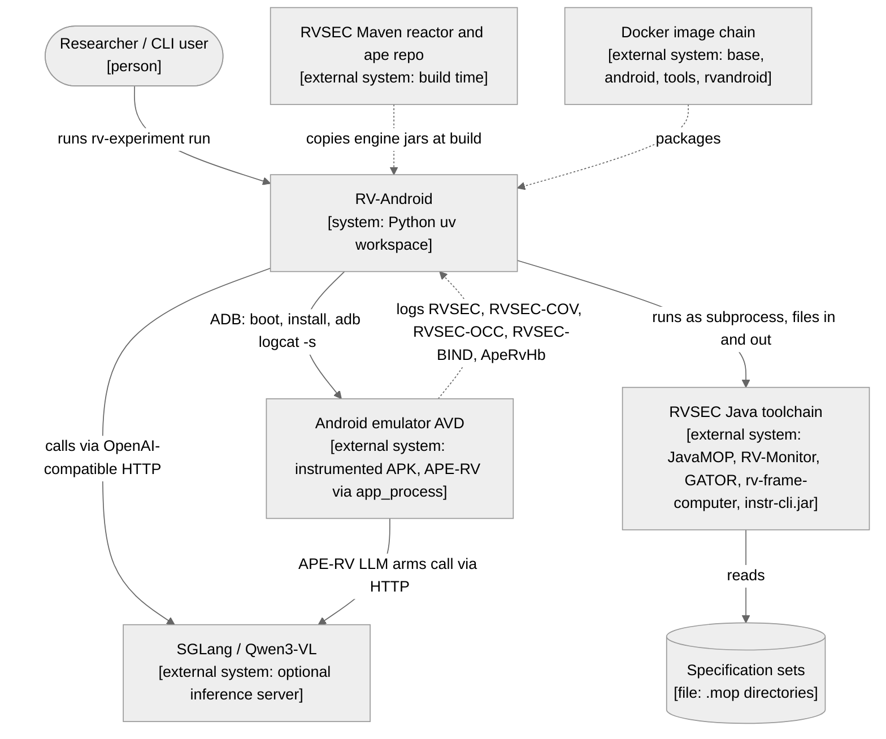
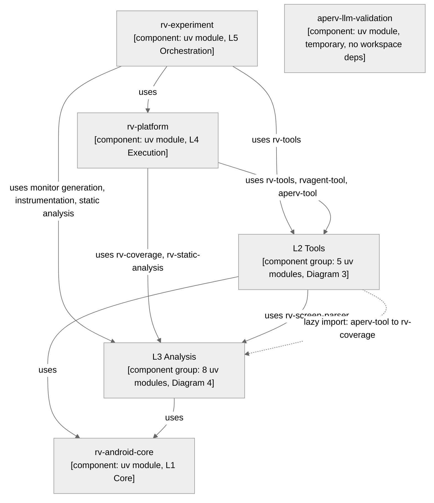
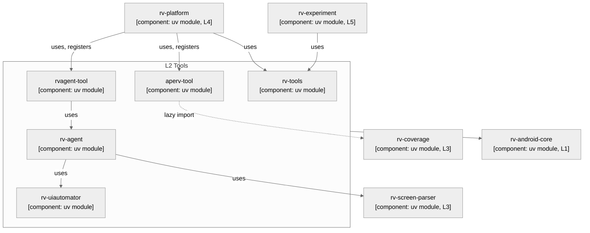
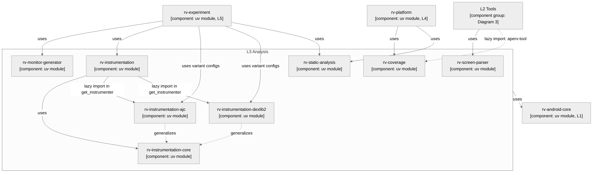
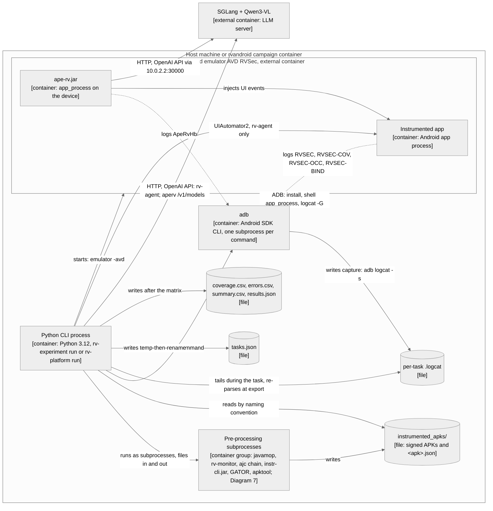
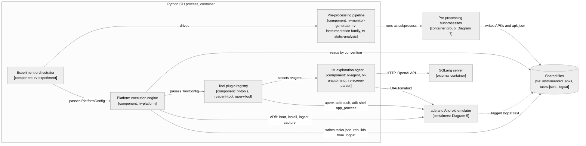
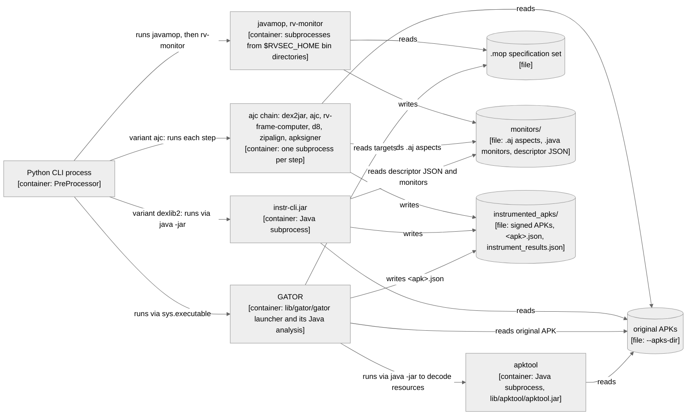
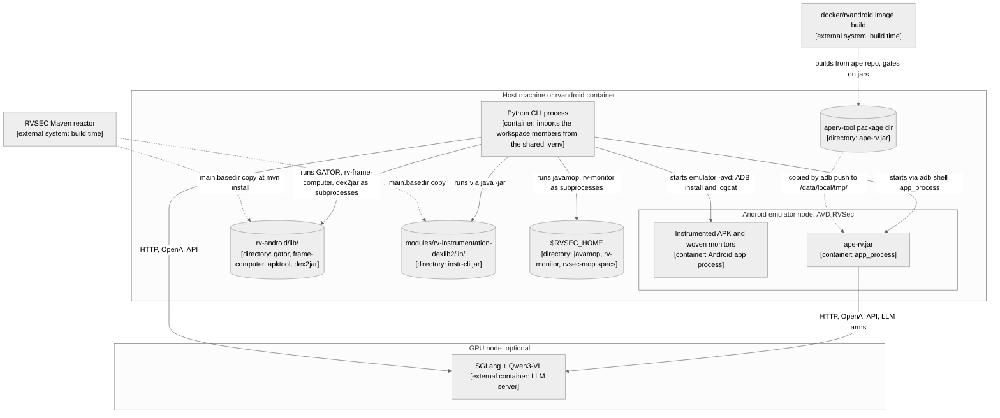

# Architecture — RV-Android (System)

> Target: system · Regenerate with: /rv-doc-arch system
> Scope: **system** · Generated by `rv-doc-arch` from `rvsec@dc599aa5`
> Languages: Python (17 uv workspace members, ~92k lines of source) orchestrating Java engines, the Android emulator and an optional LLM server, all reached out of process.

## Table of Contents

- [Part I — Beyond Views](#part-i--beyond-views)
  - [1. Documentation overview](#1-documentation-overview)
  - [2. Conceptual primer](#2-conceptual-primer)
  - [3. System overview and context](#3-system-overview-and-context)
  - [4. How it works — end to end](#4-how-it-works--end-to-end)
  - [5. Core components](#5-core-components)
  - [6. Mapping between views](#6-mapping-between-views)
  - [7. Rationale](#7-rationale)
  - [8. Output artifacts](#8-output-artifacts)
  - [9. Directory](#9-directory)
- [Part II — Views](#part-ii--views)
  - [Module view](#module-view)
  - [Component-and-connector view](#component-and-connector-view)
  - [Allocation view](#allocation-view)
- [Appendices](#appendices)
- [Specification traceability](#specification-traceability)

---

## Part I — Beyond Views

### 1. Documentation overview

This document is the system-level architecture reference for **RV-Android**, the framework that combines runtime verification with automated testing of Android applications. It is written for a **new engineer with no prior exposure to the project**: read top to bottom, it explains *what* the framework does, *how* one run flows end to end through a concrete example, and *why* the system is decomposed the way it is. The scope is the whole Python workspace — the 16 production modules under `modules/`, plus the temporary `aperv-llm-validation` member — and the external Java, Android and LLM systems they drive.

Subsystem internals are documented in their own Views-and-Beyond documents, and this one links to them rather than repeating them: [instrumentation](instrumentation.md) and its Java engine [instrumentation-java](instrumentation-java.md), [monitor-generation](monitor-generation.md), [static-analysis](static-analysis.md), [rv-platform](rv-platform.md), [ape-rv](ape-rv.md) and [rv-experiment](rv-experiment.md). Per-module 4+1 documents live in `modules/<m>/docs/architecture.md`.

**How to read this document:** Part I builds your mental model — what the system is
([primer](#2-conceptual-primer)), how it behaves end to end
([walkthrough](#4-how-it-works--end-to-end)), and why it is shaped this way
([rationale](#7-rationale)). Part II documents the selected views in detail.

### 2. Conceptual primer

RV-Android finds API-misuse violations in Android apps by combining runtime verification with automated UI testing. It takes an APK, weaves monitors compiled from formal specifications into its bytecode, installs the instrumented app on an Android emulator, drives the app with a testing tool — a random fuzzer such as Monkey, the on-device APE-RV explorer, or the host-side rv-agent — and reads the emulator's logcat to learn which monitored operations were exercised and which properties were violated. The specification sets target Java Cryptography Architecture (JCA) misuse (for example, a `Cipher` used before `init`) and generic API-usage properties (for example, `Iterator.next()` called without `hasNext()`).

**Why this approach.** A monitor woven into a method reports only if a test actually drives the app to that method, so coverage of monitored operations is a testing problem as much as an instrumentation problem. The framework therefore guides exploration with a one-shot static analysis of the original APK: which methods can reach monitored operations, which windows exist, and which UI actions move between them. The rejected alternative is purely static misuse detection, which reports on paths an app may never take; runtime verification reports only on an execution that happened. The price is operational — an emulator, a Java instrumentation and analysis toolchain, and optionally a GPU-hosted LLM server — and that price is why the Python side is split into narrowly scoped uv-workspace modules and why every heavy step runs out of process behind a file contract.

**Key concepts**

- **Runtime verification / MOP** — Monitoring-Oriented Programming: properties written as `.mop` specifications are compiled (JavaMOP, RV-Monitor) into monitors that advance a state machine on each relevant API event and report a violation when the property breaks.
- **Monitored operation** — any API method a specification watches. *MOP coverage* is the fraction of these methods a run executed. It is not a security term: it covers JCA and generic properties alike.
- **Specification set** — one directory of `.mop` files under `$RVSEC_HOME/rvsec/rvsec-mop/src/main/resources/`, selected per experiment with `--specification-set`: `jca` (frozen; the CLI default), `jca_android` (its successor for Android API 30, the set that carries specification repairs), `generic`, or `custom` with `--custom-specs-dir`.
- **Instrumentation variant** — how monitors are woven into the APK: `ajc` (dex2jar, AspectJ weaving, d8; the CLI default) or `dexlib2` (DEX-native rewriting by the `instr-cli.jar` Java CLI, driven by a JSON descriptor that JavaMOP emits).
- **Static-analysis document** — the `<apk>.json` that GATOR writes for the *original* APK: `reachability` (the coverage denominator), `windows`, `transitions` (the window transition graph, WTG), `components`, and per-method call-graph distances to each monitored target (`distanceTargets`, `targetDistances`). It is compact by default; in full mode it can reach gigabytes, so it is read as a stream of JSON events.
- **Logcat channel** — the instrumented app writes to Android logcat under fixed tags: `RVSEC` (violation), `RVSEC-COV` (coverage), `RVSEC-OCC` (every violation occurrence, throttled), `RVSEC-BIND` (handler stamp), and `ApeRvHb` (APE-RV step heartbeat). The host captures them with `adb logcat -s` into one file per task. This text stream is the only feedback path from the device.
- **Task** — one cell of the experiment matrix: APK × tool configuration (`tool:variant`) × repetition × timeout. Its identity tuple `(apk, tool, variant, repetition, timeout)` is what resume matches on.
- **Layers** — `docs/rv_android_architecture.md` groups modules into L1 Core, L2 Tools, L3 Analysis, L4 Execution and L5 Orchestration. Only L5 reads user-facing `RV_*` environment variables; the other layers receive resolved configuration.

### 3. System overview and context

RV-Android is Python orchestration wrapped around several external systems, and its boundaries are the fastest way to understand it. A researcher launches an experiment from the command line; from there the host process talks to the rest of the world only across process boundaries.

The **Android emulator (AVD)** is the execution node: the host reaches it over ADB to boot it, install the APK and capture logcat, and the woven monitors report back as tagged logcat text. For the `aperv` tool, the **APE-RV explorer** (`ape-rv.jar`, built from the separate `ape` repository) also runs *on the device*, launched with `app_process`. The **RVSEC Java toolchain** under `$RVSEC_HOME` — JavaMOP, RV-Monitor, the GATOR analysis client, rv-frame-computer and `instr-cli.jar` — compiles monitors, analyzes APKs and weaves DEX, always invoked as a subprocess with files in and files out. The **specification sets** are `.mop` directories in that same tree. The optional **SGLang server** hosts Qwen3-VL behind an OpenAI-compatible HTTP API for rv-agent's LLM modes and for APE-RV's LLM arms. At build time, the **RVSEC Maven reactor** copies the engine jars into the rv-android tree through its `main.basedir` property, and the **Docker image chain** in `docker/` (`base` → `android` → `tools` → `rvandroid`) packages the whole pipeline for containerized runs.

**Constraints:** All Java work happens out of process and all device work goes through ADB. The emulator lifecycle is owned by `rv-platform` and is never managed by hand. GATOR must analyze the original APK because Soot's TypeResolver fails on AspectJ-woven bytecode. The SGLang backend is needed only for LLM-driven exploration. The engine jars (`instr-cli.jar`, `ape-rv.jar`, the GATOR jars) are gitignored build products and must exist before a run that needs them.

Diagram 1 is the system context: RV-Android as one box among the people and external systems it deals with. Every view refers back to it.

**Diagram 1 — RV-Android and the people and systems around it.**

**Legend.** Stadium = person; rectangle = system, labeled with its kind in brackets (the target is the one `[system]` box, the others are `[external system]`); cylinder = files; solid arrow = runtime call or invocation, labeled with its mechanism; dotted arrow = no call: text the device writes to its log, or a build-time delivery.

### 4. How it works — end to end

Following one command through the whole pipeline is the clearest way to see how the parts fit. The following walks through a concrete example: running `rv-experiment run --tools monkey --specification-set jca_android --apks-dir ./apks_examples --name demo --timeouts 60` on `apks_examples/cryptoapp.apk` (package `br.unb.cic.cryptoapp`), an app that calls `javax.crypto.Cipher` — so a JCA monitor reports only if Monkey reaches that code.

1. **CLI and configuration.** The Click group in `rv_experiment/__main__.py` parses the tool DSL `monkey`, the specification set and the run flags, resolves the entry-point-only policies (package detector, build-type-suffix neutralization, handler stamp) once, and builds an `ExperimentConfig`, whose boundary model forbids unknown fields. Because `--name demo` is given and `results/demo/tasks.json` does not exist yet, this is a new run; with `--name`, the output directory becomes `results/demo`, so pre-processing artifacts and results share one flat directory. `ExperimentConfig.validate()` runs before any work, and an impossible flag combination aborts with exit status 1. Sub-configurations (`get_monitored_operations_config`, `get_instrumentation_config`, `get_static_analysis_config`) are built only when each step is reached. *Concretely:* `jca_android` resolves to `$RVSEC_HOME/rvsec/rvsec-mop/src/main/resources/jca_android`; the variant defaults to `ajc`; the package detector is off, so the scope key is the manifest package `br.unb.cic.cryptoapp`.

2. **Pre-processing 1 — monitor generation.** `PreProcessor` calls rv-monitor-generator's `RuntimeVerificationGenerator`, which shells out to `$RVSEC_HOME/javamop/bin/javamop` to turn the `.mop` files into AspectJ aspects and `.rvm` files, moves the `.rvm` files itself (JavaMOP's `-d` does not relocate them), and runs `$RVSEC_HOME/rv-monitor/bin/rv-monitor` to produce Java monitor classes. With `emit_descriptor` (on by default) the patched JavaMOP also writes the `MultiSpec_*MonitorAspect.json` descriptor that the dexlib2 variant needs. A `specification_set.txt` marker records which set the monitors came from, so a later `--skip-monitors` run can verify it reuses the set it asked for (INV-EXP-38). *Concretely:* `results/demo/monitors/` holds the aspects, the generated monitors, the descriptor and the marker. Detail: [monitor-generation](monitor-generation.md).

3. **Pre-processing 2 — instrumentation.** `PreProcessor` calls `rv_instrumentation.get_instrumenter("ajc", config)`, which lazy-imports `AjcInstrumentation`. It decompiles the APK with dex2jar, strips desugared shims, quarantines classes matched by `modules/rv-instrumentation-ajc/assets/weaving_excludes.yaml` into a side jar, weaves the aspects with ajc, recomputes stack-map frames with rv-frame-computer, restores the quarantined classes, merges the support classes, rebuilds DEX with d8, zipaligns and signs with the shared keystore in `modules/rv-instrumentation/assets/keystore.jks`. If an APK fails, its original is copied in its place so the run continues (INV-EXP-08). *Concretely:* `results/demo/instrumented_apks/cryptoapp.apk` is a signed APK whose advice logs `RVSEC-COV` on each monitored `Cipher` call and `RVSEC` on a violation. Detail: [instrumentation](instrumentation.md).

4. **Pre-processing 3 — static analysis.** Only APKs with an instrumented counterpart are analyzed (INV-EXP-15), and the *original* APK is the input, because Soot cannot type AspectJ-woven bytecode. `StaticAnalyzer` builds one GATOR command — the running interpreter (`sys.executable`) plus the GATOR launcher, `-client RvsecAnalysisClient`, the targets of the same specification set, and `-clientParam codePackage=br.unb.cic.cryptoapp` with `codePackageSource=manifest`. The client writes `reachability` first, then windows, transitions and components, flushing each, so a timeout still leaves the coverage denominator; if no file exists at all, `StaticAnalyzer` raises `StaticAnalysisException` rather than letting zero coverage pass silently. *Concretely:* `results/demo/instrumented_apks/cryptoapp.apk.json`, beside the instrumented APK, in compact form (no whitespace; distance pairs cut to `d ≤ 3` plus the three nearest per method, INV-ANA-85). Detail: [static-analysis](static-analysis.md).

5. **Task generation.** `ExecutionController` translates the experiment configuration into a `PlatformConfig` — the APK directory is the `instrumented_apks/` directory, and a container's emulator port is injected as `device_port`/`device_serial` when one is set — and runs `Platform`. `Platform._generate_tasks` builds the full cartesian product, constructing one `App` per APK under the run's package policy, and `TaskStorage` compares identity tuples against `tasks.json` to skip completed tasks; a configuration checksum (SHA-256 of the sorted configuration JSON, INV-PLT-12) that differs from the stored one only produces a warning. *Concretely:* 1 APK × 1 tool × 1 repetition × 1 timeout gives one task, identity `(cryptoapp.apk, monkey, default, 1, 60)`, whose files live under `results/demo/cryptoapp.apk/` with the base name `cryptoapp.apk__1__60__monkey`.

6. **Execution — component pipeline.** `TaskExecutor` receives five components — `StaticAnalysisComponent`, `EmulatorComponent`, `LogcatComponent`, `CoverageComponent`, `ToolExecutionComponent` — and dispatches them into three phases by type. *Outside* the emulator, `StaticAnalysisComponent` copies the co-located JSON into the task's directory (skipping an identical copy, INV-PLT-39) and loads it through `read_static_analysis_files`, which answers from the `<apk>.static.json` parsed copy when the digest it records matches the source (INV-ANA-82); then `CoverageComponent` prepares its tracker. *Inside* the emulator context manager, `EmulatorComponent` boots the `RVSec` AVD on the task's port and installs the APK, `LogcatComponent` sizes the device log buffer to 16M and starts the capture, `CoverageComponent`'s `CoverageTracker` tails the capture file on a background thread, and `ToolExecutionComponent` runs `MonkeyTool.execute()`. *Concretely:* the capture command is `adb -s emulator-5554 logcat -v threadtime -s RVSEC:V RVSEC-COV:V ApeRvHb:V RVSEC-OCC:V RVSEC-BIND:V`, written to `cryptoapp.apk__1__60__monkey.logcat`.

7. **Tool run and live coverage.** Monkey fuzzes the UI until the 60 s timeout. `AbstractTool.execute()` converts the command timeout into `RVToolTimeoutError`, which is the expected end and not a failure (INV-TOOL-06), and cleans up the tool's processes. Meanwhile the woven monitors log `RVSEC-COV` for each monitored method reached and `RVSEC` for the first occurrence of each violation identity, while `RVSEC-OCC` carries every occurrence under a 100 ms throttle. rv-coverage's `parse_logcat_line` separates the tags, and `CoverageTracker` updates method, activity and MOP coverage against the static denominator. *Concretely:* if Monkey reaches the `Cipher` code, `mop_method_coverage` rises above zero; a misused `Cipher` yields an `RVSEC` line that becomes an `errors.csv` row carrying `spec`, `class`, `method`, `source`, `code` and `event`.

8. **Persistence and result export.** When the task finishes, `Platform` stores it in `TaskStorage` (`tasks.json`, written to a temporary file and renamed) and releases its repository and static model (INV-PLT-38). After the whole matrix, `Platform._process_results` hands every completed task of every session to `ResultProcessorComponent`, which makes a single task-major pass: for each task it rebuilds the `LogcatRepository` from the `.logcat` file and the co-located static document, writes the task's rows to `coverage.csv`, `errors.csv`, `app_events.csv` and `summary.csv`, adds its `results.json` entry, and releases the parsed state before moving on. There is no fallback to serialized metrics (INV-PLT-16). Finally `PostProcessor` writes `instrument_errors.json` and `experiment_completion.json` without reading any result back (INV-EXP-02). *Concretely:* `results/demo/` ends with `tasks.json`, `experiment_config.json`, the four CSVs (`app_events.csv` holds only its header unless `--logcat-diagnostics` was given), `results.json`, `performance.csv` and the two post-processing files. Detail: [rv-platform](rv-platform.md), [rv-experiment](rv-experiment.md).

### 5. Core components

At run time the host side is one Python process — the `rv-experiment run` (or `rv-platform run`) CLI — and its code falls into a handful of coarse-grained components; the processes it starts are described in the [component-and-connector view](#component-and-connector-view). Knowing where each component hands off to the next is the backbone of Part II.

The **experiment orchestrator** is the entry point of the process the user launches with `rv-experiment run`. It resolves configuration once, sequences the three phases, and never reads results back — the platform owns the result files. Its state is the `ExperimentConfig`, the resume decision, and the run log it installs before pre-processing so that the effective scope key reaches disk (INV-CORE-62).

The **pre-processing pipeline** is a file-based chain run once before execution: specifications become monitors, monitors are woven into APKs, and GATOR analyzes the originals of the APKs that were instrumented. The outputs are placed side by side in `instrumented_apks/` so the platform finds them by naming convention instead of by object references. A failed instrumentation copies the original and is recorded; a timed-out analysis leaves a partial document the parser accepts.

The **platform execution engine** expands the configuration into tasks, skips completed identities, and for each pending task drives a `TaskExecutor` whose phases keep static-data loading off the emulator. It persists each finished task with a temp-file rename, releases the task's in-memory state, and after the matrix writes the CSV/JSON exports by rebuilding every task from its logcat file.

The **tool plugin registry** configures the tool each task runs. Built-in tools register when `rv_tools` is imported; `rvagent` and `aperv` are registered explicitly by `rv_platform/__init__.py`. `ToolFactory` hands the engine a configured `AbstractTool` whose `execute()` treats timeout as normal completion.

The **LLM exploration agent** is active only when the `rvagent` tool is selected. It runs in the host process, sees the device through UIAutomator2, optionally asks Qwen3-VL over SGLang, and stops only at the timeout.

Underneath sits the **core foundation library** — not a process but the object model threaded through every component: `App`, `Task`, `StaticAnalysisData` and `LogcatRepository`; `ErrorHandler` and `LoggingManager`; `EmulatorManager` and `LogcatManager`; the `AbstractTool` and `Instrumenter` contracts; and the event-stream reader of the static-analysis document shared by the platform and aperv-tool.

Beyond the host process, the **Android emulator** runs the app (and APE-RV) and speaks only logcat back; the **SGLang server** is optional; and the **external Java toolchain** is reached only by subprocess.

| Component | Realized by | Responsibility |
|-----------|-------------|----------------|
| Experiment orchestrator | rv-experiment | CLI and the pre-process / execute / post-process workflow; delegates low-level work. |
| Pre-processing pipeline | rv-monitor-generator, rv-instrumentation (+ -core, -ajc, -dexlib2), rv-static-analysis | APKs + specification set → instrumented APKs + co-located static documents. |
| Platform execution engine | rv-platform | Task matrix, per-task execution around an emulator session, persistence, export. |
| Tool plugin registry | rv-tools, rvagent-tool, aperv-tool | Registers and configures testing tools behind `AbstractTool`. |
| LLM exploration agent | rv-agent, rv-uiautomator, rv-screen-parser | Host-side exploration with a LangGraph workflow, algorithmic strategies and Qwen3-VL. |
| Core foundation library | rv-android-core, rv-instrumentation-core | Domain models, configuration base, errors, logging, device managers, contracts, streaming reader. |
| Android emulator (external) | Android SDK AVD | Runs the instrumented APK and on-device APE-RV; emits tagged logcat. |
| SGLang inference server (external) | SGLang + Qwen3-VL | Vision-language model over an OpenAI-compatible API. |
| External Java toolchain (external) | JavaMOP, RV-Monitor, GATOR client, dex2jar/ajc/d8, rv-frame-computer, instr-cli.jar | Monitor compilation, static analysis, weaving; subprocess only. |

### 6. Mapping between views

The three views in Part II describe the same system from different angles; their value is in how elements correspond. The **module view** groups the workspace packages into layers; the **component-and-connector view** shows the containers that run — one Python process, the subprocesses it starts, adb, the emulator and the processes on the device, the LLM server — and the files they exchange, then zooms into the Python process to show the components above; the **allocation view** places those containers on machines and the files in the file system. Reading across them connects "which package do I edit" to "what runs where": module → container → node.

No workspace module runs on its own. Every one of them is imported into a single container, the Python CLI process (`rv-experiment run`, or `rv-platform run` for direct execution), where the modules realize the components of section 5. The experiment orchestrator *is* `rv-experiment` (L5). The platform engine *is* `rv-platform` (L4). The pre-processing pipeline is realized by `rv-monitor-generator`, the instrumentation family and `rv-static-analysis` (L3). The tool plugin registry is `rv-tools` plus the two plugin modules `rvagent-tool` and `aperv-tool` (L2). The LLM agent is `rv-agent` composed with `rv-uiautomator` (L2) and `rv-screen-parser` (L3). The core foundation is `rv-android-core` (L1) together with `rv-instrumentation-core`. `aperv-llm-validation` maps to no component of that process; it is a standalone measurement CLI that runs as its own Python process. The other containers are started by specific modules, and those starts are the boundaries listed next.

The boundaries that matter are the ones that cross a process or language line, because that is where data changes form and where failures hide:

- **Monitor generation → Java toolchain**: `rv-monitor-generator` runs `javamop` and `rv-monitor` from `$RVSEC_HOME`. Files cross: `.mop` in; `.aj`, `.rvm`, `.java` and the descriptor JSON out.
- **Instrumentation → Java toolchain**: `rv-instrumentation-ajc` runs dex2jar, ajc, rv-frame-computer (`java -jar`), d8, zipalign and apksigner, one subprocess per step; `rv-instrumentation-dexlib2` runs `java -jar lib/instr-cli.jar`, which writes `instrument_results.json` for every APK it processes (INV-INS-105). Detail: [instrumentation-java](instrumentation-java.md).
- **Static analysis → Java toolchain**: `rv-static-analysis` runs the GATOR launcher under `sys.executable`. One JSON document crosses back. The package key crosses only here, on the producer side.
- **Platform → emulator**: `rv-platform` uses ADB to boot, install and capture; the five-tag logcat text stream, written to a per-task file, is the only feedback channel.
- **APE-RV tool → emulator**: `aperv-tool` pushes `ape-rv.jar`, `ape.properties` and, for MOP arms, a derived `mop-artifact.json` to `/data/local/tmp/` and runs `adb shell CLASSPATH=/data/local/tmp/ape-rv.jar app_process` — the Java explorer executes on the device. Detail: [ape-rv](ape-rv.md).
- **LLM agent → SGLang**: `rv-agent` calls the OpenAI-compatible HTTP API through LangChain's `ChatOpenAI` (`rv_agent/llm/llm_client.py`).
- **APE-RV → SGLang**: for LLM arms, `ape-rv.jar` reads `ape.llmUrl` from `ape.properties` (`http://10.0.2.2:30000/v1`, the emulator's alias for the host loopback) and calls the server from the device; `aperv-tool` itself queries `/v1/models` from the host at `127.0.0.1` to record the model's provenance (INV-APV-33).

Because these hand-offs are file- and text-based, much of the system coordinates through the file system by convention: `instrumented_apks/` with its `<apk>.json` documents, `tasks.json`, and the per-task `.logcat` files. That is what lets the platform rebuild any task's coverage and violations without a live object graph.

The allocation view then places these containers on nodes. The Python process, the Java subprocesses and adb run on the **host** (or inside one `rvandroid` container); the emulator also runs there, as a virtual device that `rv-platform` starts with `emulator -avd` (`modules/rv-android-core/src/rv_android_core/util/android/android.py`), and the app under test and APE-RV run on that **emulator node**; the optional model runs on a **GPU node** reached over HTTP.

| Module(s) | Container | Node |
|-----------|-----------|------|
| all production workspace modules | Python CLI process | host or `rvandroid` container |
| `rv-monitor-generator` | `javamop`, `rv-monitor` subprocesses | host or `rvandroid` container |
| `rv-instrumentation-ajc` | dex2jar, ajc, rv-frame-computer, d8, zipalign, apksigner subprocesses | host or `rvandroid` container |
| `rv-instrumentation-dexlib2` | `java -jar instr-cli.jar` subprocess | host or `rvandroid` container |
| `rv-static-analysis` | GATOR launcher `lib/gator/gator`, its Java analysis and the apktool run it starts | host or `rvandroid` container |
| `rv-android-core` (called by `rv-platform`, the tools) | `emulator`, `adb` subprocesses | host or `rvandroid` container |
| `aperv-tool` | `ape-rv.jar` under `app_process` | emulator node |
| `rv-agent`, `aperv-tool` (as clients) | SGLang server (external) | GPU node, optional |

### 7. Rationale

The shape of the system follows from a small number of decisions, each resolving a real tension and each avoiding a specific failure mode.

**A uv workspace of single-responsibility modules.** The pipeline has concerns with very different dependency footprints: rv-agent pulls LangChain, LangGraph and scipy; rv-screen-parser pulls OpenCV and Tesseract; aperv-tool's analysis library pulls pandas and statsmodels; the platform needs none of them. One package would put all of that on the import path of every entry point. The workspace keeps each stack inside the module that needs it, makes every suite runnable in isolation (CI loops over `modules/*/` with `--import-mode=importlib`), and makes dependency direction visible in each `pyproject.toml`. The cost is that declared and actual edges can drift; there are currently three undeclared lazy imports (rv-android-core and aperv-tool to rv-coverage, rv-platform to aperv-tool), described in the [module view](#module-view).

**Phase-ordered task execution around the emulator session.** A task mixes work that needs a device with work that does not, and some of the latter is heavy — a static document can be gigabytes. `TaskExecutor` runs static loading and coverage initialization before entering `EmulatorComponent`'s context manager, so the emulator is never held idle while the host parses, and a static-data load failure does not stop the task (INV-PLT-05). The rejected alternative, one procedure per task, would either hold the emulator during parsing or tangle the order of the steps. The trade-off is that the executor knows its five component types by name; `ITaskComponent` describes the lifecycle, but the concrete components do not subclass it, so it is not an open plug-in point.

**Instrumentation contract with independent variants.** Two weaving backends coexist: the AspectJ pipeline and the DEX-native rewriter. A single class with an `if/else` would import both toolchains into every consumer, and an environment that built only one of them could not run. With the contract in `rv-instrumentation-core` and `get_instrumenter` as the single dispatch site, selecting `ajc` never loads `rv_instrumentation_dexlib2`, and the reverse. The rule is INV-INS-41 (with INV-INS-36 for the single dispatch site), defined in the archived gh53 change and cited by the code.

**Results are rebuilt from the logcat file for every task.** Keeping every task's repository and static model alive until all output files are written does not fit in memory for a large matrix, and trusting serialized metrics lets `summary.csv` and `coverage.csv` disagree. The platform therefore drops the in-memory state as soon as a task is stored and, at export, rebuilds each task from ground truth — its logcat file and the static model — one task at a time, writing all files for that task before moving to the next (INV-PLT-16, INV-PLT-38). Live and resumed tasks take the same path, so their rows are equal by construction (INV-PLT-18). If a task's static document cannot be resolved, its coverage cells are left empty, its violations are kept, and one aggregate warning reports how many tasks were affected.

**Only the orchestration layer reads user-facing environment variables.** If any module could read the environment, configuration would have many hidden sources and no test could pin it; a plugin that reads a skip flag directly can invert its meaning when run standalone. The rule is that `rv-experiment` (and the `rv-static-analysis` command, for its own flags) reads `RV_*` values through `ENV_*` constants in `modules/rv-android-core/src/rv_android_core/constants.py` and forwards resolved values. The exception is an L1 infrastructure family of nine names — `RV_PYDANTIC`, `RV_PYDANTIC_STRICT`, `RV_PYDANTIC_LOG`, `RVSEC_HOME`, `ANDROID_HOME`, `TOOLS_DIR`, `RV_EMULATOR_BOOT_TIMEOUT`, `RV_ADB_CMD_TIMEOUT`, `RV_APK_INSTALL_TIMEOUT` — readable only in `util/validation/config.py`, `util/jar_resolver.py` and `util/android/android.py`. `scripts/check_env_vars_drift.py` enforces this and runs in CI through `tests/lint/test_env_vars_drift.py`; the rule is recorded in `docs/adr/0001-env-var-pattern.md` and in INV-CORE-31/INV-TOOL-20 of the archived gh55 change.

**Scope is chosen by the run and applied by the producer.** Which classes count as the app's own changes the coverage denominator, so a run must never acquire a heuristic by accident. `App.code_package` returns the manifest package unless the run states `--package-detector` or `--strip-build-type-suffix` (INV-EXP-34, INV-CORE-58); the key and its source reach GATOR as client parameters and are recorded in the artefact. Consumers never filter again: the parser loads `reachability` whole, so the denominator equals what the producer wrote (INV-ANA-59, INV-ANA-61). A second, consumer-side filter is the failure mode this avoids — two keys that disagree silently yield zero coverage.

**Static documents are read as event streams with digest-keyed caches.** Per-method distances to every monitored target make a full document hundreds of times larger than the rest of it, and `json.loads` would materialise all of it. `read_analysis_document` in rv-android-core walks the file once and lets the caller drop the pairs (the platform, `PairPolicy.DROP`) or fold them into per-target minima (aperv-tool, `PairPolicy.reduce`) (INV-ANA-80). GATOR writes the compact form by default (INV-ANA-85), the platform caches a parsed copy without distances (INV-ANA-82), and aperv-tool caches its derived artifact (INV-APV-47). Both caches key on the SHA-256 of the source rather than on size or modification time, so a re-analysed document under the same name is never answered by an old cache. The cost is a hard dependency on ijson's C backend, checked at import.

**Java engines delivered as build products into the Python tree.** The Python framework depends on Java engines built in sibling repositories. Instead of publishing them, the RVSEC reactor resolves `main.basedir` to its root and copies artifacts at install time (design D9 of the archived gh52 change): `instr-cli.jar` into `modules/rv-instrumentation-dexlib2/lib/`, the GATOR jars into `lib/gator/`, and rv-frame-computer and apktool into `lib/`. `ape-rv.jar` is built from the `ape` repository into aperv-tool's package directory. The engine jars are gitignored, so `docker/rvandroid/Dockerfile` tests for `instr-cli.jar` and a non-empty `ape-rv.jar` and fails the image build otherwise, turning a `FileNotFoundError` in the middle of an experiment into an early, obvious failure.

**Decisions at a glance**

| Decision | Drivers | Invariant / ADR |
|----------|---------|-----------------|
| uv workspace of single-responsibility modules | isolated dependency footprints, per-module tests, acyclic declared deps | — |
| Phase-ordered task execution around the emulator session | scarce emulator, multi-gigabyte static documents | INV-PLT-05 |
| Instrumentation contract with independent variants | swappable backends, no cross-variant imports | INV-INS-41, INV-INS-36 (archived gh53) |
| Results rebuilt from the logcat file for every task | memory bounded by one task, live = resumed | INV-PLT-16, INV-PLT-18, INV-PLT-38 |
| Only L5 reads user-facing `RV_*` | one configuration source, testability | INV-CORE-31, INV-TOOL-20 (archived gh55), INV-CORE-55, `docs/adr/0001-env-var-pattern.md` |
| Scope chosen by the run, applied by the producer | denominator equals the artefact's reachability | INV-EXP-34, INV-CORE-58, INV-ANA-59, INV-ANA-61 |
| Streaming reads with digest-keyed caches | gigabyte documents read once per task | INV-ANA-80, INV-ANA-82, INV-ANA-85, INV-APV-47 |
| Java engines delivered as build products | cross-repo integration without a registry; fail at build | gh52 design D9 |

**Patterns and styles**

At the module level the system is **layered** with medium confidence: `rv-android-core` declares no workspace dependency and L4/L5 sit on top, but L2 and L3 are not strictly ordered — `rv-agent` declares `rv-screen-parser`, and aperv-tool's offline analysis lazily imports `rv_coverage` from L2. The declared **uses** graph (each `modules/*/pyproject.toml`, resolved through `[tool.uv.sources]` in the root `pyproject.toml`) is acyclic. **Generalization** is the main extension mechanism, through the ABC families `Instrumenter`, `AbstractTool`, `ExplorationStrategy`, `Scorer` and `AbstractScreenVisitor`. At the component-and-connector level, pre-processing is **pipe-and-filter** over files; at run time the host is a **client** of the emulator (ADB), SGLang (HTTP) and the Java tools (subprocess); and coordination is **shared-data** through `instrumented_apks/`, `tasks.json` and the logcat files. At the allocation level there is a **deployment** split (host or container, emulator, optional GPU node) and an **install** structure (editable modules in one `.venv`, Maven-delivered jars, a four-stage Docker image chain).

**NFRs served**

*Modularity (NFR01):* seventeen workspace members, sixteen of them production modules, each with its own `pyproject.toml`, tests and `CLAUDE.md`, installed editable into one `.venv` by a single `uv sync`; layers L1–L5 group them and the declared dependency graph is acyclic. *Extensibility (NFR02):* a new testing tool implements `AbstractTool` and is registered as a built-in or in `rv_platform/__init__.py`; a new weaving backend implements `Instrumenter` and is added to `get_instrumenter`; agent behaviour varies through `ExplorationStrategy` and `Scorer` implementations and UI detail through `AbstractScreenVisitor` variants. Task-execution components are not an open extension point. *Testability (NFR03):* Pydantic models and explicit configuration objects let modules be built without global state; CI runs each module's suite in isolation and then the cross-cutting gates in `rv-android/tests` (the env-var lint, parity gates over the specification sets, an end-to-end package-key test). *Resilience (NFR04):* `ErrorHandler` absorbs or propagates by exception class; a failed instrumentation falls back to the original APK; a timed-out GATOR leaves a partial document that the parser accepts, while a missing one raises; tool timeout is normal completion; `tasks.json` is written temp-then-rename; export bounds memory to one task and reports unresolved static data in one warning. *Configurability (NFR05):* boundary models `ExperimentConfig` and `PlatformConfig` forbid unknown fields and are fed by the tool DSL, CLI flags, a `--config` file and `RV_*` variables read only at entry points; tool paths resolve through priority chains (explicit path, `rvsec_root`, `RVSEC_HOME`, `TOOLS_DIR`). *Observability (NFR06):* five logcat tags each declared once (INV-CORE-53), a per-run log file installed before pre-processing (INV-CORE-62), opt-in diagnostics capture of crash/VerifyError/ANR into `app_events.csv`, `[RVTRACK:<CATEGORY>]` lines from rv-agent, and a per-APK `instrument_results.json` from the dexlib2 CLI. *Compatibility (NFR07):* Python 3.12 drives Java tools by subprocess and the device by ADB; the ajc pipeline recomputes stack-map frames and quarantines VerifyError-prone classes; the LLM backend is reached through an OpenAI-compatible API. *Reproducibility (NFR08):* deterministic task generation with repetitions numbered 1..N, a SHA-256 configuration checksum compared on resume, the `experiment_config.json` snapshot, the monitor provenance marker, and caches keyed by content digest.

| NFR | PRD ID | Architectural support |
|-----|--------|-----------------------|
| Modularity | NFR01 | 17-member uv workspace (16 production), layers L1–L5, acyclic declared deps |
| Extensibility | NFR02 | `AbstractTool`, `Instrumenter`, `ExplorationStrategy`, `Scorer`, `AbstractScreenVisitor` seams |
| Testability | NFR03 | Pydantic config objects, per-module isolated suites, cross-cutting gates in `rv-android/tests` |
| Resilience | NFR04 | `ErrorHandler`, fallback to original APK, partial-document parsing, timeout-as-success, atomic `tasks.json` |
| Configurability | NFR05 | Boundary Pydantic models, tool DSL, entry-point-only env reads, priority path resolution |
| Observability | NFR06 | Five logcat tags, per-run log file, opt-in diagnostics, `[RVTRACK]`, `instrument_results.json` |
| Compatibility | NFR07 | Subprocess/ADB boundaries, frame recomputation + quarantine, OpenAI-compatible LLM API |
| Reproducibility | NFR08 | Deterministic tasks, `config_checksum`, config snapshot, provenance marker, digest-keyed caches |

### 8. Output artifacts

A run's results live entirely on disk, and the framework treats these files as the source of truth — which is what makes resume, standalone re-export (`rv-platform run --process-results`) and offline analysis possible. With `--name`, `<output_dir>` and `<results_dir>` are the same flat directory `results/<name>/`; without it, pre-processing artifacts go to `out/` and results to `results/`.

| Artifact | Location | Notes |
|----------|----------|-------|
| Monitors | `<output_dir>/monitors/` | `.aj` aspects, generated `.java` monitors, `MultiSpec_*MonitorAspect.json`, `specification_set.txt` |
| Instrumented APKs + static documents | `<output_dir>/instrumented_apks/` | signed `<apk>`, its `<apk>.json`, and `instrument_results.json` from the dexlib2 variant |
| Per-task raw files | `<results_dir>/<apk>/` | `<apk>__<rep>__<timeout>__<tool>.logcat` and `.trace`; copied `<apk>.json`; `<apk>.static.json` parsed copy; `<apk>.mop.json` for aperv |
| `tasks.json` | `<results_dir>/` | task ledger written temp-then-rename; the resume source |
| `coverage.csv`, `errors.csv`, `summary.csv`, `app_events.csv` | `<results_dir>/` | headers are contracts (INV-PLT-19); `errors.csv` has 13 columns |
| `results.json`, `performance.csv` | `<results_dir>/` | per-task results and timing |
| `experiment_config.json`, `instrument_errors.json`, `experiment_completion.json` | `<results_dir>/` | configuration snapshot and post-processing diagnostics |

### 9. Directory

**Glossary / acronyms**

- **RV** — Runtime Verification.
- **MOP** — Monitoring-Oriented Programming; also used for "monitored operation". Covers JCA and generic properties; not a security term.
- **JCA** — Java Cryptography Architecture.
- **WTG** — Window Transition Graph: the UI action → window map GATOR produces.
- **AVD** — Android Virtual Device (the emulator).
- **ADB** — Android Debug Bridge, the host ↔ emulator control and logcat channel.
- **ABC** — Abstract Base Class; the extension seams listed under Patterns and styles.
- **SGLang** — the inference server hosting Qwen3-VL; **VLM** — vision-language model.
- **Scope key** — `App.code_package`, the package that delimits app-owned classes in the static analysis.
- **Arm** — an `aperv` variant (a jar preset plus override deltas) compared in a campaign.
- **D9** — design decision of the archived gh52 change: Maven copies the engine jar into the Python module's `lib/` at build time.

**References**

- Domain specs, capability specs and the domain → module → FR/NFR mapping: `openspec/specs/README.md`.
- Product requirements (FR01–FR37, NFR01–NFR08): `docs/PRD.md`.
- Layer definitions and module dependency map: `docs/rv_android_architecture.md`.
- Subsystem Views-and-Beyond documents: `docs/architecture/` (linked in [section 1](#1-documentation-overview)).
- Per-module 4+1 documents: `modules/<m>/docs/architecture.md`. ADRs (`docs/adr/`), among them the env-var ADR `docs/adr/0001-env-var-pattern.md`, the GATOR performance-fix ADR `docs/adr/0007-relax-gator-no-touch-rule-for-semantics-preserving-perf-fixes.md` and the diagnostic-parser ADR `docs/adr/0008-separate-stateful-diagnostic-parser.md`.

---

## Part II — Views

### Module view

*Style(s): layered, uses, generalization*

The module view is the map a developer needs to navigate the workspace. It shows the same packages under three lenses: the **layers** of `docs/rv_android_architecture.md`, the declared **uses** graph (which module lists which in its `pyproject.toml`), and the **generalization** seams that make the system extensible. The declared graph is acyclic; the layering is strict at the bottom (L1) and the top (L4, L5) but not between L2 and L3, where tool modules use analysis-layer parsers. Diagram 2 shows the layers with the two multi-module layers collapsed; Diagrams 3 and 4 open L2 and L3. L1, L4 and L5 hold one module each and need no diagram of their own. Solid edges are declared dependencies; dotted edges are the one undeclared lazy import, or generalization.

**Primary presentation** — components (uv workspace modules) grouped by layer (C4 component level).

**Diagram 2 — The layers L1–L5 with L2 and L3 collapsed.**

**Legend.** Rectangle = component, labeled with its kind in brackets (`[component group]` = a layer collapsed into one box); solid arrow = dependency declared in a `pyproject.toml`; dotted arrow = undeclared lazy import, as labeled.

**Diagram 3 — L2 Tools and the edges that cross its boundary.**

**Legend.** Rectangle = component (a uv module); frame = the layer in focus; boxes outside the frame are the modules of other layers it touches; solid arrow = dependency declared in a `pyproject.toml` (an arrow from the frame stands for every module in it); dotted arrow = undeclared lazy import.

**Diagram 4 — L3 Analysis and the edges that cross its boundary.**

**Legend.** Rectangle = component, labeled with its kind in brackets (`[component group]` = a layer collapsed into one box); frame = the layer in focus; solid arrow = dependency declared in a `pyproject.toml` (the arrow from the frame stands for every module in it except `rv-instrumentation`, which declares only the three other instrumentation modules); dotted arrow = undeclared lazy import, or generalization (the variant implements the `Instrumenter` ABC), as labeled.

**Element catalog**

**L1 Core — `rv-android-core`.** Every other module builds on it. `BaseValidatedModel` is the Pydantic base of all domain entities and configurations (extra fields forbidden, whitespace stripped, validation on assignment), with `RV_PYDANTIC` toggling logging and strictness. `ErrorHandler` is a thread-safe singleton with a `@handle_errors` decorator that classifies the 23 exception classes of `util/error/exceptions.py` as absorbed or propagated; validation errors always propagate. The device layer is here: `EmulatorManager` and `util/android/android.py` own emulator boot, ADB probes and APK install under the three timeout budgets, and `LogcatManager` owns the capture command and its five-tag allowlist. The `App` model carries two package identities: `package_name` from the manifest for device operations, and `code_package`, the scope key, which equals the manifest package unless the run opts into `PackageDetector` or build-type-suffix neutralization. `util/analysis_document.py` reads a static document as one pass of ijson events, and `digest_of_file` keys both downstream caches. It is separate because shared abstractions need one home that cannot take part in a cycle — and because this lets rv-static-analysis and aperv-tool share one reader without aperv-tool depending on rv-static-analysis. *Gotchas:* `constants.py` is the single registry of `ENV_*` names, and only three of its files may read the environment (INV-CORE-55); tags are declared once in `util/logging/constants.py` because `adb logcat -s` discards an unadmitted tag on the device, so a mismatch is an empty stream, not an error (INV-CORE-53); and the core imports no other workspace module — `LogcatRepository` is imported only under `TYPE_CHECKING`, so `Task._new_repository()` returns `None` and a resumed task's repository is rebuilt from the persisted logcat by rv-platform's `ResultProcessorComponent._reconstruct_repository_from_logcat`.

**L2 Tools.** `rv-tools` is the registry/factory seam shared by rv-experiment (DSL validation) and rv-platform (instantiation). Importing it registers the eight built-ins of `BUILTIN_TOOLS` (APE, Monkey, Ares, DroidBot, DroidMate, FastBot, Humanoid, QTesting), and a failing registration never fails the import (INV-TOOL-08). `ToolFactory` merges `{**variant_config, **tool_config.parameters}` and calls `configure()` before returning the tool (INV-TOOL-05), so a per-tool default must live in `get_variants()` to be visible to overrides. `rv-uiautomator` is the UIAutomator2 adapter, action executor and `StateConverter`; only rv-agent imports it. `rv-agent` runs a LangGraph workflow whose nodes live in `agent/nodes/`; it chooses actions through `ExplorationStrategy` implementations (DFS, BFS, greedy, `RVAgentStrategy`) whose ranking uses the twelve `Scorer` implementations in `strategies/rvagent_strategy/ranking/scorers.py`, or through Qwen3-VL; `RVAgentConfig.pure_mode` turns every RV steering flag off, and the timeout is the only termination condition (INV-AGT-07). It is isolated because its dependency surface is large and changes often. `rvagent-tool` maps a Task into an `RVAgentConfig` and imports the agent only inside `execute_tool_specific_logic()`, keeping LangGraph out of the platform's import-time registration. `aperv-tool` wraps APE-RV: it resolves `ape-rv.jar` (INV-APV-01), writes `ape.properties` with the arm's preset and overrides, derives and caches the MOP artifact host-side, and launches `app_process` from `/system/bin` (INV-APV-04); its `process_pattern` is shared with the built-in `ape` tool, so the two must not run concurrently on one device (INV-APV-07). It also contains `aperv_tool/analysis/`, the offline campaign-analysis library (spec `campaign-analysis`), which imports rv-coverage lazily under an `ImportError` guard. Detail: [ape-rv](ape-rv.md).

**L3 Analysis.** `rv-coverage` holds only parsing and tracking: `parse_logcat_file` and `parse_logcat_line` turn `RVSEC` and `RVSEC-COV` lines into `RvErrorLog` and `RvCoverageLog` entries of a `LogcatRepository`; `CoverageTracker` tails the task's logcat file on a background thread; `DiagnosticEventParser` recognises crash, VerifyError and ANR blocks. The live and replay paths share one parser, which is what makes a reconstructed task equal a live one. `rv-static-analysis` is the GATOR producer (`StaticAnalyzer`) and the document consumer (`StaticAnalysisParser`, `read_static_analysis_files`); the consumer never accepts a package key (INV-ANA-61), never raises (INV-ANA-06), and the `rv-static-analysis compact` subcommand converts a full-mode document to the compact form. `rv-screen-parser` parses UIAutomator XML and DroidBot JSON through `AbstractScreenVisitor` variants (`BasicTextVisitor`, `DefaultTextVisitor`, `EnhancedTextVisitor`) and owns the MOP linkage on actions (`ItemAction.reaches_target`, `directly_reaches_target`). `rv-monitor-generator` isolates JavaMOP and RV-Monitor and their quirks. The instrumentation family is four modules: `rv-instrumentation-core` (the `Instrumenter` ABC and result models, no implementation dependencies), `rv-instrumentation-ajc` and `rv-instrumentation-dexlib2` (each depending only on `-core` and rv-android-core), and the parent `rv-instrumentation` (the `get_instrumenter` factory and the shared keystore). Only the dexlib2 variant supports the handler stamp. Detail: [instrumentation](instrumentation.md), [static-analysis](static-analysis.md), [monitor-generation](monitor-generation.md).

**L4 Execution and L5 Orchestration.** `rv-platform` isolates execution mechanics — task generation, the executor's phases, emulator ports, persistence, export — from the experiment workflow and is usable standalone through its own CLI. Its import registers `rvagent` and `aperv` idempotently (INV-TOOL-12); both plugin modules are declared in its `pyproject.toml` and imported inside `_register_external_tools()` under an `ImportError` guard, which covers a plugin that is installed but fails to import. `rv-experiment` is the only layer that reads user-facing `RV_*` variables (the `rv-static-analysis` command also reads them, for its own flags); it sequences the phases and lets data flow one way into the platform (INV-EXP-02). Detail: [rv-platform](rv-platform.md), [rv-experiment](rv-experiment.md).

**Outside the layers.** `aperv-llm-validation` is a temporary offline CLI (`aperv-llm-validate`) that checks Qwen3-VL coordinate grounding against UIAutomator bounds. It depends on no workspace module and is not part of the production set. `modules/rvsmart-tool` is excluded from the workspace in the root `pyproject.toml` and holds no tracked source.

| Element | Responsibility | Relations / interfaces |
|---------|----------------|------------------------|
| rv-android-core (L1) | Domain models, config base, `ErrorHandler`, `LoggingManager`, device managers, `AbstractTool`, streaming reader | no workspace deps, declared or imported |
| rv-tools (L2) | Registry + factory; 8 built-in tools | uses core; used by rv-experiment, rv-platform |
| rv-uiautomator (L2) | UIAutomator2 adapter, executor, `StateConverter` | uses core; used by rv-agent |
| rv-agent (L2) | LangGraph explorer, strategies, scorer pipeline | uses rv-screen-parser, rv-uiautomator; rv-static-analysis in the dev group (tests only); SGLang |
| rvagent-tool (L2) | `AbstractTool` wrapper of rv-agent | uses rv-agent (lazy), core; registered by rv-platform |
| aperv-tool (L2) | `AbstractTool` wrapper of APE-RV; MOP artifact; campaign-analysis library | uses core; lazy, guarded, undeclared import of rv-coverage; registered by rv-platform |
| rv-coverage (L3) | Logcat parsing, coverage/violation tracking, diagnostics parser | uses core; used by rv-platform |
| rv-static-analysis (L3) | GATOR invocation; document parsing and parsed-copy cache | uses core; subprocess GATOR |
| rv-screen-parser (L3) | UI parsing visitors; MOP linkage on actions | uses core; used by rv-agent |
| rv-monitor-generator (L3) | JavaMOP + RV-Monitor driver | uses core; subprocess Java |
| rv-instrumentation (L3) | `get_instrumenter` factory; shared keystore | uses -core; lazy imports of both variants |
| rv-instrumentation-core (L3) | `Instrumenter` ABC + result models | uses core only |
| rv-instrumentation-ajc (L3) | AspectJ variant (dex2jar → ajc → d8) | generalizes -core; subprocess Java |
| rv-instrumentation-dexlib2 (L3) | DEX-native variant via `instr-cli.jar` | generalizes -core; subprocess Java |
| rv-platform (L4) | Task generation, executor, persistence, export | uses rv-tools, rv-coverage, rv-static-analysis, rvagent-tool, aperv-tool (both plugins imported lazily, under a guard) |
| rv-experiment (L5) | CLI + three-phase workflow | uses rv-platform, rv-monitor-generator, rv-instrumentation (+ variants), rv-static-analysis, rv-tools |
| aperv-llm-validation | Temporary LLM coordinate validation CLI | no workspace deps |

**Context** — see [system context](#3-system-overview-and-context).

**Variability guide**

The system varies along a few seams. The **instrumentation variant** is chosen per run (`--instrumentation-variant` or `RV_INSTRUMENTATION_VARIANT`) and dispatched by `get_instrumenter`; a new backend implements `Instrumenter` in a module that depends only on `-core` and is added to the factory. The **specification set** is a CLI choice among `jca`, `jca_android`, `generic` and `custom`. **Testing tools** are added by subclassing `AbstractTool` and registering the class as a built-in (`BUILTIN_TOOLS`) or, for a plugin module, in `rv-platform/src/rv_platform/__init__.py::_register_external_tools()`. **Exploration behaviour** varies through `ExplorationStrategy` and `Scorer` implementations inside rv-agent, and **UI output detail** through the three visitor variants. **Run policies** — package detector, build-type-suffix neutralization, handler stamp, diagnostics capture — are opt-in flags resolved at the entry point.

**Rationale**

The modules exist to keep heavy, changing dependency stacks out of the import paths of stable modules and to keep each declared edge pointing downward; the ABC seams turn that structure into extensibility. The instrumentation quartet's shape is dictated by INV-INS-41: a pure `-core` contract with variants that never import each other is the only arrangement that lets `ajc` and `dexlib2` be swapped without one dragging the other's toolchain into every consumer. The one undeclared import, aperv-tool's lazy import of rv-coverage's `DiagnosticEventParser` (`aperv_tool/analysis/step_bundle.py`), is a deliberate exception to the declared graph: the diagnostic stream is opt-in, and without rv-coverage installed the bundle reports it as not read.

### Component-and-connector view

*Style(s): pipe-and-filter, client-server, shared-data*

This view is what you need to reason about a *running* experiment rather than the source tree. Pre-processing is a **pipe-and-filter** chain in which three filters transform files in sequence and hand off only through co-located artifacts. Execution is **client-server**: the Python host is a client of the emulator (ADB), the SGLang server (HTTP) and the Java tools (subprocess). Coordination is **shared-data**: `tasks.json`, `instrumented_apks/` and the per-task logcat files. The connector that explains most of the design is the host ↔ emulator one: an asynchronous text stream captured to a file, not a function call.

Diagram 5 shows the containers — the things that run as their own process — and the files they exchange. Every workspace module runs inside the one Python CLI process, so the coarse components of section 5 are not drawn as separate runtime elements; Diagram 6 shows them as the inside of the Python CLI process from Diagram 5, and Diagram 7 opens the pre-processing subprocesses.

**Primary presentation** — running containers and the connectors between them (C4 container level; a uv module is never a container).

**Diagram 5 — The containers of one run and the files they exchange.**

**Legend.** Rectangle = container (a running process), labeled `[container]`, `[container group]` (several containers collapsed into one box) or `[external container]` (one the project does not build); cylinder = file or directory; outer frame = the machine one run occupies, a bare host or one `rvandroid` Docker container; inner frame = the Android emulator, an external container that hosts the device-side processes; solid arrow = invocation, call or write, labeled with its mechanism; dotted arrow = text written to the device log, which reaches the host only through the `adb logcat` capture.

The coarse components of section 5 are the inside of the **Python CLI process** of Diagram 5. Diagram 6 zooms into that one container.

**Diagram 6 — Inside the Python process: the coarse components and the containers they reach.**

**Legend.** Rectangle = component inside the Python process (`[component]`, with the uv modules that realize it) or a container outside it (`[container]`, `[container group]`, `[external container]`); cylinder = files; frame = the Python CLI process container; solid arrow = in-process call, subprocess invocation or write, labeled with its mechanism; dotted arrow = device log text captured into a file.

Diagram 7 opens the pre-processing container group of Diagrams 5 and 6. Each box is a separate process started by one pre-processing module; the boxes hand off only through files.

**Diagram 7 — The pre-processing subprocesses and the files between them.**

**Legend.** Rectangle = container (a running process), labeled `[container]`; cylinder = file or directory; solid arrow = subprocess invocation (labeled with how it is started), file read or file write.

**Element catalog**

The first rows are the containers and files of Diagrams 5 and 7; the component rows are the inside of the Python CLI process (Diagram 6).

| Component / connector | Type | Responsibility |
|-----------------------|------|----------------|
| Python CLI process | container (Python 3.12 process) | `rv-experiment run` or `rv-platform run`; imports every workspace module; starts every other host-side process. |
| rvandroid campaign container | frame (Docker container, optional) | Runs one whole host side — Python process, subprocesses, adb, emulator — per container, with its own emulator port. |
| Pre-processing subprocesses | container group | The processes of Diagram 7: monitor generation, weaving, static analysis; files in, files out. |
| `javamop`, `rv-monitor` | container (subprocesses) | `$RVSEC_HOME/javamop/bin/javamop` and `$RVSEC_HOME/rv-monitor/bin/rv-monitor`, started by `RuntimeVerificationGenerator`; `.mop` in, `.aj`, `.rvm`, `.java` and the descriptor JSON out. |
| ajc chain | container (one subprocess per step) | dex2jar, ajc, `java -jar` rv-frame-computer, d8, zipalign, apksigner, started by `AjcInstrumentation`. |
| `instr-cli.jar` | container (Java subprocess) | `java -jar modules/rv-instrumentation-dexlib2/lib/instr-cli.jar`, started by `DexlibInstrumentation`: one `batch` call for the whole directory, or one `instrument` call per APK when the run names a subset, whose per-APK files under `instrument_results.d/` are merged into `instrument_results.json`. |
| GATOR | container (subprocess) | `sys.executable lib/gator/gator a … -client RvsecAnalysisClient`, started by `StaticAnalyzer`; writes `<apk>.json`. |
| apktool | container (Java subprocess) | `java -jar lib/apktool/apktool.jar d --no-src`, started by the GATOR launcher (`lib/gator/pygator/unpacker.py`) to decode the APK's resources. |
| `adb` | container (Android SDK CLI) | One subprocess per command from rv-android-core's device layer and the tools: install, `logcat -G`, `logcat -c`, the `logcat -s` capture, `shell`, `push`. |
| Android emulator | external container | QEMU AVD started by `emulator -avd` (`util/android/android.py`); runs the instrumented APK and on-device APE-RV; emits tagged logcat. |
| Instrumented app | container (Android app process) | The app under test with woven monitors; writes the `RVSEC*` tags. |
| `ape-rv.jar` | container (`app_process` on the device) | APE-RV explorer launched by `aperv-tool`; drives the app, logs `ApeRvHb`, calls SGLang for LLM arms. |
| SGLang server | external container | Serves Qwen3-VL over an OpenAI-compatible API. |
| `.mop` specification set, `monitors/`, original APKs | file | Inputs and intermediate output of pre-processing (Diagram 7). |
| `instrumented_apks/` | file (shared-data) | Signed APKs, their `<apk>.json` documents and `instrument_results.json`; found by the platform by naming convention. |
| `tasks.json` | file (shared-data) | Task ledger written temp-then-rename; the resume source. |
| per-task `.logcat` | file (shared-data) | Capture of the five tags; the only record of what happened on the device. |
| `coverage.csv`, `errors.csv`, `summary.csv`, `results.json` | file | Exports written after the matrix by rebuilding each task from its `.logcat` file. |
| Experiment orchestrator | component (in the Python process) | Sequences pre-process / execute / post-process; delegates all low-level work; reads nothing back. |
| Pre-processing pipeline | component (pipe-and-filter chain) | Monitors → instrumented APKs → static documents, co-located on disk. |
| Platform execution engine | component | Task matrix, per-task phases around the emulator session, persistence, export. |
| Tool plugin registry | component | Resolves and configures the selected `AbstractTool`. |
| LLM exploration agent | component | In-process UI driving through LangGraph with algorithmic and LLM decisions. |
| Shared files | store (shared-data) | `instrumented_apks/` with `<apk>.json`, `tasks.json`, per-task `.logcat`, parsed copies and MOP artifacts. |
| adb and Android emulator (Diagram 6) | containers | Diagram 6's collapsed view of `adb`, the emulator and its device-side processes. |
| ADB / logcat connector | connector | `adb logcat -s` with five tags into a per-task file; the only feedback path from the device. |
| Subprocess connector | connector | Host → Java tools; files in, files out. |
| OpenAI-compatible HTTP connector | connector | Host (rv-agent, aperv-tool's provenance query) and device (`ape-rv.jar`) → SGLang request/response. |

**Context** — see [system context](#3-system-overview-and-context).

**Variability guide**

The runtime topology has optional legs. The **SGLang server** is present only for rv-agent's `llm_only`/`multimode` paths or APE-RV LLM arms; a `pure_algorithm` run or a Monkey run needs no GPU node. The **on-device explorer** exists only when `aperv` is selected, and for its MOP arms the static document reaches the device only as a derived `mop-artifact.json`. **Diagnostics capture** (`--logcat-diagnostics`) widens the logcat allowlist with crash/VerifyError/ANR tags and fills `app_events.csv`; when off, the capture command is byte-identical to the baseline (INV-CORE-37, INV-PLT-21). Which tool occupies the tool slot is data-driven from the tool DSL; the rest of the topology is the same for every tool. In a containerized campaign, the whole host frame of Diagram 5 runs inside one `rvandroid` container; when `RVSMART_LLM_MODE=true`, `docker/rvandroid/docker-entrypoint.sh` starts a socat bridge from `127.0.0.1:30000` to the `sglang` service, so the same `127.0.0.1` and `10.0.2.2` addresses reach the LLM server from the container and from the emulator.

**Scenarios**

Each scenario is stated as WHEN / THEN / AND with concrete values, and says *why* the behaviour is what it is.

- **Resume after interruption.** WHEN an experiment named `my_exp` is interrupted after 12 of 20 tasks and the same command is run again, THEN the CLI finds `results/my_exp/tasks.json`, forces the three pre-processing steps off (INV-EXP-13), regenerates the 20-task matrix and executes only the 8 identities not yet completed, AND export writes rows for all 20 tasks, each rebuilt from its own `.logcat` file and the co-located static document. *Why:* repositories are never serialized and are released when a task is stored (INV-PLT-38); the logcat file is the only source, so live and resumed tasks produce equal rows (INV-PLT-18).

- **Tool timeout is success.** WHEN a tool is still running when its 60 s timeout elapses, THEN `AbstractTool.execute()` converts the timeout into `RVToolTimeoutError` and the task completes normally, AND the coverage and violations captured up to that moment are exported. *Why:* timeout is the expected end of exploration, and rv-agent's only exit is the timeout (INV-TOOL-06, INV-AGT-07).

- **GATOR timeout, partial document.** WHEN GATOR is killed by its timeout after writing `reachability` and part of `windows`, THEN the parser keeps every top-level member read in full and drops the truncated one, returning empty windows and transitions, AND the task runs with a valid coverage denominator while no parsed copy is cached for the truncated source. *Why:* `reachability` is written first so the denominator survives (INV-ANA-81, INV-ANA-83); if no file exists at all, `StaticAnalyzer` raises `StaticAnalysisException` instead of producing silent zero coverage.

- **Build-type suffix in the manifest package.** WHEN an APK's manifest package is `com.example.app.debug` and the run passes `--strip-build-type-suffix`, THEN `App.code_package` becomes `com.example.app` with `code_package_source` `manifest-neutralized`, and both reach GATOR as client parameters, AND the parser loads the artefact's `reachability` as written, with no further filtering. *Why:* the scope is decided once by the run and applied by the producer (INV-CORE-58, INV-ANA-59, INV-ANA-61); without the flag the manifest package is used verbatim.

- **Missing descriptor for dexlib2.** WHEN the dexlib2 variant is selected but monitors were generated with `emit_descriptor` off, THEN `DexlibInstrumentation` raises `MissingDescriptorError` because no `MultiSpec_*MonitorAspect.json` exists, AND the run fails at instrumentation rather than producing an APK without monitors. *Why:* the DEX-native weaver is driven by the descriptor, while ajc weaves from the `.aj` aspects.

- **Handler stamp with the wrong variant.** WHEN `--stamp-handlers` is given together with `--instrumentation-variant ajc`, THEN the CLI raises a `ClickException` naming the flag before any pre-processing, AND the process exits 1 with `Experiment failed: …`. *Why:* only the dexlib2 weaver implements the handler stamp; running without it would produce a campaign that silently lacks what it asked for (INV-EXP-40).

- **Large static document for an APE-RV MOP arm.** WHEN an `aperv` MOP arm runs on an APK whose full static document is several gigabytes, THEN `ApeRVTool` reads it in streaming, derives the MOP artifact, caches it as `<apk>.mop.json` keyed by the source digest and format 2, and pushes it to `/data/local/tmp/mop-artifact.json`, AND a later task of the same APK reuses the artifact after one hashing pass and no parse. *Why:* the device must never parse a call graph, and a format change must invalidate old artifacts even when the source digest matches (INV-APV-47, INV-APV-64).

- **Qwen3-VL coordinate denormalization.** WHEN Qwen3-VL returns a tap at `(500, 250)` for a 1080 × 1920 screen, THEN `ActionNormalizer.from_llm` calls `denormalize_qwen_coords` and taps `(540, 480)`, AND the same model output maps correctly at any resolution. *Why:* Qwen3-VL emits coordinates in a normalized `[0, 1000)` range; passing them through unconverted would click near the top-left corner.

**Rationale**

Because the only feedback from the device is an asynchronous text stream, the system cannot rely on in-memory callbacks across the host/emulator boundary; it captures the stream to a file and treats the file as the record. That shared-data style is what makes export reconstructable from ground truth for every task, and it is why the pre-processing filters hand off through co-located artifacts rather than by passing objects to the engine.

### Allocation view

*Style(s): deployment, install*

This view answers "what runs where, and how do the bits get there". The **deployment** structure maps software onto nodes: the host (or one `rvandroid` container) runs the Python CLI process, which imports every workspace module, and the Java subprocesses it starts; the emulator node — a virtual device that rv-platform starts on the same machine — runs the instrumented app and, for `aperv`, APE-RV; an optional GPU node runs SGLang. The **install** structure describes the layout before a run: workspace members installed editable into one `.venv`, Java engine jars copied into the tree by the RVSEC Maven reactor or built by the Docker image, and the `.mop` specification sets under `$RVSEC_HOME`.

**Primary presentation** — containers placed on execution nodes, and the directories they are installed from.

**Diagram 8 — Containers on nodes and the directories that hold the engines.**

**Legend.** Rectangle = running container (`[container]`, `[external container]`) or a build-time system (`[external system]`); cylinder = directory on disk; frame = execution node: the host machine or one `rvandroid` Docker container, the Android emulator it starts, the optional GPU node; solid arrow = runtime invocation, labeled with its mechanism (an arrow into a directory runs a program from it); dotted arrow = a copy of files, at build time or by `adb push`.

**Element catalog**

| Software element | Allocated to | Notes |
|------------------|--------------|-------|
| Python CLI process (all workspace members) | Host or `rvandroid` container (`.venv`) | Editable installs by one `uv sync`; `modules/rvsmart-tool` excluded; one process runs every module. |
| GATOR jars, rv-frame-computer, apktool, dex2jar | Host (`rv-android/lib/`) | GATOR jars gitignored and copied by the reactor; the others tracked or copied. apktool is started by the GATOR launcher (`lib/gator/pygator/unpacker.py`), not by a workspace module. |
| `instr-cli.jar` | Host (`modules/rv-instrumentation-dexlib2/lib/`) | Gitignored; copied by the reactor (gh52 design D9); the image build fails without it. |
| `ape-rv.jar` | Host (aperv-tool package directory), pushed to the emulator | Gitignored; built from the `ape` repository in the `rvandroid` image; resolved by `JarResolver`. |
| JavaMOP, RV-Monitor, `.mop` sets | Host (`$RVSEC_HOME`) | Invoked by subprocess during pre-processing. |
| Android emulator node | Host or `rvandroid` container | A virtual device that rv-platform starts with `emulator -avd` on the same machine as the Python process. |
| Instrumented APK + monitors | Android emulator node | Installed and driven over ADB; emits the five logcat tags. |
| APE-RV explorer | Android emulator node | Runs from `/data/local/tmp/ape-rv.jar` with working directory `/system/bin`. |
| SGLang + Qwen3-VL | Optional GPU node | Reached over HTTP; only for LLM modes and arms. |
| RVSEC Maven reactor | Build time (sibling repository) | Not a runtime node; `main.basedir` copies the engine jars into the rv-android tree at `mvn install`. |
| Docker image chain | Build time | `base` → `android` → `tools` → `rvandroid`; the last builds the reactor, runs `uv sync --no-dev` and builds APE-RV. |

**Context** — see [system context](#3-system-overview-and-context).

**Variability guide**

The GPU node is optional and absent from non-LLM runs. Deployment can be bare host or containers: a container is given its own emulator port (`--device-port`), which `ExecutionController` injects into every tool configuration as `device_port`, `device_serial` and `device_id`, so several containers can run side by side. The emulator node is always managed by rv-platform (boot, install, cleanup), never by hand, and its timing budgets come from the three L1 infrastructure variables.

**Rationale**

The install structure follows from the decision to deliver Java engines as build products: the Python framework depends on engines built in sibling repositories, and instead of publishing them the reactor copies them into the tree at build time. Gating the `rvandroid` image on their presence turns a would-be `FileNotFoundError` in the middle of a run into an early build failure. The deployment split isolates the scarce, slow emulator so the host can do heavy pre-processing and static-document parsing without holding it.

---

## Appendices

### A. Dependencies

The Python dependency surface is concentrated by design. `rv-android-core` pins the shared infrastructure — `androguard==3.4.0a1`, `pydantic>=2.9.0`, `networkx>=3.5`, `psutil>=7.0.0` and `ijson>=3.3.0` (whose C backend `yajl2_c` is required at import) — and every other module builds on it. Heavy, specialised dependencies stay in the modules that need them: `rv-agent` pulls LangChain, LangGraph, the OpenAI client stack and scipy; `rv-screen-parser` pulls OpenCV, Tesseract (`pytesseract`), lxml, BeautifulSoup and `uiautomator2`; `aperv-tool` pulls pandas, numpy, scipy and statsmodels for its analysis library. This keeps the LLM, vision and statistics stacks off the platform's import path.

The non-Python dependencies are reached only across process boundaries and are preconditions rather than resolved packages: the RVSEC Java toolchain under `$RVSEC_HOME` (JavaMOP, RV-Monitor, the `.mop` sets), the engine jars delivered into the tree (`instr-cli.jar`, the GATOR jars, rv-frame-computer, `ape-rv.jar`), the Android SDK and emulator reached over ADB, and the optional SGLang + Qwen3-VL server.

**External coupling.** Counted per workspace module, most modules import mostly their own code. The six above 0.5 — rv-instrumentation (0.80), rv-tools and rvagent-tool (0.69), rv-static-analysis (0.67), rv-instrumentation-ajc (0.58) and rv-platform (0.57) — lean mainly on a lower layer: their main external targets are rv-android-core's domain models (`domain.task`, `domain.app`, `domain.static`, `domain.classes`), its tool contract (`tools.abstract_tool`, `tools.tool_spec`), its command runner and utilities, and rv-instrumentation-core's `Instrumenter` contract. Two of them also import a peer in their own layer, and in both cases that is the module's job: rv-instrumentation imports the two variants from the `get_instrumenter` factory (L3), and rvagent-tool imports rv-agent (3 of its 9 external edges, L2), the agent it wraps. rv-instrumentation (2 files), rv-instrumentation-ajc (4) and rvagent-tool (5) are small enough that a handful of edges sets the ratio. No edge leaves the bottom layer upward: rv-android-core imports no other workspace module.

The ratio is external / (internal + external) first-party import edges; cross-cutting edges go to foundation packages and are left out of it. The count sees Python imports only, so the boundaries that carry most of this system's coupling do not appear in it: `java -jar instr-cli.jar`, the GATOR launcher, the `javamop` and `rv-monitor` binaries, `adb` and `app_process`, the OpenAI-compatible HTTP calls, and the file contracts between them — the `MultiSpec_*MonitorAspect.json` descriptor, the `<apk>.json` static document, `mop-artifact.json`, `tasks.json` and the tagged logcat text.

| Module | Language | Files | Internal | External | Cross-cutting | Ratio |
|--------|----------|-------|----------|----------|---------------|-------|
| aperv-llm-validation | python | 13 | 6 | 0 | 0 | 0.00 |
| aperv-tool | python | 44 | 73 | 8 | 4 | 0.10 |
| rv-agent | python | 87 | 223 | 45 | 13 | 0.17 |
| rv-android-core | python | 50 | 128 | 0 | 0 | 0.00 |
| rv-coverage | python | 9 | 13 | 12 | 3 | 0.48 |
| rv-experiment | python | 14 | 27 | 25 | 33 | 0.48 |
| rv-instrumentation | python | 2 | 1 | 4 | 0 | 0.80 |
| rv-instrumentation-ajc | python | 4 | 5 | 7 | 12 | 0.58 |
| rv-instrumentation-core | python | 3 | 3 | 0 | 1 | 0.00 |
| rv-instrumentation-dexlib2 | python | 4 | 5 | 2 | 3 | 0.29 |
| rv-monitor-generator | python | 4 | 5 | 2 | 8 | 0.29 |
| rv-platform | python | 20 | 26 | 35 | 41 | 0.57 |
| rv-screen-parser | python | 31 | 49 | 17 | 52 | 0.26 |
| rv-static-analysis | python | 11 | 8 | 16 | 15 | 0.67 |
| rv-tools | python | 60 | 22 | 48 | 27 | 0.69 |
| rv-uiautomator | python | 12 | 16 | 1 | 17 | 0.06 |
| rvagent-tool | python | 5 | 4 | 9 | 3 | 0.69 |

Most-imported external targets (modules above 0.5): rv-instrumentation → `rv_instrumentation_core` (2), `rv_instrumentation_ajc.ajc_instrumentation` (1), `rv_instrumentation_dexlib2` (1); rv-tools → `rv_android_core.tools.abstract_tool` (11), `rv_android_core.tools.tool_spec` (10), `rv_android_core.commands.command` (8); rvagent-tool → `rv_android_core.domain.app` (2), `rv_android_core.domain.task` (2), `rv_agent.agent.agent_factory` (1); rv-static-analysis → `rv_android_core.domain.app` (2), `rv_android_core.domain.classes` (2), `rv_android_core.domain.static` (2); rv-instrumentation-ajc → `rv_android_core.util.utils` (2), `rv_instrumentation_core` (2), `rv_android_core.commands.command` (1); rv-platform → `rv_android_core.domain.task` (13), `rv_android_core.domain.app` (2), `rv_android_core.tools.abstract_tool` (2).

### B. Data model

The system defines no standalone data entities beyond the core domain models — `App`, `Task`, `StaticAnalysisData`, `WindowTransitionGraph`, `LogcatRepository`, `CoverageMetrics` — all `BaseValidatedModel` subclasses or repositories in `rv-android-core`. A full entity-relationship view is not warranted at system scope; see `modules/rv-android-core/docs/architecture.md`.

---

## Specification traceability

Domain: **system (all domains)** · Spec: `openspec/specs/README.md`

The seven domain specs in `openspec/specs/` cover the 37 functional requirements and 8 NFRs of `docs/PRD.md`; four capability specs cover behaviour outside the domain table: `aperv` (aperv-tool, `INV-APV`), `campaign-analysis` (the `aperv_tool/analysis/` library, `INV-CAN`), `calibration-control` (the APE-RV LLM calibration scaffold under `experimento-cal/`, outside `modules/`, `INV-CAL`) and `conformance` (MOP/CrySL conformance, implemented in the sibling Java reactor as `rvsec/rvsec-crysl`, `INV-CONF`). Four invariants this document relies on — INV-INS-41 and INV-INS-36 (archived change gh53) and INV-CORE-31 and INV-TOOL-20 (archived change gh55) — are defined in those archived change specs and cited by the code, but are not present in the current main domain specs.

| Type | IDs | Where realized |
|------|-----|----------------|
| Functional requirements | FR01–FR03 (instrumentation/monitors); FR04–FR06, FR12–FR13 (analysis/coverage); FR07–FR11, FR14 (platform); FR15–FR17 (experiment); FR18–FR20 (tools); FR21–FR32 (agent); FR33–FR37 (core) | rv-monitor-generator + rv-instrumentation*; rv-static-analysis + rv-coverage + rv-screen-parser; rv-platform; rv-experiment; rv-tools + rv-uiautomator + plugins; rv-agent; rv-android-core |
| Invariants | Workflow: INV-EXP-02, INV-EXP-13, INV-EXP-15, INV-EXP-16, INV-EXP-34, INV-EXP-37, INV-EXP-38, INV-EXP-40. Platform: INV-PLT-01, INV-PLT-05, INV-PLT-10, INV-PLT-12, INV-PLT-16, INV-PLT-18, INV-PLT-19, INV-PLT-21, INV-PLT-38, INV-PLT-39. Core: INV-CORE-53, INV-CORE-55, INV-CORE-58, INV-CORE-62. Analysis: INV-ANA-06, INV-ANA-59, INV-ANA-61, INV-ANA-80, INV-ANA-81, INV-ANA-82, INV-ANA-85. Tools/agent: INV-TOOL-06, INV-TOOL-08, INV-TOOL-12, INV-AGT-07. Instrumentation: INV-INS-105. APE-RV: INV-APV-01, INV-APV-04, INV-APV-07, INV-APV-47, INV-APV-64 | ExperimentConfig, PreProcessor and the CLI; `Platform`, `TaskStorage`, `StaticAnalysisComponent`, `LogcatComponent`, `ResultProcessorComponent`; `constants.py`, `App`, `LogcatManager`; `StaticAnalysisParser`, `read_analysis_document`, GATOR client; `AbstractTool`, `rv_tools/__init__.py`, `rv_platform/__init__.py`, rv-agent main loop; dexlib2 CLI; `ApeRVTool` |
| NFRs | NFR01–NFR08 | see [Rationale](#7-rationale) |

**Related documentation:** subsystem documents in `docs/architecture/`, per-module 4+1 docs (`modules/<m>/docs/architecture.md`), ADRs (`docs/adr/`: `0001-env-var-pattern.md`, `0007-relax-gator-no-touch-rule-for-semantics-preserving-perf-fixes.md`, `0008-separate-stateful-diagnostic-parser.md`), PRD (`docs/PRD.md`).
