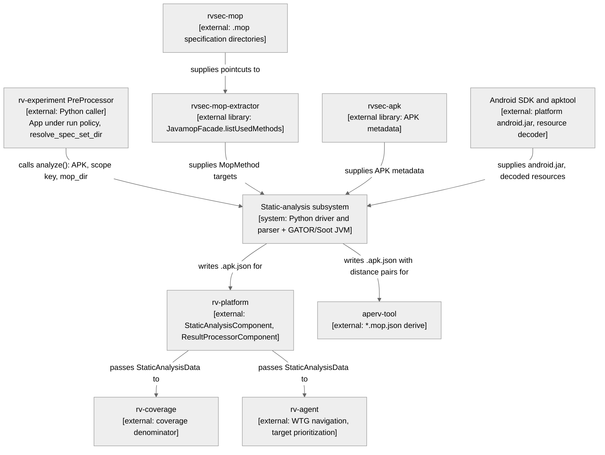
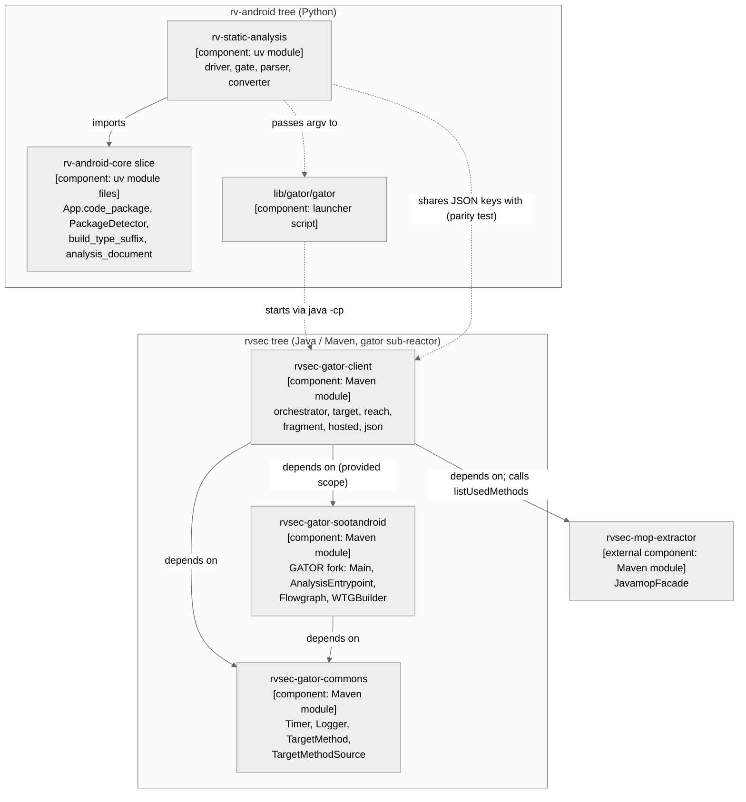
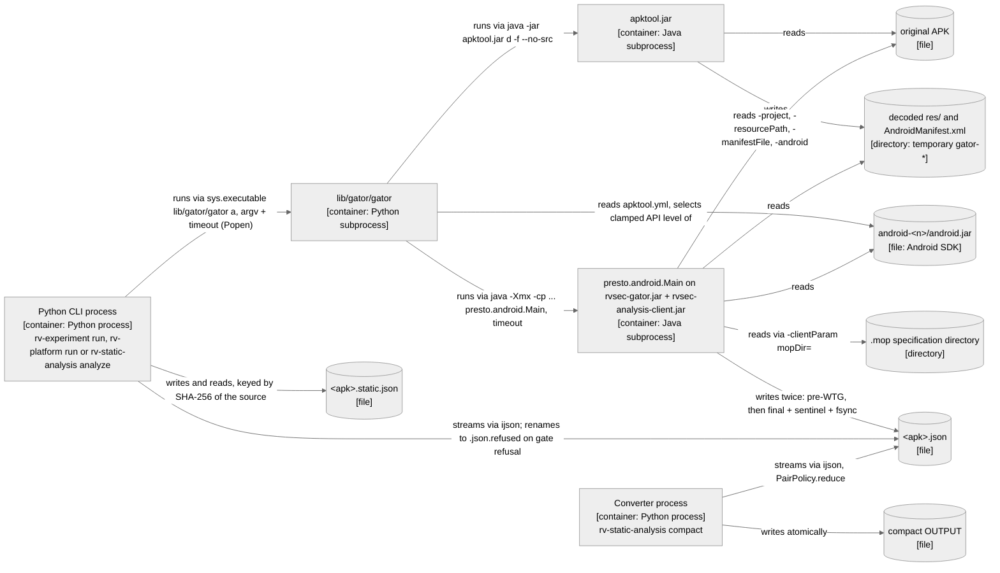
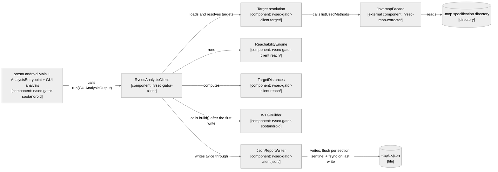
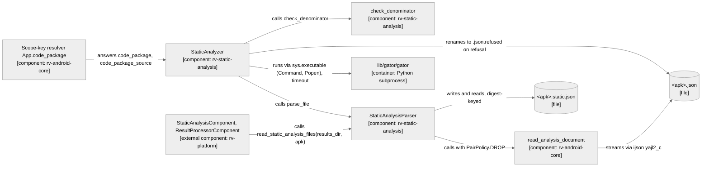
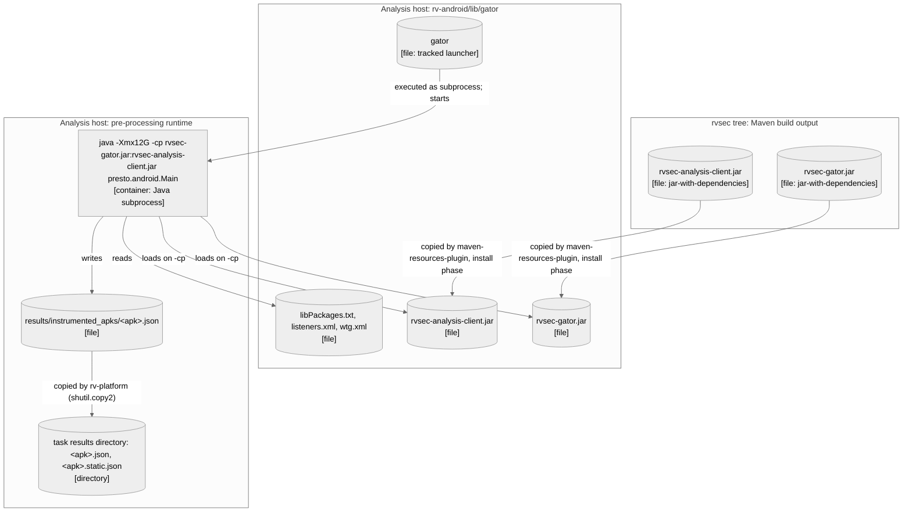

# Architecture — Static-Analysis Subsystem

> Target: subsystem-static-analysis · Regenerate with: /rv-doc-arch subsystem:static-analysis
> Scope: **subsystem** · Generated by `rv-doc-arch` from `rvsec@dc599aa5`
> Languages: Python (1 module, ~3,300 LOC, plus three `rv-android-core` files and the `lib/gator/gator` launcher) and Java (3 Maven modules, ~50,400 LOC, of which ~43,100 are the vendored GATOR fork)

## Table of Contents

- [Part I — Beyond Views](#part-i--beyond-views)
  - [1. Documentation overview](#1-documentation-overview)
  - [2. Conceptual primer](#2-conceptual-primer)
  - [3. System overview and context](#3-system-overview-and-context)
  - [4. How it works — end to end](#4-how-it-works--end-to-end)
  - [5. Core components](#5-core-components)
  - [6. Mapping between views](#6-mapping-between-views)
  - [7. Rationale](#7-rationale)
  - [8. Output artifacts](#8-output-artifacts)
  - [9. Directory](#9-directory)
- [Part II — Views](#part-ii--views)
  - [Module view](#module-view)
  - [Component-and-connector view](#component-and-connector-view)
  - [Allocation view](#allocation-view)
- [Appendices](#appendices)
- [Specification traceability](#specification-traceability)

---

## Part I — Beyond Views

### 1. Documentation overview

This document describes the **static-analysis subsystem** of RV-Android: the pre-processing pass that reads an Android APK once, before any test runs, and writes one JSON document describing the app's structure. That document answers the questions the rest of the framework depends on: which application methods exist and which are reachable from the app's entry points (the coverage denominator), which methods have a call path to a monitored API method and how many calls away each such target is, which UI windows, widgets and event listeners the app has, how those windows navigate to each other (the Window Transition Graph), and which manifest components exist.

The subsystem spans two source trees and two languages. A thin Python side in the `rv-android` repository — the `rv-static-analysis` module, a slice of the `rv-android-core` foundation, and the `lib/gator/gator` launcher — drives a heavyweight Java/Maven engine in the sibling `rvsec` tree, `rvsec-gator` (a GATOR fork on Soot 4.7.1, three Maven modules), across a subprocess boundary. The audience is a **new engineer with no prior exposure to the subsystem**: a top-to-bottom read leaves you able to follow a real analysis run, understand why the work is split across two languages and two processes, and know where each responsibility lives. Per-module 4+1 documentation is complementary and is not repeated here (`modules/rv-static-analysis/docs/architecture.md`, `../rvsec/rvsec-android/rvsec-gator/client/docs/architecture.md`, `../rvsec/rvsec-android/rvsec-gator/sootandroid/docs/architecture.md`).

**How to read this document:** Part I builds your mental model — what the subsystem is ([primer](#2-conceptual-primer)), how it behaves end to end ([walkthrough](#4-how-it-works--end-to-end)), and why it is shaped this way ([rationale](#7-rationale)). Part II documents the selected views in detail.

### 2. Conceptual primer

<!-- From model.primer. -->

The static-analysis subsystem reads an Android APK once, on the analysis host, before any test runs, and writes one JSON document that describes the app's structure: which application methods exist and which are reachable from the app's entry points, which methods reach a monitored API method (a *target*, such as a JCA crypto call) and at what call-graph distance, which UI windows, widgets and listeners the app has — activities, dialogs, menus, fragments and hosted views — how those windows navigate to each other, and which manifest components exist. A Python driver and parser (`rv-static-analysis`) runs a Java engine (`rvsec-gator`, a GATOR fork on Soot 4.7.1) in a subprocess and reads its output back into the `StaticAnalysisData` domain model.

**Why this approach.** Resolving Android's virtual dispatch and callback-driven control flow into a call graph, and then into a navigation graph, needs a mature whole-program analysis framework. The subsystem delegates that to Soot's SPARK points-to call graph and GATOR's GUI analysis instead of reimplementing them. A Python-only alternative (androguard or a hand-written DEX walker) was not taken because it cannot build a points-to call graph, and without one the `reachesTarget` flags, the target distances and the coverage denominator would all be wrong — and those values drive every coverage metric and every MOP-guided exploration decision. The price is a cross-language, cross-process boundary: a JVM started per APK through a Python launcher, multi-gigabyte heaps, analyses that can run past their time budget, and a JSON file as the only contract between producer and consumer. The architecture is shaped around that price. The producer writes the cheap and critical sections first and writes the file twice (before and after WTG construction), so a timeout still leaves a usable partial result. The document records its own scope key, so no consumer has to guess it. The consumer streams the document instead of loading it, because distance pairs can make it gigabytes long. And a denominator gate refuses an artefact whose class list cannot be the app's.

**Key concepts**

- **Reachability / method universe** — The application methods GATOR enumerates under the scope key, each flagged reachable or not from the entry points (Activity, Service, Receiver and Provider lifecycle and public methods; the manifest Application; Fragment subclasses; `ListenableWorker.doWork`/`startWork`; RecyclerView `Adapter`/`ViewHolder` public methods) and the widget and lifecycle callbacks. The `reachability` section is the coverage denominator: without it you can count calls but cannot compute a percentage.
- **Target method / MOP** — A method watched by the selected specification set (`jca`, `jca_android`, `generic`, or a custom directory). MOP means Monitored Operations, not security. `reachesTarget` marks an app method with a call path to a target; `directlyReachesTarget` marks one that invokes a target directly.
- **Scope key (`codePackage`)** — The package prefix that defines which classes are the application's own. The run that performs the analysis chooses it: the declared applicationId by default, the applicationId without a Gradle build-type suffix under `--strip-build-type-suffix`, or the `PackageDetector`'s elected package under `--package-detector`. It is passed to GATOR as `-clientParam codePackage=`; GATOR filters by it and records it in the artefact, and consumers never re-resolve it.
- **SPARK call graph** — Soot's points-to based call-graph algorithm and the default `-cgAlgorithm`. It resolves virtual and interface calls by the types actually instantiated; CHA, RTA and VTA are accepted but over-approximate.
- **WTG (Window Transition Graph)** — A graph whose nodes are UI windows and whose edges are user-triggered transitions carrying the widget and handler that fire them. It tells a dynamic explorer which screen a click leads to, and building it is the timeout-prone stage of the analysis.
- **Distance targets and `targetDistances`** — `distanceTargets` is a top-level index of app methods that directly call a target (kind `direct`) or that call into a library method from which a target is reachable through library code only (kind `boundary`). Each app method may carry `targetDistances`, a list of `[index, d]` pairs giving its call-graph distance (`d ≤ 10`) to each such target.
- **Compact and full output** — GATOR writes the compact document by default: no whitespace, each method's `targetDistances` reduced to the pairs at `d ≤ 3` plus the 3 nearest, and a `distancePairs` marker. `-clientParam fullOutput=true` (`--full-output`) writes the full document, indented and carrying every pair. Both parse to the same `StaticAnalysisData`.
- **Completion sentinel** — The trailing top-level member `"complete": true`, written last and followed by an fsync, only on the write that ends the run. Its absence marks the sample as partial.
- **Denominator gate** — A pure predicate over the artefact (`check_denominator`) that refuses an empty class list, a zero compiled universe under the key, or a parsed-to-compiled class ratio below 0.15. A refused artefact is renamed to `<apk>.json.refused` so no consumer publishes a percentage from it.
- **Parsed copy (`<apk>.static.json`)** — A small cache of the streamed document without its distance members, written beside the source and keyed by the source's SHA-256, so repeated reads of the same large document cost one digest and one small `json.load`.

### 3. System overview and context

The subsystem runs entirely on the analysis host during pre-processing, never on the device or emulator, and it always reads the **original** APK. **rv-experiment** drives it: its `PreProcessor` builds each `App` under the run's package policy and calls `StaticAnalyzer.analyze()` for every APK that instrumented successfully. Upstream, **`rvsec-mop`** supplies the JavaMOP `.mop` specification directory that defines the target methods, and **`rvsec-mop-extractor`** (`JavamopFacade.listUsedMethods`, `UsedJcaMethodsVisitor`, `MopMethod`) parses those specs into target entries, including subtype (`+`) owners, wildcard method names and the implicitly seeded `java.lang` package. **`rvsec-apk`** is an APK-metadata library on the client's classpath, with its own FlowDroid/Soot dependencies excluded so they cannot clash with the engine's. The **Android SDK** provides the platform `android.jar` that the launcher selects from the APK's target API level, and apktool decodes the resources and manifest GATOR reads.

Downstream, consumers read the one JSON artefact. **rv-platform** copies it into each task's results directory and loads it with `read_static_analysis_files(results_dir, apk)` in both `StaticAnalysisComponent` and `ResultProcessorComponent`, passing no key. **rv-coverage** uses `Classes.methods` as the coverage denominator and the reachability flags to split it. **aperv-tool** reads the raw document itself (`modules/aperv-tool/src/aperv_tool/analysis/static_artifact.py`, `modules/aperv-tool/src/aperv_tool/tools/aperv/derive_mop_artifact.py`) to derive the device-side `*.mop.json`, which is the only consumer of the distance pairs. **rv-agent** consumes the WTG and the target flags for navigation and action prioritization.

**Which specification directory.** Which directory is read is not a free parameter of the subsystem on the `rv-experiment` path: `ExperimentConfig.get_static_analysis_config()` passes `mop_dir=resolve_spec_set_dir(...)`, the same method that feeds monitor generation. One resolution serves both deliberately — the APK is instrumented over a set, and the coverage denominator, the target list and the `reachesTarget` flags must answer to that same set; a second copy of the mapping would let the two views drift apart. `RVStaticAnalysisConfig` still defaults `mop_dir` to `rvsec/rvsec-mop/src/main/resources/jca` as the fallback for standalone callers, who normally pass `--mop-dir` or `--targets-file` themselves.

**Constraints:** The engine is pinned to Soot 4.7.1 and built by the `rvsec` reactor for its Java 21 target as two jar-with-dependencies JARs; it runs in its own JVM, so the Python 3.12 workspace and the Java toolchain never share a runtime. Analysis always runs on the original APK because Soot's `TypeResolver` fails on AspectJ-woven bytecode. Each run is bounded by `-Xmx` (default `12g`) and a wall-clock timeout (default 600 s); WTG construction is the timeout-prone stage.

The system context diagram (Diagram 1) shows the subsystem as one box among the callers, the libraries and tools it reads from, and the consumers of its one artefact. Every view refers back to it.

**Diagram 1 — The static-analysis subsystem, the pre-processing caller and libraries upstream of it, and the consumers of its JSON document.**

**Legend.** Rectangle = the subsystem (`[system]`) or an external caller, library, tool set or consumer (`[external …]`); solid arrow = the relation named by its label, in the direction data flows.

### 4. How it works — end to end

<!-- From model.walkthrough. -->

The following walks through a concrete example: **analyzing `cryptoapp.apk` (applicationId `br.unb.cic.cryptoapp`) inside an `rv-experiment` run with `--specification-set jca_android` and the default package policy, producing `instrumented_apks/cryptoapp.apk.json`, so that each task later knows the method universe and which handlers reach a `javax.crypto` target.** Each stage transforms a concrete artifact and hands it to the next.

1. **Scope key and specification directory.** `rv-experiment`'s `PreProcessor` runs static analysis during pre-processing, over the original APK of every APK that instrumented successfully. It builds the `App` through `_build_app`, which hands the run's two package policies (`package_detector`, `strip_build_type_suffix`) to the model. `App.code_package` then answers the scope key: with both policies off it is the declared applicationId, and `code_package_source` is `"manifest"`. The specification directory comes from `resolve_spec_set_dir`, as described in [§3](#3-system-overview-and-context). Concretely, `code_package='br.unb.cic.cryptoapp'`, `code_package_source='manifest'`, `mop_dir=<rvsec_root>/rvsec/rvsec-mop/src/main/resources/jca_android`, and the output directory is `<results>/instrumented_apks`.

2. **Config and command build.** `RVStaticAnalysisConfig` resolves tool paths through a four-level chain (explicit field > `rvsec_root` layout > `RVSEC_HOME` > parent of the working directory). Its eager checks — the gator launcher, the analysis-client JAR, the Android platforms directory and an `android.jar`, and the INV-ANA-33 mutex between `mop_dir` and `targets_file` — run only when `validate_on_init` is true. `rv-experiment` constructs the config with `validate_on_init=False`, so on that path a missing tool surfaces as a launcher failure rather than a `ConfigurationError`; standalone CLI callers keep the eager checks. `get_tool_command()` assembles the argv with `sys.executable` rather than a literal `python`, appends the scope key and its origin as client parameters, and adds `skipWtg`/`fullOutput` client parameters and the top-level `-cgDelegation`/`-succDepth` flags only when configured. Concretely: `[sys.executable, <lib>/gator/gator, 'a', '-p', cryptoapp.apk, '--client-jar', rvsec-analysis-client.jar, '--out', cryptoapp.apk.json, '-client', 'RvsecAnalysisClient', '-clientParam', 'mopDir=.../jca_android', '-cgAlgorithm', 'spark', '--timeout', '600', '--jvm-memory', '12G', '-clientParam', 'codePackage=br.unb.cic.cryptoapp', '-clientParam', 'codePackageSource=manifest']`.

3. **Keyed cache check.** `StaticAnalyzer.model_post_init` fixes the output path `<output_dir>/<app.name>.json`. `_execute_command` checks whether that file already exists, but existence alone is not a hit: `_disagreeing_recorded_key` parses the stored artefact and compares the `codePackage` it records with this run's key. A matching key, or an artefact that records no key, is reused and a synthetic `CommandResult(0)` is returned without spawning anything; a different recorded key removes the file and re-runs the analysis, with a warning naming both keys (INV-ANA-70). On the first run of `cryptoapp` there is no file, so the analysis proceeds; a resumed run with the same policy reuses it.

4. **Launcher hop.** The Python driver runs `lib/gator/gator` as a subprocess with the analysis timeout. The launcher decodes the APK's resources with apktool, reads the target API level from `apktool.yml` (29 when unknown, never below 10) and clamps it down to the highest platform installed in the SDK, which it finds through `--sdk`, `ANDROID_SDK_HOME` or an existing `ANDROID_HOME`. It joins `rvsec-gator.jar` with the `--client-jar` on one classpath and starts the JVM with the listener spec, WTG spec and library-package list that sit next to it, enforcing the same timeout. Concretely: `java -Xmx12G -cp rvsec-gator.jar:rvsec-analysis-client.jar presto.android.Main -libraryPackageListFile libPackages.txt -resourcePath <apktool>/res -manifestFile <apktool>/AndroidManifest.xml -apiLevel android-<n> ... -android <sdk>/platforms/android-<n>/android.jar -client RvsecAnalysisClient -clientParam mopDir=...`.

5. **Soot setup, scope guard and GUI analysis.** `presto.android.Main` builds the Soot argument list in `Main.sootArgs`: `jb.sils` and `jb.dae` disabled to shrink the crash surface, no `-exclude` package list, `-no-bodies-for-excluded` kept (it acts on Soot's default exclusions such as `java.*` and `javax.*`), and the `cg.spark` phase enabled for `-cgAlgorithm spark`. `AnalysisEntrypoint` then demotes classes listed in `libPackages.txt` to Soot library classes, but protects every class under the same scope key the client will filter by — `Configs.getClientParamCode("codePackage=")`, falling back to the manifest package only when the parameter is absent (INV-ANA-65) — and keeps declared activities as application classes. GATOR's GUI flow analysis runs and then calls `RvsecAnalysisClient.run(GUIAnalysisOutput)`. If SPARK call-graph construction itself throws, the JVM exits non-zero before the client runs and no JSON exists. Here the log reads `scope key for app/library classification: br.unb.cic.cryptoapp`.

6. **Class enumeration and target resolution.** The client enumerates Scene application classes whose name starts with the filter package (`codePackage`, else the manifest package) and excludes generated resource classes by their last name segment — `R`, `R$*`, `BuildConfig`, `Manifest`, `Manifest$*` (INV-ANA-71). It then loads targets: `MopSpecsTargetSource` wraps `JavamopFacade.listUsedMethods(mopDir, false)` and turns each `MopMethod` into a `TargetMethod` carrying a `MatchPolicy` and the `includeSubtypes`/`nameIsPattern` flags. MOP targets match LENIENT (class and method name, every overload), except those whose owner resolved only through the implicitly seeded `java.lang` package, which match STRICT by full signature (INV-ANA-40). `TargetResolver.resolveInScene` resolves them to `SootMethod`s, testing `FastHierarchy.canStoreType` against the declared super-type for `+` owners (INV-ANA-42). Every target the specs name is seeded; the source applies no filter on whether a spec can report a violation. The log line is `MOP methods resolved: N (resolveInScene: t ms)`.

7. **Lambda edges and reachability.** `LambdaEdges.addTo` adds edges to `Scene.v().getCallGraph()` from D8/desugar lambda wrappers to the app methods their bodies invoke, and from single-invoke implementations of a directly implemented single-abstract-method interface, because SPARK gives a captured lambda receiver no points-to set and a widget handler resolves to the wrapper (INV-ANA-77). `EmptySiteEdges.addTo` then adds edges at the instance-invoke sites SPARK left without one, to app callees only (INV-ANA-96); the client removes them again before the fragment windows and the WTG. `ReachabilityEngine.run()` projects the call graph into a JGraphT graph without self-loops and runs a multi-source BFS from the entry points and the callbacks `RvsecAnalysisClient.collectCallbacks` gathers for `reachable` (INV-ANA-94). It computes the direct-caller set first — call-graph callers of targets UNION a bytecode scan of app classes, which recovers the app-to-library invokes SPARK quarantines (BUG-INV-ANA-19) — and then runs the reverse BFS on an `EdgeReversedGraph` seeded with `targets ∪ directTargetSet`, so `reachesTarget ⊇ directlyReachesTarget` holds by construction (INV-ANA-64). The resulting `ReachabilityIndex` is immutable. A click handler wrapper `MainActivity$$ExternalSyntheticLambda0.onClick` whose body calls a method reaching `Cipher.getInstance` therefore carries `reachesTarget=true`.

8. **Distances, fragments and hosted windows.** `TargetDistances.compute` runs one reverse BFS per distance target over the same call graph — library methods are walked, but only app methods carry pairs — up to `DIST_MAX = 10` (INV-ANA-73). Distance targets are the app direct callers (kind `direct`) followed by the boundary methods (kind `boundary`), each group sorted by signature so an index is stable within the artefact. `FragmentWindows.analyze` builds `FRAGMENT` windows (`Host#Fragment`) from layout tags, transactions, Navigation XML and pagers, and `HostedWindowExtractor` builds `HOSTED` windows (`Host#Owner`) for dialogs, DialogFragments, DataBinding layouts and adapter rows. All of these depend only on the solver and the call graph, so they are ready before WTG construction. A failure in any of these passes is caught and costs only its own section.

9. **Pre-WTG write.** `JsonReportWriter`, holding one output mode for the whole run, writes the document: `package` and `mainActivity`, the scope members `codePackage`, `codePackageSource` and `class_defs_under_key` (the compiled classes under the key that pass `isAppClass`, counted from `Scene.getClasses()`), the `distancePairs` marker in compact mode, `distanceTargets`, then `components`, `reachability` (with `targetDistances`), `windows` and an empty `transitions` array, flushing after each section. Every per-node flag comes through the `ReachabilityEnricher` callback; the writer holds no reference to the index (INV-ANA-30). This first write asks for no sentinel unless `skipWtg` is set, in which case the client returns right after it and the write ends with `"complete": true`. The document starts `{"package":"br.unb.cic.cryptoapp","mainActivity":…,"codePackage":"br.unb.cic.cryptoapp","codePackageSource":"manifest","class_defs_under_key":N,"distancePairs":{"weighedMax":3,"k":3},"distanceTargets":[…],"components":…`.

10. **WTG construction and final write.** `WTGBuilder.build` runs; with `cgDelegation=false`, the default, `FlowgraphRebuilder` rebuilds the legacy `AndroidCallGraph` for virtual dispatch. On success the client re-runs `prepareWindows` with the WTG node ids and overwrites the file with the same members plus the `transitions` edges, followed by `"complete": true` and `fos.getFD().sync()` (INV-ANA-31). If WTG construction throws, the exception is caught and the pre-WTG file stays — valid JSON without the sentinel. If the time budget runs out, the process is killed and the file holds whatever the last write had flushed. The trailing bytes of a finished compact run are `…],"complete":true}`.

11. **Post-condition and denominator gate.** Back in Python, a timeout is a partial success: `RVCommandTimeoutError` is caught, `timed_out` is set and `CommandResult(0)` is returned. `_run_analysis` then requires the file to exist and raises `StaticAnalysisException` otherwise. `analyze()` parses the artefact once and calls `check_denominator(classes, class_defs_under_key, key)`: zero compiled classes under the key, an empty `reachability`, or a parsed-to-compiled ratio below `MIN_PARSED_RATIO = 0.15` raise `DenominatorImplausibleError`, which `analyze()` catches, marking the result failed and renaming the artefact to `<apk>.json.refused`. An artefact that records no `class_defs_under_key` is not judged. For `cryptoapp` the result is `StaticAnalysisResult(analysis_file=…/cryptoapp.apk.json, success=True, timed_out=False, code_package='br.unb.cic.cryptoapp', code_package_source='manifest')`.

12. **Per-task load and streaming parse.** For each task, rv-platform's `StaticAnalysisComponent` copies `<apk>.json` next to the task results (skipping the copy when size and mtime already match) and calls `read_static_analysis_files(results_dir, apk)` with no key (INV-ANA-61). The parser digests the source with SHA-256; if `<apk>.static.json` records the same digest, the model is built from that small copy. Otherwise the source is streamed with `read_analysis_document(path, PairPolicy.DROP)`, an ijson (`yajl2_c`) pass that never builds `distanceTargets` or `targetDistances` and recovers truncation member by member (INV-ANA-81); the parsed copy is written when the read was not truncated. `_build_model` parses each section independently (INV-ANA-06): `reachability` is loaded unfiltered as the denominator (INV-ANA-59), an `ACTIVITY` window is admitted only when its class is in `reachability` (INV-ANA-60), `FRAGMENT` and `HOSTED` are mapped explicitly (INV-ANA-78), widgets referenced only by transitions are back-filled, identifiers are stored verbatim (INV-ANA-67), and `complete` plus the three scope members are surfaced. The result is `StaticAnalysisData(classes, windows, wtg, components, code_package='br.unb.cic.cryptoapp', code_package_source='manifest', class_defs_under_key=N, complete=True)`.

### 5. Core components

At runtime the subsystem is a chain of short-lived elements, most of which exist only while one APK is analyzed.

The chain begins before `rv-static-analysis`, with the **scope-key resolver** (`App.code_package` in `rv-android-core`, backed by `PackageDetector` and `neutralize_build_type_suffix`). The scope key decides which classes form the coverage denominator, and it is the run's decision: `rv-experiment` builds the `App` with its `package_detector` and `strip_build_type_suffix` policies, and `App.code_package` answers the declared applicationId, the neutralized one, or the detector's election. The value and its origin cross the subprocess boundary as two client parameters and come back recorded inside the artefact, so nothing downstream ever infers a key from the manifest `package` member (INV-ANA-58, INV-ANA-66).

The **Python static-analysis driver** (`StaticAnalyzer`, configured by `RVStaticAnalysisConfig`) is created per APK by `rv-experiment`'s `PreProcessor` or by the standalone CLI. It owns the run-level policies around the engine: reuse an artefact only under its own key, treat a timeout as partial success, raise when no file appears, and refuse a denominator that cannot be right. It never interprets analysis semantics beyond the counts the gate divides. The **gator launcher** (`lib/gator/gator`) is the intermediate process hop between the driver and the JVM; it is where the platform `android.jar` and the decoded resources come from, which is why the config-level `android_jar` check does not decide what Soot sees.

The **GATOR/Soot analysis JVM** is the heavyweight runtime element: one process per APK running `presto.android.Main`, bounded by `-Xmx` and the wall-clock timeout. Its two failure modes shape the whole subsystem — running out of time inside WTG construction, which is recoverable because the pre-WTG write is already on disk, and failing inside call-graph construction, which is a hard halt with no output by design. Inside it, the **`RvsecAnalysisClient` orchestrator** computes everything that depends only on the solver and the call graph — reachability, distances, `FRAGMENT` and `HOSTED` windows — before the first write, so the pre-WTG artefact already carries all of it (INV-ANA-75), and it decides which write ends the run and therefore which one carries the sentinel.

**Target resolution** (`MopSpecsTargetSource`, `SignatureFileTargetSource`, `TargetResolver`, `TargetMatching`) loads targets from a `.mop` directory or a signature file. Each target carries its own `MatchPolicy` and subtype/pattern flags, so matching precision follows the source rather than a CLI switch; `TargetMatching` force-resolves declared owners into the Scene once and answers `canStoreType` for both match points — the resolver that seeds the reverse BFS and the bytecode scan. The **`ReachabilityEngine`** is the analytical core: a forward multi-source BFS for `reachable`, call-graph callers plus a bytecode scan for the direct set, and one reverse BFS seeded with targets and the direct set for `reachesTarget`, frozen into a `ReachabilityIndex`. **`TargetDistances`** gives exploration a gradient instead of a boolean — how many calls separate a handler from each direct or boundary target — and its `compact()` reduction keeps exactly what aperv-tool's derive reads. The **`JsonReportWriter`** is the producer side of the on-disk contract: it reads every flag through the `ReachabilityEnricher` callback, writes every key from `JsonSchema.Keys`, flushes per section, and holds a single compact-or-full mode for both writes of a run.

The remaining elements straddle or sit on the consumer side of the boundary. The **analysis JSON document** is the only producer-to-consumer contract: one file per APK, keys defined as named constants on both sides (INV-ANA-32), section-at-a-time so a truncated file is still usable, and self-describing about its scope. The **denominator gate** (`check_denominator`) is a pure predicate over two counts the artefact carries, both produced by the same `isAppClass` predicate, wired in `StaticAnalyzer.analyze()` — the only place that holds both the APK and the key — so the parser can stay keyless. The **`StaticAnalysisParser`** streams the document without ever holding its text, keeps every top-level member read in full when the file is truncated, caches a digest-keyed parsed copy, and builds `StaticAnalysisData`. The **offline compact converter** (`rv-static-analysis compact`) turns a full document into the compact document GATOR would have written for the same analysis, byte for byte.

| Component | Realized by | Responsibility |
|-----------|-------------|----------------|
| Scope-key resolver | `modules/rv-android-core/src/rv_android_core/domain/app.py`, `util/android/package_detector.py`, `util/android/build_type_suffix.py` | Answer the package that scopes the app's own classes, and its origin, under the run's policy. |
| Python static-analysis driver | `modules/rv-static-analysis/src/rv_static_analysis/analysis/static/static_analysis.py`, `config.py` | Build the command, run it with keyed caching and timeout tolerance, check the post-condition, run the gate. |
| gator launcher | `lib/gator/gator` | Decode resources, choose `android.jar`, assemble the JVM command, run it with a timeout. |
| GATOR/Soot analysis JVM | `rvsec-gator/sootandroid`, `rvsec-gator/client` | Soot SPARK call graph, scope guard, GUI flow analysis, client run, WTG. |
| `RvsecAnalysisClient` orchestrator | `rvsec-gator/client/.../clients/RvsecAnalysisClient.java` | Wire enumeration, targets, lambda edges, reachability, distances, windows and the two writes. |
| Target resolution | `rvsec-gator/client/.../clients/target/`, `rvsec-gator/commons/.../clients/target/` | Load targets and resolve them under the source's match policy. |
| `ReachabilityEngine` / `ReachabilityIndex` | `rvsec-gator/client/.../clients/reach/` | Compute `reachable`, `directlyReachesTarget`, `reachesTarget` into an immutable index. |
| `TargetDistances` | `rvsec-gator/client/.../clients/reach/TargetDistances.java` | Per-target reverse BFS up to depth 10; compact reduction of each method's pairs. |
| `JsonReportWriter` | `rvsec-gator/client/.../clients/json/JsonReportWriter.java` | Stream sections with a flush after each in one mode; sentinel and fsync on the run's last write. |
| Analysis JSON document | `<output_dir>/<apk>.json` | The single shared artifact. |
| Denominator gate | `modules/rv-static-analysis/src/rv_static_analysis/analysis/static/denominator_gate.py` | Refuse an implausible class denominator; quarantine the artefact. |
| `StaticAnalysisParser` | `modules/rv-static-analysis/src/rv_static_analysis/parser/static/static_analysis_parser.py`, `modules/rv-android-core/src/rv_android_core/util/analysis_document.py` | Streaming read, truncation recovery, parsed copy, `StaticAnalysisData`. |
| Offline compact converter | `modules/rv-static-analysis/src/rv_static_analysis/compact.py` | Full → compact conversion, byte-identical to GATOR's compact output. |

### 6. Mapping between views

The module structure and the runtime structure meet at a single seam: the subprocess boundary. On the Python side, the `rv-static-analysis` module realizes four runtime roles — the driver (`StaticAnalyzer` + `RVStaticAnalysisConfig`), the denominator gate, the parser, and the offline converter — while the in-scope slice of `rv-android-core` realizes the scope-key resolver (`App`, `PackageDetector`, `neutralize_build_type_suffix`) and the streaming reader (`read_analysis_document`) that both the parser and the converter use. On the Java side, `rvsec-gator-sootandroid` and `rvsec-gator-client` together realize the analysis JVM; the client module specifically realizes the orchestrator, target resolution, the reachability engine, the distance pass, the fragment and hosted window passes and the writer. `rvsec-gator-commons` holds the target contract types (`TargetMethod` with its `MatchPolicy`, `TargetMethodSource`) and the timing/logging helpers, and has no runtime component of its own.

The cross-language, cross-process boundary is two hops in and one artefact out. The Python driver does not call Java directly: it spawns the **gator launcher** (`sys.executable lib/gator/gator a …`), and the launcher spawns the JVM (`java -Xmx<mem> -cp rvsec-gator.jar:rvsec-analysis-client.jar presto.android.Main …`). What crosses inward is the argv: the APK path, the target source (`mopDir=` or `targetsFile=`), the scope key and its origin (`codePackage=`, `codePackageSource=`), the optional `skipWtg=` and `fullOutput=` client parameters, the top-level `-cgAlgorithm`, `-cgDelegation` and `-succDepth` flags, the timeout and the heap size. What crosses back is the exit code and exactly one file, the **analysis JSON document**. No memory, socket or stdout protocol is shared. The Java `JsonReportWriter` writes that file section by section; the Python `StaticAnalysisParser` (and, independently, aperv-tool's derive) reads it back. The two sides agree on its shape only because every key is a named constant on each side (`JsonSchema.Keys`, `_JK`), kept value-equal by `tests/parity/test_json_keys.py`, and because the distance-reduction constants are pinned equal across Java, the converter and aperv-tool by `tests/parity/test_distance_pair_constants.py`.

In allocation terms the whole subsystem runs on the analysis host during pre-processing. The two JARs are built in the `rvsec` tree and copied by the Maven `install` phase into `rv-android/lib/gator/`, beside the tracked launcher, `libPackages.txt`, `listeners.xml` and `wtg.xml`, which is exactly where the Python config's default layout looks. The document is written into `instrumented_apks/` by the pre-processor and copied by rv-platform into each task's results directory, where the parsed copy is created.

### 7. Rationale

The decisions that shaped this architecture, each with the tension behind it and the failure mode it avoids.

**Single unified GATOR client.** The analysis needs several products — a method universe, target flags, distances, a window inventory and a navigation graph — and all of them depend on the same expensive Soot Scene and call graph. Separate tools would pay Soot initialization repeatedly, multiply the chances to time out, and let the denominator and the WTG be computed against subtly different call graphs, making `reachesTarget` and navigation disagree. One client sharing one Scene and one output file removes that possibility; the cost is a larger orchestrator, which the client's package split (`target/`, `reach/`, `fragment/`, `hosted/`, `json/`) keeps manageable.

**Two writes, streamed sections, sentinel on the run's last write.** An all-or-nothing document would throw away the reachability, distance and window data every time WTG construction runs long. The client therefore writes the whole document without transitions before the WTG stage and overwrites it afterwards; the writer flushes after each section so a kill mid-write still leaves every earlier section intact; and buffering the whole model before serializing is ruled out. The sentinel answers to the analysis, not to the write: the pre-WTG write asks for none unless `skipWtg` makes it the run's last write. Without that distinction a run killed inside WTG construction would end in `"complete": true` with an empty `transitions` array and be counted as finished.

**The run chooses the scope key; the artefact records it; consumers never re-resolve it.** Which package is the application's own is a property of the study, not only of the APK: an app built with a build-type suffix declares an id under which nothing was compiled, and a game engine's code lives under the engine's package. The decision puts that choice in one place, the run that performs the analysis, and carries it to every point that needs it. Inside GATOR, the library demotion in `AnalysisEntrypoint` and the client's class filter read the same key; if they read different ones, the demotion removes exactly the classes the client is about to count. The artefact then records the key, its origin and the compiled class count under it, so a consumer can judge the file without the APK. Letting the parser re-filter by a key it resolves itself is ruled out because it could only contradict the producer, and on an app with `applicationIdSuffix` it would empty the universe.

**Denominator gate with quarantine.** A denominator of one class out of hundreds compiled is not empty, so a check for emptiness alone admits it, and a percentage computed over it looks like a result. The gate divides two counts that answer to the same `isAppClass` predicate and fails loudly on three distinct conditions, checking the zero compiled universe first because `0/0` is no ratio at all. Nothing downstream reads the `StaticAnalysisResult` — the pre-processor and the result processor look for `<apk>.json` by name — so a refusal that only logged would still be published. The artefact is therefore renamed rather than deleted: consumers see it as absent and take the existing no-denominator path (empty coverage cells, `measured=false`), and an operator can still read the recorded key and count to find the cause. A refusal fails that APK only.

**Cache reuse keyed by the recorded scope key.** Re-analysis is the costliest pre-processing step, so an existing artefact must be reused on resume. Existence alone is not enough: a run whose key policy changed would reuse a file filtered by another key, and the gate would then judge it by the wrong one. The recorded key settles it. An artefact recording no key is reused because inventing one from the manifest member is exactly the inference INV-ANA-58 forbids, and an unreadable one is reused because the parser recovers truncated files on purpose. `--force` is the deliberate invalidation for a fresh artefact under the same key.

**`reachesTarget` via one reverse BFS seeded with targets ∪ direct callers.** Asking "does `m` reach a target?" per method is a graph search per method. Reversing the call graph turns it into one forward search from the target set that labels every ancestor at once. SPARK quarantines app-to-library invokes, so the direct callers are repaired by scanning app bytecode; seeding the reverse BFS only with targets would leave scan-discovered direct callers, and their callers, unmarked on the transitive axis. Seeding with the direct set propagates upward, so the containment `reachesTarget ⊇ directlyReachesTarget` is derived rather than asserted, and no consumer-side check is needed.

**Match policy is an attribute of the target source.** A `.mop` pointcut names its owner and method with AspectJ patterns, so its full Soot signature is undefined and the match must be lenient; a signature file is exact and matches strictly (lenient only for its own `..`/`*` entries). Baking one mode into the client, or exposing a `--match-mode` switch (INV-ANA-36), would be wrong for one of the two sources. The source stamps each `TargetMethod` with its policy and flags, and both match points honour them, including `FastHierarchy.canStoreType` for `+` owners. The one STRICT case among MOP targets is an owner resolved only through the implicit `java.lang` package: seeding that package under LENIENT would readmit overloads such as `String.valueOf(int)`. The source applies no filter on whether a spec can report a violation — `reachesTarget` measures whether the app touches a monitored operation, not whether a violation is possible.

**Compact output by default, full on request, offline converter.** Distance pairs dominate the document's size, but the parser drops them and the aperv-tool derive keeps only the pairs at distance 3 or less plus the three nearest, so writing every pair by default costs disk and copy time for nothing. Compact output keeps exactly those pairs, which makes the reduction lossless for the derive, and the `distancePairs` marker tells a streaming reader which form it holds before the first pair. Full output remains for reproducing a published document and for offline analyses that count pairs beyond the reduction; the converter turns an existing full document into the compact form without re-running an analysis that costs far more than one streaming pass. The reduction constants are declared three times and pinned equal by a parity test (INV-ANA-88).

**Streaming read and digest-keyed parsed copy.** Loading a document whole needs several times its size in memory. Streaming events and skipping the distance members keeps memory proportional to the sections the parser uses, and the same pass handles truncation by keeping every member read in full. Because the same document is read once per task of its APK and again at result processing, the parsed result is cached beside it. The cache key is the source's digest rather than size and mtime, so a re-analysed document under the same name is never answered by the old copy; a truncated source is never cached, so a recovery cannot shadow a later complete document.

**Analyze the original APK.** Feeding the woven APK to Soot aborts the analysis, so the pre-processor analyzes the original APK of every APK that instrumented successfully and writes the result into `instrumented_apks/`, where rv-platform looks for `<apk>.json` next to the APK it runs. The denominator is therefore the original code's methods, which is the right universe because weaving adds advice and adds no application method.

**Shared JSON schema keys, parity-enforced.** Producer and consumer live in different trees and languages, so a renamed or mistyped key would break parsing with no compile-time signal. `JsonSchemaKeysDump` dumps the Java constants and `tests/parity/test_json_keys.py` compares them with `_JK` value for value; a key added on one side only fails the build.

**`cgDelegation` off by default; narrow relaxation of the no-touch rule (ADR 0007).** Delegating WTG virtual dispatch to the SPARK call graph is faster on some apps but changes results on apps with hybrid-framework wiring, so it stays opt-in (`-cgDelegation true`) and the legacy `AndroidCallGraph` rebuild is the bit-for-bit default (INV-ANA-21). The dominant WTG cost sat in `FlowgraphRebuilder.buildFlowThroughContainer()`, a pass no configuration lever bounded; ADR 0007 (status Proposed) relaxes the rule against editing the vendored fork only for changes that leave output identical, and the spec's container-flow requirement pins that the hoisted and memoized pass produces the same edges (INV-ANA-39).

**Decisions at a glance**

| Decision | Drivers | Invariant / ADR |
|----------|---------|-----------------|
| Single unified GATOR client | One call graph for every section; one JVM start per APK | INV-ANA-32 |
| Two writes, streamed sections, sentinel on last write | WTG is timeout-prone; partial must be distinguishable from finished | INV-ANA-31, INV-ANA-75 |
| Run chooses the key; artefact records it; consumers keyless | Manifest member does not name the filtering key; guard and filter must agree | INV-ANA-58, -59, -61, -65, -66 |
| Denominator gate with quarantine | Collapsed denominators publish plausible percentages; consumers key on presence | INV-ANA-69 |
| Cache reuse keyed by recorded key | Filename carries no key; cheap resume | INV-ANA-70, INV-ANA-11 |
| Reverse BFS seeded with targets ∪ direct callers | Linear cost; direct axis has a bytecode complement | INV-ANA-64 |
| Match policy on the target source | `.mop` signatures undefined; signature files exact; subtype/wildcard pointcuts | INV-ANA-33, -36, -40, -42 |
| Compact default, full on request, converter | Pair volume; derive reads `d ≤ 3` ∪ 3 nearest; reproducibility | INV-ANA-85 … INV-ANA-89 |
| Streaming read and parsed copy | Documents larger than container memory; repeated reads | INV-ANA-80 … INV-ANA-84 |
| Analyze the original APK | Soot fails on woven bytecode | — |
| Shared JSON schema keys | Producer/consumer in different trees and languages | INV-ANA-32 |
| `cgDelegation` off; ADR 0007 | Bit-for-bit rollback; untunable WTG pass | INV-ANA-21, INV-ANA-39 / ADR 0007 |

**Patterns and styles**

At the module level the subsystem is **decomposed** and **layered**. The gator sub-reactor is strictly ordered `commons ← sootandroid ← client` (the client depends on `sootandroid` at `provided` scope), and on the Python side `rv-static-analysis` depends only on `rv-android-core` and Pydantic — the whole module graph is acyclic. The client is decomposed by responsibility into `target/`, `reach/`, `fragment/`, `hosted/` and `json/` packages around the orchestrator. At the component-and-connector level the defining style is **client-server**: a two-hop subprocess boundary where the request is the argv plus the APK and the response is the exit code plus one file. Coupled to it is a **shared-data** style — producer and consumers communicate exclusively through that file, with a parity-checked key schema, recorded scope members and the completion sentinel as coordination data. Inside the JVM and in the consumer there is a **pipe-and-filter** flavor: lambda edges, reachability, distances and window passes feed a section-streaming writer, and the reader is a stream of JSON events filtered by a `PairPolicy`. In allocation terms the styles are **install** (Maven copies both JARs into `lib/gator`) and a host-only **deployment** during pre-processing.

**NFRs served**

**Resilience (NFR04)** is the most load-bearing. A timeout is a first-class, non-fatal outcome: the producer writes everything that does not need the WTG before building it and flushes per section; the driver catches `RVCommandTimeoutError`, sets `timed_out` and returns success; the parser keeps every top-level member read in full from a truncated file and parses each section independently, so a corrupt section yields an empty domain object instead of an exception. Failures in the lambda, distance, fragment and hosted passes cost only their section. Two cases fail hard on purpose — no output file at all (`StaticAnalysisException`), and a denominator the gate refuses (failed result plus quarantine) — because a missing or collapsed denominator must surface rather than degrade into a zero or a misleading percentage.

**Compatibility (NFR07)** comes from the boundary itself: the engine is a pair of jar-with-dependencies JARs built for the reactor's Java 21 target on Soot 4.7.1 and run in their own JVM, so the Python 3.12 workspace and the Java toolchain never share a runtime. The launcher is started with `sys.executable`, so hosts without `/usr/bin/python` work; it accepts `ANDROID_HOME` when `ANDROID_SDK_HOME` is unset, and it clamps the APK's target API level to the highest installed platform instead of pointing Soot at a missing `android.jar`. **Extensibility (NFR02)** is concentrated in the target-source strategy and the configuration surface: a new provenance of targets is a new `TargetMethodSource` class rather than an edit to reachability code, the call-graph algorithm is a pinned configuration value, WTG can be skipped and its dispatch mode switched without code changes, and the parser reads members by key, so new members leave older consumers working. **Configurability (NFR05)** is provided by `RVStaticAnalysisConfig` (four-level path chain, enum pinning at construction, optional eager validation) and by run-level switches for the key policy and the output mode, the policies resolved through the same `resolve_bool_setting` helper `rv-experiment` uses. **Reproducibility (NFR08)** rests on the artefact recording the key, origin and compiled count it was produced under, on cache reuse answering to that recorded key, on full output reproducing a published document byte for byte up to `transitions`, on the converter reproducing GATOR's compact output byte for byte, and on the digest-keyed parsed copy. **Observability (NFR06)** comes from recording the key and origin on `StaticAnalysisResult` and in the log, from the client's per-stage counts and timings (resolved targets, the direct-caller split between call graph and bytecode scan, reverse-BFS seeds, distances, output mode), and from refusals and cache regenerations that name the keys and counts involved.

| NFR | PRD ID | Architectural support |
|-----|--------|-----------------------|
| Resilience | NFR04 | Pre-WTG write; flush per section; sentinel only on last write; per-section parse; member-level truncation recovery; hard fail only on no file or refused denominator. |
| Compatibility | NFR07 | Separate JVM (Java 21 target, Soot 4.7.1); `sys.executable`; SDK root fallbacks; platform clamping in the launcher. |
| Extensibility | NFR02 | `TargetMethodSource` strategy; pinned `cg_algorithm`; `skip_wtg` / `cg_delegation` / `full_output` switches; key-based parsing. |
| Configurability | NFR05 | Pydantic config with four-level path chain; key policy and output mode as run-level switches. |
| Reproducibility | NFR08 | Recorded scope members; keyed cache reuse; byte-identical full output and converter; digest-keyed parsed copy. |
| Observability | NFR06 | Key/origin on the result and in logs; per-stage counts and timings; refusals name key and counts. |

### 8. Output artifacts

The subsystem produces one primary artifact per APK, and everything downstream reads from it or from a cache derived from it. The document is self-describing: it carries the scope it was produced under, the output mode it was written in, and whether the run finished.

| Artifact | Location | Notes |
|----------|----------|-------|
| Analysis JSON document | `<output_dir>/<apk>.json` (rv-experiment: `<results>/instrumented_apks/<apk>.json`; copied by rv-platform into each task results directory) | Compact by default. Members in order: `package`, `mainActivity`, `codePackage`, `codePackageSource`, `class_defs_under_key`, `distancePairs` (compact only), `distanceTargets` (absent if the distance pass failed), `components`, `reachability`, `windows`, `transitions`, `complete` (last write only). |
| Parsed copy | `<results_dir>/<apk>.static.json` | The streamed document without `distanceTargets` and `targetDistances`, plus `source: {digest: "sha256:…", generator: "rv-static-analysis/1"}`; rewritten when the source digest changes; never written from a truncated source; read only through `static_analysis_parser`. |
| Refused artefact | `<output_dir>/<apk>.json.refused` | An artefact the denominator gate refused, renamed so consumers treat the APK as having no denominator. |
| Converted compact document | `OUTPUT` of `rv-static-analysis compact INPUT OUTPUT` | Byte-identical to GATOR's compact output for the same analysis; written to a temporary file, fsynced and renamed. |
| `StaticAnalysisResult` | In memory, returned to the caller | `analysis_file`, `success`, `timed_out`, `errors`, `execution_times`, `code_package`, `code_package_source`. |

### 9. Directory

**Glossary / acronyms**

- **GATOR** — the whole-program Android GUI analysis framework this subsystem forks (`limerick1718/Gator` → `phtcosta/Gator` → in-tree), running on Soot.
- **Soot** — the Java program-analysis framework (pinned 4.7.1) that provides the Scene, the call graph and the Jimple IR.
- **SPARK** — Soot's points-to based call-graph algorithm; the default `-cgAlgorithm`. **CHA / RTA / VTA** — cheaper, over-approximating alternatives.
- **WTG** — Window Transition Graph.
- **MOP / target** — Monitored Operations; a target is a method watched by a specification set. `reachesTarget` / `directlyReachesTarget` are the two reachability flags.
- **Scope key / `codePackage`** — the package prefix that defines the app's own classes; **`codePackageSource`** — its origin (`manifest`, `manifest-neutralized`, `detector`); **`class_defs_under_key`** — the net count of compiled classes under the key that pass `isAppClass`.
- **LENIENT / STRICT** — the two `MatchPolicy` values: class and method name only, or the full Soot signature.
- **Direct / boundary target** — the two kinds of distance target: an app method that calls a target, or an app method that calls a library method from which a target is reachable through library code only.
- **Compact / full output** — the two document modes; **`distancePairs`** — the compact-mode marker `{weighedMax: 3, k: 3}`.
- **Completion sentinel** — the trailing `"complete": true` plus fsync on the run's last write.
- **Parsed copy** — `<apk>.static.json`, the digest-keyed cache of a streamed document.
- **BFS / JGraphT / EdgeReversedGraph** — multi-source breadth-first search over a JGraphT projection of the call graph; edge reversal turns "reaches a target" into forward reachability from the targets.

**References**

- Analysis domain spec: `openspec/specs/analysis/spec.md`.
- ADR 0004 (subtype target matching through `FastHierarchy.canStoreType` at match time): `docs/adr/0004-generic-subtype-target-matching-canstoretype.md`.
- ADR 0007 (relax the GATOR no-touch rule for semantics-preserving performance fixes): `docs/adr/0007-relax-gator-no-touch-rule-for-semantics-preserving-perf-fixes.md`.
- Module docs: `modules/rv-static-analysis/CLAUDE.md`, `modules/rv-static-analysis/docs/architecture.md`, `../rvsec/rvsec-android/rvsec-gator/CLAUDE.md`, `../rvsec/rvsec-android/rvsec-gator/client/docs/architecture.md`, `../rvsec/rvsec-android/rvsec-gator/sootandroid/docs/architecture.md`.
- Product requirements: `docs/PRD.md` (FR04–FR06; NFR02, NFR04–NFR08).

---

## Part II — Views

### Module view

*Style(s): decomposition, layered*

This view shows how the source is split across two trees and two languages, and why the split is acyclic. It matters because the subsystem's most important structural fact — the Python side carries no Java or Soot dependency, and the Java side carries no Python dependency — is a module-boundary decision, not a runtime one. Read Diagram 2 as two stacks joined only by the launcher, the shared key schema and the subprocess.

**Primary presentation**

**Diagram 2 — Source modules of the subsystem in the two trees, and the relations that join them.**

**Legend.** Rectangle = a source unit (`[component: …]`; `[external component]` when it is outside the subsystem); frame = source tree and language; solid arrow = build-time import or Maven dependency; dotted arrow = relation that exists only at run time or through a data contract (argv, subprocess start, shared key names).

**Element catalog**

The Python side is one dedicated module, a slice of the foundation, and the launcher. **`rv-static-analysis`** keeps the whole Python side of the pipeline free of any Java or Soot dependency: it treats the engine as an opaque command that emits a file. That lets rv-platform, rv-coverage, rv-experiment and aperv-tool depend on a small Pydantic surface (`StaticAnalysisData`) while the JVM-bound analysis lives in another process and another tree, and it concentrates the tolerance for partial, oversized and stale artefacts in one place. Internally, `config.py` holds `RVStaticAnalysisConfig`, which resolves every path through the four-level chain, pins `cg_algorithm` to `spark`/`cha`/`rta`/`vta`, and turns its fields into the launcher argv in `get_tool_command()`. `analysis/static/static_analysis.py` holds `StaticAnalyzer`, which implements rv-android-core's `BaseAnalyzer`: `analyze()` records the key and origin on the result, runs the command through `_execute_command` (keyed cache, timeout as partial success, non-zero exit as `StaticAnalysisException`), enforces the no-file post-condition, then parses the artefact once and hands it to the gate in `denominator_gate.py`. `parser/static/static_analysis_parser.py` holds `StaticAnalysisParser` and the module-level `parse_file` / `read_static_analysis_files`. `compact.py` is the converter, and `__main__.py` exposes the `analyze`, `batch` and `compact` subcommands. Gotchas a maintainer learns the hard way: the parser takes no package key, and choosing the key belongs to `analyze()`; `jvm_memory` defaults to `12g`; the config's `android_jar` is only validated, because the launcher chooses the `android.jar` the JVM uses; a cached artefact is reused whatever output mode wrote it, so `--full-output` needs `--force` to regenerate one; the standalone CLI does not read `RV_SA_TIMEOUT` / `RV_JVM_MEMORY` but does read `RV_PACKAGE_DETECTOR` and `RV_STRIP_BUILD_TYPE_SUFFIX`; `check_denominator` lives in its own file because the reverse import would close a cycle; and no module outside this one references the `.static.json` suffix (`modules/rv-static-analysis/tests/test_static_copy_audit.py`).

The **`rv-android-core` slice** holds what other modules need too. `App.code_package` is a computed property: with both policies off it returns the declared applicationId; with `strip_build_type_suffix` it returns `neutralize_build_type_suffix(package_name)`, which removes a trailing Gradle build-type segment found in `BUILD_TYPE_DENYLIST`; with `package_detector` it lazily runs `PackageDetector.detect_package(apk)`. The detector enumerates manifest Activities, Services and Receivers (Providers are excluded because they are often third-party), drops framework and library prefixes, and applies, in order, `same_package`, game-engine detection (Godot, Unity, Cocos2D, LibGDX), single package, common prefix, a 60%-dominant package, a weighted string-similarity match (Jaro-Winkler 0.5, Levenshtein 0.3, SequenceMatcher 0.2, threshold 0.85), and the manifest fallback (INV-ANA-14). When both policies are on, the detector wins and the origin is `detector`. `util/analysis_document.py` implements `read_analysis_document(path, PairPolicy)` as one pass of ijson events on the `yajl2_c` backend — it refuses any other backend — building members as `json.loads` would except the distance pairs, which `PairPolicy.DROP` skips and `PairPolicy.reduce(weighed_max, k)` reduces. These live in the foundation because `rv-experiment` builds the `App` under the run's policy and aperv-tool's derive reads the same document.

The **launcher** `lib/gator/gator` is the one place that knows the on-disk layout of the GATOR distribution: it decodes resources with apktool, resolves the SDK root, clamps the target API level to an installed platform (with a loud message when it falls back), builds the classpath and the `presto.android.Main` command, and runs it with the timeout, exiting `-50` on `TimeoutExpired`.

On the Java side the gator sub-reactor is three modules ordered bottom-up. **`rvsec-gator-commons`** is a four-class leaf: `Timer`, `Logger`, `TargetMethod` (with its nested `MatchPolicy` and the `includeSubtypes` / `nameIsPattern` flags) and `TargetMethodSource`; it sits at the bottom so the engine and the client share helpers and the target contract without depending on each other. **`rvsec-gator-sootandroid`** is the GATOR fork itself (180 Java files, ~43k lines): `Main` parses GATOR's flags into `Configs` and builds the Soot arguments in `sootArgs`; `AnalysisEntrypoint` reads the manifest, resolves the scope key from the client parameter and demotes library classes outside it; the GUI analysis builds and solves the flow graph, with `FragmentViewFlow` linking a fragment's `onCreateView` result to `onViewCreated(view)` and `getView()`, `LibraryInflateModel` covering DataBinding, `AppCompatActivity(int)` and builder `setView(int)`, and a ViewBinding op node in `Flowgraph.createOpNode`; `WTGBuilder` builds the transition graph. It is its own module because it is a large third-party framework the project forked; keeping it apart lets the rule against modifying the fork apply here while RVSEC logic evolves in the client, a rule ADR 0007 relaxes only for output-preserving performance fixes. Its gotchas: no `-exclude` list reaches Soot, because Soot 4.7.1 reads exclusions only when the Scene is constructed, which `PrerunEntrypoint.run()` does before arguments are parsed; `-cgDelegation`, `-cgAlgorithm` and `-succDepth` are top-level GATOR flags, not client parameters; a failure inside SPARK call-graph construction halts the JVM with no JSON, while failures inside `Flowgraph.processApplicationClasses()` skip the method and continue (INV-ANA-17).

**`rvsec-gator-client`** (~7.1k lines, 26 main and 33 test classes) is the project's own analysis logic, packaged as `rvsec-analysis-client.jar`. `RvsecAnalysisClient.run()` resolves the filter package, enumerates app classes with `isAppClass`, loads and resolves targets with one `TargetMatching` shared by both match points, adds `LambdaEdges`, runs `ReachabilityEngine`, computes `TargetDistances`, builds a `ReachabilityEnricher` that also carries the scope provenance and the distance index, runs the fragment pass, and writes the document twice through one `JsonReportWriter`. `prepareWindows` assembles windows from GATOR's activities, dialogs and menus, adds `FRAGMENT` and then `HOSTED` windows (numbered from `FIRST_OWNED_WINDOW_ID = 900000`; an owner shared by more than `MAX_HOSTS = 20` hosts yields no `HOSTED` window), enriches widgets from layout XML, unions programmatic and array-resource Spinner items, and drops repeated owned windows and repeated widget records. The section writers (`writeComponentsSection`, `writeReachabilitySection`, `writeWindowsSection`, `writeTransitionsSection`) still live on `RvsecAnalysisClient` and are called by `JsonReportWriter`. The client is a separate module so its semantics can be unit-tested without the engine (`ReachabilityBfsTest`, `TargetDistancesTest`, `LambdaEdgesTest`, `SentinelEmissionTest`, `JsonReportWriterPurityTest`, `DistancePairsMarkerTest`, among others) and shipped as an add-on JAR on the engine's classpath — which is what the `provided` scope on `sootandroid` encodes. Its gotchas: the class Javadoc of `RvsecAnalysisClient` still lists an older section order, and `JsonReportWriter` is the authority on the actual one; a failure in the lambda, distance, fragment or hosted pass is caught and logged with `[RvsecAnalysisClient]` and costs only that section; Compose UI has no view tree for GATOR to read and is not modelled, without breaking the run; and window/widget ids and widget-list order are not deterministic between runs of the same jar, so regenerated baselines are compared by counts, not by line diff.

| Element | Responsibility | Relations / interfaces |
|---------|----------------|------------------------|
| `rv-static-analysis` (Python) | Driver, gate, parser, converter; CLI `analyze` / `batch` / `compact`. | depends on `rv-android-core`, Pydantic; runs the launcher |
| `rv-android-core` slice (Python) | `App.code_package` / `code_package_source`, `PackageDetector`, `neutralize_build_type_suffix`, `read_analysis_document`, `StaticAnalysisData`. | used by `rv-static-analysis`, `rv-experiment`, aperv-tool |
| `lib/gator/gator` (Python) | Resource decoding, platform selection, JVM command, timeout. | spawned by the driver; spawns the JVM |
| `rvsec-gator-client` (Java) | Targets, reachability, distances, fragment/hosted windows, streaming JSON. `rvsec-analysis-client.jar`. | `provided` dep on `sootandroid`; uses `commons`, `rvsec-mop-extractor`, `rvsec-apk`, Gson, JGraphT |
| `rvsec-gator-sootandroid` (Java) | GATOR fork: `Main`, `AnalysisEntrypoint`, flow graph, `WTGBuilder`, XML parsing. `rvsec-gator.jar`. | uses `commons` |
| `rvsec-gator-commons` (Java) | `Timer`, `Logger`, `TargetMethod` + `MatchPolicy`, `TargetMethodSource`. | leaf |
| `rvsec-mop-extractor` (Java, external) | Parses `.mop` files into `MopMethod` targets. | consumed by `MopSpecsTargetSource`; see [context](#3-system-overview-and-context) |

**Context** — see [system context](#3-system-overview-and-context).

**Variability guide**

The variation points sit in configuration and in the target source, not in the module graph. Target provenance is a choice of `TargetMethodSource` implementation (`MopSpecsTargetSource` or `SignatureFileTargetSource`), selected by which of `--mop-dir` / `--targets-file` is set; a new provenance is a new class in the client's `target/` package. The specification set changes which `.mop` directory is read, and with it which owners are exact, subtype-declared or wildcard, without code changes. The scope-key policy (declared id, neutralized id, detector) is a run-level switch. The call-graph algorithm is pinned to the four Soot values; WTG participation (`skipWtg`), virtual-dispatch delegation (`-cgDelegation`) and successor depth (`-succDepth`) are switches; the output mode is a switch (`fullOutput`).

**Rationale**

The two-stack, acyclic split lets the JVM analysis and the vendored fork evolve under their own rules in one tree, while the small Pydantic consumer surface and all the tolerance logic live in another. The `commons ← sootandroid ← client` order keeps the Java side acyclic and lets the client be rebuilt and tested without touching the 43k-line engine, encoded by the `provided` scope. Placing the scope-key resolver and the streaming reader in the foundation rather than in `rv-static-analysis` reflects that they are shared: the run decides the key before static analysis starts, and the derive reads the same document.

### Component-and-connector view

*Style(s): client-server, shared-data, pipe-and-filter*

This view shows what processes exist while one APK is analyzed and how bytes move between them. The defining features are the two-hop subprocess boundary, the two writes of one file, and the streaming read on the other side. Everything about the subsystem's resilience — partial recovery, the sentinel, the post-condition, the gate — is a property of this boundary, so this is the view where the scenarios live.

**Primary presentation** — running containers and the connectors between them (C4 container level; a uv module is never a container).

Diagram 3 shows the processes that exist while one APK is analyzed and the files they exchange. Under `rv-experiment`, one Python process runs both pre-processing and task execution (`ExecutionController` creates the `Platform` in process), so the driver and the parser live in the same container; a standalone `rv-static-analysis analyze` or `rv-platform run` is a separate Python process holding the same components.

**Diagram 3 — Containers of one analysis: the Python process, the launcher, apktool and the GATOR JVM, and the files they exchange.**

**Legend.** Rectangle = running process (`[container: …]`); cylinder = file or directory on disk; solid arrow = process start, read or write, labeled with its mechanism. The two `java` hops and the `sys.executable` hop are separate operating-system processes; no memory, socket or stdout protocol crosses them.

The flow inside two of these containers matters for the walkthrough. Diagram 4 is the inside of the Java subprocess `presto.android.Main` from Diagram 3; Diagram 5 is the inside of the Python process from Diagram 3.

**Diagram 4 — Inside the GATOR JVM: the client passes that build the document.**

**Legend.** Rectangle = a code unit inside the JVM (`[component: …]`; `[external component]` when it comes from outside the subsystem); cylinder = file or directory on disk at the container boundary; solid arrow = in-process call, or file read/write when it touches a cylinder.

**Diagram 5 — Inside the Python process: driver, gate, parser and streaming reader.**

**Legend.** Rectangle = a code unit inside the Python process (`[component: …]`; `[external component]` when it belongs to another module) or, when labeled `[container: …]`, the separate process at the boundary; cylinder = file on disk; solid arrow = in-process call, subprocess start, or file read/write, as its label says.

**Element catalog**

| Component / connector | Type | Responsibility |
|-----------------------|------|----------------|
| Python process (`rv-experiment` / `rv-platform` / `rv-static-analysis analyze`) | container (Python process) | Hosts the scope-key resolver, the driver, the gate and the parser (Diagram 5). |
| gator launcher | container (Python subprocess) | Resources, `android.jar`, JVM command, timeout. |
| apktool (`lib/apktool/apktool.jar`) | container (Java subprocess) | `java -jar apktool.jar d -f --no-src --output <tmp> <apk>`, started by the launcher through `pygator.unpacker.decode_res_from_apk`; decodes resources and manifest. |
| GATOR/Soot JVM | container (Java subprocess) | Soot setup, scope guard, GUI analysis, client run, WTG. |
| compact converter (`rv-static-analysis compact`) | container (Python process) | Full → compact, byte-identical to GATOR. |
| original APK | file (input) | The non-instrumented APK; read by apktool and by the JVM (`-project`). |
| decoded resources | directory (temporary) | `res/`, `AndroidManifest.xml` and `apktool.yml` under a `gator-*` temporary directory; removed by the launcher after the run. |
| `android.jar` | file (Android SDK) | The platform jar at the clamped API level; passed as `-android`. |
| `.mop` specification directory | directory (input) | Read through `JavamopFacade` when `mopDir=` is set (a signature file under `targetsFile=` takes its place). |
| compact OUTPUT | file (on disk) | The converter's output, written to a temporary file, fsynced and renamed. |
| `presto.android.Main` + GUI analysis | component (in JVM) | Parse GATOR flags, build Soot arguments, guard the scope key, run the GUI analysis, call the client. |
| `RvsecAnalysisClient` | class (in JVM) | Orchestrate the passes and the two writes. |
| Target resolution | class (in JVM) | Load and resolve targets under each target's `MatchPolicy`. |
| `JavamopFacade` (rvsec-mop-extractor) | external component (in JVM) | Parse `.mop` files into `MopMethod` targets. |
| `ReachabilityEngine` | class (in JVM) | `reachable`, `directlyReachesTarget`, `reachesTarget` into an immutable index. |
| `TargetDistances` | class (in JVM) | Per-target reverse BFS to depth 10; compact reduction. |
| `WTGBuilder` | class (in JVM) | Build the Window Transition Graph after the first write. |
| `JsonReportWriter` | class (in JVM) | Stream sections with a flush each; one mode; sentinel and fsync on request. |
| `apk.json` | store (on disk) | The producer→consumer contract. |
| Scope-key resolver | class (Python) | Answer `code_package` and `code_package_source` under the run's policy. |
| Python driver (`StaticAnalyzer`) | service | Keyed cache, launch with timeout, post-condition, gate. |
| Denominator gate | class (Python) | Refuse implausible denominators; quarantine. |
| `StaticAnalysisParser` | class (Python) | Streaming read, truncation recovery, `StaticAnalysisData`. |
| `read_analysis_document` | function (Python) | One ijson event pass over the document under a `PairPolicy`; member-level truncation recovery. |
| `StaticAnalysisComponent`, `ResultProcessorComponent` | external class (rv-platform) | Copy the document into the task results directory and load it with no key. |
| `apk.static.json` | store (on disk) | Digest-keyed parsed copy. |
| driver → launcher | connector (subprocess) | `sys.executable lib/gator/gator a …`, `--timeout`, `--jvm-memory`. |
| launcher → apktool | connector (subprocess) | `java -jar lib/apktool/apktool.jar d -f --no-src`. |
| launcher → JVM | connector (subprocess) | `java -Xmx<mem> -cp rvsec-gator.jar:rvsec-analysis-client.jar presto.android.Main …`. |
| writer → `apk.json` | connector (shared file) | Two writes; flush per section; sentinel + fsync only on the run's last write. |
| `apk.json` → parser | connector (shared file) | ijson event stream; distance members skipped; member-level truncation recovery. |

**Context** — see [system context](#3-system-overview-and-context).

**Variability guide**

The connector timeout (`--analysis-timeout`, default 600 s) and the JVM heap (`--jvm-memory`, default `12g`) are per-run settings. The producer can skip the WTG stage (`skipWtg=true`), in which case the first write is the last and carries the sentinel. The output mode is per run (`fullOutput`), and both writes of a run share it. The cache is the implicit variation point: an artefact recording this run's key, or no key, short-circuits the subprocess; `--force` removes it first.

**Scenarios**

**WHEN** WTG construction runs past the 600 s timeout on a large APK, **THEN** the process is killed after the pre-WTG write: the file holds the scope members, `distanceTargets`, `components`, `reachability` with distances, and `windows` including `FRAGMENT` and `HOSTED`, with an empty `transitions` array and no sentinel; Python catches `RVCommandTimeoutError` and sets `timed_out=True`, **AND** the parser builds `StaticAnalysisData` with `complete=False`, a full denominator and window inventory, and an empty WTG. *Why:* everything that depends only on the solver and the call graph is written before WTG construction starts (INV-ANA-75), and the sentinel is reserved for the run's last write (INV-ANA-31).

**WHEN** `WTGBuilder.build` throws instead of timing out, **THEN** the client catches it, logs `WTG construction failed`, and returns, and the JVM exits normally, **AND** the file on disk is the pre-WTG write without the sentinel, so it parses with `complete=False`. *Why:* a successful process exit is not a finished analysis; the pre-WTG write asked for no sentinel.

**WHEN** a run is launched with `--skip-wtg`, **THEN** the config appends `-clientParam skipWtg=true` and the client makes only the first write, with `transitions: []` and `"complete": true`, returning without calling `WTGBuilder.build`, **AND** the sample is `complete=True`, unlike a timeout, so completeness-gated consumers accept its non-WTG data. *Why:* when WTG is skipped by parameter the first write is the run's end, so it may claim completeness.

**WHEN** an app declares `com.example.app.debug` while its classes live under `com.example.app`, and the run uses the default policy, **THEN** GATOR filters by `com.example.app.debug`, finds no compiled class under it and records `class_defs_under_key: 0`; `check_denominator` raises `DenominatorImplausibleError`, and `analyze()` returns `success=False` and renames the file to `<apk>.json.refused`, **AND** re-running with `--strip-build-type-suffix` scopes by `com.example.app`, records `codePackageSource: "manifest-neutralized"`, and does not reuse any stored artefact recording the old key. *Why:* the zero-universe branch is checked first because `0/0` is no ratio at all, and cache reuse answers to the recorded key (INV-ANA-69, INV-ANA-70).

**WHEN** a Godot game declares manifest package `ir.hsn6.trans` and the run enables `--package-detector`, **THEN** `App.code_package` runs `PackageDetector`, which skips `same_package`, matches the game-engine branch and elects `org.godotengine.godot` with origin `detector`, **AND** GATOR's guard and filter both use `org.godotengine.godot`, the artefact records it, and the parser loads `reachability` unfiltered. *Why:* the key is chosen once by the producing run, and the consumer never re-resolves it (INV-ANA-61, INV-ANA-65).

**WHEN** the output JSON already exists on a resumed run and records this run's `codePackage` (or records none), **THEN** `_execute_command` logs `Analysis result already exists, skipping` and returns `CommandResult(0, b"", b"")` without spawning the launcher, **AND** an artefact recording a different key is removed and regenerated with a warning naming both keys, while `--force` removes it unconditionally before `analyze()`. *Why:* re-analysis is expensive, but reuse must never mix a denominator built under one key with coverage measured under another.

**WHEN** the launcher cannot be executed and no JSON appears, **THEN** `_run_analysis` finds no file at the expected path and raises `StaticAnalysisException`, **AND** `analyze()` returns a failed result instead of a silently empty denominator. *Why:* a partial file is recoverable; a missing one means the invocation failed.

**WHEN** SPARK call-graph construction throws (for example an `InternalTypingException` in a Kotlin class), **THEN** the JVM exits non-zero before `RvsecAnalysisClient.run()` is called and no JSON is written, **AND** `StaticAnalyzer` reports a `StaticAnalysisException` rather than a report over a broken graph. *Why:* every flag is derived from the call graph; a complete-looking report over a corrupt one would be wrong without looking wrong.

**WHEN** a `.mop` spec declares an owner with `+` (for example `Iterator+`) and a wildcard method name, **THEN** the extractor marks `includeSubtypes` and `nameIsPattern`, `MopSpecsTargetSource` propagates them, and both match points test `nameMatches` first and then `FastHierarchy.canStoreType` against the declared super-type, **AND** a call through any implementing type becomes a target call site while the output schema is unchanged. *Why:* exact-FQN matching contributed no target for hierarchy-declared specs, and every downstream flag read `false` (INV-ANA-40 … INV-ANA-44).

**WHEN** a click handler resolves to a D8 wrapper `X$$ExternalSyntheticLambda0.onClick` whose body calls `X.lambda$onCreate$0`, which reaches a target, **THEN** `LambdaEdges` adds the wrapper→body edge to the Scene call graph before reachability, **AND** the wrapper carries `reachesTarget: true` and distance pairs, so a widget bound to it is prioritized. *Why:* SPARK gives the captured receiver no points-to set, so without the edge the handler looks unrelated to the target (INV-ANA-77).

**WHEN** GATOR writes a compact document for a method that is 1, 2, 5, 6 and 9 calls from five targets, **THEN** its `targetDistances` keeps the pairs at `d=1` and `d=2` (within 3) and the third nearest at `d=5`, sorted by target index, and the document carries `distancePairs: {weighedMax: 3, k: 3}`, **AND** the parser yields the same `StaticAnalysisData` as for the full document, and the derived `*.mop.json` differs only in `source.digest`. *Why:* the reduction keeps exactly what the derive reads, so it is lossless for every consumer (INV-ANA-85, INV-ANA-89).

**WHEN** a full document is converted with `rv-static-analysis compact full.json out.json`, **THEN** the converter writes, atomically, the document GATOR would have written in compact mode for the same analysis, **AND** a truncated input, an input already carrying `distancePairs`, a non-integer number, or an output naming the input exits 1 with one stderr line and no output file. *Why:* re-analysis costs far more than one streaming pass, and only a document GATOR wrote has a well-defined compact form (INV-ANA-87).

**WHEN** a document is cut inside the `transitions` array, **THEN** `read_analysis_document` returns every top-level member read in full and drops `transitions` and everything after it, with `truncated=True`, **AND** no parsed copy is written, so the next read streams the source again. *Why:* a recovery must not shadow a later complete document under the same name (INV-ANA-81, INV-ANA-83).

**WHEN** `windows` lists `androidx.activity.ComponentActivity` as an `ACTIVITY` window but `reachability` holds no such class, **THEN** the parser does not admit that window, while `DIALOG`, `OPTIONSMENU`, `FRAGMENT` and `HOSTED` windows are admitted regardless, **AND** `FRAGMENT` and `HOSTED` are mapped explicitly and never counted as activities. *Why:* GATOR does not scope windows, and framework activities would inflate the activity denominator (INV-ANA-60, INV-ANA-78).

**Rationale**

The client-server and shared-data pairing is what lets the two toolchains coexist without sharing a runtime, and it is deliberately asymmetric — driver to engine, never peers — so the document has one producer. The two writes and the per-section flush are what turn the common WTG timeout from a total loss into a partial success, and reserving the sentinel for the run's last write is what lets a consumer tell the two apart. On the consumer side, streaming with a pair policy is what keeps memory bounded regardless of the document's size, and the digest-keyed copy is what makes repeated reads cheap without ever answering with a stale document.

### Allocation view

*Style(s): install, deployment*

This view answers a question a newcomer hits immediately: the Python config expects two JARs in `lib/gator`, but the Java source lives in another tree — how do they get there, and where does each piece run? The answer is a Maven `install`-phase copy and a host-only deployment during pre-processing.

**Primary presentation** — containers placed on execution nodes or files on disk.

**Diagram 6 — How the two JARs reach `lib/gator` and what runs from there on the analysis host.**

**Legend.** Cylinder = file or directory on disk (`[file]`, `[directory]`); rectangle = running process (`[container: …]`); frame = where the element lives (build output in the `rvsec` tree, the `lib/gator` directory, the runtime on the analysis host); solid arrow = copy, start, load, read or write, as its label says.

**Element catalog**

| Software element | Allocated to | Notes |
|------------------|--------------|-------|
| `rvsec-analysis-client.jar` | `${main.basedir}/rv-android/lib/gator/` | Built by `maven-assembly-plugin` (jar-with-dependencies) in `rvsec-gator/client`; copied by the parent's `maven-resources-plugin` on `install`. |
| `rvsec-gator.jar` | `${main.basedir}/rv-android/lib/gator/` | Same build and copy from `rvsec-gator/sootandroid`; joined with the client JAR on one `-cp`. |
| `gator` launcher, `libPackages.txt`, `listeners.xml`, `wtg.xml` | `rv-android/lib/gator/` | Tracked in the `rv-android` tree; the launcher passes the three files to `presto.android.Main`. |
| Analysis JVM (`presto.android.Main`) | Analysis host, pre-processing only | Bounded by `-Xmx` (default `12g`) and the wall-clock timeout; never runs on the device or emulator. |
| Analysis JSON document | `<results>/instrumented_apks/` then each task results directory | Written by the JVM; copied by rv-platform (skipped when size and mtime match). |
| Parsed copy | Task results directory | Written by the parser beside the copied document; never pushed to a device. |
| Task results directory | Analysis host, one per task | Holds the copied `<apk>.json` and the parsed copy; created by rv-platform. |

**Context** — see [system context](#3-system-overview-and-context).

**Variability guide**

The install destination is `${main.basedir}/rv-android/lib/gator/`, where `main.basedir` is resolved by the reactor's `directory-maven-plugin`, so the copy works when building from the root reactor. The Python config's path chain lets an operator point `gator_dir`, `analysis_client_jar`, `lib_dir` and the SDK paths elsewhere, but the default layout is exactly this install target. The SDK root used by the launcher comes from `--sdk`, `ANDROID_SDK_HOME` or `ANDROID_HOME`; heap and timeout are per-run flags.

**Rationale**

The install-phase copy stitches the two trees into one runnable subsystem without a published-artifact dependency: the Java side builds two fat JARs and drops them where the Python side's default configuration looks, so a developer who has built `rvsec` finds the analysis pipeline wired. Allocating the whole subsystem to the host during pre-processing is a hard constraint, not a preference — Soot analysis is memory-heavy and reads the original APK, a host-side file.

---

## Appendices

### A. Dependencies

On the Python side, `rv-static-analysis` depends within the workspace only on `rv-android-core` (the `App` model, `BaseAnalyzer`, the `StaticAnalysisData` domain types, the error and logging infrastructure, and `util.analysis_document`) and externally on Pydantic; the streaming reader in `rv-android-core` brings `ijson` with its `yajl2_c` C backend. The Python side carries no Java or Soot dependency. On the Java side, the gator sub-reactor depends on Soot 4.7.1 (pinned), JGraphT 1.5.2 (call-graph projection and BFS), Gson 2.10.1 (the streaming `JsonWriter`), Guava, and the machinery inherited from the GATOR fork; the client additionally depends on `rvsec-mop-extractor` (`JavamopFacade`) and `rvsec-apk` (with its FlowDroid modules excluded) at compile time, and on `rvsec-gator-sootandroid` at `provided` scope. The two toolchains share no runtime dependency; what they share is the JSON key schema and the distance-reduction constants, kept in sync by parity tests rather than by a shared library.

**External coupling.** The Python ratio of 0.46 reads as heavy outward coupling, but every one of its 12 external edges goes down into `rv-android-core`, the workspace's foundation layer: the domain models the parser fills (`rv_android_core.domain.classes`, `domain.static`, and `domain.wtg`, `window`, `widget` and `components`), the `Command` / `CommandResult` subprocess wrappers the driver runs the launcher through, `util.utils` and `analysis.base_analyzer`. No edge reaches a peer module, which is the layering the Module view's rationale describes. The Java side is self-contained: its three external edges all go to `rvsec-mop-extractor` — `br.unb.cic.mop.extractor.model` (`MopMethod`, imported by `RvsecAnalysisClient` and `MopSpecsTargetSource`) and `br.unb.cic.mop.extractor` (`JavamopFacade`, imported by `MopSpecsTargetSource`). The count sees imports only, so the boundaries this document is built around do not appear in it: the `sys.executable lib/gator/gator` hop, the `java -jar apktool.jar` and `java -cp … presto.android.Main` subprocesses, and the `<apk>.json` contract with rv-platform and aperv-tool.

| Language | Files | Internal | External | Cross-cutting | Ratio |
|----------|-------|----------|----------|---------------|-------|
| Python | 15 | 14 | 12 | 18 | 0.46 |
| Java | 210 | 728 | 3 | 0 | 0.00 |
| All | — | 742 | 15 | 18 | 0.02 |

Most-imported external targets: `rv_android_core.domain.classes` (2), `rv_android_core.domain.static` (2), `rv_android_core.analysis.base_analyzer` (1), `rv_android_core.commands.command` (1), `rv_android_core.commands.command_result` (1); Java: `br.unb.cic.mop.extractor.model` (2), `br.unb.cic.mop.extractor` (1).

### B. Data model

The subsystem's one persistent structure is the analysis document, and its logical shape is: top-level scope members (`package` — the manifest package as GATOR read it; `mainActivity`; `codePackage`; `codePackageSource`; `class_defs_under_key`, where `""` and `-1` mean "not recorded"), the compact-mode marker `distancePairs`, the distance index `distanceTargets` (`{signature, kind}` entries, `direct` then `boundary`), and the sections `components` (activities, receivers, services, providers with intent filters, exported status and target reachability), `reachability` (classes with `componentType`, `isMain` and methods carrying `reachable`, `reachesTarget`, `directlyReachesTarget` and optional `targetDistances`), `windows` (types `ACTIVITY`, `DIALOG`, `OPTIONSMENU`, `FRAGMENT`, `HOSTED`, each with widgets and listeners), `transitions` (WTG edges with events, widgets and handlers), and the trailing `complete`. Every key is a named constant in `JsonSchema.Keys` (Java) and `_JK` (Python). In Python the document becomes `StaticAnalysisData(classes, windows, wtg, components, code_package, code_package_source, class_defs_under_key, complete)`; the distance members are not part of that model and are read only by aperv-tool's derive. The parsed copy is the same document without the distance members plus a `source` object. There is no database and no other stored entity.

---

## Specification traceability

Domain: **analysis** · Spec: `openspec/specs/analysis/spec.md`

The subsystem realizes the static-analysis half of the analysis domain spec; the coverage, logcat-parsing and screen-parsing requirements of the same spec belong to `rv-coverage` and `rv-screen-parser` and are out of scope here. `docs/PRD.md` still describes FR04, FR05 and FR06 as three separate tools (GATOR, GESDA, REACH) with their own output files; the spec realizes all three in the single client, and the mapping used below is FR04 = WTG, FR05 = windows, widgets and listeners, FR06 = reachability and distances. Invariant enforcement is split by repository: some are enforced in the Java producer, some in the Python consumer, and a few span both.

| Type | IDs | Where realized |
|------|-----|----------------|
| Functional requirements | FR04, FR05, FR06 | FR04: `WTGBuilder` + `writeTransitionsSection`; FR05: `prepareWindows`, `FragmentWindows`, `HostedWindowExtractor`, `MenuExtractor`, `SpinnerItemExtractor`; FR06: `TargetResolver`, `ReachabilityEngine`, `LambdaEdges`, `TargetDistances`. All in the single `RvsecAnalysisClient`, parsed by `StaticAnalysisParser`. |
| Invariants — producer (Java) | INV-ANA-16, -17, -20, -21, -30, -31, -32, -35, -36, -39, -40 … -44, -64, -65, -66, -71, -73 … -77, -79, -85, -86 | Defensive Soot config and method-local skip (16, 17); windows survive the WTG (20); `cgDelegation` dispatch (21); writer purity (30); sentinel and fsync on the last write (31); key parity (32); target loading and policy (35, 36, 40–44); container-flow pass (39); seeded reverse BFS (64); guard and filter on one key (65); recorded scope members (66); resource-class exclusion (71); distances (73, 74); pre-WTG completeness (75); owned-window naming (76); lambda edges (77); no-change baseline (79); compact reduction and full mode (85, 86). |
| Invariants — consumer (Python) | INV-ANA-06, -11, -14, -33, -58 … -61, -67, -69, -70, -78, -80 … -84, -87 | Per-section degradation (06); cache reuse (11, refined by 70); detector order when enabled (14); target-source mutex (33); key recorded, never inferred, parser keyless (58–61); verbatim identifiers (67); denominator gate (69); FRAGMENT/HOSTED mapping (78); streaming read, truncation, parsed copy (80–84); converter (87). |
| Invariants — spanning | INV-ANA-88, INV-ANA-89 | Reduction constants pinned across Java, converter and aperv-tool (`tests/parity/test_distance_pair_constants.py`); both modes yield the same model and derive. |
| NFRs | NFR02, NFR04, NFR05, NFR06, NFR07, NFR08 | see [Rationale](#7-rationale) |

**Related documentation:** per-module 4+1 docs (`modules/rv-static-analysis/docs/architecture.md`, `../rvsec/rvsec-android/rvsec-gator/client/docs/architecture.md`, `../rvsec/rvsec-android/rvsec-gator/sootandroid/docs/architecture.md`), ADRs (`docs/adr/`, here `docs/adr/0004-generic-subtype-target-matching-canstoretype.md` and `docs/adr/0007-relax-gator-no-touch-rule-for-semantics-preserving-perf-fixes.md`), PRD (`docs/PRD.md`).
