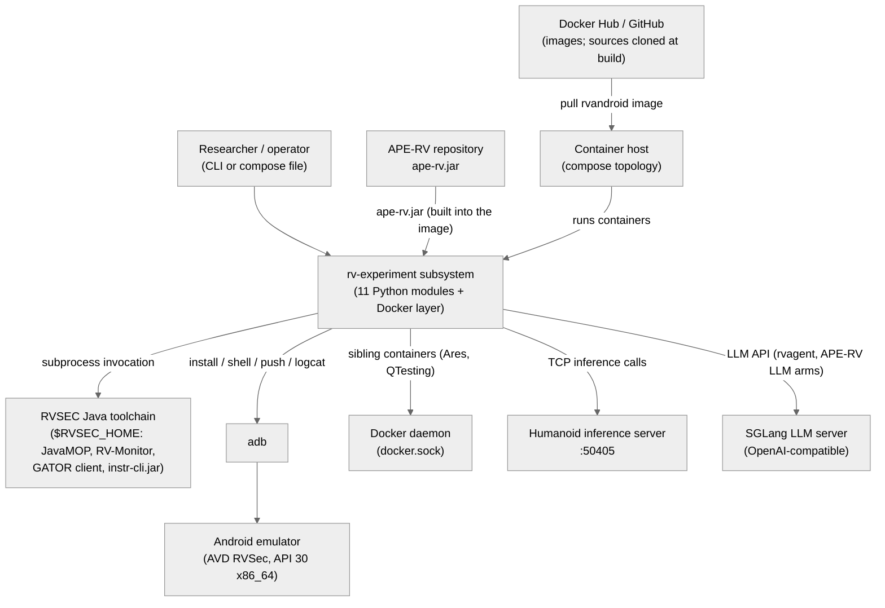
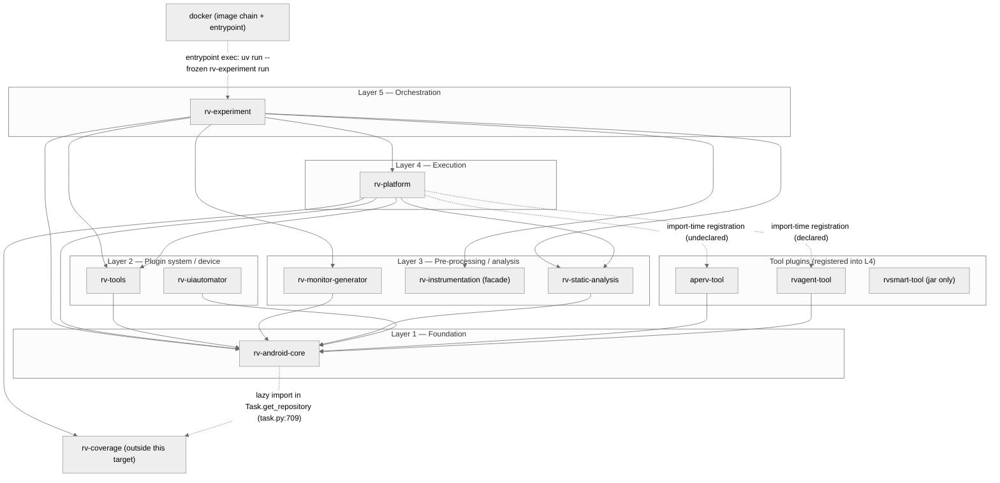
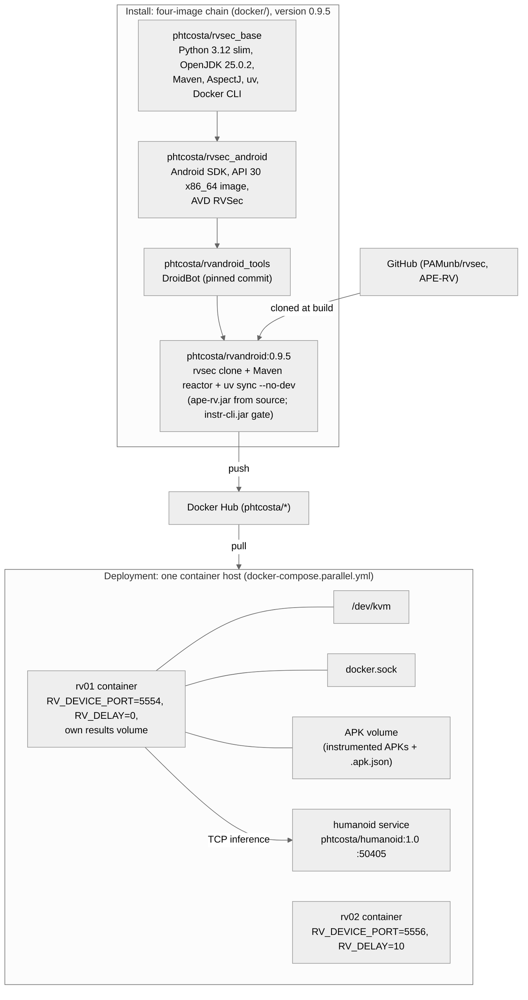

```mermaid
%%{init: {'theme': 'neutral'}}%%
flowchart LR
    DENT["Docker entrypoint<br/>(validate RV_*, exec frozen)"]
    ECTL["ExperimentController<br/>pipeline"]
    PREJ["Java pre-processing toolchain<br/>(JavaMOP, RV-Monitor,<br/>weaving engines, GATOR client)"]
    ARTF[("Filesystem artifacts<br/>monitors/, instrumented_apks/<br/>+ .apk.json")]
    PENG["Platform / TaskExecutor<br/>engine"]
    TREG["ToolRegistry +<br/>ToolFactory"]
    TSUB["Testing-tool processes<br/>(adb shell, app_process jars,<br/>sibling containers, LLM agent)"]
    EMUS["Android emulator<br/>session"]
    LOGC["Logcat<br/>channel"]
    TSTO[("TaskStorage<br/>tasks.json")]
    RESD[("Results directory<br/>result files, per-task streams")]
    OFFC["Offline consolidation<br/>(--process-results,<br/>campaign analysis)"]

    DENT -. "exec" .-> ECTL
    ECTL -- "Phase 1: subprocess via Command" --> PREJ
    PREJ -- "writes" --> ARTF
    ECTL -- "Phase 2 handoff (one-way)" --> PENG
    ARTF -- "every instrumented APK + SA document if present" --> PENG
    PENG -- "resolve + configure per task" --> TREG
    TREG -- "fresh AbstractTool instance" --> TSUB
    PENG -- "boot / install / teardown" --> EMUS
    TSUB -- "adb / uiautomator2 / app_process" --> EMUS
    EMUS -- "RVSEC, RVSEC-COV, RVSEC-OCC, RVSEC-BIND lines" --> LOGC
    PENG -- "atomic write after every task" --> TSTO
    LOGC -- "per-task logcat files" --> RESD
    PENG -- "six result files" --> RESD
    ECTL -- "Phase 3 diagnostics" --> RESD
    TSTO -- "completed tasks" --> OFFC
    RESD -- "streams + SA documents" --> OFFC
```

# Architecture — rv-experiment subsystem

> Scope: **subsystem** · Generated by `rv-doc-arch` · Source model: `out/arch/subsystem-rv-experiment/architecture-model.json`
> Languages: Python (11 modules, ~54,000 LOC in `src/`) · Docker (1 module: ~1,000 lines of Dockerfiles and scripts, plus compose files)

## Table of Contents

- [Part I — Beyond Views](#part-i--beyond-views)
  - [1. Documentation overview](#1-documentation-overview)
  - [2. Conceptual primer](#2-conceptual-primer)
  - [3. System overview and context](#3-system-overview-and-context)
  - [4. How it works — end to end](#4-how-it-works--end-to-end)
  - [5. Core components](#5-core-components)
  - [6. Mapping between views](#6-mapping-between-views)
  - [7. Rationale](#7-rationale)
  - [8. Output artifacts](#8-output-artifacts)
  - [9. Directory](#9-directory)
- [Part II — Views](#part-ii--views)
  - [Module view](#module-view)
  - [Component-and-connector view](#component-and-connector-view)
  - [Allocation view](#allocation-view)
- [Appendices](#appendices)
- [Specification traceability](#specification-traceability)

---

## Part I — Beyond Views

### 1. Documentation overview

This document describes the architecture of the **rv-experiment subsystem**, the end-to-end
experiment pipeline of RV-Android. It spans eleven Python workspace modules and the Docker
layer that packages them for containerized runs. It is written for a new engineer with no
prior exposure to the subsystem: reading it top to bottom should leave you knowing *what* the
pipeline does, *how* one experiment flows through it, and *why* it is shaped this way. It
documents the current code only.

This is the orchestration view. Three companion documents cover the parts it leans on in more
depth and are referenced rather than repeated: `docs/architecture/rv-platform.md` (the
execution engine), `docs/architecture/static-analysis.md` (GATOR and the static-analysis
document) and `docs/architecture/ape-rv.md` (the APE-RV tool plugin). Per-module 4+1
documentation lives in `modules/<name>/docs/architecture.md`.

**How to read this document:** Part I builds your mental model — what the subsystem is
([primer](#2-conceptual-primer)), how it behaves end to end
([walkthrough](#4-how-it-works--end-to-end)), and why it is shaped this way
([rationale](#7-rationale)). Part II documents the selected views in detail.

### 2. Conceptual primer

The rv-experiment subsystem turns a directory of Android APKs and a list of testing tools into
a reproducible, resumable experiment. It prepares the APKs for runtime verification —
generating monitors from MOP specifications, weaving them into the APKs, and statically
analyzing the originals — then runs every combination of APK × tool × repetition × timeout on
an Android emulator, and finally writes per-task coverage, violation and timing data to CSV
and JSON. One command (`uv run rv-experiment run --tools monkey,droidbot:dfs_greedy
--specification-set jca_android`) or one Docker container configured with `RV_*` environment
variables drives the whole pipeline.

**Why this approach.** The alternative is one script per study, which does not survive
multi-day runs: a crash loses the run, and every new tool means editing the loop. The
subsystem is instead a layered stack. rv-experiment owns only the three-phase lifecycle and
never reads results back; rv-platform owns task generation, emulator sessions, atomic per-task
persistence and result production; rv-tools owns tool discovery and configuration;
rv-android-core owns the shared domain model and infrastructure. The cost is more modules and
more indirection. The gain is two properties a single script cannot offer: **crash-safe
resume** (a killed run restarted under the same experiment name loses at most the task that
was in flight, because `tasks.json` is rewritten atomically after every task) and **tool
pluggability** (a new testing tool is an `AbstractTool` subclass plus a registration; the
executor, coverage and result pipeline do not change). The pre-processing modules
(rv-monitor-generator, rv-instrumentation, rv-static-analysis) are separate because they wrap
Java toolchains (JavaMOP/RV-Monitor, AspectJ or dexlib2, GATOR/Soot) behind subprocess
boundaries and hand their results to the next stage as files, so each stage can be skipped and
its artifacts reused.

**Key concepts**

- **Three-phase workflow** — Every experiment runs pre-processing (monitors →
  instrumentation → static analysis), then execution (the task matrix on emulators), then
  post-processing (diagnostics), in strict order (INV-EXP-01). Data flows one way:
  rv-experiment configures rv-platform and never reads task results back (INV-EXP-02).
- **Task** — The unit of execution: one (APK, tool, variant, repetition, timeout) tuple. The
  task matrix is the full cross-product of the configured values (INV-PLT-01). Each task gets a
  fresh tool instance and is persisted to `tasks.json` as soon as it finishes.
- **Monitored operations (MOP)** — API calls monitored by a runtime-verification
  specification — any specification, not only security ones. A run uses exactly one
  specification set: `jca` (the frozen Java SE set), `jca_android` (its successor for Android
  API 30), `generic` (Iterator, stream and similar protocols) or `custom` (a directory given
  with `--custom-specs-dir`).
- **Instrumented APK** — An APK with monitor code woven into its bytecode (by the AspectJ
  `ajc` variant or the DEX-native `dexlib2` variant), so that monitored operations write
  `RVSEC` lines to logcat at runtime. Every APK in `instrumented_apks/` executes (INV-EXP-16).
- **Coverage denominator** — The static-analysis document `<apk>.apk.json` written beside the
  instrumented APK. It lists the statically reachable methods that coverage divides by. An APK
  without it still runs and still reports its violations, but its coverage cells are left
  empty and its `summary.csv` row says `measured=false` (INV-PLT-35, INV-PLT-36). Writing
  `0.00` there would claim the app covered nothing, which is a different fact.
- **Tool plugin / variant** — A testing tool wrapped as an `AbstractTool` subclass and
  registered in the `ToolRegistry`. A variant is a named configuration preset from the
  plugin's `get_variants()` (for example `droidbot:dfs_greedy`, `aperv:mop_on_llm_off`).
  Experiment arms are variants.
- **Resume** — Re-running with the same experiment name (`--name`, or `RV_EXPERIMENT_NAME` in
  Docker) finds `results/<name>/tasks.json`, turns all three pre-processing steps off
  (INV-EXP-13) and skips every identity tuple already COMPLETED. Tasks that ended in ERROR run
  again.
- **Skip flags** — `--skip-monitors`, `--skip-instrument` and `--skip-static` bypass
  pre-processing steps whose artifacts already exist. This is the usual mode for large runs: a
  dataset is instrumented and analyzed once, and every later run only executes. With
  instrumentation skipped on a new experiment, `--apks-dir` must point at already-instrumented
  APKs with their `.apk.json` files beside them.
- **Timeout-as-success** — Experiments are budgeted in time. A tool that runs until its
  timeout has completed normally; `RVToolTimeoutError` is recorded as expected behavior, and
  timeout is the only exit from exploration.

### 3. System overview and context

The subsystem sits between two worlds. Upstream it depends on the **RVSEC Java toolchain**
built by the sibling Maven reactor at `$RVSEC_HOME`: the JavaMOP and RV-Monitor binaries, the
MOP specification sets under `rvsec/rvsec-mop/src/main/resources/`, the GATOR client
`rvsec-analysis-client.jar`, and the dexlib2 weaving engine `instr-cli.jar`. All of them are
invoked as subprocesses from Python wrappers. A related repository, **APE-RV**, produces
`ape-rv.jar` for the aperv-tool plugin; the Docker image builds it from source.

Downstream, everything executes against an **Android emulator**. The image's AVD is named
`RVSec` and uses an API 30 `google_apis` x86_64 system image; rv-platform boots it for every
task with 4096 MB of guest RAM and an 8192 MB data partition (INV-CORE-66), headless and with
`/dev/kvm` in Docker, on a per-container port so several containers can share a host. **adb**
is the device channel for everything: APK install, logcat capture, shell tools such as
monkey, and file push followed by `app_process` launch for on-device jars. Some tools reach
further: Ares and QTesting start sibling containers through the mounted **Docker daemon
socket**; Humanoid calls a shared **TensorFlow inference server** (`phtcosta/humanoid:1.0`,
port 50405); the rvagent and APE-RV LLM arms talk to an **SGLang server** (OpenAI-compatible
API). Images are published to **Docker Hub** (`phtcosta/*`); the production image itself is
built by cloning the rvsec and ape repositories from **GitHub**, not by copying the local tree.

**Constraints:** the Java toolchains are reachable only through `$RVSEC_HOME` resolution
(explicit `rvsec_root`, then the `RVSEC_HOME` environment variable, else `ConfigurationError`;
INV-EXP-05); GATOR analyzes original APKs, never instrumented ones; the emulator lifecycle is
owned by rv-platform alone; behavior inside and outside Docker must be the same, and the
`RV_*` surface is checked against the `ENV_*` registry in rv-android-core's `constants.py`.

**System context diagram** (external actors and systems — every view refers back to this):

### 4. How it works — end to end

The following walks through a concrete example: running `uv run rv-experiment run --tools
monkey --specification-set jca --apks-dir ./apks_examples --timeouts 60 --name demo` over
`apks_examples/cryptoapp.apk` (package `br.unb.cic.cryptoapp`, a test app that calls
`javax.crypto.Cipher` and `MessageDigest`), and then the same run inside a
`phtcosta/rvandroid:0.9.5` container.

**1. CLI parsing and config assembly.** Click's `run` command in `rv_experiment/__main__.py`
parses the tool DSL `tool[:variant[:variant…]][@k=v,…]`. Multi-variant specs expand at parse
time, so `droidbot:dfs_greedy:bfs_greedy` becomes two `ToolConfig` objects, and a comma
followed by a `k=v` token stays inside the same tool's parameters (INV-EXP-09). Three run
policies are resolved by callbacks rather than by Click's `envvar=`, with CLI over environment
over default: the package detector (INV-EXP-34), build-type suffix neutralization
(INV-EXP-35) and the handler stamp (INV-EXP-40). `_create_experiment_config_from_cli` then
decides the run directory: `--name demo` becomes `results/demo`, and if `results/demo/tasks.json`
already exists the run is a resume and all three pre-processing steps are turned off
(INV-EXP-13). Without a name, the directory is `results/cli_experiment_<timestamp>_<hex>`.
`output_dir` and `results_dir` are the same flat directory (INV-EXP-14), so pre-processing
artifacts and results live together. Before anything runs, `--stamp-handlers` with a variant
other than `dexlib2` aborts the command (INV-EXP-40), the run's own log file is opened in the
run directory (INV-CORE-62), and `ExperimentController.run()` writes
`results/demo/experiment_config.json`, which `--config` can load again.

**2. Phase 1a — monitor generation (rv-monitor-generator).** `PreProcessor._generate_monitors`
asks `ExperimentConfig.get_monitored_operations_config()` for an `RVGeneratorConfig` built just
in time: it resolves `$RVSEC_HOME` (INV-EXP-05) and maps the specification set to its
directory, here `$RVSEC_HOME/rvsec/rvsec-mop/src/main/resources/jca`.
`RuntimeVerificationGenerator.generate_monitors()` shells out twice: JavaMOP turns the `.mop`
files into AspectJ aspects (`.aj`) and RV-Monitor specs (`.rvm`) — and, through the locally
patched JavaMOP, into `MultiSpec_*MonitorAspect.json` descriptors that the dexlib2 variant
reads — and RV-Monitor compiles the `.rvm` files into Java monitor classes. Because JavaMOP's
`-d` does not relocate `.rvm` files, the generator moves them itself. On success the
pre-processor writes `results/demo/monitors/specification_set.txt` containing `jca`. A later
run with `--skip-monitors` reads that marker and aborts if it names a different set
(INV-EXP-38); a missing marker only warns, so older monitor directories remain usable.

**3. Phase 1b — APK instrumentation (rv-instrumentation family).** The pre-processor calls
`get_instrumenter(variant, config)`, the single dispatch site in the `rv-instrumentation`
facade (INV-INS-36). It lazy-imports exactly one variant: `AjcInstrumentation` (dex2jar, ajc,
d8; the CLI default) or `DexlibInstrumentation` (DEX-native rewriting by the `instr-cli.jar`
Java engine, run as a subprocess; selected with `--instrumentation-variant dexlib2`, and the
only variant that can add the handler stamp). Woven, signed APKs are written to
`results/demo/instrumented_apks/`, and the instrumenter writes its per-APK error report,
`instrument_errors.json`, into the same directory. If the instrumenter raises or its module
cannot be imported, the pre-processor copies the original APKs into `instrumented_apks/`
instead (INV-EXP-08); the run continues, but those APKs carry no monitors.

**4. Phase 1c — static analysis on the original APKs (rv-static-analysis).** First,
`_assert_instrumentation_available_for_static` refuses the combination `--skip-instrument
--static-analysis` when `instrumented_apks/` holds no APK, because that combination would
analyze nothing and publish empty denominators for the whole run (INV-EXP-37). Then
`_get_target_apks_for_analysis()` returns the original of every APK that has a file of the
same name in `instrumented_apks/` (INV-EXP-15). The originals are analyzed, not the woven
copies, because Soot's TypeResolver fails on woven bytecode. For each one, `StaticAnalyzer`
runs the GATOR client with the run's scope key — the applicationId declared in the manifest
unless `--strip-build-type-suffix` or `--package-detector` says otherwise — and with the run's
own specification set as targets, so the denominator and the monitors describe the same
operations. GATOR writes a compact document by default: no indentation, and per method only
the target-distance pairs the APE-RV derivation can use (INV-ANA-85). The output lands beside
the instrumented APK as `results/demo/instrumented_apks/cryptoapp.apk.json`. A denominator
gate (INV-ANA-69) parses the result and, if its class list cannot be the app's class universe
under that key, renames the artifact so every later stage sees it as absent. An artifact that
already exists is reused rather than regenerated, unless it records a different scope key.
For cryptoapp, the reachability section omits `unreachableEncrypt()` and `unreachableHash()`,
methods the test app contains precisely to exercise this filter.

**5. End of Phase 1 — the consolidated report.** `_report_missing_static_analysis` lists, in
one message, the instrumented APKs that have no `.apk.json` and will therefore run without a
coverage denominator (INV-EXP-39); when the cause was `--skip-static`, the message says so.
`get_instrumented_apks()` returns every instrumented APK, with or without its document
(INV-EXP-16). The run continues either way: violations do not depend on static analysis, and
stopping a campaign because GATOR failed on a few APKs costs more than those APKs are worth.
For cryptoapp the log reads `Static analysis artefact present for all 1 APKs`.

**6. Phase 2 — handoff to rv-platform (ExecutionController).** `ExecutionController.setup()`
translates the experiment into a `PlatformConfig` and creates the `Platform` (INV-EXP-06
requires setup before run). Its `apks_dir` is `instrumented_apks/`, or the source APK
directory when that is empty or missing. When `--device-port` is set, the port and the
`emulator-<port>` serial are injected into every tool's parameters. The APK filter file,
logcat diagnostics flag and the two package policies are copied across. `Platform.run()` then
takes over: it globs the APK directory (and applies `--apks-filter`), generates the task
matrix, records `ExperimentMetadata` with a SHA-256 checksum of the configuration
(INV-PLT-12), and on resume skips every task whose identity tuple `(apk, tool, variant,
repetition, timeout)` is already COMPLETED in `tasks.json`, warning — not refusing — if the
checksum changed. Per task, `ToolFactory.create_tool()` resolves the variant, merges
`{**variant_config, **tool_config.parameters}` and configures a fresh instance. From this point
rv-experiment is out of the loop until `Platform.run()` returns its aggregate counts. For the
example the matrix is 1 APK × 1 tool × 1 repetition × 1 timeout = 1 task.

**7. Phase 2 — per-task emulator session (TaskExecutor).** Each task runs five components.
Outside the emulator, `StaticAnalysisComponent` copies `cryptoapp.apk.json` from the APK
directory into the task's directory `results/demo/cryptoapp.apk/` (skipping the copy when the
destination already has the same size and modification time, INV-PLT-39) and parses it into
`task.static_data`. The parser answers from a parsed copy `cryptoapp.apk.static.json` when the
digest it records matches the source (INV-ANA-82), and otherwise streams the source and writes
that copy. A failure here is logged and the task continues (INV-PLT-05). Inside the emulator
session — a context manager that owns boot, APK install and teardown — the order matters:
logcat capture starts first (after `adb logcat -G 16M` enlarges the device ring buffer,
INV-CORE-64), then `mark_tool_execution_start()` stamps the moment coverage timing begins, so
boot time is excluded, then coverage tracking starts, then the tool runs. Teardown stops
logcat before coverage: logcat is the writer and coverage the reader, so stopping the writer
first freezes the file and the tracker's last read sees the complete log. Monkey builds `adb
-s emulator-5554 shell monkey … --ignore-security-exceptions -p br.unb.cic.cryptoapp
1000000000`; the event count is effectively unlimited and the 60 s Command timeout is the
real bound. When the app calls `Cipher.getInstance("AES")`, the woven code writes its lines
under the captured tags. After the task — success or failure — `TaskStorage.update_task`
rewrites `tasks.json` atomically, and the task's parsed repository and static model are
released so memory does not grow with every finished task (INV-PLT-38).

**8. Phase 2 — result processing (ResultProcessorComponent).** After the last task,
`Platform._process_results` hands every COMPLETED task in `TaskStorage` — from this session and
from earlier ones — to `ResultProcessorComponent`. It makes one pass, task by task, and writes
six files: `coverage.csv`, `errors.csv`, `app_events.csv`, `summary.csv`, then `results.json`
and `performance.csv`. Coverage and violations are always rebuilt from the persisted logcat
plus the static document, never from metrics serialized in `tasks.json` (INV-PLT-16), so
resumed tasks and live ones produce the same rows (INV-PLT-18). A task without a denominator
gets empty coverage cells and `measured=false` (INV-PLT-35, INV-PLT-36); if any resumed task
could not find its document, one aggregate `N/M` warning says so. `tasks.json` is saved once
more at the end so that per-file write-error counts recorded during the pass are kept
(INV-CORE-61). For cryptoapp, `summary.csv` gets one row with its class and method counts
beside the coverage percentages and `measured=true`.

**9. Phase 3 — post-processing (rv-experiment again).** Control returns to
`PostProcessor.process()`, which writes `experiment_completion.json` and, through
`ResultManager`, a results-level `instrument_errors.json` built from per-task status. Phase 3
runs even when execution failed or was skipped. It never aggregates results: that is
rv-platform's job (INV-EXP-02). The CLI then exits with status 1 if any task failed or
execution raised, and 0 otherwise — which is also the container's exit status in Docker.

**10. The same pipeline in a container.** In a container the flow is identical, inside
`phtcosta/rvandroid:0.9.5`, the fourth image of the chain `phtcosta/rvsec_base` (Python 3.12
slim, OpenJDK 25.0.2, Maven, AspectJ 1.9.25.1, uv, Docker CLI) → `phtcosta/rvsec_android`
(Android SDK, API 30 system image, the `RVSec` AVD) → `phtcosta/rvandroid_tools` (DroidBot at
a pinned commit) → `phtcosta/rvandroid`. The last image clones `PAMunb/rvsec` at
`RVSEC_BRANCH` (default `modules`), runs the Maven reactor, runs `uv sync --no-dev`, builds
`ape-rv.jar` from the APE-RV repository, and fails the build if `instr-cli.jar` did not reach
the dexlib2 module's `lib/`. At start, `docker-entrypoint.sh` validates every `RV_*` variable
against the `ENV_*` registry (unknown names exit 64), sleeps `RV_DELAY` seconds to stagger
emulator boots, optionally starts a socat bridge to the SGLang alias, translates the five
negation-style variables (`RV_SKIP_MONITORS`, `RV_SKIP_INSTRUMENT`, `RV_SKIP_STATIC_ANALYSIS`,
`RV_SKIP_EXECUTION`, `RV_NO_QUARANTINE`) into explicit CLI flags, and execs `uv run --frozen
--no-dev rv-experiment run`. With `docker-compose.parallel.yml`, container `rv01` runs with
`RV_EXPERIMENT_NAME=rv01`, `RV_DEVICE_PORT=5554`, `RV_DELAY=0`, its own results volume,
`/dev/kvm`, the docker socket, and the shared Humanoid service; `rv02` uses port 5556 and a
10 s delay.

### 5. Core components

**ExperimentController pipeline.** One `ExperimentController.run()` call is one experiment. It
saves the configuration snapshot, runs `PreProcessor.process()` with the three step flags,
runs execution unless `--skip-execution` was given — asking the pre-processor whether any APK
exists, creating one tool instance per `ToolConfig` through `ToolFactory` (a tool that fails to
instantiate is logged and left out), and driving `ExecutionController.setup()` and `.run()` —
and always finishes with `PostProcessor.process()`. It holds no execution state; everything
inside Phase 2 belongs to `Platform`.

**Platform / TaskExecutor engine.** The runtime center of the subsystem. `Platform` is a facade
whose `run()` generates tasks, filters them by resume identity, executes them sequentially and
processes results. `TaskExecutor` runs each task's components in three coordinated phases,
with a fresh tool instance and its own emulator session. Its crash-safety property — an
atomic `tasks.json` write after every task — is what long containerized runs depend on.

**TaskStorage (tasks.json).** A repository over `results/<name>/tasks.json` with atomic writes,
transactions and `ExperimentMetadata`. Resume reads it to skip completed identity tuples;
result processing iterates every completed task in it. It stores facts — states, file paths,
timestamps, write-error counts — rather than derived metrics, because tasks loaded from it
have no live repository and coverage is rebuilt from primary sources.

**ToolRegistry + ToolFactory.** A singleton registry filled at import time — eight builtin tools
registered by `import rv_tools`, plus `RVAgentTool` and `ApeRVTool` registered by
`rv_platform/__init__.py`, each import guarded so a missing package only logs — and a factory
that resolves variant defaults and merges user parameters before `configure()`. It is the
extensibility seam: everything above it speaks `ToolConfig`, everything below it speaks
`AbstractTool`.

**Android emulator session.** `EmulatorComponent.start_emulator()` is a context manager owning
the device lifecycle: boot with a real boot-completion gate whose budget is
`RV_EMULATOR_BOOT_TIMEOUT`, APK install (a failure fails the task), and teardown, on the port
the task's tool parameters name. The rule that nothing else manages emulators exists because
this bracketing is what keeps thousands of sequential tasks from leaking device state into
each other.

**Logcat channel.** `LogcatComponent` captures a per-task file through `LogcatManager`, whose
default tags are `RVSEC` (violations), `RVSEC-COV` (coverage markers), `ApeRvHb` (APE-RV
heartbeat), `RVSEC-OCC` (one line per violation occurrence) and `RVSEC-BIND` (handler stamps).
`CoverageComponent` tracks progressive metrics against the static denominator during the run.
Because the file is persisted, coverage and violations can be recomputed offline at any time —
the property that both resume and `--process-results` rely on.

**Testing-tool processes.** Each plugin turns `execute_tool_specific_logic(task, app)` into its
own connector: Monkey is one `adb shell` command; ApeRVTool pushes `ape-rv.jar`, a broadcast
catalog, the derived MOP artifact (MOP arms) and `ape.properties`, then runs the jar on the
device through `app_process` with a command timeout of the budget plus 45 s; Ares and QTesting
start sibling containers through the docker socket; Humanoid calls the shared inference
server; `RVAgentTool` runs rv-agent in-process, which talks to the device through
uiautomator2 and to an SGLang server. All are bounded by the Command timeout and stream their
output to `task.result.trace_file`.

**Java pre-processing toolchain.** Phase 1 is a chain of subprocess boundaries: JavaMOP and
RV-Monitor under `$RVSEC_HOME`, the instrumentation engines (the ajc toolchain or `java -jar
instr-cli.jar`), and the GATOR launcher with `rvsec-analysis-client.jar`. Every invocation goes
through rv-android-core's `Command`, so timeout, process-tree kill and error semantics are the
same everywhere. Their outputs — monitors, instrumented APKs, `.apk.json` — pass between stages
only through the filesystem, which is what makes each stage skippable and its artifacts
reusable.

**Docker entrypoint.** The container's first process. It refuses unknown `RV_*` variables
(exit 64), staggers start-up with `RV_DELAY`, optionally bridges the SGLang alias with socat,
copies pre-computed files from `RV_SA_DIR`, translates the five negation-style variables into
explicit CLI flags, and execs `uv run --frozen --no-dev rv-experiment run`, so container start
needs no network. The arguments `bash` or `shell` skip validation and open a shell.

**Results directory.** The durable record of a run. `results/<name>/` holds the pre-processing
artifacts (`monitors/`, `instrumented_apks/` with the `.apk.json` documents), the resume state
(`tasks.json`), one subdirectory per APK with that APK's per-task logcat and trace files and
its copied static document, the six result files, the configuration snapshot, the run log, and
the Phase 3 diagnostics. In Docker each container mounts its own results volume.

**Offline consolidation.** Two read-only paths turn existing results directories into numbers
without an emulator. `rv-platform run --process-results <dir>` loads `tasks.json` and reruns
`ResultProcessorComponent`, rebuilding the six result files from the persisted streams. For
analyses across many results directories, the campaign-analysis library in
`aperv_tool.analysis` (validity gates, outcome builders, estimators) reads `tasks.json`, the
CSVs, the per-run streams and the static documents; it never writes to its inputs.

| Component | Realized by | Responsibility |
|-----------|-------------|----------------|
| ExperimentController pipeline | `modules/rv-experiment/src/rv_experiment/experiment/experiment_controller.py` | Sequences the three phases and snapshots the config; never reads results back |
| Platform / TaskExecutor engine | `modules/rv-platform/src/rv_platform/platform.py`, `modules/rv-platform/src/rv_platform/execution/executor.py` | Task matrix, resume skip, per-task component execution, result production |
| TaskStorage (tasks.json) | `modules/rv-platform/src/rv_platform/storage/task_storage.py` | Atomic persistence of task state; source of truth for resume |
| ToolRegistry + ToolFactory | `modules/rv-tools/src/rv_tools/registry/registry.py`, `modules/rv-tools/src/rv_tools/registry/factory.py` | Name → class/spec/variant; merged-config instantiation per task |
| Android emulator session | `modules/rv-platform/src/rv_platform/components/emulator.py`, `modules/rv-android-core/src/rv_android_core/util/android/android.py` | Boot, install, host the tool run, teardown |
| Logcat channel | `modules/rv-platform/src/rv_platform/components/logcat.py`, `modules/rv-platform/src/rv_platform/components/coverage.py`, `modules/rv-android-core/src/rv_android_core/util/android/logcat_manager.py` | Per-task capture of the RVSEC family of tags; progressive coverage |
| Testing-tool processes | `modules/rv-tools/src/rv_tools/builtin/`, `modules/aperv-tool/src/aperv_tool/tools/aperv/tool.py`, `modules/rvagent-tool/src/rvagent_tool/tools/rvagent/tool.py` | The exploration engines behind each plugin |
| Java pre-processing toolchain | `modules/rv-monitor-generator`, `modules/rv-instrumentation`, `modules/rv-static-analysis` | JavaMOP, RV-Monitor, weaving engines, GATOR client as subprocesses |
| Docker entrypoint | `docker/rvandroid/docker-entrypoint.sh`, `docker/rvandroid/scripts/validate_env_vars.sh` | Allow-list validation, negation-flag translation, frozen exec |
| Results directory | `results/<name>/` | Artifacts, task state, per-task streams, result files |
| Offline consolidation | `modules/rv-platform/src/rv_platform/__main__.py`, `modules/aperv-tool/src/aperv_tool/analysis/` | Rebuild result files; campaign-level analysis over many results directories |

### 6. Mapping between views

The module view and the component-and-connector view describe the same code from two angles.
The **ExperimentController pipeline** is realized by `rv-experiment` (layer 5). The
**Platform / TaskExecutor engine**, **TaskStorage** and the standalone half of **offline
consolidation** live in `rv-platform` (layer 4). The **ToolRegistry + ToolFactory** is
`rv-tools` (layer 2), filled at import time both by rv-tools itself (eight builtins) and by
`rv_platform/__init__.py` (the two external plugins). The **Java pre-processing toolchain** is
reached through the three layer-3 wrappers (`rv-monitor-generator`, `rv-instrumentation`,
`rv-static-analysis`); the **Docker entrypoint** belongs to the `docker` module; the
campaign-analysis half of offline consolidation belongs to `aperv-tool`. The **emulator
session**, **logcat channel** and **results directory** are runtime constructs owned by
rv-platform components over external substrates (emulator, adb, filesystem).

The subsystem mixes languages, so the **cross-language boundary needs an explicit statement:
every Python-to-Java crossing is a process boundary, and every one goes through
rv-android-core's `Command`.** The crossings are: `rv-monitor-generator` →
`$RVSEC_HOME/javamop/bin/javamop` and `$RVSEC_HOME/rv-monitor/bin/rv-monitor`;
`rv-instrumentation` → `java -jar instr-cli.jar` (dexlib2) or the dex2jar + ajc + d8 toolchain
(ajc); `rv-static-analysis` → the gator launcher with `rvsec-analysis-client.jar`; and
`aperv-tool` → `adb push ape-rv.jar` followed by `adb shell CLASSPATH=… app_process` (the jar
runs on the device, not the host). What crosses these boundaries is never Python objects but
files and command lines: `.mop` specs in, `.aj`/`.java`/JSON descriptors out; APKs in, woven
signed APKs out; original APKs and a scope key in, one `.apk.json` out; a properties file and a
derived MOP artifact pushed to the device, a trace stream back. This file-based data plane is
what makes each stage skippable, reusable and reconstructible.

In the allocation view, the whole workspace plus every Java artifact is installed into the
single `rvandroid` image, which runs the Maven reactor at build time — the install-time
counterpart of the subprocess boundary. At runtime one container is one rv-experiment process,
one emulator and one results volume; sibling containers (Ares, QTesting) and shared services
(Humanoid, SGLang) are separate deployment units reached through the docker socket and TCP.

### 7. Rationale

The decisions below shaped the subsystem; each is narrated with the tension behind it, the
rejected alternative, and what would go wrong without it.

**One-way data flow: rv-experiment never reads results back.** The tempting alternative is for
the orchestrator to collect per-task results and build its own reports, which would tie
rv-experiment to rv-platform's internals and put result logic in two layers. Instead all result
production lives in rv-platform's `ResultProcessorComponent`, and Phase 3 writes only its own
diagnostics (INV-EXP-02); the only thing that returns is the aggregate count dictionary from
`Platform.run()`. Without this rule, resume would need two coordinated states instead of one
`tasks.json`, and `rv-platform run` and `--process-results` would lack report logic held
upstream.

**Execute every instrumented APK; let the denominator decide `measured`, not admission.** The
alternative — admitting to execution only APKs that have a static-analysis document — looks
safe but throws data away: violations come from the monitors in logcat and do not depend on
static analysis at all, so excluding an APK because GATOR failed on it destroys its violation
data one layer before the report. It also hides the loss: a dropped row cannot be recovered
by the reader. So `get_instrumented_apks()` returns every instrumented APK (INV-EXP-16),
pre-processing ends with one consolidated statement of which APKs lack a denominator
(INV-EXP-39), and the report layer writes their coverage cells empty with `measured=false`
instead of `0.00` (INV-PLT-35, INV-PLT-36). Dropping denominator-less rows becomes an explicit,
revisable decision of whoever reads `summary.csv`.

**Refuse flag combinations that would silently disable a step.** Some flag combinations
would run to completion while doing nothing useful: `--skip-instrument --static-analysis`
with no instrumented APK would analyze nothing; `--skip-monitors` over monitors generated from
another specification set would instrument with the wrong properties; `--stamp-handlers` with
the ajc variant would do nothing. Each now aborts before work starts with a message naming the flag and
the cause (INV-EXP-37, INV-EXP-38, INV-EXP-40). The alternative — a warning in a long
pre-processing log — is exactly what let such runs finish and be read as real.

**Resume as identity-tuple skip over an atomically persisted `tasks.json`.** Long runs make
failure the normal case, so the design minimizes restart cost instead of trying to prevent
crashes. Checkpointing per batch or per experiment would lose hours per restart; per-task
atomic persistence bounds the loss to the task in flight. Turning pre-processing off on resume
(INV-EXP-13) protects comparability: re-instrumenting mid-experiment could produce different
APKs if specifications or tools changed. The configuration checksum warns on drift rather than
refusing (INV-PLT-12), leaving the operator in control. The visible cost is the documented
gotcha that a resumed or skip-flag run pointed at original APKs runs them without monitors.

**Timeout is the expected exit; timeout-as-success.** Coverage-over-time comparisons give each
tool the same budget, so a tool finishing early would explore less than its competitors and
bias the comparison. Monkey therefore always gets an effectively unlimited event count with
the Command timeout as the real bound, and APE-RV gets 45 s of teardown grace beyond its
budget; conversely, an APE-RV run that returns more than that grace short of its budget is
reported as a failure, not a success (INV-APV-60). Without this rule every tool's own stopping
heuristic would become a hidden experimental variable.

**Environment allow-list at the entrypoint, with negation-flag translation.** Containerized
runs are configured by hand-written compose files with a dozen `RV_*` variables; a silently
ignored typo (`RV_TIMEOUT` for `RV_TIMEOUTS`) means a run with wrong parameters. The allow-list
turns typos into an immediate exit 64 against a single registry in rv-android-core. The
negation-flag translation exists because Click's `envvar=` resolves a value onto the option's
positive destination: `RV_SKIP_MONITORS=true` would set `generate_monitors=True`, the opposite
of the intent, so the entrypoint emits explicit flags that win by CLI-over-environment
precedence. The acknowledged gap is that outside Docker those five variables have no effect.

**Static analysis on the originals; output beside the instrumented APK.** Analyzing what will
run is impossible, because Soot's TypeResolver fails on woven bytecode. So the originals are
analyzed — but only those whose instrumented counterpart exists, since analysis is the most
expensive pre-processing step (INV-EXP-15). Naming the output `<name>.apk.json` and placing it
beside the instrumented APK gives every consumer — the execution report, the platform's
`StaticAnalysisComponent`, aperv-tool's MOP derivation, offline reconstruction — one path
convention with no lookup service. The static analysis also reads the run's own specification
set, so the denominator describes the same operations the monitors watch.

**Bounded memory for large static-analysis documents.** Per-method target distances can make a
static-analysis document gigabytes long, and the same document is read once per task of its APK
and again at result processing. Holding it whole per read would exhaust memory on a host
running several containers. The pipeline bounds that cost at four points: GATOR writes a
compact document by default (INV-ANA-85); `StaticAnalysisComponent` copies a document into the
task directory only when size or modification time differ (INV-PLT-39); the parser streams the
source and answers later reads from a small parsed copy keyed by the source digest
(INV-ANA-82); and each task's parsed state is released as soon as the task is persisted and
again after its rows are written (INV-PLT-38).

**Degrade locally in pre-processing; fail an arm that lost its input.** In a large batch some
APKs always resist instrumentation or analysis. Aborting the experiment for them would make
large runs unfinishable, so each degradation stays local and visible: instrumentation failure
falls back to copying the originals (INV-EXP-08), an APK without a document runs unmeasured,
a missing optional module is logged and skipped, a plugin whose import fails does not register.
The line is drawn where degradation would mislabel data: an APE-RV MOP arm whose task finds no
static document fails the task (INV-APV-45), because a run labeled as a MOP arm that explored
without MOP guidance cannot be told apart from a real one in the results.

**Run policies read only at the entry point.** The package detector, the build-type suffix
policy and the handler stamp change what a study counts or what the instrumenter emits. Each is
read at the rv-experiment entry point only — through an `ENV_*` constant and the shared
truthiness helper, not Click's own boolean vocabulary — and travels down by value through
`ExperimentConfig`, `PlatformConfig` and `App` (INV-EXP-34, INV-EXP-35, INV-EXP-40). A lower
layer reading the environment itself could disagree with the entry point about the same run.

**Import-time hardcoded plugin registration.** Entry-point scanning (`importlib.metadata`) is
the canonical alternative; nothing in the workspace declares or scans one. The hardcoded
imports in `rv_platform/__init__.py` are a deliberate simplicity trade: two guarded imports,
easy to debug, and degrading gracefully — an image without rv-agent still runs Monkey
experiments. The accepted cost is a layer-4 → plugin edge that the layering otherwise forbids,
and an inconsistency: `rvagent-tool` is declared in rv-platform's `pyproject.toml` while
`aperv-tool` is not.

**Frozen environment at container start; reactor built inside the image.** A bare `uv run`
performs an implicit sync against all dependency groups, including dev-only ones, even though
the image was built with `uv sync --no-dev`; every container start would then reach PyPI, and
a network hiccup there kills the container before rv-experiment starts. `--frozen --no-dev`
pins execution to the environment as built. In the same spirit, the image builds the Maven
reactor and `ape-rv.jar` from source and gates on `instr-cli.jar`, so a stale committed jar
cannot ship. The flip side, stated in `docker/rvandroid/build.sh`, is that the image clones
GitHub rather than the local tree: a commit that was not pushed is not in the image.

**Documentation-only component interfaces (ITaskComponent).** Enforcing inheritance and
iterating components polymorphically buys nothing at five fixed, phase-ordered components whose
sequence matters (static analysis before the emulator, logcat before the tool, logcat-stop
before coverage-stop). The interfaces in `task_interfaces.py` document the lifecycle; the
executor dispatches by `isinstance` over the five concrete types. The trade is explicit
coupling in one file against pluggability nothing currently needs.

**Decisions at a glance**

| Decision | Drivers | Invariant / ADR |
|----------|---------|-----------------|
| One-way data flow: rv-experiment never reads results back | layer separation; standalone rv-platform; one result pipeline | INV-EXP-02 |
| Execute every instrumented APK; denominator decides `measured` | violations independent of static analysis; no invisible exclusions | INV-EXP-16, INV-EXP-39, INV-PLT-35, INV-PLT-36 |
| Refuse flag combinations that silently disable a step | no run that finishes and means nothing | INV-EXP-37, INV-EXP-38, INV-EXP-40 |
| Resume as identity-tuple skip over atomic `tasks.json` | long runs; at most one task lost | INV-EXP-13, INV-PLT-12 |
| Timeout is the expected exit | equal budgets across arms | INV-APV-60 (APE-RV floor) |
| Env allow-list entrypoint + negation-flag translation | typo detection; Click envvar semantics | Docker Execution Mode requirement |
| Static analysis on originals; output beside instrumented APKs | Soot cannot read woven bytecode; one path convention | INV-EXP-15 |
| Bounded memory for large static documents | multi-gigabyte documents read many times | INV-ANA-82, INV-ANA-85, INV-PLT-38, INV-PLT-39 |
| Degrade locally; fail an arm that lost its input | large-batch robustness without mislabeled arms | INV-EXP-08, INV-APV-45 |
| Run policies read only at the entry point | one reading per run | INV-EXP-34, INV-EXP-35, INV-EXP-40 |
| Hardcoded plugin registration | simplicity; graceful absence | — |
| Frozen environment; reactor built in the image | offline start; no stale jars | — |
| Documentation-only component interfaces | five fixed, ordered components | — |

**Patterns and styles**

At module granularity the subsystem is **layered**: the declared dependencies run downward
from L5 (rv-experiment) to L4 (rv-platform), L3 (pre-processing and analysis), L2 (rv-tools,
rv-uiautomator) and L1 (rv-android-core). There are two documented exceptions:
rv-platform's import-time registration of rvagent-tool and aperv-tool, and rv-android-core's
lazy import of `rv_coverage` in `Task.get_repository()` (`task.py:709`). The **uses** style
follows the `pyproject.toml` declarations, with known gaps between declared and imported in
both directions (rv-experiment declares rv-screen-parser and rv-coverage without importing
them; rv-platform imports aperv-tool without declaring it). At runtime three C&C styles
coexist: **pipe-and-filter** (the three phases with file hand-offs), **client-server** (adb and
the emulator, on-device jars, sibling containers, the Humanoid and SGLang servers, the Java
subprocesses), and **shared-data** (`tasks.json` across sessions and restarts; the co-located
`.apk.json` and the persisted logcat read by several consumers). In allocation, the
**install** style is the four-image chain and the **deployment** style is the container
topology defined by the compose files.

**NFRs served**

**Reproducibility (NFR08).** Every run snapshots its full `ExperimentConfig` to
`experiment_config.json` before work begins, and `ExperimentMetadata` stores a SHA-256 checksum
of the platform configuration that resume compares. The monitors directory records which
specification set produced it. The image records the rvsec branch it was built from (`LABEL
rvsec.branch`), builds `ape-rv.jar` from source, and starts with `--frozen --no-dev`. Result
files are reconstructible from primary sources: coverage is always recomputed from the
persisted logcat plus the static document (INV-PLT-16), so `--process-results` can rebuild
every file from a results directory alone.

**Resilience (NFR04).** Failure is treated as the normal case at every level: tool timeouts
are completions; instrumentation failure falls back to copying originals (INV-EXP-08); static
data loading never stops a task (INV-PLT-05); plugin import failures shrink the registry; a
task exception marks the task ERROR, runs cleanup and lets the batch continue; and the atomic
post-task write bounds crash loss to one task. In Docker, recovering a killed container means
starting it again with the same `RV_EXPERIMENT_NAME` and results volume.

**Configurability (NFR05).** One Pydantic `ExperimentConfig` holds every knob, assembled from
three surfaces with a defined precedence (CLI over environment over default): the tool DSL
`tool[:variant][@k=v]` and flags on the command line, the `RV_*` registry in Docker, and JSON
configuration files (`rv-experiment config` writes templates; `--config` loads one, and then the
file is the authority). Sub-module configurations are built just in time, only when a phase
runs (INV-EXP-05). Experiment arms are frozen variant tables inside the plugins (for APE-RV a
`preset` plus `overrides` per variant, INV-APV-40; for rvagent a literal table that spreads the
pinned steering-off registry).

**Extensibility (NFR02).** Adding a testing tool means an `AbstractTool` subclass implementing
`get_tool_spec`, `get_variants`, `configure` and `execute_tool_specific_logic`, plus one
registration; the executor, coverage pipeline, result processing and CLI do not change, as the
two plugins living outside rv-tools show. Instrumentation variants extend through the
`get_instrumenter` factory, and `TaskExecutor` components follow a documented
initialize/execute/cleanup lifecycle.

**Modularity (NFR01).** The subsystem is eleven uv-workspace modules installed editable by one
`uv sync`, with a downward dependency order and two documented deviations: the plugin
registration edge from rv-platform and the lazy `rv_coverage` import from rv-android-core.

**Observability (NFR06).** Every layer leaves a durable trace: the run's own log file in the
results directory (INV-CORE-62); per-task logcat and trace files; `performance.csv` timed from
`mark_tool_execution_start` so boot time is excluded; the consolidated end-of-Phase-1 report of
APKs without a denominator (INV-EXP-39); the `measured` column and the class and method counts
beside every percentage in `summary.csv` (INV-PLT-33); the aggregate warning for resumed tasks
whose document could not be found (INV-PLT-18); per-file write-error counts kept in
`tasks.json` (INV-CORE-61); and the instrumenter's per-APK error report.

| NFR | PRD ID | Architectural support |
|-----|--------|-----------------------|
| Reproducibility | NFR08 | Config snapshot + checksum; monitor provenance; pinned image build; `--frozen --no-dev`; coverage rebuilt from primary sources (INV-PLT-16) |
| Resilience | NFR04 | Timeout-as-success; INV-EXP-08 fallback; INV-PLT-05; plugin degradation; atomic per-task persistence; restart-as-recovery |
| Configurability | NFR05 | Unified `ExperimentConfig`; CLI > env > default; just-in-time sub-configs (INV-EXP-05); frozen arm tables |
| Extensibility | NFR02 | Four-method `AbstractTool` contract; registry seam; `get_instrumenter` factory; component lifecycle |
| Modularity | NFR01 | Eleven editable workspace modules; downward dependencies; two documented deviations |
| Observability | NFR06 | Run log; per-task streams; `measured` column and denominators; INV-EXP-39 report; write-error counts |

### 8. Output artifacts

Every run leaves a self-describing record under `results/<name>/` (with the CLI, the
pre-processing artifacts live in the same directory, because `output_dir` and `results_dir`
are the same path). These files are at once the results, the resume state and the
reproducibility record.

| Artifact | Location | Notes |
|----------|----------|-------|
| `experiment_config.json` | `results/<name>/` | Full `ExperimentConfig` written before execution; reloadable with `--config` |
| `monitors/` + `specification_set.txt` | `results/<name>/` | `.aj` aspects, monitor `.java` classes, `MultiSpec_*MonitorAspect.json` descriptors, and the set that produced them |
| `instrumented_apks/` | `results/<name>/` | Woven, signed APKs; `<apk>.apk.json` beside each analyzed one; the instrumenter's `instrument_errors.json` |
| `tasks.json` | `results/<name>/` | Atomic task-state store with `ExperimentMetadata`; source of truth for resume |
| `<apk>/<apk>__<rep>__<timeout>__<tool>.logcat` / `.trace` | `results/<name>/` | Primary per-task streams; all coverage and violation numbers are rebuilt from these |
| `<apk>/<apk>.json`, `<apk>/<apk>.static.json` | `results/<name>/` | The static document copied for the APK's tasks and its digest-keyed parsed copy |
| `coverage.csv`, `errors.csv`, `app_events.csv`, `summary.csv`, `results.json`, `performance.csv` | `results/<name>/` | Written by `ResultProcessorComponent` over all completed tasks; rebuildable with `rv-platform run --process-results` |
| `experiment_completion.json`, `instrument_errors.json` | `results/<name>/` | Phase 3 diagnostics (see the gotcha on `instrument_errors.json` in the module view) |
| `<name>_<timestamp>.log` | `results/<name>/` | The run's INFO log, opened before pre-processing (INV-CORE-62) |

### 9. Directory

**Glossary / acronyms**

- **MOP** — Monitored operations: API calls monitored by any runtime-verification
  specification (not security-specific).
- **JCA** — Java Cryptography Architecture; `jca` and `jca_android` are specification sets
  about it.
- **WTG** — Window Transition Graph, the GATOR-derived UI model used for steering (APE-RV,
  rvagent).
- **Arm** — One experimental condition, expressed as a tool variant.
- **AVD** — Android Virtual Device; the image's AVD is `RVSec` (API 30, x86_64).
- **SA document** — The static-analysis output `<name>.apk.json`, written beside the
  instrumented APK.
- **Denominator** — The reachable classes and methods coverage divides by; absent means the
  row is `measured=false`.
- **Identity tuple** — `(apk, tool, variant, repetition, timeout)`; the resume skip key.
- **Scope key** — The package that decides which classes count as the app's own; by default
  the applicationId declared in the manifest.
- **app_process** — Android's mechanism for running a jar with framework classes on the device
  (used by APE-RV).
- **Weaving** — Inserting monitor code into APK bytecode (ajc or dexlib2 variant).

**References**

- Per-module 4+1 docs: `modules/<name>/docs/architecture.md`; module `CLAUDE.md` files.
- Experiment domain spec: `openspec/specs/experiment/spec.md`; related domains:
  `openspec/specs/platform/spec.md`, `openspec/specs/analysis/spec.md`,
  `openspec/specs/aperv/spec.md`, `openspec/specs/campaign-analysis/spec.md`; PRD:
  `docs/PRD.md`.
- Companion architecture docs: `docs/architecture/rv-platform.md`,
  `docs/architecture/static-analysis.md`, `docs/architecture/ape-rv.md`,
  `docs/architecture/monitor-generation.md`.
- Deployment: `docker/README.md`, `docker/docker-compose.yml`,
  `docker/docker-compose.parallel.yml`.
- Source model: `out/arch/subsystem-rv-experiment/architecture-model.json`.

---

## Part II — Views

### Module view

*Style(s): layered, uses*

This view shows the subsystem's code-time structure: a five-layer dependency stack in which
the volatile orchestrator sits on top and the shared foundation at the bottom. Read it as "who
is allowed to know about whom". Every arrow points downward except two documented deviations
— rv-platform's import-time registration of rvagent-tool and aperv-tool, and rv-android-core's
lazy import of the rv_coverage logcat parser. The edges below are what you need to change any
module safely.

**Primary presentation**

Solid arrows are declared `uses` dependencies; dashed arrows are the documented deviations and
the deployment entrypoint. `rvsmart-tool` has no import edges — it holds only a jar (see the
catalog).

**Element catalog**

**rv-experiment** (layer 5, `modules/rv-experiment`). The Click CLI in `__main__.py` (1,635
lines; commands `run`, `config`, `list-tools`, `validate`) parses the tool DSL, resolves run
policies, decides the run directory and resume mode, and assembles one Pydantic
`ExperimentConfig`, which is snapshotted to the results directory. `ExperimentController.run()`
then sequences three components. `PreProcessor` drives monitor generation, instrumentation and
static analysis through just-in-time builders on `ExperimentConfig`
(`get_monitored_operations_config()`, `get_rv_instrumentation_config()`,
`get_dexlib_instrumentation_config()`, `get_static_analysis_config()`), which keep sub-module
imports out of the boundary until a phase actually runs; it enforces the provenance check of
reused monitors (INV-EXP-38), refuses impossible flag combinations (INV-EXP-37), restricts
analysis to APKs with an instrumented counterpart (INV-EXP-15) and closes with the consolidated
report (INV-EXP-39). `ExecutionController` adapts the configuration into a `PlatformConfig`
and calls `Platform.run()`. `PostProcessor` writes `experiment_completion.json` and
`instrument_errors.json`. It is a separate module because the boundary protects the one-way
data flow (INV-EXP-02): rv-experiment configures the execution stack but never reads task
results back, and it is the only module that knows all three pre-processing toolchains —
rv-platform can run standalone precisely because it never learned about monitors or
instrumentation.

Gotchas. `python -m rv_experiment` runs `run_local()`, a development helper with a hardcoded
personal path, instead of `main()`; use the `rv-experiment` console script.
`ExperimentConfig.validate()` is wrapped by `ErrorHandler.handle_errors` without `reraise`, so
a failing check is logged and absorbed rather than raised; this is why the handler-stamp check
is done in `run()` itself, and why most boundary checks that must stop a run live in Click
callbacks (`click.Choice`, `BadParameter`). The list returned by `get_instrumented_apks()` is
used for the emptiness test and for logging; the set that actually executes is the directory
glob inside `Platform`. Under `--config`, the JSON file is the authority for
`package_detector`, `strip_build_type_suffix` and `stamp_handlers`, and the corresponding
flags are ignored. The results-level `instrument_errors.json` is built from a per-task
`instrument_errors` attribute that `TaskResult` does not define, so it is the empty object
`{}` — and `ResultManager` skips writing it entirely when no task completed; the
instrumenter's own per-APK report in `instrumented_apks/instrument_errors.json` is the one
that carries failures. `WorkflowFactory` has no production caller. `rv-screen-parser` and
`rv-coverage` are declared in `pyproject.toml` but never imported. On resume all three
pre-processing steps are off regardless of the flags (INV-EXP-13).

**rv-platform** (layer 4, `modules/rv-platform`). `Platform.run()` is a facade over five
steps: generate the task matrix with an `ExperimentMetadata` checksum; skip tasks already
COMPLETED by identity tuple; execute the rest sequentially, creating a fresh tool per task
through `ToolFactory` and persisting each task atomically as soon as it finishes; process all
completed tasks into the six result files in one task-major pass; return an aggregate summary.
Inside each task, `TaskExecutor` coordinates five components — `StaticAnalysisComponent`,
`EmulatorComponent`, `LogcatComponent`, `CoverageComponent`, `ToolExecutionComponent` — with
static loading outside the emulator and a nested emulator session in which logcat starts
first and stops first. The component ABCs in `task_interfaces.py` are documentation only; the
executor dispatches with `isinstance`. Tasks loaded from `tasks.json` and tasks already
released carry no repository, so coverage and violations are rebuilt from the persisted logcat
and the static document (INV-PLT-16). It is separate because it is the reusable execution
engine: `rv-platform run` works without any experiment wrapper, and the boundary keeps emulator
lifecycle, task persistence and result production independent of experiment policy while
giving resume one owner. Gotchas: `rv_platform/__init__.py` registers `RVAgentTool` and
`ApeRVTool` at import time, and `aperv-tool` is not declared in its `pyproject.toml`;
`RVToolTimeoutError` is a successful completion; ERROR tasks re-run on resume, only COMPLETED
ones are skipped; `TaskStorage.delete_task` stores a `None` sentinel that `commit_transaction`
merges without filtering — a latent corruption path if transactional delete is ever used;
`rv-platform run --process-results <dir>` reruns result processing without executing tasks.
The detailed engine description is in `docs/architecture/rv-platform.md`.

**rv-tools** (layer 2, `modules/rv-tools`). `import rv_tools` runs
`_register_builtin_tools()`, which registers the eight classes of `BUILTIN_TOOLS` (APE, Monkey,
Ares, DroidBot, DroidMate, FastBot, Humanoid, QTesting) into the singleton `ToolRegistry`
(tool classes, `ToolSpec`s and variant maps keyed by tool name). At execution time
`ToolFactory.create_tool(ToolConfig)` checks registration, looks up the variant's defaults
(`default` when none is named, a `ConfigurationError` for an unknown one), merges
`{**variant_config, **tool_config.parameters}` so user values win, then instantiates and
`configure()`s the tool. The wrappers build external commands: Monkey and FastBot drive `adb
shell`; Ares and QTesting start sibling Docker containers through the docker socket
(`--network container:<hostname>` inside Docker, `--network host` outside, INV-TOOL-15);
Humanoid talks to the shared inference server, whose address rv-experiment injects from
`RV_HUMANOID_URL`. The execution lifecycle (`AbstractTool.execute()` →
`execute_tool_specific_logic()`) lives in rv-android-core; rv-tools only defines discovery and
configuration. It is separate because the registry must sit below rv-platform, which consumes
it, and above rv-android-core, whose contract it fills, so plugins can be added without
touching the engine. Gotchas: a builtin that fails to register is logged, but a failure to
import the builtin package as a whole is swallowed silently; `builtin/qtesting/src/` is
vendored Q-testing research code that runs inside a sibling container — do not refactor or
lint it; external plugin discovery is the hardcoded imports in `rv_platform/__init__.py`;
Monkey's command always ends with `1000000000` events, but its `default` variant passes
neither `--ignore-crashes` nor `--ignore-timeouts`, so the first crash or ANR of the app stops
it — runs that need it to continue pass those parameters through the DSL
(`monkey@ignore_crashes=…,ignore_timeouts=…`).

**rv-android-core** (layer 1, `modules/rv-android-core`). Everything the stack shares lives
here, with no workspace dependencies of its own. The `Task` model is the unit of execution
with its state machine and `TaskConfiguration`/`TaskResult`; `Task.initialize()` places each
task's logcat and trace files under `<results>/<apk_name>/`. `Command` wraps subprocess
execution with validated arguments, timeout and process-tree kill; every external toolchain in
the subsystem goes through it, which is why `RVCommandTimeoutError`/`RVToolTimeoutError`
behave the same everywhere. `AbstractTool` is the template method every tool implements.
`App.code_package` is the scope key: the declared applicationId by default, optionally
neutralized for a Gradle build-type suffix or elected by `PackageDetector`'s heuristic
cascade, with `code_package_source` recording which. `Android.start_emulator` passes
`-memory 4096 -partition-size 8192` (INV-CORE-66) and `LogcatManager` enlarges the device log
buffer to 16 MiB before each capture (INV-CORE-64); both are constants, not environment
variables, so the containers of one run cannot differ. `read_analysis_document` is the
streaming reader of the static document shared by the parser and the APE-RV derivation.
`constants.py` holds the `ENV_*` registry that the Docker allow-list is derived from. It is
separate because it is the shared vocabulary of every module; any edge from it back up the
stack would create cycles across the workspace. Gotchas: `Task.get_repository()` (`task.py:709`)
lazily imports `rv_coverage.parser.log.logcat_parser`, the one known upward edge;
`ErrorHandler.handle_errors` absorbs exceptions unless `reraise=True` is passed, which callers
must keep in mind when they rely on a decorated method to fail.

**rv-uiautomator** (layer 2, `modules/rv-uiautomator`). An Adapter-pattern library: the
`UIAdapter` ABC declares the device operations (connect, capture UI state, gestures, text
input, app lifecycle) and `UIAutomator2Adapter` implements them over uiautomator2's HTTP
protocol. Failures log and return `False`/`{}`/`None` rather than raise, and timing uses fixed
sleeps. In this subsystem it participates only through rv-agent, whose `DeviceInterface`
instantiates `UIAutomator2Adapter` when the rvagent tool runs. It is separate to keep device
I/O out of the agent's decision logic. Gotchas: rv-agent is its only consumer outside its own
tests — the module's `CLAUDE.md` names rv-platform as a consumer, which the imports do not
show; `rv-screen-parser` is declared but not imported.

**rv-monitor-generator** (layer 3, `modules/rv-monitor-generator`). `RVGeneratorConfig`
resolves tool paths by priority — explicit paths, then `rvsec_root`, then `RVSEC_HOME` — and
validates at construction. `RuntimeVerificationGenerator.generate_monitors(output_dir)` runs
the two-stage pipeline through `Command`: reset the output directory, run JavaMOP over the
specification directory, move the `.rvm` files (the `-d` workaround), copy custom `.aj`
aspects, run RV-Monitor, delete intermediates. The patched JavaMOP also emits the
`MultiSpec_*MonitorAspect.json` descriptors the dexlib2 variant needs, since it cannot parse
AspectJ source. Pipeline errors become a `False` return; configuration errors raise. It is
separate because it hides two Java toolchains behind one Python facade with a boolean
contract, and its output is the reusable input of instrumentation. Gotchas: with an unpatched
JavaMOP the descriptors are silently absent, and only `get_generation_summary()['descriptors']
== 0` shows it; the module CLI's `generate --summary` indexes integer counts as dictionaries
and raises `TypeError` after a successful generation. The subsystem is documented in
`docs/architecture/monitor-generation.md`.

**rv-instrumentation** (layer 3 facade, `modules/rv-instrumentation`). A logic-free facade:
`__init__.py` re-exports `Instrumenter`, `InstrumentationResults` and `InstrumentationError`
from rv-instrumentation-core, and `get_instrumenter(variant, config)` lazy-imports exactly one
variant — `AjcInstrumentation` for `"ajc"`, `DexlibInstrumentation` for `"dexlib2"` — and
raises `ValueError` otherwise. Selecting one variant never imports the other's package.
`assets/keystore.jks` is the signing keystore both variants use. It is separate because the
family split (core ABC ← variants ← facade) breaks a dependency cycle, and rv-experiment
consumes only this dispatch site (INV-INS-36). Gotchas: rv-experiment imports the variant
configuration classes (`AjcInstrumentationConfig`, `DexlibInstrumentationConfig`) directly
from the variants; the `--quarantine/--no-quarantine` flag affects only the ajc variant.

**rv-static-analysis** (layer 3, `modules/rv-static-analysis`). `StaticAnalyzer.analyze()`
builds the GATOR command from `RVStaticAnalysisConfig` — passing the scope key and its source,
the specification directory as targets, and `fullOutput=true` only when the full document is
requested — and runs `rvsec-analysis-client.jar` through `Command`. An existing output is
reused unless it records a different scope key; a timeout is a partial success
(`timed_out=True`) because GATOR writes reachability first; a run that leaves no output file
raises `StaticAnalysisException`; the denominator gate (INV-ANA-69) renames an implausible
artifact out of the consumers' path. `StaticAnalysisParser` reads the document in streaming,
tolerates truncation, parses each section independently (INV-ANA-06) and does not filter by
package again — the artifact already carries the scope its producer gave it. `compact.py`
converts a full document into the compact one GATOR would have written. It is separate
because it is the only module that knows the GATOR toolchain and the document contract; both
rv-experiment and rv-platform use it through narrow entry points. The detailed description is
in `docs/architecture/static-analysis.md`.

**aperv-tool** (tool plugin, `modules/aperv-tool`). The plugin class `ApeRVTool` (`tool.py`)
runs a device-deployment sequence in `execute_tool_specific_logic`: resolve `ape-rv.jar`
(module directory, then `$RVSEC_HOME/ape/target/`, then `$TOOLS_DIR/aperv/`) and push it to
`/data/local/tmp/ape-rv.jar`; push the broadcast catalog when present; for MOP arms, derive
the compact MOP artifact from the static document in the task's directory
(`derive_mop_artifact.py`, cached beside its source and keyed by the source digest and the
format, INV-APV-47) and push only that artifact (INV-APV-46); push `ape.properties`; then run
`adb shell CLASSPATH=… app_process … com.android.commands.monkey.Monkey` with a timeout of the
budget plus `APERV_TEARDOWN_GRACE_S` (45 s). Its ten variants are frozen names, each a
`preset` plus `overrides` (INV-APV-40, INV-APV-42). The module also holds the offline
campaign-analysis library `aperv_tool.analysis`, which never runs during execution. It is
separate because the exploration logic lives in the APE-RV Java repository; the plugin owns
the deployment contract, so the platform never learns APE-RV specifics. Gotchas: a MOP arm
whose task finds no static document fails with `RVToolExecutionError` rather than running
unguided (INV-APV-45) — with `--skip-static`, the documents must sit beside the APKs in
`--apks-dir`; an exploration that returns more than 45 s before its budget is a failure
(INV-APV-60); rv-platform imports this plugin without declaring it. The detailed description
is in `docs/architecture/ape-rv.md`.

**rvagent-tool** (tool plugin, `modules/rvagent-tool`). A thin adapter: `configure()` stores
the merged variant configuration; `execute_tool_specific_logic(task, app)` translates platform
context (task, app, variant, device serial, timeout) into an `RVAgentConfig`, fails before any
device time when static data is present but invalid (`validate_static_data`), and treats
absent static data as a supported mode with WTG guidance off. `AgentFactory` and the agent run
are imported lazily so registration stays light, and a `try/finally` guarantees
`_teardown_agent`, which never raises. The six variants (`default`, `multimode`,
`pure_algorithm`, `mop_frontier`, `llm_only`, `thorough`) are literal dictionaries spreading
`RV_STEERING_OFF`, a pinned copy of the agent's steering kill-switch registry, so no
arm-defining key inherits a default; a test fails when the copy drifts from the agent
(INV-RVA-01/02 in the plugin's code). It is separate because it keeps rv-agent usable as a
standalone CLI while this plugin alone maps platform context to agent configuration. Gotchas:
`RV_STEERING_OFF` is a deliberate duplication guarded by that test; `rv-tools` is declared but
not imported.

**rvsmart-tool** (jar only, `modules/rvsmart-tool`). The directory holds one untracked file,
`src/rvsmart_tool/tools/rvsmart/rvsmart.jar`, the RVSmart Java exploration agent built by the
rvsec Maven reactor and placed by path convention. It has no `pyproject.toml` and no
importable package, and nothing in this tree registers an `rvsmart` tool, so an experiment
that names `rvsmart` fails tool resolution.

**docker** (deployment layer, `docker/`). The image chain is built by
`docker/build_all.sh` (which also builds the Ares and QTesting images): `phtcosta/rvsec_base`
(Python 3.12 slim, OpenJDK 25.0.2, Maven 3.9.16, AspectJ 1.9.25.1, uv, Docker CLI) →
`phtcosta/rvsec_android` (Android SDK, platforms 10 to 37, the API 30 `google_apis` x86_64
system image and the `RVSec` AVD) → `phtcosta/rvandroid_tools` (DroidBot at a pinned commit)
→ `phtcosta/rvandroid`, all at version 0.9.5. The last image clones `PAMunb/rvsec` at
`RVSEC_BRANCH`, runs `mvn clean install -DskipTests -DskipMopAgent`, runs `uv sync --no-dev`,
builds `ape-rv.jar` from the APE-RV repository, gates on `instr-cli.jar`, and records the
branch in `LABEL rvsec.branch`. `docker/rvandroid/build.sh` tags `0.9.5` and `latest`; any
other `VERSION` (a campaign image) does not move `latest`. `docker-entrypoint.sh` validates
the allow-list, handles `RV_DELAY`, the socat bridge (`RVSMART_LLM_MODE`), the `RV_SA_DIR`
copy and the five negation flags, and execs rv-experiment. The two generic compose files
define the topologies: `docker-compose.yml` (one container, the Humanoid service, the docker
socket) and `docker-compose.parallel.yml` (a YAML-anchor base service and N containers, each
with its own experiment name, device port, delay and results volume); the other compose files
in `docker/` record specific runs. It is separate because containerization is what turns the
pipeline into a scalable and restartable instrument. Gotchas: the image clones GitHub, so
unpushed commits are not in it; outside Docker the five negation-style variables have no
effect; `RV_SA_DIR` copies only the legacy `.gesda`/`.wtg`/`.reach` files, never an
`.apk.json`, and without `RV_EXPERIMENT_NAME` it copies into `out/instrumented_apks`, which a
CLI run does not read; `docker-compose.parallel.yml` still pins `phtcosta/rvandroid:0.8.0` and
`docker/README.md` still describes the earlier image names and Java/Python versions; the
Humanoid health check is a raw TCP connect because that image has no curl and its server
answers 501 to GET.

| Element | Responsibility | Relations / interfaces |
|---------|----------------|------------------------|
| rv-experiment (L5) | Three-phase lifecycle, unified config, CLI | uses rv-platform, rv-monitor-generator, rv-instrumentation, rv-static-analysis, rv-tools, rv-android-core |
| rv-platform (L4) | Task matrix, resume skip, TaskExecutor, atomic persistence, result files | uses rv-tools, rv-static-analysis, rv-coverage, rv-android-core; registers rvagent-tool + aperv-tool at import |
| rv-tools (L2) | ToolRegistry/ToolFactory + eight builtin wrappers | uses rv-android-core; consumed by rv-platform and rv-experiment |
| rv-android-core (L1) | Domain models, AbstractTool, Command, errors, logging, emulator/logcat, ENV_* registry | no workspace dependencies; lazy rv_coverage import at `task.py:709` |
| rv-uiautomator (L2) | UIAdapter + uiautomator2 device interaction | uses rv-android-core; consumed by rv-agent |
| rv-monitor-generator (L3) | JavaMOP + RV-Monitor orchestration | uses rv-android-core; subprocess to `$RVSEC_HOME` binaries |
| rv-instrumentation (L3) | `get_instrumenter(variant, config)`; shared keystore | re-exports rv-instrumentation-core; lazy-imports one variant |
| rv-static-analysis (L3) | GATOR client runner, parser, denominator gate, compact converter | uses rv-android-core; subprocess to `rvsec-analysis-client.jar` |
| aperv-tool (plugin) | APE-RV deployment contract; offline campaign analysis | uses rv-android-core; registered by rv-platform (undeclared) |
| rvagent-tool (plugin) | Platform → rv-agent adapter; six frozen variants | uses rv-android-core; registered by rv-platform (declared) |
| rvsmart-tool (jar only) | Holds `rvsmart.jar`; no Python package | no import edges |
| docker | Four-image chain, allow-list entrypoint, compose topologies | entrypoint execs rv-experiment; image builds every Java artifact |
| rv-coverage (external) | Logcat parsing (outside this target) | used by rv-platform; target of rv-android-core's lazy import |

**Context** — see [system context](#3-system-overview-and-context).

**Variability guide**

The stack varies along declared seams. Tool plugins are the main variation point: an
`AbstractTool` subclass plus one registration joins the matrix, and variants define arms
without code changes. The instrumentation variant (`ajc` or `dexlib2`) is chosen at the single
`get_instrumenter` dispatch site. The specification set (`jca`, `jca_android`, `generic`,
`custom`) is a configuration value resolved to one directory that feeds both monitor
generation and static analysis. The scope-key policies (`--package-detector`,
`--strip-build-type-suffix`) and the handler stamp are per-run choices, off by default.
Optional plugins degrade: a missing rv-agent package shrinks the registry rather than breaking
the platform. The generalization style was not documented as a separate view — the only
significant hierarchies (`AbstractTool`, `BaseValidatedModel`, the exception tree) are covered
in this catalog.

**Rationale**

The layered shape makes the two central properties — crash-safe resume and tool pluggability —
structural rather than conventional: everything volatile sits at the top, everything shared at
the bottom, and the only owner of persisted task state is layer 4. The two deviations stay on
the diagram because they only make sense against the layered baseline: the plugin
registration edge is a deliberate simplicity trade (see [Rationale](#7-rationale)), and the
core → rv_coverage lazy import is a known defect, not a design.

### Component-and-connector view

*Style(s): pipe-and-filter, client-server, shared-data*

This view shows the subsystem at runtime: a three-phase pipeline whose stages communicate only
through filesystem artifacts (pipe-and-filter with file hand-offs, INV-EXP-15/16), wrapped
around request/response boundaries at the bottom (client-server: adb to the emulator,
on-device jars, sibling containers, the Humanoid and SGLang servers, the Java subprocesses).
Shared data threads through both: `tasks.json` coordinates sessions across restarts, and the
co-located `.apk.json` and persisted logcat are read by several consumers. The walkthrough in
[Part I §4](#4-how-it-works--end-to-end) traces one run through this diagram.

**Primary presentation**

**Element catalog**

| Component / connector | Type | Responsibility |
|-----------------------|------|----------------|
| Docker entrypoint | service (process 1) | `RV_*` allow-list, negation-flag translation, frozen exec of rv-experiment |
| ExperimentController pipeline | class (orchestrator) | Sequences Phase 1 → 2 → 3; snapshots config; never reads results back (INV-EXP-02) |
| Java pre-processing toolchain | subprocess filters | JavaMOP/RV-Monitor, ajc or `instr-cli.jar` weaving, GATOR client — all through `Command` |
| Filesystem artifacts | store (pipe) | `monitors/`, `instrumented_apks/` and co-located `.apk.json`; the hand-off between phases |
| Platform / TaskExecutor engine | class (engine) | Task matrix, resume skip, per-task component execution, result production |
| ToolRegistry + ToolFactory | class (locator/factory) | Name → class/spec/variant resolution; merged-config instantiation per task |
| Testing-tool processes | subprocess/client connectors | Monkey/FastBot (`adb shell`), APE-RV (`app_process`), Ares/QTesting (sibling containers), Humanoid (TCP), rvagent (in-process → uiautomator2 + SGLang) |
| Android emulator session | external (server) | AVD boot, APK install, tool host, teardown; per-container port |
| Logcat channel | store (event stream → file) | Persists the RVSEC family of tags per task; the only runtime measurement channel |
| TaskStorage (tasks.json) | store (shared data) | Atomic task-state persistence; resume source of truth |
| Results directory | store | Result files, per-task streams, static documents, config snapshot, diagnostics |
| Offline consolidation | read-only consumer | Rebuilds result files from one results directory; campaign analysis over many |

**Context** — see [system context](#3-system-overview-and-context).

**Variability guide**

Each pipeline filter is independently skippable because its input and output are files: the
skip flags reuse existing artifacts, and a static document already on disk short-circuits a
new analysis. The connector style per tool is the plugin's own choice — a tool with a new kind
of connector needs no engine change. Result processing is detachable: `rv-platform run
--process-results` reruns the last stage alone over any results directory, and
`--skip-execution` runs pre-processing and diagnostics without Phase 2. Excluded C&C styles:
publish-subscribe (the executor's `_publish_*_event` methods only write log lines; no
component subscribes to anything) and peer-to-peer (no symmetric collaboration exists; every
connector here is client-server or a file hand-off).

**Scenarios**

The following scenarios illustrate the runtime behavior this view documents.

1. **WHEN** the instrumenter raises for a batch of 3 APKs, **THEN** `PreProcessor` copies the 3
   originals into `instrumented_apks/` (INV-EXP-08) and the run continues, **AND** because
   static analysis keys on file presence in that directory, the copies are analyzed and
   executed like woven APKs — they simply produce no monitor output. *Why:* aborting a long run
   for an instrumentation failure costs more than a visible degraded run; the instrumenter's
   per-APK report in `instrumented_apks/instrument_errors.json` records what failed.

2. **WHEN** GATOR produces no document for 2 of 10 instrumented APKs, **THEN** pre-processing
   ends with one warning naming both (INV-EXP-39), **AND** both still execute, their violations
   appear in `errors.csv`, and their `summary.csv` rows have empty coverage cells and
   `measured=false` (INV-EXP-16, INV-PLT-35). *Why:* violations come from the monitors, not from
   static analysis, and `0.00` would wrongly claim the app covered nothing.

3. **WHEN** `rv-experiment run --skip-instrument --static-analysis` runs with no APK in
   `instrumented_apks/`, **THEN** `PreProcessingConfigurationError` stops the run before any
   work, **AND** the message names `--skip-instrument` and explains that static analysis only
   runs for APKs with an instrumented counterpart. *Why:* without the check, that combination would
   finish with empty denominators for every APK and nothing in the results saying so
   (INV-EXP-37).

4. **WHEN** `--skip-monitors --specification-set jca` reuses a `monitors/` directory whose
   `specification_set.txt` says `generic`, **THEN** the run aborts naming both sets, **AND** a
   directory with no marker only produces a warning. *Why:* instrumenting with the wrong set
   produces an experiment that monitors the wrong properties and says nothing about it; the
   absent-marker case stays usable so older runs can resume (INV-EXP-38).

5. **WHEN** container `rv01` (`RV_EXPERIMENT_NAME=rv01`) is killed mid-run and started again
   with the same results volume, **THEN** rv-experiment finds `results/rv01/tasks.json`, turns
   pre-processing off (INV-EXP-13) and `Platform` skips every COMPLETED identity tuple, **AND**
   the task that was in flight and any ERROR tasks run again. *Why:* per-task atomic
   persistence makes restart the designed recovery procedure.

6. **WHEN** Monkey runs against `cryptoapp.apk` with a 60 s timeout and is killed by
   `Command`'s process-tree kill at expiry, **THEN** `RVToolTimeoutError` is caught and the
   task is recorded COMPLETED, **AND** its coverage is computed from the markers captured up to
   the kill. *Why:* bounded-time comparisons define success as "explored for the full budget".

7. **WHEN** a compose file contains `RV_TIMEOUT=300` (a typo for `RV_TIMEOUTS`), **THEN**
   `validate_env_vars.sh` fails the allow-list and the container exits with code 64 before
   rv-experiment starts, **AND** the operator fixes the name instead of discovering later that
   the default timeout ran. *Why:* hand-written compose files are the riskiest input surface.

8. **WHEN** `RV_SKIP_MONITORS=true` is set in Docker, **THEN** the entrypoint appends
   `--skip-monitors` to the command line, **AND** monitor generation is skipped — whereas
   Click's `envvar=` would have resolved the value onto `generate_monitors=True`. *Why:* Click
   maps an environment value onto the positive destination of a paired flag; outside Docker the
   five negation-style variables therefore have no effect and the CLI flags must be used.

9. **WHEN** an `aperv:mop_on_llm_off` task starts under `--skip-static` and no `<apk>.json` sits
   beside the APK in `--apks-dir`, **THEN** `ApeRVTool` raises `RVToolExecutionError` before
   pushing anything and the task ends in ERROR, **AND** the run summary counts it as failed and
   the CLI exits 1. *Why:* a MOP arm that explored without MOP guidance would be
   indistinguishable from a real one in the results (INV-APV-45).

10. **WHEN** an APK whose static document is 2 GB in full form runs 9 tasks, **THEN** GATOR has
    written the compact form (INV-ANA-85), the document is copied into the APK's task
    directory once (INV-PLT-39) and parsed into its `.static.json` copy once (INV-ANA-82),
    **AND** each task's parsed state is released as soon as the task is persisted
    (INV-PLT-38). *Why:* the same document is read once per task and again at result
    processing; without these bounds, memory grows with document size times reads.

11. **WHEN** `--stamp-handlers` is given with the default `--instrumentation-variant ajc`,
    **THEN** the run aborts before pre-processing with a message naming the flag and the
    variant, **AND** the CLI exits 1. *Why:* the ajc variant has no handler stamp, so the run
    would otherwise proceed without the stamp it asked for (INV-EXP-40).

12. **WHEN** rv-agent is absent from the environment and `rv_platform` is imported, **THEN**
    the registration in `rv_platform/__init__.py` catches the `ImportError`, logs it and
    continues with the eight builtin tools plus aperv, **AND** experiments naming `rvagent`
    fail tool resolution while others run normally. *Why:* the engine's availability should
    not depend on the heaviest optional tool's dependency tree.

**Rationale**

The pipe-and-filter shape is what makes the pipeline stateless between phases. Because every
stage's contract is "files exist at path X", the same predicate serves fresh runs, skip-flag
runs, resumed runs and offline reprocessing; there is no in-memory phase status to lose when a
process dies. The client-server boundaries at the bottom are equally deliberate: each foreign
runtime (Java toolchains, the emulator, sibling containers, inference and LLM servers) stays
behind a process or network boundary reached through `Command`, so timeout and kill semantics
are uniform and a hung external tool cannot hang the engine. The shared-data style
(`tasks.json`, the co-located static document, the persisted logcat) is what makes crash
recovery and offline reconstruction consequences of the design rather than separate features:
every derived number can be recomputed from primary sources.

### Allocation view

*Style(s): install, deployment*

This view shows how the subsystem is operated. The install style documents the four-image
chain that builds every Java artifact the Python side shells out to. The deployment style
documents the container topology the two generic compose files define: one or more
`rvandroid` containers, each with its own emulator, experiment name, device port and results
volume, sharing a Humanoid inference service on the same host. Together they make the
cross-language boundary concrete: the Maven reactor runs at *image build time*, so at *run
time* the container is a sealed unit that starts without network access.

**Primary presentation**

Every container gets its own experiment name, device port, start delay and results volume;
`rv02` shares the same mounts as `rv01` (elided in the diagram). Resource limits come from
`CPUS` and `MEMORY` in the compose file's base service.

**Element catalog**

| Software element | Allocated to | Notes |
|------------------|--------------|-------|
| `phtcosta/rvsec_base` | image chain layer 1 | Python 3.12 slim (Debian trixie), OpenJDK 25.0.2, Maven 3.9.16, AspectJ 1.9.25.1, uv, Docker CLI |
| `phtcosta/rvsec_android` | image chain layer 2 | Android SDK (platforms 10 to 37), API 30 `google_apis` x86_64 system image, AVD `RVSec` (pixel profile) |
| `phtcosta/rvandroid_tools` | image chain layer 3 | DroidBot cloned at a pinned commit |
| `phtcosta/rvandroid:0.9.5` | image chain layer 4 | Clones `PAMunb/rvsec` at `RVSEC_BRANCH`, Maven reactor, `uv sync --no-dev`, `ape-rv.jar` from source, `instr-cli.jar` gate, `LABEL rvsec.branch` |
| GitHub (PAMunb/rvsec, APE-RV) | build-time source | The image builds what is pushed, not the local tree |
| Docker Hub (phtcosta/*) | distribution | Hosts pull images |
| rv01, rv02 containers | container host | Each: own `RV_EXPERIMENT_NAME`, device port, `RV_DELAY`, results volume |
| humanoid service | container host (one per compose project) | Shared TensorFlow inference server on 50405; raw-TCP health check, `start_period: 30s` |
| /dev/kvm | host device passthrough | Required for x86_64 emulator acceleration |
| docker.sock | host socket mount | Lets Ares/QTesting start sibling containers joined to the experiment container's network |
| APK volume | host mount | Instrumented APKs with co-located `.apk.json` when pre-processing is skipped |

**Context** — see [system context](#3-system-overview-and-context).

**Variability guide**

Topology is driven by compose files: `docker-compose.yml` runs a single container and
`docker-compose.parallel.yml` stamps out N containers from a YAML-anchor base service, each
with its own experiment name, device port, delay and results volume. Scaling out means more
containers per host (bounded by CPU and RAM per emulator; raise `RV_EMULATOR_BOOT_TIMEOUT`
when many emulators boot together) or more hosts (an `--apks-filter` file per container
partitions the APK set). Timeout passes can reuse experiment names: a second pass under the
same name skips every identity tuple the first pass completed. A specific run is recorded as
its own compose file; campaign images are tagged with their own `VERSION` so they do not move
`latest`. The work-assignment style is not documented: this is a single-maintainer project.

**Rationale**

The four-image split exists because the layers change at different rates: base and android
layers are nearly static, the tools layer changes when a tool is added, and only the
`rvandroid` layer rebuilds per code change. Building the Maven reactor and `ape-rv.jar`
*inside* the image, rather than copying jars in, keeps the shipped jars consistent with the
shipped Python code; the `instr-cli.jar` gate moves a missing-jar failure to build time, the
cheapest moment. At deployment time the design assumes containers die: the per-container
results volume plus `RV_EXPERIMENT_NAME` is the whole recovery story, staggered `RV_DELAY`
values flatten emulator-boot resource peaks, and the frozen entrypoint means a container can
start with no network access.

---

## Appendices

### A. Dependencies

The model characterizes the dependency surface at the subsystem level rather than as
per-package inventories (see each module's `pyproject.toml` and
`modules/<name>/docs/architecture.md` for package detail).

**Python side** (11 workspace modules, ~54,000 LOC in `src/`; aperv-tool's offline analysis
library and rv-tools' vendored Q-testing code account for a large part): the modules depend
on each other per the [module view](#module-view), installed editable by one `uv sync`.
Notable framework dependencies: Pydantic (`BaseValidatedModel`, `ExperimentConfig`,
`PlatformConfig`, `RVGeneratorConfig`, `RVStaticAnalysisConfig`; development validation
toggled by `RV_PYDANTIC`), Click (the rv-experiment CLI, including the `envvar=` behavior that
motivates the entrypoint's flag translation), pandas (rv-platform), ijson (the streaming reader
of static documents), uiautomator2 (through rv-uiautomator), and — through the rvagent plugin
— rv-agent's LangGraph/LLM stack, which is optional (scenario 12).

**Java side** (invoked as subprocesses, never imported): JavaMOP and RV-Monitor under
`$RVSEC_HOME`; the GATOR client `rvsec-analysis-client.jar`; `instr-cli.jar` (dexlib2
weaving); the dex2jar + ajc + d8 toolchain for the AspectJ variant; `ape-rv.jar` (APE-RV
repository); `rvsmart.jar` (rvsec reactor). All are resolved by path convention and executed
through rv-android-core's `Command`.

**Infrastructure**: Docker Engine (image chain, sibling containers through the docker socket),
`/dev/kvm`, adb and the Android SDK, the Humanoid image `phtcosta/humanoid:1.0`, and an
external SGLang server for LLM arms.

---

## Specification traceability

Domain: **experiment** · Spec: `openspec/specs/experiment/spec.md`

The subsystem realizes the experiment domain of the SDD spec tree. It is a cross-tree
subsystem that also exercises platform, tools, analysis, core and aperv behavior; invariants
from those domains cited in this document (INV-PLT-01/05/12/16/18/33/35/36/38/39,
INV-ANA-06/69/82/85, INV-CORE-61/62/64/66, INV-APV-40/42/45/46/47/60, INV-INS-36,
INV-TOOL-15) are enforced in their owning modules and specified in those domains' specs — they
are referenced for context, not claimed as this subsystem's rows. `INV-RVA-01/02` are named in
rvagent-tool's code and tests rather than in an OpenSpec domain spec.

| Type | IDs | Where realized |
|------|-----|----------------|
| Functional requirements | FR15, FR16, FR17, FR08 (timeout list) | Three-phase workflow (`ExperimentController`, `PreProcessor`, `ExecutionController`, `PostProcessor`) over the rv-platform engine; CLI and DSL in `__main__.py`; just-in-time sub-configs in `config.py` |
| Invariants | INV-EXP-01..09, INV-EXP-11..16, INV-EXP-33..40 | 01/02: `ExperimentController` phase order and one-way handoff; 03: `ExperimentConfig.validate()` (absorbed on failure — see the module view); 04: custom-set check in `run`; 05: JIT builders' `$RVSEC_HOME` resolution; 06: `ExecutionController.run()` guard; 07: skip warnings in `PreProcessor.process()`; 08: `_copy_original_apks`; 09: `_split_tool_specifications`; 11: `PostProcessor`/`ResultManager`; 12: `ExperimentConfig.model_post_init`; 13: resume branches of `_create_experiment_config_from_cli`; 14: flat results path; 15: `_get_target_apks_for_analysis`; 16: `get_instrumented_apks`; 33: `_parse_timeouts`; 34/35/40: policy callbacks and `ExperimentConfig` → `PlatformConfig`/`DexlibInstrumentationConfig`; 36: ajc instrumenter receives the declared applicationId; 37: `_assert_instrumentation_available_for_static`; 38: `_check_monitors_provenance`; 39: `_report_missing_static_analysis` |
| NFRs | NFR01, NFR02, NFR04, NFR05, NFR06, NFR08 | see [Rationale](#7-rationale) |

Two places where the code and the experiment spec disagree are recorded here rather than
smoothed over. INV-EXP-11 requires `instrument_errors.json` to be written always; the current
`ResultManager` skips it when no task completed and otherwise writes `{}`. The Docker Execution
Mode requirement says the entrypoint does not translate environment variables into flags; the
entrypoint translates the five negation-style variables.

**Related documentation:** per-module 4+1 docs (`modules/<m>/docs/architecture.md`), ADRs
(`modules/<m>/docs/adr/`), PRD (`docs/PRD.md`).
