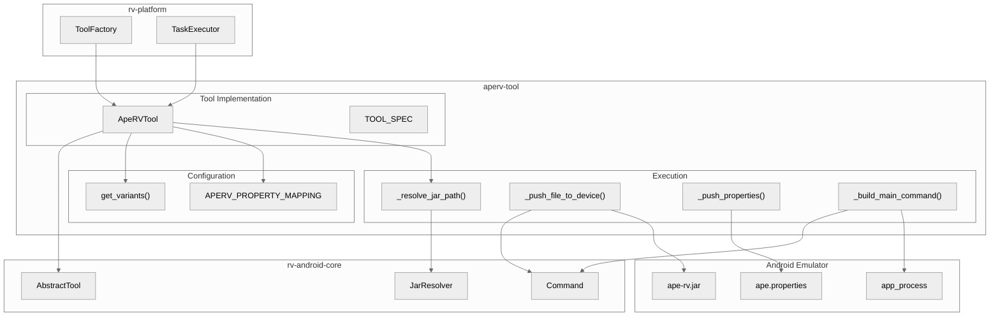
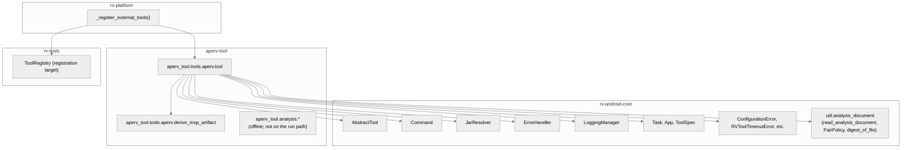
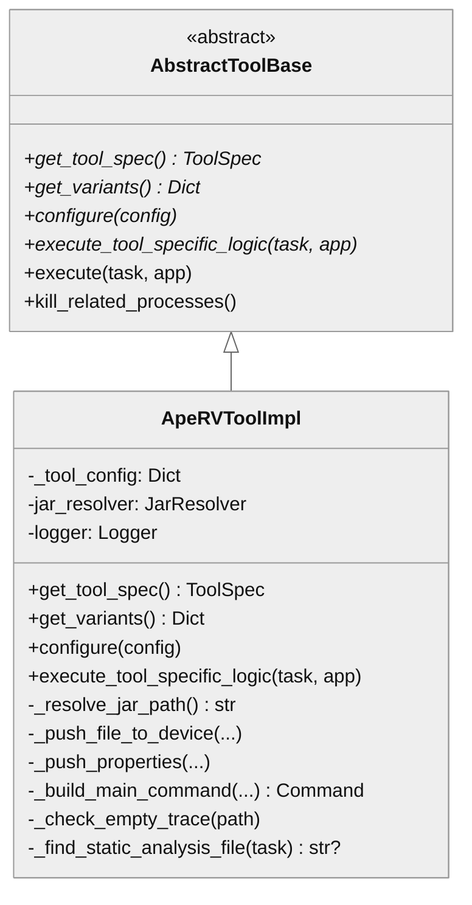
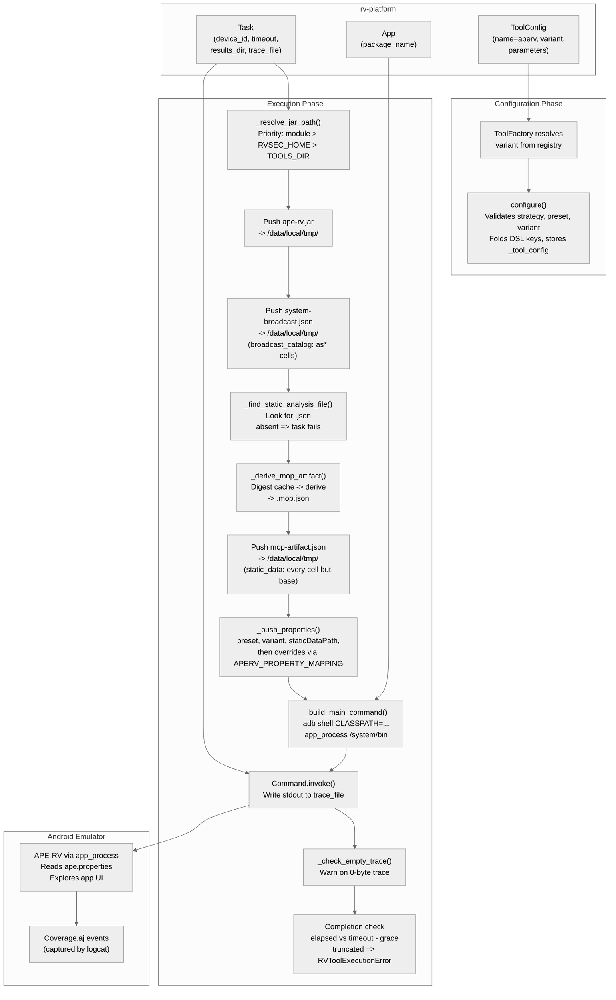

# APE-RV Tool Architecture

## Overview

The aperv-tool module wraps the APE-RV binary (`ape-rv.jar`) as an `AbstractTool` plugin for rv-platform integration. APE-RV is an enhanced fork of the AOSP Monkey tool that implements model-based UI exploration via the Widget Table Graph (WTG) model with adaptive random testing (SATA) and random strategies. The module handles JAR deployment to the Android device and the selection of one experimental cell per variant: each cell is a jar preset that mounts a union of APE-RV's behaviour groups (BASE, ADDONS, STATIC, MOP, LLM), and the module supplies only what the jar cannot know — the static-analysis artifact for the cells that read it, the broadcast catalog for the cells that mount STATIC, the server URL for the LLM cells, and the cell's name, which the jar echoes into the trace. It runs inside the Android emulator via `app_process`, not as a standard JVM process.

## Specification Alignment

This module implements requirements from `openspec/specs/tools/spec.md` as an external tool registered by rv-platform.

### Functional Requirements

| FR | Description | Architectural Support |
|----|-------------|----------------------|
| FR18 | Plugin system with registry and factory patterns | `ApeRVTool` extends `AbstractTool` (rv-android-core) and registers via `ToolRegistry` in rv-platform's `_register_external_tools()` |
| FR20 | Per-tool variant system | `get_variants()` returns eight names carrying seven configurations — the six cells `base`, `mop`, `as`, `as_mop`, `as_llm`, `as_mop_llm`, `default` bound to `base`, and the ablation `mop_nolaunch` on the `mop` preset — each a `preset`, a `variant` name and `overrides`; the three MOP cells and `mop_nolaunch` set `mop_coin_ledger_max_interactions` to 2 (D18); `configure()` validates strategy, preset, variant and overrides eagerly, and folds tool-DSL overrides into place (INV-APV-39) |

### Key Invariants

| Invariant | Description | Enforcement Mechanism |
|-----------|-------------|----------------------|
| INV-TOOL-02 | Every registered tool must have a "default" variant | `get_variants()["default"]` is the same object as `get_variants()["base"]`, so a bare `aperv` runs the APE reference cell and its trace says `variant: "base"` |
| INV-TOOL-05 | Factory must call `configure()` before returning tool | `configure()` stores validated config in `_tool_config`; `execute_tool_specific_logic()` checks truthiness of `_tool_config` |
| INV-TOOL-06 | `execute()` must convert `RVCommandTimeoutError` to `RVToolTimeoutError` | `execute_tool_specific_logic()` catches `RVCommandTimeoutError` and re-raises as `RVToolTimeoutError` |
| INV-APV-01 | JAR resolution follows priority search order | `_resolve_jar_path()` searches: module directory, `$RVSEC_HOME/ape/target/`, `$TOOLS_DIR/aperv/` |
| INV-APV-02 | Invalid strategy must be rejected before device interaction | `configure()` validates strategy against `APERV_AVAILABLE_STRATEGIES` and raises `ConfigurationError` immediately |
| INV-APV-04 | Working directory must be `/system/bin` | `_build_main_command()` passes `/system/bin` as the working directory argument to `app_process` |
| INV-APV-07 | APE and APE-RV must not run concurrently | `TOOL_SPEC.process_pattern` is `com.android.commands.monkey`, shared with the builtin APE tool, so rv-platform's `kill_related_processes()` terminates either before launch |
| INV-APV-10 | The broadcast catalog reaches the device exactly where its only reader runs | `execute_tool_specific_logic()` pushes `system-broadcast.json` only when the variant carries `broadcast_catalog=True` (the four `as*` cells, whose presets mount component triggering) and the file exists |
| INV-APV-45 | A cell that reads the artifact never launches without it | when `static_data == "static_analysis"` the tool either pushes a freshly validated derived artifact and writes `ape.staticDataPath`, or raises `RVToolExecutionError` before the jar is launched |
| INV-APV-65 | The trace names its cell | every variant carries `variant` equal to its cell name; `_push_properties()` writes `ape.variant=<variant>` as the second line; the jar echoes it as `RUN_START.variant`, and the tool never reads it back |
| INV-APV-60 | A run that did not explore its budget must not be reported as successful | `execute_tool_specific_logic()` measures the exploration against `time.monotonic()` and raises `RVToolExecutionError` when a non-timeout return came back more than `TOOL_TEARDOWN_GRACE_S` short of `task.config.timeout` |
| INV-APV-64 | On a cache miss the source is read in streaming, keeping per method only the per-target minima at `d <= DIST_WEIGHED_MAX` and the `DIST_K` nearest, and the artifact is byte-identical to one derived from the whole document | `_derive_mop_artifact()` calls `read_analysis_document(path, PairPolicy.reduce(DIST_WEIGHED_MAX, DIST_K))`; the cuts are imported from `derive_mop_artifact`, so the reduction and the derivation name one pair of constants. `tests/test_derive_mop_artifact.py` compares the streamed and whole-document artifacts byte for byte |

### Specification Scenarios

Scenarios from `openspec/specs/tools/spec.md` that validate this architecture:
- **External tool registration**: rv-platform imports `ApeRVTool` in `_register_external_tools()`, checks `is_tool_registered("aperv")` for idempotency, and registers the tool class with all seven variants -- traces through `rv_platform/__init__.py` -> `ToolRegistry` -> `ApeRVTool.get_tool_spec()` / `get_variants()`
- **Tool execution with variant**: rv-platform calls `ToolFactory.create_tool(tool_config)` which instantiates `ApeRVTool`, resolves the variant config, merges parameters, calls `configure()`, then `execute_tool_specific_logic()` -- traces through `ToolFactory` -> `ApeRVTool.configure()` -> `execute_tool_specific_logic()`

## Key Architectural Decisions

| Decision | Choice | Rationale |
|----------|--------|-----------|
| Application Type | Library (rv-platform plugin) | aperv-tool is a tool plugin, not standalone; rv-platform manages its lifecycle |
| Structuring | One execution class plus two read-only satellites | `ApeRVTool` owns the device interaction. `derive_mop_artifact` is a separate pure module because the MOP substrate's parse-time semantics are a single authority that must be testable without a device, and `analysis/` is a separate package because nothing in it may be reachable from the run path |
| Primary Pattern | Template Method (via AbstractTool) | Inherits the `execute()` -> `execute_tool_specific_logic()` template from AbstractTool, gaining consistent timeout and cleanup handling |
| Control Strategy | Call-based, sequential | rv-platform calls `configure()` then `execute_tool_specific_logic()` in sequence; no internal concurrency |
| Configuration | Properties file injection | APE-RV reads `ape.properties` from the device; the tool generates this file from Python config and pushes via ADB |
| JAR Resolution | Priority search with JarResolver | Module-local JAR takes precedence over Maven build output, ensuring packaged JAR is used by default for reproducibility |
| Process Pattern | Shared with builtin APE | Both APE and APE-RV use `com.android.commands.monkey` -- mutual exclusion enforced by rv-platform process cleanup |
| LLM URL Override | Tool DSL `@llm_url`, or `APERV_LLM_BASE_URL` read by the `rv-experiment` entry point and injected as `llm_url` into the LLM cells | Emulator uses `10.0.2.2` (host loopback alias); Docker and physical devices need different addresses. `configure()` reads no environment (INV-TOOL-20), so the variable reaches the tool by value, through `ToolConfig.parameters` |

### Why Properties File Injection?

APE-RV is a Java application running inside the Android emulator via `app_process`. It reads configuration from `ape.properties` on the device filesystem at startup. The Python wrapper generates this file dynamically and writes only what distinguishes the cell: `ape.preset=<cell>` first, `ape.variant=<cell>` second, `ape.staticDataPath` when the derived artifact was pushed, then one line per `overrides` entry. What a preset contains is resolved inside the jar, so the file never restates the keys of a group block. Keys not in `APERV_PROPERTY_MAPPING` — the ten in `APERV_ORCHESTRATION_KEYS` — are Python-only control parameters; of those, only `preset` and `variant` reach the device, through their fixed lines.

### Why Shared Process Pattern with APE?

Both the builtin APE tool (from rv-tools) and APE-RV run as `com.android.commands.monkey` on the Android device. This shared process pattern is a deliberate safety mechanism (INV-APV-07): rv-platform's `kill_related_processes()` terminates any running APE/APE-RV process before launching a new one. Since both tools use the same Android Monkey entry point (`app_process` with `CLASSPATH`), they cannot coexist on the same device. The shared pattern ensures stale processes from a previous experiment are cleaned up before the next run.

### Why Working Directory is /system/bin?

The `app_process` command requires the working directory as its first argument. APE-RV uses `/system/bin` (INV-APV-04) rather than `/data/local/tmp/` because the enhanced binary resolves internal Android framework classes relative to the system path. Using `/data/local/tmp/` causes `ClassNotFoundException` on some API levels because `app_process` cannot locate required system resources from that directory. This was discovered empirically during development and is a hard requirement.

### Why Module-Local JAR Has Highest Priority?

The JAR resolution priority (INV-APV-01) places the module directory first because experiment reproducibility requires using the exact binary that was packaged with the tool. If `$RVSEC_HOME/ape/target/` were checked first, a developer rebuilding the Java project mid-experiment would silently change the binary being used. The module-local JAR (shipped alongside `tool.py`) provides a stable reference point.

### Why Timeout is Expected Exit?

Exploration tools like APE-RV are designed to run indefinitely, exploring the application until killed. The `--running-minutes` flag sets a soft limit, but the tool may exceed it during state serialization. The `TOOL_TEARDOWN_GRACE_S` (45 s) grace period on the Command timeout gives APE-RV time to flush its WTG model to disk and emit its coverage dump before the process is forcibly killed. `RVCommandTimeoutError` is re-raised as `RVToolTimeoutError`, which rv-platform treats as a completed run (not a failure) and proceeds to collect coverage from logcat.

### Why the Exit Code Cannot Decide Whether a Run Happened

Timeout being the normal ending means a *normal* return is the anomalous one, and the exit code cannot classify it (INV-APV-60). APE-RV exits non-zero when it detects an application crash during exploration — data the campaign exists to collect — so an emulator that vanished (exit 255) and an application that crashed (exit 1) arrive through the same channel carrying the same information.

Elapsed time separates them because the exploration is budget-bound by construction: an APE-RV asked for 1800 s and back at 1012 s did not do the work, whatever ended it. `execute_tool_specific_logic()` therefore stamps `time.monotonic()` before launching and, on the non-timeout return path only, raises `RVToolExecutionError` when the elapsed time is below `task.config.timeout - TOOL_TEARDOWN_GRACE_S`. The single constant is read from opposite sides by the two users that must agree: `_build_main_command()` adds it to the command timeout, and the completion check subtracts it to obtain the floor.

Raising is what makes the failure recoverable. rv-platform stores the task as ERROR with a non-empty `error_message`, and its ordinary resume re-executes the identity — the same path that already recovers a failed `adb install`. Before this check such a run was stored COMPLETED with `error_message` null, which no resume could reach.

## Architectural Patterns

### Pattern: Template Method (AbstractTool)

**Description**: `ApeRVTool` extends `AbstractTool` from rv-android-core. The base class defines `execute()` which calls the abstract `execute_tool_specific_logic()`, handles `RVCommandTimeoutError` conversion, and performs process cleanup via `kill_related_processes()`. ApeRVTool implements only the tool-specific logic.

**When Used**: Every tool in the rv-android system uses this pattern. It ensures consistent timeout handling (timeouts are expected, not errors), process cleanup, and error handling across all tools.

**Advantages**:
- Consistent behavior: timeout handling, cleanup, and error reporting are identical across tools
- Tool implementors focus only on tool-specific logic

**Disadvantages**:
- Inheritance coupling: changes to AbstractTool affect all tools

### Pattern: Variant Configuration

**Description**: `get_variants()` returns a dictionary of named cells, each a `preset` name, a `variant` name, an `overrides` dict and the Python-only keys `strategy`, `static_data` and `broadcast_catalog`. `configure()` validates the shape, folds any tool-DSL override into `overrides`, and raises on a top-level key it cannot honour -- without that fold a DSL override would produce no property line and no error, which is the silent-discard failure the preset mechanism exists to remove. `_push_properties()` then translates `overrides` through `APERV_PROPERTY_MAPPING`. Python-only keys are excluded automatically because they have no mapping entry.

**When Used**: When the experiment configuration specifies a variant (e.g., `aperv:as_mop`), `ToolFactory` resolves the variant config, merges any parameter overrides, and calls `configure()`.

**Advantages**:
- Declarative cell definitions: what a cell mounts is stated once, in the jar's group blocks, and the Python side names it
- Type safety: `configure()` validates strategy eagerly before device interaction

**Disadvantages**:
- All variants defined statically in code; no file-based variant definitions

---

## Logical View

Shows key domain entities and their relationships.

### Domain Entities

| Entity | Responsibility |
|--------|----------------|
| ApeRVTool | Wraps APE-RV binary as an AbstractTool; manages JAR push, properties push, command execution, and trace capture |
| ToolSpec | Metadata describing the tool: name, description, URL, version, process pattern |
| JarResolver | Resolves the path to `ape-rv.jar` via priority search across configured directories |
| Command | Encapsulates an ADB shell command with timeout; used for both file push and main execution |
| APERV_PROPERTY_MAPPING | Maps Python config keys to Java `ape.properties` keys; controls what is written to the device |
| MOP artifact (`<apk>.mop.json`) | The lossy projection of static analysis that the device reads; derived host-side, cached by the source digest, and readable by no module outside aperv-tool (INV-ANA-53) |

### Component Architecture



---

## Development View

Shows code organization for developers.

### Module Structure

```
aperv-tool/
├── src/
│   └── aperv_tool/
│       ├── __init__.py
│       ├── tools/                          # the run path — everything that touches a device
│       │   ├── __init__.py
│       │   └── aperv/
│       │       ├── __init__.py
│       │       ├── tool.py                 # ApeRVTool class, constants, property mapping
│       │       ├── derive_mop_artifact.py  # pure derivation of the device's MOP artifact
│       │       ├── ape-rv.jar              # APE-RV binary (gitignored; built from ape source at Docker image build)
│       │       └── system-broadcast.json   # Broadcast intent catalog for component triggering
│       └── analysis/                       # read-only over recorded runs; never imported by the run path
│           ├── __init__.py
│           ├── trace_ndjson.py             # native reader of the stage-4 NDJSON trace
│           ├── coverage_dump.py            # parser of the jar's UICOV / UICOV-ACT dump
│           ├── clock_logcat_join.py        # places RVSEC violations on the exploration timeline
│           ├── run_identity.py             # single seat of the run identity: regex, arm table, frame columns
│           ├── runspec.py                  # per-run attribution evidence against a declared arm
│           ├── tasks_record.py             # tasks.json read by identity, with the collision policy
│           ├── loader.py                   # a campaign into one tidy frame at the run grain
│           ├── liveness.py                 # sole owner of the per-run admissibility verdict
│           ├── gates.py                    # the five validity gates, per arm
│           ├── corpus.py, clones.py        # declared subsets, both denominators, clone collapse
│           ├── outcomes.py                 # metric-agnostic builders; conventions as parameters
│           ├── screen_visits.py            # activity-visit segmentation, state trail, form episodes
│           ├── step_bundle.py              # one record per step with every stream placed on it
│           ├── state_coverage_join.py      # per-state UICOV onto steps by STATE.key, intra-run
│           ├── violations.py, monitored_ops.py       # event streams at a declared grain
│           ├── static_artifact.py          # size covariate and strata from <apk>.json
│           ├── baseline_ape.py, baseline_droidbot.py # extract-only-what-is-certain baseline parsers
│           ├── envelope.py                 # the result structure: no number leaves without one
│           ├── provenance.py, emit.py      # re-derivability, and envelopes into tables/figures
│           ├── estimators/                 # one estimator per module, each returning an Envelope
│           └── callers/                    # the ONLY place a research-question identifier appears
│               ├── rq_map.toml             #   entry id -> builder, estimator, parameters
│               ├── basis.py                #   carrying corpus and attrition into the envelope
│               ├── coverage.py             #   entries with no working caller, by kind
│               ├── paired_detection.py     #   example caller: paired binary
│               └── count_model.py          #   example caller: negative-binomial GLM
├── tests/
│   ├── __init__.py
│   ├── test_aperv_tool.py                  # spec, cells, configure/DSL fold, commands, properties, pushes
│   ├── test_derive_mop_artifact.py         # one named test per derivation rule + cryptoapp ground truth
│   ├── test_trace_ndjson.py                # reader semantics against the v1 golden and the v2 groups traces
│   ├── test_coverage_dump.py               # coverage-dump parsing
│   ├── test_clock_logcat_join.py           # heartbeat placement, including both routes to UNALIGNED
│   ├── test_smoke_two_apps.py              # the whole chain over two applications, no device
│   ├── test_corrupted_fixture.py           # three defects, each reported rather than absorbed
│   ├── test_no_rq_identifier.py            # the genericity scan over the package
│   ├── test_analysis_off_collection_path.py  # import-graph proof the run path cannot reach analysis/
│   ├── fixtures/                           # cryptoapp.apk.json, the golden NDJSON, the pinned manifests
│   └── migration/                          # retirement list, jar tables, mapping sweep, offline cell gate
└── pyproject.toml
```

The `tools/` ÷ `analysis/` split is load-bearing rather than cosmetic: `analysis/` reads artifacts a run already produced and rv-platform never calls into it, so a change there cannot alter what any cell does on a device.

### Package Dependencies



`AnalysisPkg` has no inbound edge on purpose: nothing imports it, which is what keeps offline analysis unable to affect a run.

---

## Process View

Shows the runtime execution sequence when rv-platform dispatches an APE-RV task.

### Execution Flow

```mermaid
%%{init: {'theme': 'neutral'}}%%
sequenceDiagram
    participant Platform as rv-platform<br/>TaskExecutor
    participant Tool as ApeRVTool
    participant Resolver as JarResolver
    participant ADB as ADB / Device
    participant APE as APE-RV<br/>(app_process)

    Platform->>Tool: configure(variant_config)
    Tool->>Tool: validate strategy, preset, variant, overrides
    Tool->>Tool: fold DSL keys into overrides, store _tool_config

    Platform->>Tool: execute_tool_specific_logic(task, app)

    Tool->>Resolver: resolve_jar_path("ape-rv.jar")
    Resolver-->>Tool: /path/to/ape-rv.jar

    Tool->>ADB: adb push ape-rv.jar /data/local/tmp/
    ADB-->>Tool: OK

    opt broadcast_catalog and system-broadcast.json exists (as* cells)
        Tool->>ADB: adb push system-broadcast.json /data/local/tmp/
        ADB-->>Tool: OK
    end

    opt static_data == "static_analysis" (every cell but base)
        Tool->>Tool: _find_static_analysis_file(task)
        alt static analysis JSON found
            Tool->>Tool: _derive_mop_artifact(task) [cache-or-derive]
            Tool->>ADB: adb push mop-artifact.json /data/local/tmp/
            ADB-->>Tool: OK
        else absent or underivable
            Tool-->>Tool: raise RVToolExecutionError (task fails)
        end
    end

    Tool->>Tool: _push_properties() - ape.preset, ape.variant,<br/>ape.staticDataPath (if pushed), overrides
    Tool->>ADB: adb push ape.properties /data/local/tmp/
    ADB-->>Tool: OK

    opt overrides carry llm_url
        Tool->>Tool: _capture_llm_provenance(llm_url, jar_path)
        Tool->>Tool: write <run>.provenance.json sidecar<br/>(failure logs a warning, never fails the run)
    end

    Tool->>Tool: stamp time.monotonic()
    Tool->>ADB: adb shell CLASSPATH=... app_process /system/bin Monkey -p pkg --ape strategy
    ADB->>APE: start exploration

    alt Timeout (expected)
        APE-->>Tool: RVCommandTimeoutError
        Tool->>Tool: _gzip_trace()
        Tool-->>Platform: RVToolTimeoutError (normal completion)
    else Normal exit, budget explored
        APE-->>Tool: exit code (0 or non-zero)
        Tool->>Tool: _check_empty_trace()
        Tool->>Tool: _gzip_trace()
        Tool-->>Platform: return
    else Normal exit, truncated (elapsed below the floor)
        APE-->>Tool: exit code (0 or non-zero)
        Tool->>Tool: _check_empty_trace()
        Tool->>Tool: _gzip_trace()
        Tool-->>Platform: RVToolExecutionError (INV-APV-60)<br/>rv-platform stores ERROR; resume re-executes
    end
```

`_gzip_trace()` runs on all three paths because timeout is the majority path, not the exception: compressing only on normal exit would exempt most runs. It is write-only and non-fatal — it produces `<run>.trace.ndjson.gz` beside the trace, leaves `task.result.trace_file` byte-identical (INV-APV-52), parses nothing and changes no task status (INV-APV-53).

The two normal-exit branches are one code path that ends differently: compression happens *before* the completion check deliberately, so the artifacts of a truncated run survive as the evidence of what truncated it. The branches are distinguished by the clock, never by the exit code — see "Why the Exit Code Cannot Decide Whether a Run Happened" above.

---

## Core Components

### ApeRVTool

**Purpose**: Implements the `AbstractTool` interface for APE-RV, managing the complete device interaction lifecycle: JAR resolution, file deployment, properties generation, command execution, trace validation and the completion check that establishes a run actually explored its budget.

**Location**: `src/aperv_tool/tools/aperv/tool.py`

**Key Classes**:
- `ApeRVTool`: Main tool class extending `AbstractTool`, covering configuration, JAR resolution, file push, MOP artifact derivation and caching, LLM provenance capture, properties generation, command building, execution, empty-trace detection and trace compression.

**Dependencies**:
- Internal: `rv-android-core` (AbstractTool, Command, JarResolver, ErrorHandler, LoggingManager, domain models, exceptions, and `util.analysis_document` for the streaming read and the source digest); `aperv_tool.tools.aperv.derive_mop_artifact`
- External: None (uses only stdlib `gzip`, `hashlib`, `json`, `os`, `re`, `shutil`, `tempfile`, `urllib.request`)

### derive_mop_artifact

**Purpose**: Single authority for the MOP substrate's parse-time semantics. `derive(document) -> dict` projects the full static-analysis JSON into what the device needs; `serialize_canonical(artifact) -> bytes` renders it deterministically so two derivations of the same source are byte-identical.

**Location**: `src/aperv_tool/tools/aperv/derive_mop_artifact.py`

**Why it is a module rather than methods on the tool**: these rules used to run on the device at load time, where the jar parsed the whole call graph and rejected large ones. Moving them host-side made them testable without a device and removed the per-app fairness gap; keeping them pure — no I/O, no device concepts — is what lets `tests/test_derive_mop_artifact.py` name one test per rule and check the cryptoapp ground truth directly.

**Why its two cuts bind the caller's read**: `derive()` merges a target's distances by the minimum and cuts only at emission — a widget or handler list keeps every pair at `d <= DIST_WEIGHED_MAX`, an activity list its `DIST_K` nearest. That is what makes the caller's streaming reduction exact (INV-APV-64): a pair outside both cuts has `DIST_K` targets ahead of it in its own method, and they stay ahead after any merge, so dropping it while reading cannot change the artifact. A change to either cut is therefore a change to the reduction, and `tool.py` imports both constants from here rather than restating them. The module reads no file; the provenance digest is computed by the caller with `rv_android_core.util.analysis_document.digest_of_file()`, the same digest the parsed-copy cache of `rv-static-analysis` keys on.

### analysis package

**Purpose**: Read-only utilities over the artifacts of a recorded run, and the campaign analysis layer built on them.

**Location**: `src/aperv_tool/analysis/`

The three stream readers:

| Module | Reads | Produces |
|--------|-------|----------|
| `trace_ndjson.py` | the stage-4 NDJSON trace, `RUN_START.v` 1 or 2 | one row per exploration step, with the `ACT`/`STATE` dictionaries resolved, omitted defaults materialized, and the run-relative clock expanded through `RUN_START.t0`; the run-level records `run_start` (with `variant`), `mop_data`, `pipeline`, `llm_ack` and `run_end` as verbatim attributes (see "The reader's two jar generations" below) |
| `coverage_dump.py` | the `UICOV` / `UICOV-ACT` lines of the trace | parsed coverage records; `StateCoverage.mop_reach` is `None` on a `UICOV` line without `mopReach`, which the group-isolation jar writes only with MOP mounted, and such a line is complete, not partial (INV-APV-68) |
| `clock_logcat_join.py` | a run's logcat plus `trace_ndjson` rows | each `RVSEC` violation placed at the step of the last `ApeRvHb` heartbeat at or before it. Also owns `read_tagged_lines`, the exact-match reader of one logcat tag shared by all three streams (INV-APV-63), returning a `TaggedLines` list subclass whose `.skipped` makes unparseable tagged lines visible without changing the eight existing call sites |
| `violations.py` | the `RVSEC` lines of a run's logcat, or rv-platform's consolidated `errors.csv` | `ViolationEvent` records with the seven comma fields and the v1 message envelope decomposed, plus `LogcatDiagnostics` / `CsvDiagnostics` accounting for every line that did not survive intact |

The campaign analysis layer, in five layers plus a callers directory:

| Layer | Modules | Establishes |
|---|---|---|
| 0 — run model and corpus | `run_identity`, `runspec`, `tasks_record`, `loader`, `liveness`, `gates`, `corpus`, `clones` | which runs exist, which of them count, and what the denominator is |
| 1 — outcome builders | `outcomes`, `screen_visits` | streams into labelled per-unit values under declared conventions |
| 2 — estimators | `estimators/` | one estimator per module, every function returning an `Envelope` |
| 3 — stream readers | `step_bundle`, `state_coverage_join`, `violations`, `monitored_ops`, `static_artifact`, `baseline_ape`, `baseline_droidbot`, plus the three above | parsing the recorded artifacts |
| 4 — reporting | `envelope`, `provenance`, `emit` | the result structure, its re-derivability, and the files it becomes |
| callers | `callers/` + `rq_map.toml` | the only place a research-question identifier appears |

**Constraints**: nothing here is imported by the run path, and none of it holds a clock reconstruction. `clock_logcat_join` works because both series come out of the same logcat, so their identical unknowns (no year, no zone) cancel in the difference. No `*.mop.json` is ever opened (INV-ANA-53). No research-question identifier appears outside `callers/` (INV-CAN-22). Every knob the pre-registration decides — the margin, the corpus, the replica rule, the dedup convention, the GLM offset and reference level, the multiplicity strategy — is a required parameter with no default (INV-CAN-11), so a call that omits one raises rather than choosing on the author's behalf.

Full narrative, including the two fixture classes and why the activity-visit is the analysis unit: [docs/20260815_gh103_analysis_layer.md](../../../docs/20260815_gh103_analysis_layer.md).

#### The reader's two jar generations

`TraceReader` accepts `RUN_START.v` in `SUPPORTED_VERSIONS = {1, 2}` (INV-APV-62). Version 1 is the `eea2b1a9` jar and earlier; version 2 is the jar of the `ape` change `isolate-guidance-groups` (contract v3.2, `ape` `16b185f4`), which bumped the version because `dec.src` changed meaning. Any other declared version is counted in `TraceDiagnostics.schema_version_mismatch`, and raises `SchemaVersionMismatch` in strict mode before any row is yielded. The reader carries the version as `run_start.v` and does not branch on it: it reads both vocabularies faithfully and leaves the interpretation to the consumer, which is why some fields need the version to be read correctly.

**`decision_source` has two meanings** (INV-APV-67). Under `v == 2` it is the owner that executed the step — `budget`, `restart`, `llm`, `launcher`, `mop` or `sata` — and it is causal. Under `v == 1` it is the stage whose boost was largest, which is not causal, because every stage adds into one shared priority. `screen_visits` reports `decision_source_counts` beside the version, and an aggregation across runs refuses to pool two versions (INV-CAN-21).

**The decision record of the group-isolation jar** reaches typed `StepRow` fields. Each is `None` when the member is absent, because a `v == 1` trace carries none of them and a default would claim a mechanism ran (INV-APV-49). Enumerated values are carried as written, so a new owner or SATA path on the jar side does not turn a well-formed record into a malformed one.

| Wire member | `StepRow` field | Type |
|---|---|---|
| `dec.own` | `owner` | `Ownership(intended, trigger, u_llm, u_mop, gate, fallback)` — the intended owner, the LLM stage that made the step's one call, the two coin draws, the gate and the fallback |
| `dec.cfc` | `scorer_cf` | `Mapping[str, bool]`: for each mounted scorer, whether zeroing it alone would have changed the pick |
| `dec.draw` | `draw` | `Tuple[int, int]` (index, total) |
| `dec.nav` | `nav` | `NavTie(point, component, alternative, drew)` |
| `dec.inp` | `input_source` | `str` |
| `dec.restart` | `restart_kind` | `str` |
| `dec.bmc` | `back_menu_capped` | `int` |
| `dec.strat` | `sata_path` | `str` |
| `dec.rot` | `rotation` | `int` |
| `dec.buf` | `buffer_abandoned_by` | `str` |
| `dec.trig` | `component_trigger` | `ComponentTrigger(kind, component_class)` — the step during which component triggering fired, whatever its owner |
| `dec.navf` | `nav_frontier` | `int`, a boost field materialized at `0` |
| `dec.mopd` / `dec.mops` / `dec.ret` | `mop_distance` / `mop_stamp` / `retired_targets` | `int` / `str` / `Tuple[int, ...]`, on both versions |
| `dec.hnd` | `mop_handler` | `str`: the binary class name of the handler stamp behind the weight, written only when `mops` is `s` |
| `dec.fz` | `fuzz_events` | `Tuple[str, ...]`: the gesture kinds the step's fuzz action queued, in order; `()` when fuzzing queued nothing, `None` when the step did not fuzz (INV-APV-69) |

`counterfactual` and `wtg_source` carry the `v == 1` jar's `dec.cf` and `dec.wtgsrc`, and are `None` on `v == 2`, which removed them. `counterfactual` is the pick with **only the MOP boosts** zeroed, so it is evidence about MOP guidance and about nothing else; `scorer_cf` answers the narrower "did this one scorer change the choice", not "did the guidance as a whole change it".

**`activity_has_mop` is tri-state** (INV-APV-68). The `v == 2` jar writes `ACT.mop` only when MOP is mounted, so in `base`, `as` and `as_llm` the fact was not computed and reads `None` on both sides of the row. `screen_visits` and `step_bundle` carry `None` through as null, never as `False` (INV-CAN-22).

**`RunStart` has fourteen members**, `variant` among them; it is `None` on every `v == 1` trace.

**`run_end` is a census attribute.** It is the `RUN_END` record minus `type`, verbatim, beside `mop_data`, `pipeline` and `llm_ack`, and `None` when the trace has none: `reason`, `steps`, and `counters`, which on `v == 2` add `launches`, `gateMinActions`, `gateBreaker`, `guardBacks`, `bufAbandoned`, `restarts`, `coinLlm`, `coinMop` and `nullRelaunches` beside `acts`, `states`, `stampNodes`, `stampHits`, `retired` and `llm`. An analysis of the cells needs those per-run counts of each mechanism. The reader derives nothing from the record — no completeness flag, no status — and the collection path in `tools/aperv/*` never reads it (INV-APV-53).

#### Gate 1 has two forms

The clean-control gate counts a forbidden signal in each run of the arms the caller declares as controls (`arm_predicate`, a parameter, not a module constant). Its signal is computed in exactly one place per trace format (INV-CAN-07):

- **Legacy `key=value` streams**: `count_forbidden_signal` keeps the anchored pattern `(?<![a-z_])mop=`, so `activity_has_mop=1` never matches. The pattern cannot match an NDJSON `"mop":` member, so on a stage-4 trace it would count zero whatever the trace carried; the gate therefore never uses it there.
- **NDJSON traces** (the first sink record is `{`-leading, tested with `trace_ndjson.RECORD_PREFIX`, the reader's own INV-SNK-11 test, so the two cannot disagree on what a record is): `count_mop_group_signal(reader)` reads the trace through `TraceReader`. On a `v == 2` trace it counts the members of the `ape` side's own clean-control list (`event-sink` INV-SNK-18). A step row counts once when it carries a non-zero `mop`, `mop_frontier`, `wtg` or `menu`; a present `mop_distance`, `mop_stamp`, `retired_targets` or `mop_exposure`; an `owner.u_mop`; a `scorer_cf` key among `mop`, `mopf`, `wtg`, `menu`; `nav.component == "mop"`; a `pick_channel` of `mop_coin` or `launcher`; a `decision_source` or `owner.intended` of `mop` or `launcher`; or an `activity_has_mop` or `target_activity_has_mop` that is not `None`. Outside the rows, a `UICOV` line carrying `mopReach` counts once, and so does a `RUN_END` with a non-zero `coinMop`, `launches`, `stampHits` or `retired`. That jar writes each of these only with MOP mounted.
- **On a `v == 1` trace** the list is the legacy one: a step row counts once when its `mop` or `mop_frontier` boost is non-zero, and nothing else counts. That jar's control arm (`mop_off_llm_off`) mounted MOP with the weights zeroed, so the MOP pass wrote its by-products in a clean run: a recorded cmp162 control of 73 steps carries `mopx` on all 73, a non-zero `wtg` on 1 and `mopReach` on every `UICOV` line, and no fired MOP boost.
 `MOP_DATA` never counts: it reports that the artifact was loaded, which the STATIC cells `as` and `as_llm` do by design. On a group-isolation campaign the controls are `aperv:base`, `aperv:as` and `aperv:as_llm`. Gate 3 (arm attribution) uses `RUN_START.variant` as evidence against the manifest's cell on a `v == 2` trace, and reports that check `not-run` on `v == 1`.

#### The violation record

The violation stream has two sources and one decomposition. `violations.parse_payload` is the
module's only payload parser — `clock_logcat_join` imports it (inside the function, since
`violations` imports `clock_logcat_join` for the tagged-line reader) rather than keeping the
second copy it used to hold, so the seven-field split exists once and the two readers cannot
drift apart.

Below the seventh comma field sits the **v1 message envelope** the `jca_android` monitors emit:
`v=1 code=<SPEC>-<KIND>-<NN> ev=<event> obj=<SimpleClass> val='…' exp='…' msg='…'`. Reading it
turns `code`, `event`, `obj`, `val`, `exp` and `msg` into fields, so a downstream question about
which automaton event failed is answered by a column rather than by a regex over prose. The
grammar is restated in `violations.py` rather than imported from `rv_coverage`, which parses the
same envelope for the platform: `rv_coverage` is not a declared dependency of this module, and a
Layer-3 reader that could not open a recorded artifact without the platform installed would not
be a reader of recorded artifacts.

Nothing that fails to parse is dropped, and the failures are kept apart because they mean
different things:

| Counter | Condition | Why it is its own number |
|---|---|---|
| `shape_bad` | the payload did not split into seven comma fields | the line is kept whole in `message` and stays countable (INV-CAN-04) |
| `envelope_malformed` | the seventh field declared `v=1` and then did not match the grammar | the seven comma fields are still populated, so the event is usable at the coarser grain |
| `envelope_truncated` | the last quoted value was never closed | logcat cuts a payload at 4068 bytes with no marker, so an unclosed quote is the only evidence the record is half a record — a transport limit, not a producer defect |
| `skipped_lines` | the tag matched exactly and the threadtime shape did not parse | counted by `read_tagged_lines`; a line under a longer tag (`RVSEC-COV` under a request for `RVSEC`) is not a skip, it belongs to another stream |
| `envelope_status = absent` | the message carries no `v=1` | **not** a failure: a pre-change message is a legitimate shape |

`step_bundle.BundleDiagnostics.violations` carries `LogcatDiagnostics` onto each bundle. Without
it a step whose lines were discarded upstream would be indistinguishable from a step that simply
produced no violation, since the bundle's per-tag counters account only for lines the reader
returned.

Reading rv-platform's consolidated `errors.csv` is the second source. `ERRORS_CSV_HEADER` states
its 13 columns exactly as the platform writes them, so a header change fails loudly at the reader
instead of surfacing as a missing column three layers up. `CsvDiagnostics` counts two conditions
the CSV can carry: `unique_msg_unparsed`, rows whose `:::`-joined `unique_msg` did not decompose
(the event itself is intact, so it is counted, not raised), and `unique_msg_disagrees`, rows whose
`code`/`event` recovered from `unique_msg` contradict the CSV's own `code`/`event` columns. Both
are written by one producer from one object, so a disagreement is a transport defect worth a
number rather than a preference the reader exercises silently.

**Changing the message breaks consumers that regex it.** `data/gh104/consumer_matrix.md` (repository
root) names every reader of `message`, `unique_msg` or `errors.csv` with its verdict — migrated, or
frozen with the reason — closed by a grep over `modules/`, `scripts/`, the experiment directories and
`audit/`, so every hit that is code has a row and data files are listed once as data.

### Constants and Configuration Mapping

**Purpose**: Define device paths, available strategies, and the Python-to-Java property name mapping.

**Location**: `src/aperv_tool/tools/aperv/tool.py` (module-level constants)

**Key Constants**:
- `APERV_TOOL_NAME = "aperv"` -- registry key
- `APERV_JAR_NAME = "ape-rv.jar"` -- JAR filename for resolution
- `APERV_DEVICE_JAR_PATH = "/data/local/tmp/ape-rv.jar"` -- target path on device
- `APERV_DEVICE_PROPERTIES_PATH = "/data/local/tmp/ape.properties"` -- properties target
- `APERV_MAIN_CLASS = "com.android.commands.monkey.Monkey"` -- Java entry point
- `TOOL_TEARDOWN_GRACE_S = 45` (`rv_android_core.constants`, shared with the `ape` built-in and `analysis/liveness.py`) -- seconds of teardown allowed beyond the exploration budget. Stated once because two users must agree on it: the command timeout is the budget *plus* this value, and the completion floor is the budget *minus* it (INV-APV-60). The value is a hypothesis about censored teardown durations, not a measurement — among iter0 runs whose teardown completed the overrun reaches 12,991 ms, with 32 runs stacked against the previous 15 s ceiling and none beyond it, the signature of a hard wall rather than a natural distribution
- `APERV_AVAILABLE_STRATEGIES = ["sata", "random"]` -- valid strategies. `bfs`/`dfs` were never agent types (`ApeAgent.createAgent` knows `sata`, `random` and `replay`), so accepting them would let a run pass local validation and abort on the device
- `APERV_ORCHESTRATION_KEYS` -- the ten top-level keys that are Python orchestration rather than jar configuration (`preset`, `variant`, `overrides`, `strategy`, `static_data`, `broadcast_catalog`, `seed`, `device_port`, `device_serial`, `device_id`); anything else at the top level must be a mapped override or `configure()` raises, `mop_data` included
- `APERV_PROPERTY_MAPPING` -- 67-entry pass-through table mapping Python override keys to Java `ape.*` property names. It contains only keys the deployed jar accepts (INV-APV-41); the sweep against `KeyOwnership.java` lives in `tests/migration/test_mapping_sweep.py`

### Variant System

**Purpose**: Define the experimental matrix as **one variant per cell**, plus the ablation `mop_nolaunch`: 8 names carrying 7 configurations, each a jar cell preset, its own name, the deployment facts the jar cannot know, and on the three MOP cells the coin's ledger budget.

**Location**: `src/aperv_tool/tools/aperv/tool.py` (`get_variants()` classmethod)

APE-RV mounts five behaviour groups by declaration. BASE is the APE algorithm, ADDONS the fork's own improvements, STATIC the consumers of the static GUI model (the navigation frontier, typed input, component triggering), MOP the consumers of the specification targets, and LLM the vision-language model. A cell is a union of groups, and each jar preset is the union of that cell's group blocks.

| Variant | preset | Groups beside BASE | static_data | broadcast_catalog | overrides |
|---|---|---|---|---|---|
| `default` | `base` | — | — | — | _(empty)_ — the same object as `base` (INV-TOOL-02) |
| `base` | `base` | — | — | — | _(empty)_ |
| `mop` | `mop` | MOP | `"static_analysis"` | — | `mop_coin_ledger_max_interactions: 2` |
| `as` | `as` | ADDONS, STATIC | `"static_analysis"` | `True` | _(empty)_ |
| `as_mop` | `as_mop` | ADDONS, STATIC, MOP | `"static_analysis"` | `True` | `mop_coin_ledger_max_interactions: 2` |
| `as_llm` | `as_llm` | ADDONS, STATIC, LLM | `"static_analysis"` | `True` | `llm_url` |
| `as_mop_llm` | `as_mop_llm` | ADDONS, STATIC, MOP, LLM | `"static_analysis"` | `True` | `mop_coin_ledger_max_interactions: 2`, `llm_url` |
| `mop_nolaunch` | `mop` | MOP without `MOP_LAUNCHER` | `"static_analysis"` | — | `mop_coin_ledger_max_interactions: 2`, `activity_trigger_enabled: False` |

Every variant carries `strategy="sata"` and `variant` equal to its own name (`default` carries `"base"`).

Each orchestration key states one deployment fact, because the Python side does not know what a preset mounts and does not branch on a preset name:

- `static_data` is present exactly on the cells that mount STATIC or MOP (INV-APV-66). `mop` reads the artifact with ADDONS and STATIC off, and `as` reads it with MOP off, which is why the key is named after the static data and not after MOP.
- `broadcast_catalog` is present exactly on the cells that mount STATIC (INV-APV-10), because the catalog's only reader in the jar is component triggering, a STATIC member.
- `overrides` carries `llm_url` on the two LLM cells (INV-APV-38). The LLM presets state the group without the URL, which names a machine rather than a cell.
- `overrides` carries `mop_coin_ledger_max_interactions: 2` on the three MOP cells (design D18). The jar's default is 1 and its group blocks do not state the key; the author placed the default here after the `e03igg2` campaign, where the coin at 2 was the only arm above APE in misuses. The cell gate therefore compares these cells with their fixtures plus one `params` entry and leaves the digest out.

The division of authority is the point: the jar owns what a group *means* and which groups a cell mounts, Python owns *which cells exist*. A dose or another tunable is an ablation through the tool DSL (`aperv:as_mop@mop_coin_percentage=0.5`), never a new preset. An ablation that runs in the same containers as its cell is a named variant on the cell's preset instead, because the platform's resume identity (apk, tool, variant, repetition, timeout) and the result file names leave the parameters out: `mop_nolaunch` is the `mop` cell with the launcher unmounted. The arm names of earlier campaigns are not defined; campaigns recorded under them resume from the frozen image `rvandroid:0.9.5`.

---

## NFR Support

How the architecture supports non-functional requirements from the PRD.

| NFR | PRD ID | Priority | Architectural Support |
|-----|--------|----------|----------------------|
| Modularity | NFR01 | P0 | Standalone uv workspace module whose only declared workspace dependency is rv-android-core; registered lazily by rv-platform, which declares aperv-tool |
| Extensibility | NFR02 | P0 | An ablation is a tool-DSL override on an existing cell; a new tunable is an entry in `APERV_PROPERTY_MAPPING`. New cells and presets are not added here — the preset vocabulary and the group blocks belong to the jar's `Presets.java` |
| Testability | NFR03 | P1 | `tests/test_aperv_tool.py` covers spec metadata, variant shape, `configure()` validation, the DSL override fold, JAR paths, command building, constants, empty-trace detection, properties generation and the catalog and artifact pushes per cell; `tests/migration/` holds the sweep of `APERV_PROPERTY_MAPPING` against the jar's accepted-key table, the pinned jar tables and the offline cell gate, and skips silently without `$APE_REPO` |
| Resilience | NFR04 | P1 | Timeout treated as expected exit (re-raised as `RVToolTimeoutError`); non-zero exit codes logged as debug (APE-RV reports app crashes this way) and never used to judge a run; a truncated exploration raises `RVToolExecutionError` so rv-platform's resume re-executes the identity (INV-APV-60); empty trace produces warning, not error |
| Configurability | NFR05 | P1 | The LLM cells' URL is changed by a DSL `@llm_url`, or by `APERV_LLM_BASE_URL`, which the `rv-experiment` entry point reads and injects into those cells' `ToolConfig.parameters` (the tool itself reads no environment for it); `RVSEC_HOME` and `TOOLS_DIR` extend JAR search paths; `ape.properties` generated from `_tool_config` via mapping |
| Reproducibility | NFR08 | P1 | Module-local JAR (`ape-rv.jar` shipped alongside `tool.py`) takes priority in resolution, ensuring experiments use the packaged binary |

---

## Key Interfaces

### AbstractTool (from rv-android-core)

```python
class AbstractTool(ABC):
    """Base class for all testing tools in rv-android."""

    def get_tool_spec(cls) -> ToolSpec: ...
    def get_variants(cls) -> Dict[str, Dict[str, Any]]: ...
    def configure(self, config: Dict[str, Any]) -> None: ...
    def execute_tool_specific_logic(self, task: Task, app: App) -> None: ...
```



---

## Scenarios

### Scenario 1: The full tool with MOP guidance (`aperv:as_mop`)

**Description**: An experiment runs the `as_mop` cell — APE plus the fork's improvements, the static GUI model and MOP guidance. It overrides nothing, so it is the shortest properties file a cell that reads the artifact can produce.

**Flow**:
1. rv-experiment generates a task with `tool_config = ToolConfig(name="aperv", variant="as_mop")`
2. rv-platform's `ToolFactory` instantiates `ApeRVTool`, resolves the `as_mop` variant config (`preset="as_mop"`, `variant="as_mop"`, `strategy="sata"`, `static_data="static_analysis"`, `broadcast_catalog=True`, `overrides={}`), and calls `configure()`
3. `configure()` validates `strategy="sata"` against `APERV_AVAILABLE_STRATEGIES`, checks that `preset` and `variant` are present and non-empty and that `overrides` is a dict, and stores the config. WHEN the experiment adds a DSL ablation (`aperv:as_mop@mop_coin_percentage=0.5`) THEN `configure()` folds that top-level key into `overrides` AND an unmappable key raises `ConfigurationError` here, before any device interaction
4. `execute_tool_specific_logic()` resolves `ape-rv.jar` via `JarResolver` and pushes it to the device
5. Because the variant carries `broadcast_catalog=True`, `system-broadcast.json` is pushed when present in the module directory; component triggering, a STATIC member, reads it for typed extras
6. The tool finds the static analysis JSON in `task.results_dir`, derives the compact artifact from it (or reuses the cached `<apk_name>.mop.json` when its recorded digest and format still match), and pushes **only the artifact** as `/data/local/tmp/mop-artifact.json`
7. `_push_properties()` generates a four-line `ape.properties`: `ape.preset=as_mop`, `ape.variant=as_mop`, `ape.staticDataPath=/data/local/tmp/mop-artifact.json`, `ape.mopCoinLedgerMaxInteractions=2`. The last line is the cell's one override: the jar's default is 1, and this side sets the MOP cells to 2 (D18). Nothing else is written — the group keys, the throttle, the frontier, the MOP weights and the rest of the MOP coin are supplied by the `as_mop` preset inside the jar
8. APE-RV runs via `app_process` on the device, resolves the cell, echoes `RUN_START` with `variant: "as_mop"`, and uses the artifact for the STATIC and MOP members
9. After timeout, `RVCommandTimeoutError` is caught and re-raised as `RVToolTimeoutError` (normal completion)
10. rv-platform collects coverage from logcat independently

### Scenario 2: The LLM cell behind a non-emulator address (`aperv:as_mop_llm`)

**Description**: An experiment runs `as_mop_llm` in a Docker deployment, where `10.0.2.2` does not reach the SGLang server. It shows the two overrides the cell carries, the MOP coin ledger at 2 and the LLM URL, and the two ways a deployment changes the URL.

**Flow**:
1. The operator sets `APERV_LLM_BASE_URL=http://192.168.0.36:30000/v1` and runs `rv-experiment run --tools aperv:as_mop_llm`
2. `rv-experiment`'s entry point reads the variable once, beside `RV_HUMANOID_URL`. The variant definition of `as_mop_llm` in `ToolRegistry` carries `overrides.llm_url`, and the `ToolConfig` has no `llm_url` parameter, so the entry point sets `parameters["llm_url"]` to the variable's value. A `ToolConfig` for `aperv:as_mop` or `aperv:base` would receive nothing, and `aperv:as_mop_llm@llm_url=http://sglang:30000/v1` would keep its own value, because the DSL wins over the variable
3. `ToolFactory` merges the variant (`preset="as_mop_llm"`, `variant="as_mop_llm"`, `static_data`, `broadcast_catalog`, `overrides={"mop_coin_ledger_max_interactions": 2, "llm_url": "http://10.0.2.2:30000/v1"}`) with the parameters, and `configure()`'s DSL fold moves the top-level `llm_url` into `overrides`, where it replaces the cell default. `configure()` reads no environment
4. Execution pushes the JAR, the broadcast catalog and the derived artifact, then writes `ape.properties`: `ape.preset=as_mop_llm`, `ape.variant=as_mop_llm`, `ape.staticDataPath=/data/local/tmp/mop-artifact.json`, `ape.mopCoinLedgerMaxInteractions=2`, `ape.llmUrl=http://192.168.0.36:30000/v1`. The identity of the jar being pushed is measured, not declared: `_capture_llm_provenance()` digests it into the run's `jar_sha256` and queries the backend's `/v1/models`, and no variant names a build (INV-APV-59)
5. APE-RV resolves the cell, whose LLM block states E6 arm 4's sampling configuration with `p_L = 0.9`, and queries the SGLang server at the configured URL during exploration

---

## Data Flow

This section describes how data flows through aperv-tool from rv-platform input to APE-RV execution on the Android device.

### End-to-End Data Flow



### Properties Generation Flow

`_push_properties()` writes only what distinguishes the cell, in a fixed order, so two runs of the same variant produce byte-identical files:

```text
ape.preset=<preset>                                   # always first
ape.variant=<variant>                                 # always second; echoed as RUN_START.variant
ape.staticDataPath=/data/local/tmp/mop-artifact.json  # only when the artifact was pushed
ape.<mapped-override-key>=<value>                     # one line per overrides entry, mapping order
```

What a preset contains is resolved inside the jar, so no line restates a group block: `base` ships a two-line file, `as_mop` a four-line one, the fourth being `ape.mopCoinLedgerMaxInteractions=2`, and `as_mop_llm` five lines, the ledger line followed by `ape.llmUrl`. The emission loop walks the mapping rather than the `overrides` dict, so line order follows the table. The data line is `ape.staticDataPath` because the artifact feeds STATIC as well as MOP; the jar retired `ape.mopDataPath`, and a file that still writes it aborts with `retired_key`. The device path of the artifact is a file name, not a key, and keeps its name.

`ape.variant` is a fixed line rather than a mapped override for a reason: `ToolFactory` passes `configure()` the variant's config, not its name, so the name has to live in the config, and a mapped key would let any DSL parameter relabel a run. The jar echoes it outside the plan digest, so a trace names its cell without relying on the file name, and two cells with the same effective plan keep the same digest.

Python-only control keys are the ten in `APERV_ORCHESTRATION_KEYS`: `preset` and `variant` (written by their own lines), `overrides` (the cell's deltas), `strategy` (the `--ape` flag), `static_data` (whether the artifact is pushed), `broadcast_catalog` (whether the catalog is pushed), `seed`, and `device_port` / `device_serial` / `device_id` (device addressing that rv-experiment's `ExecutionController` injects into every tool's parameters whenever `--device-port` is set). Any other top-level key must resolve through `APERV_PROPERTY_MAPPING`, or `configure()` raises `ConfigurationError` before a device is touched. Boolean values are serialized as lowercase `true`/`false` to match what the jar's `Config` loader parses.

`APERV_PROPERTY_MAPPING` is a pass-through table that contains only keys the paired jar accepts (INV-APV-41); `tests/migration/test_mapping_sweep.py` sweeps it against the jar's `KeyOwnership.java` vocabulary and retired list. No cell sets any entry but `llm_url` and, on the three MOP cells, `mop_coin_ledger_max_interactions`: the others exist so an ablation can be written as a DSL override without a code change. The 67 entries, grouped by the group that owns each key:

| Python Key | Java Property | Notes |
|------------|--------------|-------|
| `addons` | `ape.addons` | ADDONS group key; stated by the `as*` presets |
| `static` | `ape.static` | STATIC group key; requires the artifact |
| `mop` | `ape.mop` | MOP group key; requires the artifact |
| `llm` | `ape.llm` | LLM group key; requires `llm_url` |
| `throttle_ms` | `ape.defaultGUIThrottle` | BASE |
| `default_epsilon` | `ape.defaultEpsilon` | BASE |
| `graph_stable_restart_threshold` | `ape.graphStableRestartThreshold` | BASE |
| `state_stable_restart_threshold` | `ape.stateStableRestartThreshold` | BASE |
| `fuzzing_rate` | `ape.fuzzingRate` | `FUZZING` sub-parameter |
| `do_fuzzing` | `ape.doFuzzing` | `FUZZING` activation |
| `throttle_for_activity_transition` | `ape.throttleForActivityTransition` | BASE |
| `max_extra_priority_aliased_actions` | `ape.maxExtraPriorityAliasedActions` | BASE |
| `max_states_per_activity` | `ape.maxStatesPerActivity` | BASE |
| `trivial_activity_rank_threshold` | `ape.trivialActivityRankThreshold` | BASE |
| `do_back_to_trivial_activity` | `ape.doBackToTrivialActivity` | BASE |
| `max_idle_timeout_ms` | `ape.maxIdleTimeoutMs` | BASE tuning knob |
| `take_screenshot_for_every_step` | `ape.takeScreenshotForEveryStep` | BASE diagnostic |
| `save_gui_tree_to_xml_every_step` | `ape.saveGUITreeToXmlEveryStep` | BASE diagnostic |
| `back_menu_pick_cap` | `ape.backMenuPickCap` | `BACK_MENU_CAP` (ADDONS) |
| `activity_stable_restart_threshold` | `ape.activityStableRestartThreshold` | `ACTIVITY_STABLE_RESTART` (ADDONS) |
| `foreign_activity_guard` | `ape.foreignActivityGuard` | `FOREIGN_ACTIVITY_GUARD` (ADDONS) |
| `tree_package_guard` | `ape.treePackageGuard` | `TREE_PACKAGE_GUARD` (ADDONS) |
| `dynamic_epsilon` | `ape.dynamicEpsilon` | `DYNAMIC_EPSILON` (ADDONS) |
| `heuristic_input` | `ape.heuristicInput` | `HEURISTIC_INPUT` (ADDONS) |
| `form_completion_enabled` | `ape.formCompletionEnabled` | `FORM_COMPLETION` (ADDONS) |
| `model_menu_enabled` | `ape.modelMenuEnabled` | `MODEL_MENU` (ADDONS) |
| `tree_enhancements_enabled` | `ape.treeEnhancementsEnabled` | `TREE_ENHANCEMENTS` (ADDONS) |
| `activity_budget_enabled` | `ape.activityBudgetEnabled` | `ACTIVITY_BUDGET` (ADDONS) |
| `coverage_boost_weight` | `ape.coverageBoostWeight` | `COVERAGE_BOOST` (ADDONS) |
| `frontier_boost_weight` | `ape.frontierBoostWeight` | `NAV_FRONTIER` (STATIC) |
| `fuzz_input_typed` | `ape.fuzzInputTyped` | `TYPED_FUZZ` (STATIC) |
| `mop_weight_direct` | `ape.mopWeightDirect` | `MOP` sub-parameter, read under `flag` |
| `mop_weight_transitive` | `ape.mopWeightTransitive` | `MOP` sub-parameter, read under `flag` |
| `mop_weight_open_menu` | `ape.mopWeightOpenMenu` | `MENU_GATEWAY` activation (MOP; also requires `MODEL_MENU`) |
| `mop_weight_wtg` | `ape.mopWeightWtg` | `WTG` activation (MOP) |
| `mop_activity_source_components` | `ape.mopActivitySourceComponents` | `MOP_ACTIVITY_SOURCE` (MOP) |
| `mop_frontier_weight` | `ape.mopFrontierWeight` | `MOP_FRONTIER` activation (MOP) |
| `activity_trigger_enabled` | `ape.activityTriggerEnabled` | `MOP_LAUNCHER` activation (MOP) |
| `activity_trigger_stagnation_step` | `ape.activityTriggerStagnationStep` | `MOP_LAUNCHER` sub-parameter; the launcher cadence |
| `activity_trigger_max_per_run` | `ape.activityTriggerMaxPerRun` | `MOP_LAUNCHER` sub-parameter |
| `component_percentage` | `ape.componentPercentage` | `COMPONENT_TRIGGER` activation (STATIC); the STATIC block states 0.03 |
| `mop_scoring` | `ape.mopScoring` | `MOP` sub-parameter; the MOP block states `distance` |
| `mop_weight_d1` | `ape.mopWeightD1` | `MOP` sub-parameter, read under `distance` only |
| `mop_weight_d2` | `ape.mopWeightD2` | `MOP` sub-parameter, read under `distance` only |
| `mop_weight_d3` | `ape.mopWeightD3` | `MOP` sub-parameter, read under `distance` only |
| `mop_retire_after` | `ape.mopRetireAfter` | `MOP` sub-parameter, read under `distance` only |
| `mop_launcher_dmax` | `ape.mopLauncherDmax` | `MOP` sub-parameter, read under `distance` only |
| `mop_coin_percentage` | `ape.mopCoinPercentage` | `MOP_COIN` activation (MOP); `p_M`, jar default 1.0 |
| `mop_coin_ledger_max_interactions` | `ape.mopCoinLedgerMaxInteractions` | `MOP_COIN` sub-parameter; the coin's picks per (activity, widget) key, jar default 1, below 1 read as 1; set to 2 on `mop`, `as_mop` and `as_mop_llm` |
| `llm_url` | `ape.llmUrl` | `LLM` dependency; required on both LLM cells (INV-APV-38) |
| `llm_on_new_state` | `ape.llmOnNewState` | `LLM_NEW_STATE` activation |
| `llm_on_stagnation` | `ape.llmOnStagnation` | `LLM_STAGNATION` activation |
| `llm_model` | `ape.llmModel` | `LLM` sub-parameter |
| `llm_temperature` | `ape.llmTemperature` | `LLM` sub-parameter |
| `llm_top_p` | `ape.llmTopP` | `LLM` sub-parameter |
| `llm_top_k` | `ape.llmTopK` | `LLM` sub-parameter |
| `llm_timeout_ms` | `ape.llmTimeoutMs` | `LLM` sub-parameter |
| `llm_percentage` | `ape.llmPercentage` | `LLM_COIN` activation; `p_L`, the LLM block states 0.9 |
| `llm_percentage_no_substrate` | `ape.llmPercentageNoSubstrate` | `LLM_COIN` sub-parameter; the `-1` sentinel is accepted on a plan with no LLM |
| `llm_prompt_variant` | `ape.llmPromptVariant` | `LLM` sub-parameter |
| `llm_max_tokens` | `ape.llmMaxTokens` | `LLM` sub-parameter |
| `llm_snap_tolerance_px` | `ape.llmSnapTolerancePx` | `LLM` sub-parameter |
| `llm_boundary_top_pct` | `ape.llmBoundaryTopPct` | `LLM` sub-parameter |
| `llm_gate_min_actions` | `ape.llmGateMinActions` | `LLM` sub-parameter; `0` leaves the gate unmounted |
| `llm_breaker_failures` | `ape.llmBreakerFailures` | `LLM` sub-parameter; `0` leaves the gate unmounted |
| `llm_breaker_open_ms` | `ape.llmBreakerOpenMs` | `LLM` sub-parameter |
| `corpus_basis` | `ape.corpusBasis` | deployment provenance, echoed into `RUN_START` and read nowhere ("Corpus Basis Provenance") |

`mop_target_pick_cap` (`ape.mopTargetPickCap`, replaced by `ape.mopCoinLedgerMaxInteractions`, the MOP coin's budget of picks per activity and widget) and `least_visited_priority_tiebreak` (`ape.leastVisitedPriorityTiebreak`, replaced by the scorer-sum tie at X1, which equals APE with zero scorers) are not in the table, because the jar retired their keys and a file carrying either aborts with `retired_key`. The jar has no launcher-mode key, no X1 key and no X3/X4 key — the cadence is fixed and the MOP variant of each extension point is mounted with MOP — so the table carries none. A key the jar does not recognise is not inert: under stage-2 resolution an unknown key, a retired key, or a non-neutral value of an inactive feature aborts before step 1, which is what makes the mapping's contents a correctness property rather than a tidiness one.

`corpus_basis` -> `ape.corpusBasis` is mapped, set by no cell, and supplied per campaign through the tool DSL. It is deployment provenance, not configuration: it names the application list a run was drawn from, as `<corpus-id>:<sha256>` (`CORPUS_BASIS_PATTERN`). The jar recognises the key, echoes it into the trace's opening record and reads it nowhere, so it changes no behaviour. `configure()` validates only the shape — whether the digest matches the list is verified where the list lives, by recomputing it from the file — because a value that is not `<corpus-id>:<sha256>` produces a run whose provenance line looks populated while nothing can be checked against it. The check runs after the DSL fold, so it covers both a variant's own `overrides` dict and an `@corpus_basis=…` parameter. When unstated the key is omitted entirely.

### Static Data Flow (every cell but `base`)

For the cells that mount STATIC or MOP, static analysis data flows from rv-platform's pre-processing through to the jar's static-model consumers and MOP scorers:

1. rv-experiment runs GATOR static analysis during pre-processing, producing `<apk_name>.json` in `task.results_dir`
2. `_find_static_analysis_file(task)` locates this JSON by constructing the expected path
3. `_derive_mop_artifact(task)` projects it into `<apk_name>.mop.json` (format 2) — widget MOP flags and target distances, both MOP-activity sets and the per-activity distances, the handler-class table a gh121 stamp is read through, the OPTIONSMENU records, the click-only WTG view and the component trigger surface — reusing the cache when the recorded `source.digest` matches the current JSON and its `formatVersion` matches the generator's, otherwise deriving and writing atomically. Widget and handler distance lists keep every target within three calls, the distances the jar weighs; an activity's list keeps its three nearest targets. The handler-class table has one record per `reachability[]` class that declares a handler method, matched by exact name and parameter list (INV-DRV-11): `onClick(android.view.View)` fills `click`, `onLongClick(android.view.View)` fills `longclick`, and `java.lang.Object invoke()` / `invoke(java.lang.Object)` fill both. The app callbacks that the stamp names in `rvsec.click` in place of a library dispatcher — `onOptionsItemSelected`, `onNavigationItemSelected`, `onMenuItemClick`, `onMenuItemSelected`, `onPreferenceClick`, `onPreferenceTreeClick`, `onPreferenceChange` and `onClick(android.content.DialogInterface,int)` — are not handler methods and fill no event: the table is keyed by class and cannot carry a handler's family, so a class whose only such methods are those callbacks is not listed, and a tap stamped with it falls through to the widget id key. A class that declares one of them and also a View handler method stays listed through the View method, and a tap stamped with it reads that record, because the stamp names the class, not the method. All methods that fill one event of one class OR their flags and merge their pairs by the minimum per target before the cut. A listed class is listed even when its handler methods carry no pair, and the jar's lookup takes a listed stamped class as its answer without reading the widget's id key. The component trigger surface projects every receiver, service and provider, whatever its `reachesTarget`, because the trigger is a STATIC member whose pool reads no MOP data. Each receiver and service intent filter carries `actions`, `categories` and a reduced `data` member (`schemes`, `hosts`, `paths`, `pathPrefixes`, `mimeTypes`): a component that filters on a scheme or a MIME type matches no intent built from its action alone, and the jar builds one intent from the first scheme, host and MIME type and the first path, or the first path prefix. `ports` and `pathPatterns` are never emitted, empty lists are omitted, and `data` is omitted when all five are empty, so the member is additive and the format stays 2. The source is hashed in chunks (`digest_of_file`) before anything reads it as JSON, so a cache hit never parses it. A miss reads it as a stream of JSON events (`read_analysis_document` with `PairPolicy.reduce(DIST_WEIGHED_MAX, DIST_K)`) that folds each method's `targetDistances` into the pairs the artifact can carry (INV-APV-64): the gh120 distance pairs make a document several gigabytes (9.34 GB for the largest of the Study 03 corpus), a whole-document parse peaked at about 3.1 times the file size, and the streamed derive of that document peaked at 685 MiB. The read is strict where the static-analysis parser is tolerant: a document whose root object never closes — a producer killed mid-write, or bytes that stop being UTF-8 JSON partway — raises `RVToolExecutionError` and leaves no artifact, because an interrupted write must not arm a run. `derive_mop_artifact.py` is the single authority for those rules
4. Only the artifact is pushed, to `/data/local/tmp/mop-artifact.json`. The full JSON stays byte-identical on the host as the archived source every metric reads, and never travels
5. `_push_properties()` includes `ape.staticDataPath` pointing to the pushed artifact
6. APE-RV reads the artifact at startup instead of parsing a call graph. Its loader separates the static GUI model (read by STATIC) from the MOP targets (read by MOP), so the same artifact serves `mop`, `as` and the cells that mount both

If the static analysis file is not found, or the derivation refuses the document, the task **fails** with `RVToolExecutionError` (INV-APV-45). A cell that cannot arm is not degraded to a run without its data: such a run would carry the cell's name while behaving like another cell, which is indistinguishable from a real run of that cell in the results directory.

### LLM Data Flow (`as_llm`, `as_mop_llm`)

For the LLM cells, the data flow involves network communication between the emulator and the host:

1. The cell's `overrides` carry `llm_url=http://10.0.2.2:30000/v1`. A deployment that needs another address changes it in one of two ways, with the precedence DSL > environment > cell default: a tool-DSL `@llm_url=…`, or the `APERV_LLM_BASE_URL` environment variable. The variable is read only by the `rv-experiment` entry point (`rv_experiment/__main__.py`, beside `RV_HUMANOID_URL`), which places its value as `llm_url` in the `ToolConfig.parameters` of each `aperv` cell whose variant definition carries `overrides.llm_url` and whose parameters do not already set it. `configure()` reads no environment (INV-TOOL-20); its DSL fold moves the top-level `llm_url` into `overrides`. Cells without the LLM group never receive it, because it would write an `ape.llmUrl` line for a group they do not mount. `rv-platform run` does not read the variable, so there only `@llm_url` changes the address
2. `_push_properties()` writes `ape.preset=as_llm` or `ape.preset=as_mop_llm`, the matching `ape.variant`, `ape.staticDataPath`, and `ape.llmUrl`. The model, the prompt, the sampling parameters, the dose `p_L` and the timeouts come from the preset's LLM block inside the jar; `llm_url` is always an override because it names a machine rather than a cell
3. APE-RV resolves the cell at startup and initializes its LLM client
4. During exploration, APE-RV sends requests to the SGLang server at the configured URL
5. Inside the emulator, `10.0.2.2` routes to the host machine's loopback address
6. The SGLang server returns action suggestions that APE-RV integrates with its WTG model

The override exists because the emulator's `10.0.2.2` alias does not work in Docker containers (where the SGLang server is at the Docker host's IP) or on physical devices (where the server is at the development machine's network IP).

---

## Extension Points

- **Running an ablation**: Write it as a tool-DSL override on an existing cell (`aperv:as_mop@mop_coin_percentage=0.5`). Only when it runs in the same containers as its cell does it need a named variant on that cell's preset, as `mop_nolaunch` does, because the resume identity leaves the parameters out. If it uses a tunable not yet listed, add it to `APERV_PROPERTY_MAPPING` first, and only if the paired jar accepts the key (INV-APV-41); `tests/migration/test_mapping_sweep.py` sweeps the mapping against the jar's `KeyOwnership.java` vocabulary.
- **Adding a cell**: A cell is a jar preset first. Add it to the jar's `Presets.java` as a union of group blocks, then add one entry to `get_variants()` with `preset` and `variant` equal to its name, `static_data` when it mounts STATIC or MOP, `broadcast_catalog` when it mounts STATIC, and `llm_url` in `overrides` when it mounts LLM. The offline cell gate (`tests/migration/test_cells.py`) then needs the jar's `cells/<cell>.run_start.json` fixture.
- **Adding a strategy**: Add the strategy name to `APERV_AVAILABLE_STRATEGIES`. The string is passed directly to APE-RV's `--ape` flag, so it must be an agent type `ApeAgent.createAgent` knows (`sata`, `random`, `replay`) — anything else passes local validation and aborts on the device.
- **Changing the JAR**: The shipped jar is built from `ape` source at Docker image build (`docker/rvandroid/Dockerfile`: clone → `mvn package` → copy); it is gitignored, never committed. To change what ships, change the `ape` source (or pin the clone ref in the Dockerfile). For local non-Docker runs, place a built `ape-rv.jar` in `src/aperv_tool/tools/aperv/` — the module-local path has highest resolution priority.
- **LLM URL override**: Set `APERV_LLM_BASE_URL` before `rv-experiment run` to redirect the LLM cells to a different endpoint (used in Docker environments); `rv-experiment` injects it as `llm_url`, and a DSL `@llm_url` on one tool entry wins over it.

## Dependencies

### Internal (rv-android modules)

| Module | Purpose |
|--------|---------|
| rv-android-core | AbstractTool base class, Command for ADB invocation, JarResolver for JAR lookup, ErrorHandler for error management, LoggingManager for structured logging, domain models (Task, App, ToolSpec), exception classes, `util.analysis_document` (streaming read of the static-analysis JSON on `ijson`'s C backend, and the source digest the artifact cache keys on) |

aperv-tool does not depend on rv-tools. rv-platform, which depends on both, imports `ApeRVTool` in `_register_external_tools()` (`rv_platform/__init__.py`) and registers it in rv-tools' `ToolRegistry`.

One import of a workspace module is deliberately left undeclared: `analysis/step_bundle.py` imports rv-coverage's `DiagnosticEventParser` lazily, inside a `try/except ImportError`. The diagnostic stream it reads is opt-in, so when rv-coverage is not installed the bundle records that stream as not read instead of failing, and the offline analysis layer stays installable with rv-android-core alone.

### External

| Package | Version | Purpose |
|---------|---------|---------|
| `pandas` | `>=3.0.0` | the analysis layer's tidy carrier — every reader returns a frame |
| `numpy` | `>=2.4.0` | numerics under the estimators |
| `scipy` | `>=1.17.0` | the estimator stack (resampling, paired tests, variance) |
| `statsmodels` | `>=0.14.6` | the negative-binomial GLM in `analysis/estimators/count_glm.py`, imported lazily inside that module so the three stream readers and the collection path never pay its import cost |

These are declared here rather than inherited transitively from a sibling module on purpose: the
campaign analysis is a first-class consumer of these versions, and a version drift arriving through
someone else's dependency set would move the parity tests without naming a cause.

The tool path itself needs none of them — it needs the Android SDK's `adb` on `PATH` for device push
and shell execution.

## Testing Strategy

| Type | Location | Purpose |
|------|----------|---------|
| Unit | tests/test_aperv_tool.py | ToolSpec metadata, variant structure (INV-APV-05), `configure()` validation (INV-APV-02) including the `corpus_basis` shape, the DSL override fold (INV-APV-39), JAR search paths (INV-APV-01), command building (INV-APV-04), constants (INV-APV-03), empty-trace detection, trace compression, the completion check (INV-APV-60, `TestCompletionIsEstablished`: a truncated run raises naming elapsed and budget and still compresses, a full budget with a non-zero exit does not raise, a return inside the grace does not raise, and the timeout path is untouched), properties generation (the fixed `ape.preset` / `ape.variant` / `ape.staticDataPath` lines and the 67 entries), the cell variants, the catalog push on the four `as*` cells only, the rejection of a missing `variant` and of the old `mop_data` key, the ban on declaring an external artifact's identity in source (INV-APV-59), MOP artifact derivation (the streaming miss path, and the refusal of a truncated or non-UTF-8 source that leaves no artifact) and the `.mop.json` audit (INV-ANA-53), and the frozen-corpus carve-out |
| Unit | tests/test_derive_mop_artifact.py | One named test per relocated derivation rule, plus the cryptoapp ground truth in `tests/fixtures/cryptoapp.apk.json`, and the exactness of the streaming reduction: the streamed artifact is byte-identical to the whole-document one, including when a method's nearest targets lie beyond `DIST_WEIGHED_MAX` (INV-APV-64) |
| Unit | tests/test_trace_ndjson.py, tests/test_coverage_dump.py, tests/test_clock_logcat_join.py | The offline readers: NDJSON row semantics against `tests/fixtures/trace_ndjson_golden.ndjson` (`v: 1`), `trace_ndjson_groups.ndjson` (`v: 2`, every new decision member, `RUN_END` counters) and `trace_ndjson_v3_header.ndjson` (an unsupported version), coverage-dump parsing including `UICOV` lines without `mopReach`, and heartbeat placement including both routes to `UNALIGNED` |
| Migration | tests/migration/ | The explicit retirement list, the pinned jar tables (the six cells, their group-block unions and the accepted vocabulary read off the ape source), the sweep of `APERV_PROPERTY_MAPPING` against the jar's accepted-key table, and the offline cell gate (`test_cells.py`: the jar's presets are the six cells, and each `cells/<cell>.run_start.json` fixture carries the `preset` and `variant` of `get_variants()`). The one-time regeneration diff that proved each surviving arm's effective configuration unchanged under `preset + overrides` was deleted at owner sign-off (2026-08-07); its baseline and executed result are archived under `docs/gh95-migration-record/`, because a one-time measurement kept running becomes a constant-vs-constant guard (INV-APV-44) |

## Related Documentation

- [Tool Infrastructure Spec](../../../openspec/specs/tools/spec.md) - Requirements and invariants for the tool plugin system
- [PRD](../../../docs/PRD.md) - Product Requirements Document (FR18-FR20, NFR01-08)
- [CLAUDE.md](../../../CLAUDE.md) - Quick reference for Claude Code
- [rv-platform Architecture](../../rv-platform/docs/architecture.md) - How rv-platform registers and dispatches external tools
